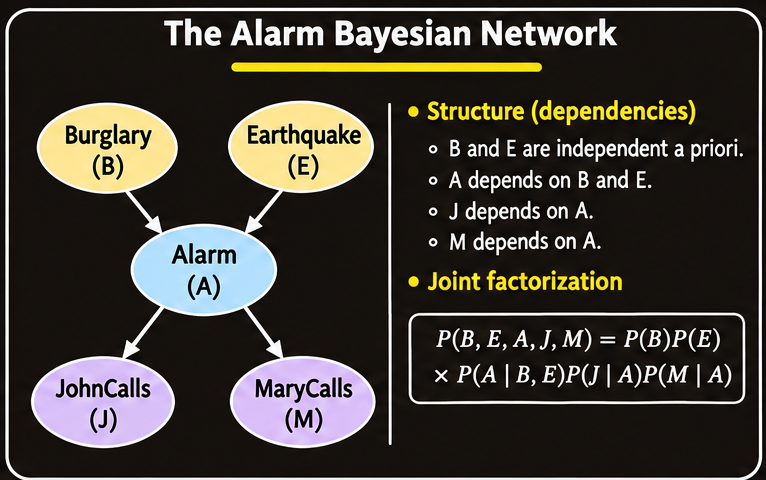
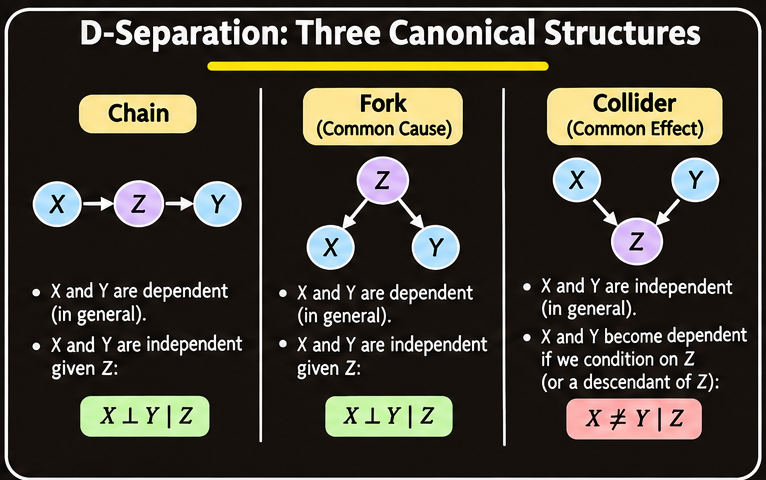
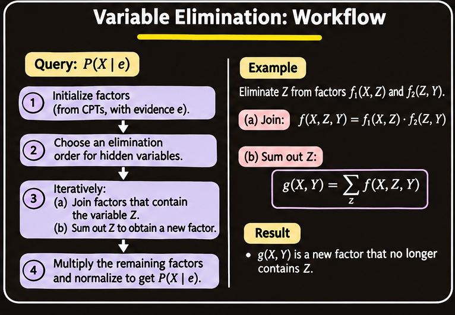
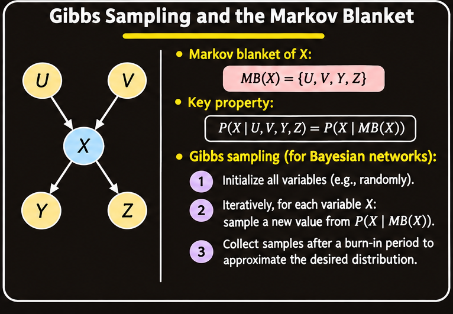

# Bayesian Networks, Causality, and Uncertain Reasoning

## 1. Overview: Reasoning When the World Is Uncertain

Classical logic is useful when facts are known and relationships are deterministic. A logical system can represent statements such as “the alarm is on” or “the alarm is not on.” Real-world AI systems, however, often have incomplete information, noisy sensors, and several plausible explanations for the same observation. A person may have a cough for many different reasons; a sensor may report a nearby object even when the object is farther away.

In such situations, an agent should not commit to one explanation too early. It should maintain a **belief distribution** over the possible states of the world and update that distribution as evidence arrives. This is the purpose of probabilistic reasoning.

### 1.1 The Ghostbusters example

Imagine a grid containing a hidden ghost. The agent does not know the ghost's location. Sensors report a colour related to the distance from the ghost:

- Red: the ghost is on the sensed square.
- Orange: the ghost is one or two squares away.
- Yellow: the ghost is three or four squares away.
- Green: the ghost is five or more squares away.

The sensors are noisy, so a red reading does not prove that the ghost is on that square. It may be a sensor error. The agent therefore maintains probabilities over possible ghost locations. After several readings, it combines the evidence to update its belief.

The example illustrates four general ingredients of uncertain reasoning:

1. **Observed variables (evidence):** what the agent has observed, such as sensor colours or symptoms.
2. **Unobserved variables:** what the agent wants to infer, such as the ghost's true location or the cause of a symptom.
3. **A probabilistic model:** how observed and unobserved variables are related.
4. **Inference:** computing updated beliefs about unknown variables given the evidence.

Probabilistic reasoning is necessary when evidence is noisy, multiple hypotheses are possible, or decisions must be made without complete certainty. Bayesian networks, Hidden Markov Models, and particle filters are examples of tools for representing and updating beliefs.

### 1.2 What this chapter covers

The chapter develops the probability concepts needed for Bayesian networks, explains how a network represents a joint distribution, and shows how to reason efficiently using graph structure. It then introduces exact inference (enumeration and variable elimination) and approximate inference through sampling.

## 2. Probability Foundations

### 2.1 Experiments, sample spaces, and events

An **experiment** is a process that produces an outcome.

- A deterministic experiment has an outcome that is known under the stated conditions. For example, an object released near Earth's surface accelerates downward.
- A random experiment has an outcome that is not known beforehand. Rolling a die is a standard example.

The **sample space**, denoted by $S$, is the set of all possible outcomes. For a fair six-sided die,

$$
S=\{1,2,3,4,5,6\}.
$$

An individual element of the sample space is called a **sample point**. A sample space may be finite, as in a die roll, or infinite, as when selecting a real number from an interval.

An **event** is any subset of the sample space. For example, the event that a die roll is less than three is

$$
A=\{1,2\}.
$$

### 2.2 Probability of an event

A probability measure $P$ assigns a number to each event. For a fair die, the event that the outcome is odd is

$$
A=\{1,3,5\},
\qquad
P(A)=\frac{3}{6}=0.5.
$$

For repeated experiments, the **relative frequency** of an event can be used to estimate its probability. If an experiment is performed $n$ times and event $A$ occurs $n(A)$ times, then

$$
P(A)\approx \frac{n(A)}{n}.
$$

As the number of trials grows, the relative frequency often becomes a better estimate of the underlying probability.

A probability measure satisfies the following properties:

$$
0\leq P(A)\leq 1,
$$

$$
P(\varnothing)=0,
\qquad
P(S)=1.
$$

For pairwise disjoint events $A_1,\ldots,A_k$,

$$
P\left(\bigcup_{i=1}^{k}A_i\right)
=
\sum_{i=1}^{k}P(A_i).
$$

Two events are **disjoint** (or mutually exclusive) if they cannot occur at the same time. For a single die roll, the events “roll a 2” and “roll a 5” are disjoint.

### 2.3 Complements and the addition rule

The complement of event $A$, written $\neg A$ or $A^c$, contains all outcomes in which $A$ does not occur. Since $A$ and its complement partition the sample space,

$$
P(A)+P(\neg A)=1,
$$

so

$$
\boxed{P(\neg A)=1-P(A)}.
$$

For two events that may overlap, the addition rule is

$$
\boxed{
P(A\cup B)=P(A)+P(B)-P(A\cap B)
}.
$$

The intersection is subtracted because outcomes in $A\cap B$ would otherwise be counted twice. If $A$ and $B$ are disjoint, then $P(A\cap B)=0$ and the rule reduces to the sum of their probabilities.

### 2.4 Random variables and their domains

A **random variable (RV)** represents an aspect of the world about which there may be uncertainty. Random variables are usually written using capital letters, and their possible values form a domain.

Examples include:

- $R$: whether it is raining, with domain $\{\text{true},\text{false}\}$.
- $T$: temperature category, with domain $\{\text{hot},\text{cold}\}$.
- $D$: driving time, with a non-negative real-valued domain.
- $L$: the location of a hidden object, with a domain of possible grid coordinates.

A random variable is **discrete** if it takes values from a finite or countable set, and **continuous** if it can take values over a continuous range.

For a discrete random variable $X$ with possible values $x_1,\ldots,x_k$, its probability distribution assigns a probability to every value:

$$
P(X=x_i)=p_i,
\qquad
p_i\geq 0,
\qquad
\sum_{i=1}^{k}p_i=1.
$$

The distribution is a complete description of the probabilities of the possible values of that variable.

### 2.5 Joint distributions

A **joint probability distribution** over random variables $X_1,\ldots,X_n$ assigns a probability to every complete assignment:

$$
P(X_1=x_1,\ldots,X_n=x_n).
$$

It must satisfy

$$
P(x_1,\ldots,x_n)\geq 0
$$

and

$$
\sum_{x_1}\cdots\sum_{x_n}P(x_1,\ldots,x_n)=1.
$$

For example, a joint distribution over temperature $T$ and weather $W$ describes probabilities such as $P(T=\text{hot},W=\text{sun})$.

The size of a full joint table grows rapidly. If each of $n$ variables has $d$ possible values, the table contains

$$
d^n
$$

entries. For ten binary variables, this is $2^{10}=1024$ entries. This exponential growth motivates compact representations such as Bayesian networks.

A **probabilistic model** is a mathematical representation of a relevant part of the world using random variables and a joint distribution. A model is necessarily a simplification: it may omit variables (for example, dew when modelling wet grass) or ignore interactions that are not important for the task. Simplification makes reasoning and computation manageable, but conclusions are only as good as the model's assumptions.

### 2.6 Marginal distributions and marginalization

A **marginal distribution** describes one or more variables while ignoring the others. To obtain it from a joint distribution, sum over the values of variables that are not needed. This operation is called **marginalization** or **summing out**.

For two discrete variables $X$ and $Y$,

$$
P(X=x)=\sum_y P(X=x,Y=y).
$$

For example, suppose a joint table gives

| Temperature | Weather | Joint probability |
| --- | --- | ---: |
| Hot | Sun | 0.4 |
| Hot | Rain | 0.1 |
| Cold | Sun | 0.2 |
| Cold | Rain | 0.3 |

Then

$$
P(T=\text{hot})=0.4+0.1=0.5,
$$

$$
P(T=\text{cold})=0.2+0.3=0.5.
$$

The weather variable has been summed out. Marginalization is fundamental to inference because a query usually concerns only a subset of all model variables.

### 2.7 Conditional probability and conditional distributions

A **conditional probability** describes the probability of an event after another event is known to have occurred. For $P(A)>0$,

$$
\boxed{
P(B\mid A)=\frac{P(A,B)}{P(A)}
}.
$$

Rearranging gives the product rule:

$$
\boxed{P(A,B)=P(A)P(B\mid A)}.
$$

A conditional distribution is a probability distribution over one or more variables after fixing the values of other variables. A marginal asks, “What is the probability in general?” A conditional asks, “What is the probability given this information?”

For instance, using the joint table above,

$$
P(T=\text{hot}\mid W=\text{sun})
=
\frac{P(T=\text{hot},W=\text{sun})}{P(W=\text{sun})}
=
\frac{0.4}{0.4+0.2}
=
\frac{2}{3}.
$$

For a fixed conditioning value, the conditional probabilities across all possible values of the query variable must sum to one.

### 2.8 The normalization trick

Sometimes it is convenient to calculate unnormalized joint values first and normalize them afterwards. Suppose the goal is $P(X\mid E)$, where $X$ is the query variable and $E$ is the evidence. For each value $x$, calculate

$$
f(x)=P(X=x,E).
$$

Then normalize:

$$
\boxed{
P(X=x\mid E)
=
\frac{f(x)}{\sum_{x'}f(x')}
}.
$$

The denominator is the total probability of the evidence, $P(E)$. The method works because the normalized values sum to one. It is especially useful in Bayesian-network inference, where intermediate computations often produce quantities proportional to the desired posterior rather than a normalized distribution.

**Worked example.** Let $M$ represent mood and $A$ represent activity, with the joint probabilities:

| Mood | Activity | $P(M,A)$ |
| --- | --- | ---: |
| Happy | Reading | 0.20 |
| Happy | Running | 0.30 |
| Sad | Reading | 0.25 |
| Sad | Running | 0.25 |

The probability of being happy given that the person is running is

$$
P(\text{happy}\mid\text{running})
=
\frac{0.30}{0.30+0.25}
=
\frac{6}{11}
\approx 0.545.
$$

For a sad person, the conditional activity distribution is

$$
P(\text{reading}\mid\text{sad})=\frac{0.25}{0.25+0.25}=0.5,
$$

$$
P(\text{running}\mid\text{sad})=\frac{0.25}{0.25+0.25}=0.5.
$$

## 3. Product Rule, Chain Rule, and Bayes' Rule

### 3.1 Product rule

The product rule follows directly from the definition of conditional probability:

$$
P(X,Y)=P(X)P(Y\mid X).
$$

It allows a joint probability to be computed when a marginal and a conditional probability are known.

### 3.2 Chain rule of probability

The product rule can be extended to any number of variables. For three variables,

$$
P(X,Y,Z)=P(X)P(Y\mid X)P(Z\mid X,Y).
$$

In general,

$$
\boxed{
P(X_1,\ldots,X_n)
=
P(X_1)
\prod_{i=2}^{n}
P(X_i\mid X_1,\ldots,X_{i-1})
}.
$$

The chain rule is always valid. The order of variables may be chosen freely, provided each factor is conditioned on all variables that precede it in that order. For example,

$$
P(Y,X,Z)=P(Y)P(X\mid Y)P(Z\mid X,Y).
$$

The chain rule by itself does not assume independence. Conditional-independence assumptions are what allow some of the conditioning variables to be removed, producing the simpler factorizations used by Bayesian networks.

### 3.3 Bayes' rule

The product rule gives two expressions for the same joint probability:

$$
P(X,Y)=P(X\mid Y)P(Y)
$$

and

$$
P(X,Y)=P(Y\mid X)P(X).
$$

Equating them and rearranging gives **Bayes' rule**:

$$
\boxed{
P(X\mid Y)=\frac{P(Y\mid X)P(X)}{P(Y)}
}.
$$

The terms have distinct meanings:

- **Prior** $P(X)$: belief about $X$ before observing the evidence.
- **Likelihood** $P(Y\mid X)$: probability of the observed evidence if $X$ is true.
- **Evidence** or **marginal likelihood** $P(Y)$: total probability of observing $Y$ across all possible causes.
- **Posterior** $P(X\mid Y)$: updated belief about $X$ after observing $Y$.

For a discrete set of mutually exclusive and exhaustive hypotheses $X_i$,

$$
P(Y)=\sum_i P(Y\mid X_i)P(X_i).
$$

This is the law of total probability and provides the normalizing denominator in Bayes' rule.

Bayes' rule is important in diagnostic reasoning. A doctor observes a symptom and estimates the probability of different diseases given that symptom. The likelihood describes how often the symptom occurs for each disease, while the prior captures how common each disease is before the test.

### 3.4 Why base rates matter: medical-test examples

A test's sensitivity alone does not determine how likely a positive result is to be correct. The prior prevalence of the condition and the false-positive rate also matter.

**Example: comparing two virus tests.** The virus prevalence is $1\%$. Test A has sensitivity $95\%$ and false-positive rate $10\%$. Test B has sensitivity $90\%$ and false-positive rate $5\%$. The posterior probability of infection after a positive result is:

For Test A,

$$
P(V\mid +_A)
=
\frac{P(+_A\mid V)P(V)}
{P(+_A\mid V)P(V)+P(+_A\mid\neg V)P(\neg V)}
$$

$$
=
\frac{0.95(0.01)}
{0.95(0.01)+0.10(0.99)}
\approx 0.0876.
$$

For Test B,

$$
P(V\mid +_B)
=
\frac{0.90(0.01)}
{0.90(0.01)+0.05(0.99)}
\approx 0.1538.
$$

A positive result from Test B is more indicative of infection, even though its sensitivity is slightly lower. Its lower false-positive rate is especially important when the disease is rare.

**Example: a rare disease.** Suppose a disease affects $1$ in $10{,}000$ people, so $P(D)=0.0001$. A test has $99\%$ sensitivity and $99\%$ specificity. Thus, $P(+\mid D)=0.99$ and $P(+\mid\neg D)=0.01$.

$$
P(D\mid +)
=
\frac{0.99(0.0001)}
{0.99(0.0001)+0.01(0.9999)}
\approx 0.0098.
$$

The chance of actually having the disease after a positive result is about $0.98\%$, not $99\%$. The low prior prevalence means false positives from the much larger healthy population can outnumber true positives. This is the **base-rate effect**.

### 3.5 Perception and prior probabilities

The lecture's taxi example illustrates the same principle. A witness reports that a taxi was blue, but under dim lighting the distinction between blue and green is only $75\%$ reliable.

If no information about the proportions of blue and green taxis is available, the most likely actual colour cannot be determined from the witness reliability alone; the prior proportions are also needed.

If $9$ out of $10$ taxis are green, then

$$
P(\text{blue})=0.1,
\qquad
P(\text{green})=0.9.
$$

Assuming the witness is correct with probability $0.75$ for either colour,

$$
P(\text{reported blue}\mid\text{blue})=0.75,
$$

$$
P(\text{reported blue}\mid\text{green})=0.25.
$$

Therefore,

$$
P(\text{blue}\mid\text{reported blue})
=
\frac{0.75(0.1)}
{0.75(0.1)+0.25(0.9)}
=0.25.
$$

Despite the witness reporting blue, green remains more likely because green taxis are much more common. It is important to distinguish the actual colour from the colour that appears to the witness.

### 3.6 Inferring a hidden cause from repeated observations

Suppose a bag contains three coins, $a$, $b$, and $c$, with head probabilities $0.2$, $0.6$, and $0.8$. A coin is selected uniformly at random, then flipped three times. The observed sequence contains two heads and one tail. Let $C$ denote the selected coin and $D$ the observed sequence.

The prior is $P(C=a)=P(C=b)=P(C=c)=1/3$. Assuming the flips are conditionally independent given the selected coin, the likelihood of any particular sequence with two heads and one tail is $p^2(1-p)$, where $p$ is that coin's probability of heads:

$$
P(D\mid C=a)=0.2^2(0.8)=0.032,\quad
P(D\mid C=b)=0.6^2(0.4)=0.144,\quad
P(D\mid C=c)=0.8^2(0.2)=0.128.
$$

Bayes' rule gives posterior probabilities proportional to these likelihoods because the priors are equal. The normalizing constant is $0.032+0.144+0.128=0.304$, so

$$
P(a\mid D)\approx0.1053,\quad
P(b\mid D)\approx0.4737,\quad
P(c\mid D)\approx0.4211.
$$

Coin $b$ is the most likely selected coin, even though coin $c$ has the largest head probability. The observed mixture of two heads and one tail is most likely under coin $b$. If the exact order of the flips is specified, the same likelihood applies to that sequence; if the observation only specifies the count of heads, the common binomial coefficient $\binom{3}{2}$ appears in every likelihood and cancels during normalization.

## 4. Independence and Conditional Independence

### 4.1 Independence

Two random variables $X$ and $Y$ are **independent** if knowing the value of one does not change the probability distribution of the other:

$$
X\perp Y
\quad\Longleftrightarrow\quad
P(X\mid Y)=P(X)
$$

for all relevant values with nonzero conditioning probability. Equivalently,

$$
P(X,Y)=P(X)P(Y).
$$

For example, the outcomes of two independent fair coin flips have joint probabilities of $0.25$ for each of HH, HT, TH, and TT. Knowing the first coin's outcome does not change the distribution of the second.

### 4.2 Conditional independence

Two variables may be dependent in general but become independent after a third variable is known. This is **conditional independence**.

$$
\boxed{
X\perp Y\mid Z
}
$$

means that once $Z$ is known, learning $Y$ provides no additional information about $X$. Equivalent statements include

$$
P(X\mid Y,Z)=P(X\mid Z)
$$

and

$$
P(X,Y\mid Z)=P(X\mid Z)P(Y\mid Z).
$$

**Example: toothache, cavity, and probe catch.** Let:

- $C$: whether a patient has a cavity.
- $T$: whether the patient has a toothache.
- $P$: whether a dental probe catches in the cavity.

A cavity can cause both a toothache and a probe catch. Without knowing whether a cavity exists, toothache and probe catch may be dependent. Once the cavity status is known, the model assumes that the probe catch provides no additional information about the toothache:

$$
P(P\mid T,C)=P(P\mid C).
$$

Thus,

$$
T\perp P\mid C.
$$

The conditional-independence assumption allows a simpler model: instead of specifying a distribution of the probe catch for every combination of toothache and cavity, it is enough to specify it given the cavity.

**Example: traffic, umbrella, and rain.** Let $R$ be rain, $U$ umbrella use, and $T$ traffic. A model may assume

$$
T\perp U\mid R.
$$

Knowing whether someone carries an umbrella gives no additional information about traffic once the rain status is already known.

### 4.3 Why conditional independence matters

For three variables, the chain rule gives

$$
P(T,C,P)=P(C)P(T\mid C)P(P\mid T,C).
$$

Under the assumption $T\perp P\mid C$,

$$
\boxed{
P(T,C,P)=P(C)P(T\mid C)P(P\mid C)
}.
$$

The conditional-independence assumption removes an unnecessary dependency from the factorization. This is the central idea behind Bayesian networks: represent the important dependencies and exploit conditional independences to avoid storing a huge joint table.

## 5. Bayesian Networks

### 5.1 Definition and components

A **Bayesian network (BN)** is a probabilistic graphical model that represents a joint probability distribution compactly. It consists of:

1. **Nodes:** random variables.
2. **Directed edges (arcs):** direct dependency relationships.
3. **Conditional probability tables (CPTs):** local probability distributions for each variable given its parents.

A Bayesian network must be a **directed acyclic graph (DAG)**: edges have directions and there are no directed cycles.

The parents of node $X_i$, written $\operatorname{Parents}(X_i)$, are the nodes with arrows pointing directly into $X_i$. A node with no parents is a **root node**. Its probability is represented by a prior or marginal distribution $P(X_i)$. Having no parents does **not** mean that a root is marginally independent of all other nodes: it can still be statistically associated with its descendants. The BN assumption concerns the conditional independences encoded by the graph.

A CPT specifies

$$
P(X_i\mid \operatorname{Parents}(X_i)).
$$

For each assignment to the parents, the probabilities of all possible values of $X_i$ must sum to one.

### 5.2 The Bayesian-network factorization

The defining numerical semantics of a Bayesian network is its factorization of the joint distribution:

$$
\boxed{
P(X_1,\ldots,X_n)
=
\prod_{i=1}^{n}
P(X_i\mid \operatorname{Parents}(X_i))
}.
$$

A root node contributes a factor $P(X_i)$ because its parent set is empty.

This factorization follows from the chain rule together with the conditional-independence assumptions encoded by the graph. The graph is not merely a drawing: together with the CPTs, it specifies a complete joint distribution.

*The alarm network is a running example: burglary and earthquake can trigger an alarm, which can lead John and Mary to call.*

### 5.3 The alarm network

Consider five Boolean variables:

| Variable | Meaning |
| --- | --- |
| $B$ | Burglary occurs |
| $E$ | Earthquake occurs |
| $A$ | Alarm goes off |
| $J$ | John calls |
| $M$ | Mary calls |

The graph has edges

$$
B\rightarrow A,\qquad E\rightarrow A,\qquad
A\rightarrow J,\qquad A\rightarrow M.
$$

Burglary and earthquake are root nodes. The alarm depends on both. John and Mary each depend on the alarm.

The joint distribution factorizes as

$$
\boxed{
P(B,E,A,J,M)
=
P(B)P(E)P(A\mid B,E)P(J\mid A)P(M\mid A)
}.
$$

To calculate a complete assignment, select the corresponding entry from each prior or CPT and multiply the five values.

For example, the lecture gives the assignment $B=1$, $E=0$, $A=1$, $J=0$, $M=1$ with

$$
P(B=1)=0.001,\quad P(E=0)=0.998,
$$

$$
P(A=1\mid B=1,E=0)=0.94,
$$

$$
P(J=0\mid A=1)=0.10,\quad
P(M=1\mid A=1)=0.70.
$$

Therefore,

$$
\begin{aligned}
&P(B=1,E=0,A=1,J=0,M=1)\\
&=0.001\times0.998\times0.94\times0.10\times0.70\\
&=0.0000656684.
\end{aligned}
$$

The value is small because it is the probability of all five events occurring in that exact combination, including the relatively rare burglary.

### 5.4 Why a Bayesian network is compact

For $n$ binary variables, a full joint distribution has $2^n$ entries, of which $2^n-1$ are independent because all entries must sum to one.

In a BN, a node with $k$ binary parents has $2^k$ parent assignments. Since the node itself is binary, one probability per parent assignment is sufficient; the probability of the other value is its complement. Thus, the number of independent CPT values is $2^k$ for that node.

For the five-node alarm network:

| Node | Parents | Number of parents | CPT values needed |
| --- | --- | ---: | ---: |
| $B$ | None | 0 | 1 |
| $E$ | None | 0 | 1 |
| $A$ | $B,E$ | 2 | 4 |
| $J$ | $A$ | 1 | 2 |
| $M$ | $A$ | 1 | 2 |
| **Total** |  |  | **10** |

The full joint distribution has $2^5=32$ entries, or 31 independent values, while the BN requires only 10 independent CPT values.

More generally, if every node has at most $k$ parents, the representation size grows linearly with the number of nodes and exponentially with the maximum number of parents, rather than exponentially with the total number of variables. This is the main representational advantage of Bayesian networks.

### 5.5 Choosing a good node ordering

When constructing a BN, a useful ordering places causes before their effects. For example,

$$
\text{Burglary}\rightarrow\text{Alarm}\rightarrow\text{John calls}
$$

is a natural causal ordering. A poor ordering may require more edges and larger CPTs, making the model harder to specify and reason with. The graph must remain acyclic.

### 5.6 A network for weather, traffic, and lateness

Suppose weather $W$ affects traffic $T$, and traffic affects lateness $L$. If weather has no direct effect on lateness once traffic is known, the graph is

$$
W\rightarrow T\rightarrow L
$$

and the factorization is

$$
P(W,T,L)=P(W)P(T\mid W)P(L\mid T).
$$

If weather can also directly affect lateness, add the edge $W\rightarrow L$. The factorization then becomes

$$
P(W,T,L)=P(W)P(T\mid W)P(L\mid T,W).
$$

The correct graph depends on the assumptions about the domain. The CPTs and graph together make those assumptions explicit.

## 6. Reading Conditional Independence from a Bayesian Network

### 6.1 Local Markov property

A basic independence assumption encoded by a BN is that each node is conditionally independent of its **non-descendants** given its parents:

$$
\boxed{
X_i\perp \operatorname{NonDescendants}(X_i)
\mid \operatorname{Parents}(X_i)
}.
$$

In words, once the direct causes of a node are known, its non-descendants provide no additional information about it. Additional independences can be derived from the overall graph structure.

For example, in the chain

$$
L\rightarrow R\rightarrow T
$$

where $L$ is low pressure, $R$ is rain, and $T$ is traffic, the network implies

$$
T\perp L\mid R.
$$

Once rain is known, low pressure gives no additional information about traffic under this model.

### 6.2 D-separation

**D-separation** is a graphical test for determining whether two sets of variables are conditionally independent given observed variables. Instead of enumerating all entries of the joint distribution, inspect the paths between the variables.

A path is considered without regard to arrow direction when tracing connectivity. A path is **active** if every triple along it is active under the given evidence. A path is **blocked** if at least one triple blocks it.

Two variables $X$ and $Y$ are d-separated by evidence set $Z$ if every path between them is blocked by $Z$. In that case, the BN implies

$$
X\perp Y\mid Z.
$$

If at least one path remains active, d-separation does not establish independence.

### 6.3 The three canonical structures

Every path can be analyzed using three basic patterns.

#### A. Chain: $X\rightarrow Y\rightarrow Z$

The middle variable $Y$ transmits information from $X$ to $Z$. Without observing $Y$, the path is active. Conditioning on $Y$ blocks the path:

$$
X\perp Z\mid Y.
$$

Example: cloudy conditions affect rain, and rain affects traffic. If rain is already known, cloudy conditions provide no additional information about traffic through this chain.

#### B. Fork (common cause): $X\leftarrow Y\rightarrow Z$

The common cause $Y$ influences both $X$ and $Z$. Without observing $Y$, the two effects may be dependent. Conditioning on the common cause blocks the path:

$$
X\perp Z\mid Y.
$$

Example: weather affects both ice-cream sales and park attendance. On a sunny day, both may increase. Once the weather is known, ice-cream sales do not provide additional information about park attendance under this model.

#### C. Collider (common effect): $X\rightarrow Y\leftarrow Z$

Here, two variables independently influence a common effect. If the collider $Y$ is not observed, the path is blocked. Conditioning on the collider (or on one of its descendants) activates the path, making the causes dependent.

$$
X\perp Z
\quad\text{along this path if }Y\text{ and its descendants are unobserved},
$$

but generally

$$
X\not\!\perp Z\mid Y.
$$

Example: having a particular qualification and having strong professional experience may each increase the chance of being hired by a company. If we learn that someone was hired, evidence about one qualification changes how plausible the other explanation is. This is sometimes called **explaining away**.

*Conditioning blocks chains and forks at their middle node, but activates a collider when the collider or one of its descendants is observed.*

### 6.4 Descendants of colliders

Observing a descendant of a collider also activates the collider path. This is important because the evidence does not have to be placed directly on the collider node.

For example, in

$$
X\rightarrow C\leftarrow Y,\qquad C\rightarrow D,
$$

the path between $X$ and $Y$ is blocked when neither $C$ nor its descendant $D$ is observed. Observing $C$ or $D$ activates the path.

### 6.5 A practical d-separation procedure

To test whether $X$ and $Y$ are conditionally independent given evidence $Z$:

1. List all undirected paths between $X$ and $Y$.
2. Inspect every triple along each path.
3. Identify whether the triple is a chain, fork, or collider.
4. For a chain or fork, the triple is blocked if its middle node is observed.
5. For a collider, the triple is active if the collider or one of its descendants is observed; otherwise it is blocked.
6. A path is active only if every triple on it is active.
7. If all paths are blocked, $X$ and $Y$ are d-separated and conditionally independent given $Z$. If at least one path is active, independence is not guaranteed by d-separation.

A single blocked triple is enough to block its entire path. Conversely, one active path is enough to prevent d-separation.

**Important distinction:** “Not d-separated” means the graph does not guarantee conditional independence. It does not necessarily prove that the numerical variables are dependent for every possible choice of CPT parameters; special parameter values can create additional independences.

## 7. Bayesian Inference

### 7.1 What inference asks

**Probabilistic inference** means computing a desired probability from a probabilistic model. In a BN, a common query is the posterior distribution of a query variable $Q$ given observed evidence $E$:

$$
P(Q\mid E).
$$

For example, in the alarm network, we may want

$$
P(B\mid J=1,M=1),
$$

the probability of a burglary given that both John and Mary called.

Another kind of query is **maximum a posteriori (MAP) inference**, which seeks the most probable assignment to one or more hidden variables given the evidence:

$$
\arg\max_h P(H=h\mid E).
$$

Computing a posterior distribution and finding its most probable assignment are related but different tasks.

### 7.2 Inference by enumeration

Inference by enumeration calculates a query by explicitly considering all possible values of the hidden variables.

For a query $P(Q\mid E)$:

1. Select assignments consistent with the evidence.
2. Sum over variables that are hidden and not part of the query.
3. Calculate the unnormalized probability for each query value.
4. Normalize the results so that the query distribution sums to one.

In general, for hidden variables $H$,

$$
P(Q\mid E)
\propto
\sum_H P(Q,E,H).
$$

After computing this expression for every value of $Q$, normalize:

$$
P(Q\mid E)
=
\frac{\sum_H P(Q,E,H)}
{\sum_{q}\sum_H P(q,E,H)}.
$$

**Worked example: weather, temperature, and sky.** The lecture gives the joint distribution:

| Weather $W$ | Temperature $H$ | Sky $S$ | $P(W,H,S)$ |
| --- | --- | --- | ---: |
| Summer | Hot | Sun | 0.30 |
| Summer | Hot | Rain | 0.05 |
| Summer | Cold | Sun | 0.10 |
| Summer | Cold | Rain | 0.05 |
| Winter | Hot | Sun | 0.10 |
| Winter | Hot | Rain | 0.05 |
| Winter | Cold | Sun | 0.15 |
| Winter | Cold | Rain | 0.20 |

Suppose the evidence is $W=\text{winter}$ and the query is temperature $H$. Keep only the winter rows and sum out the sky variable:

$$
f(\text{hot})=0.10+0.05=0.15,
$$

$$
f(\text{cold})=0.15+0.20=0.35.
$$

The normalization constant is $0.15+0.35=0.50$. Therefore,

$$
P(H\mid W=\text{winter})
=
\{\text{hot}:0.30,\ \text{cold}:0.70\}.
$$

The method is conceptually simple, but the number of hidden-variable assignments grows exponentially with the number of variables. For ten binary hidden variables, there are $2^{10}=1024$ assignments to consider for each query configuration.

### 7.3 Enumeration in the alarm network

For the query $P(B\mid J=1,M=1)$, the evidence is that John and Mary called. The hidden variables are the alarm $A$ and earthquake $E$. The burglary variable is the query, so it is not summed out.

Using the BN factorization,

$$
P(B,E,A,J,M)
=
P(B)P(E)P(A\mid B,E)P(J\mid A)P(M\mid A).
$$

For each value of $B$, sum over the four combinations of $E$ and $A$:

$$
f(B)
=
\sum_e\sum_a
P(B)P(e)P(a\mid B,e)P(J=1\mid a)P(M=1\mid a).
$$

Then normalize the two values $f(B=1)$ and $f(B=0)$:

$$
P(B=1\mid J=1,M=1)
=
\frac{f(B=1)}{f(B=1)+f(B=0)}.
$$

The essential idea is to enumerate every hidden explanation consistent with the observed calls and add their probabilities. The numerical CPT values are required to produce a numerical posterior.

## 8. Variable Elimination

### 8.1 Why variable elimination is needed

Enumeration first constructs products for complete assignments and only then sums out hidden variables. This can perform many unnecessary calculations.

**Variable elimination (VE)** uses the same probability identities but changes the order of operations. It joins only the factors needed for a hidden variable, sums that variable out immediately, and passes the smaller resulting factor to later steps.

The key principle is:

> Do not construct the full joint distribution if the query only requires a small part of it.

### 8.2 What is a factor?

A **factor** is a function that maps an assignment of a set of variables to a numerical value. It can be represented as a multidimensional table.

Examples include:

- $P(X,Y)$: a joint factor over $X$ and $Y$.
- $P(X)$: a one-variable factor.
- $P(Y\mid X)$: a conditional factor over $X$ and $Y$.
- $P(Y\mid X=x)$: a selected slice in which $X$ is fixed, leaving a function of $Y$.

A factor is not necessarily normalized by itself. It may contain unnormalized values that become a probability distribution only after the final normalization step.

Two operations are central:

1. **Join (multiply):** combine factors by multiplying entries for compatible assignments.
2. **Eliminate (sum out):** remove a variable by summing over all its values.

### 8.3 Joining factors

Suppose the factors are $P(R)$ and $P(T\mid R)$. Joining them produces a factor over both variables:

$$
f(R,T)=P(R)P(T\mid R).
$$

For every assignment $(r,t)$, multiply the corresponding entries. The resulting factor is the joint distribution $P(R,T)$.

When joining factors, the scope of the result is the union of the variables in the input factors.

### 8.4 Eliminating a variable

If a factor $f(R,T)$ contains hidden variable $R$, eliminate $R$ by summing over its values:

$$
g(T)=\sum_r f(r,T).
$$

The resulting factor depends only on $T$. This is marginalization performed locally rather than after building the entire joint table.

### 8.5 General variable-elimination algorithm

To compute $P(Q\mid E)$:

1. **Initialize factors:** start with the local CPT for each node in the BN.
2. **Enter evidence:** restrict each factor containing an evidence variable to the observed value.
3. **Choose a hidden variable:** select a variable that is neither a query variable nor an evidence variable.
4. **Join:** multiply all current factors that contain that hidden variable.
5. **Eliminate:** sum out the hidden variable from the joined factor.
6. **Repeat:** continue until all hidden variables have been eliminated.
7. **Final join:** multiply the remaining factors, which involve only query and evidence variables.
8. **Normalize:** normalize over the query values to obtain $P(Q\mid E)$.

The result before normalization is proportional to the desired posterior. Normalization turns it into a valid conditional distribution.

*Variable elimination alternates multiplication and marginalization so that intermediate factors can remain smaller than the full joint distribution.*

### 8.6 Variable elimination in the alarm network

For $P(B\mid J=1,M=1)$, initialize with

$$
P(B),\quad P(E),\quad P(A\mid B,E),\quad
P(J\mid A),\quad P(M\mid A).
$$

First incorporate the evidence $J=1$ and $M=1$, giving factors $P(J=1\mid A)$ and $P(M=1\mid A)$. The hidden variables are $A$ and $E$.

One possible elimination order is:

1. Join $P(A\mid B,E)$, $P(J=1\mid A)$, and $P(M=1\mid A)$.
2. Sum out $A$, producing a factor over $B,E$.
3. Join the result with $P(E)$.
4. Sum out $E$, producing a factor over $B$.
5. Join with $P(B)$.
6. Normalize over $B$.

The final factor over $B$ contains values proportional to $P(B,J=1,M=1)$. Normalizing gives $P(B\mid J=1,M=1)$.

### 8.7 Elimination ordering and computational cost

The order in which hidden variables are eliminated can make a large difference. Eliminating a highly connected variable early may force many of its neighbours into one large intermediate factor.

For example, suppose binary variables $X_1,\ldots,X_{n-1}$ are each connected through a common variable $Z$. If $Z$ is eliminated first, the resulting factor may involve all $X_i$ and contain $2^{n-1}$ entries. If the $X_i$ variables are eliminated first, each operation can produce a small factor over $Z$.

The size of the largest intermediate factor determines much of the time and memory cost of variable elimination. This is why practical algorithms use ordering heuristics such as:

- **Min-degree:** prefer eliminating a variable with relatively few current neighbours.
- **Min-fill:** prefer eliminating a variable that would introduce the fewest new connections among its neighbours.

There is no single elimination order that is optimal for every graph. Finding an optimal order is generally computationally difficult. The useful rule of thumb is to avoid eliminating highly connected hub variables too early when a lower-cost ordering is available.

## 9. Approximate Inference by Sampling

### 9.1 Why sampling is useful

Exact inference can be expensive in large networks because full joint distributions and intermediate factors can become enormous. **Approximate inference** uses samples to estimate probabilities rather than calculating every possible assignment.

If $N$ samples are generated and $N_Q$ of them satisfy query event $Q$, then

$$
P(Q)\approx\frac{N_Q}{N}.
$$

For conditional probabilities, count or weight the samples consistent with the evidence. Larger sample sets generally improve the estimate, although the rate of improvement depends on the sampling method and the structure of the model.

### 9.2 Sampling from a discrete distribution

To sample a discrete variable from a known probability distribution, generate a uniform random number $u$ in $[0,1)$ and divide the interval into subintervals whose lengths equal the outcome probabilities.

For example, suppose

| Colour | Probability | Interval |
| --- | ---: | --- |
| Red | 0.6 | $[0,0.6)$ |
| Green | 0.1 | $[0.6,0.7)$ |
| Blue | 0.3 | $[0.7,1)$ |

If the generated value is $u=0.83$, the sample is Blue because $0.83\in[0.7,1)$.

### 9.3 Prior sampling (forward sampling)

**Prior sampling** generates complete assignments from the BN's joint distribution without conditioning on evidence.

The procedure is:

1. Choose a topological ordering of the nodes, so parents appear before children.
2. Sample each root node from its prior distribution.
3. Sample each non-root node from its CPT using the already sampled values of its parents.
4. Continue until every node has a value.

For the familiar Cloudy–Sprinkler–Rain–WetGrass network,

$$
P(C,S,R,W)
=
P(C)P(S\mid C)P(R\mid C)P(W\mid S,R).
$$

A sample is generated by first sampling Cloudy, then Sprinkler and Rain conditioned on Cloudy, and finally WetGrass conditioned on Sprinkler and Rain.

The probability of a complete sample is the product of the corresponding local probabilities. For example, for sample $(+c,-s,+r,+w)$,

$$
\begin{aligned}
&P(+c,-s,+r,+w)\\
&=P(+c)P(-s\mid+c)P(+r\mid+c)P(+w\mid-s,+r).
\end{aligned}
$$

Repeated prior samples can estimate marginal probabilities. If 4 out of 5 samples have wet grass and 1 has dry grass, the empirical estimate is

$$
P(W=\text{wet})\approx\frac45=0.8,
\qquad
P(W=\text{dry})\approx\frac15=0.2.
$$

Prior sampling is straightforward and follows the BN structure, but it does not directly focus on a particular evidence condition.

### 9.4 Rejection sampling

**Rejection sampling** estimates a conditional distribution by generating prior samples and discarding those that do not match the evidence.

To estimate $P(C\mid S=+s)$:

1. Generate complete samples using prior sampling.
2. Reject every sample in which $S\neq +s$.
3. Keep only samples consistent with $S=+s$.
4. Estimate the query distribution by counting the retained samples.

If two retained samples contain one $C=+c$ and one $C=-c$, the estimated conditional probability is $0.5$ for each value.

Rejection sampling is simple, but it can be very inefficient when the evidence is rare. Most generated samples may be discarded, leaving very few useful samples.

### 9.5 Likelihood weighting

**Likelihood weighting** avoids discarding samples that disagree with evidence by fixing the evidence variables during sampling and assigning each sample a weight.

For each sample:

1. Fix each evidence variable to its observed value; do not sample it.
2. Sample non-evidence variables in topological order using their CPTs.
3. Whenever an evidence node is reached, multiply the sample weight by the probability of its observed value given its parents.
4. Use weighted counts to estimate the posterior.

For a sample with evidence variables $E_1,\ldots,E_m$, its weight is

$$
\boxed{
w=\prod_{i=1}^{m}
P(e_i\mid \operatorname{Parents}(E_i))
}.
$$

Non-evidence variables are assigned weight contribution $1$ because they are sampled directly from their conditional distributions. Evidence variables are fixed rather than sampled, so their likelihood must be included explicitly.

**Worked example: Shape and Colour.** Suppose the evidence is Colour = Blue and the generated samples have the following weights:

| Sample | Shape | Fixed colour | Weight |
| --- | --- | --- | ---: |
| 1 | Pyramid | Blue | 0.6 |
| 2 | Sphere | Blue | 0.8 |
| 3 | Cube | Blue | 0.9 |
| 4 | Sphere | Blue | 0.5 |

The weighted counts are:

- Pyramid: $0.6$
- Sphere: $0.8+0.5=1.3$
- Cube: $0.9$

The total weight is $0.6+1.3+0.9=2.8$. Thus,

$$
P(\text{Sphere}\mid\text{Blue})
\approx
\frac{1.3}{2.8}
\approx 0.464.
$$

The estimate uses weighted counts rather than ordinary counts. The arithmetic above follows from the four weights listed in the lecture; the displayed decimal on the slide appears inconsistent with that fraction.

Likelihood weighting is usually more efficient than rejection sampling when evidence is rare because it does not discard samples simply because their evidence values disagree. However, it has an important limitation: upstream non-evidence variables are sampled before downstream evidence is encountered. The evidence changes sample weights, but does not directly guide the sampling of those upstream variables. If the evidence is unlikely under many sampled parent assignments, weights can become very small.

For example, in

$$
CLOUDY\rightarrow RAIN\rightarrow WETGRASS,
$$

if $WETGRASS=\text{true}$ is evidence, likelihood weighting fixes WetGrass and weights each sample by

$$
P(WETGRASS=\text{true}\mid RAIN).
$$

Cloudy and Rain are sampled before this evidence likelihood is applied. Thus, evidence can influence the weights of upstream assignments, but it does not adapt their proposal-sampling probabilities directly.

### 9.6 Gibbs sampling

**Gibbs sampling** is a Markov chain Monte Carlo method. It keeps evidence variables fixed and repeatedly resamples one non-evidence variable conditioned on the current values of all the other variables.

The procedure is:

1. Fix all observed variables to their evidence values.
2. Initialize the unobserved variables, often randomly.
3. Repeat for many iterations:
   - Choose one non-evidence variable $X$.
   - Compute its conditional distribution given the current values of all other variables.
   - Sample a new value for $X$ from that conditional distribution.
4. Discard an initial **burn-in** period if needed.
5. Estimate posterior probabilities from the frequencies in the retained samples.

For a Boolean variable, if the current conditional probability is

$$
P(X=\text{true}\mid\text{all other variables})=0.7,
$$

then set $X$ to true with probability $0.7$ and false with probability $0.3$.

Under appropriate conditions (including that the Markov chain can reach the relevant states and has the desired stationary distribution), the distribution of samples converges to the target posterior conditioned on the evidence. In practice, convergence must be assessed; a finite run is only an approximation.

### 9.7 Markov blanket

The **Markov blanket** of a node $X$ consists of:

1. The parents of $X$.
2. The children of $X$.
3. The other parents of the children of $X$ (the co-parents).

Given its Markov blanket, $X$ is conditionally independent of every other node in the network:

$$
X\perp
\text{all other nodes}
\mid MB(X).
$$

This means that Gibbs sampling does not need to multiply the probabilities of the entire network to update $X$. It can use only the local factors involving $X$: its own conditional probability given its parents and the conditional probabilities of its children given their parents.

For a node $X$ with parents $Pa(X)$ and children $Ch(X)$, its full conditional has the form

$$
P(X\mid \text{all other variables})
\propto
P(X\mid Pa(X))
\prod_{Y\in Ch(X)}
P(Y\mid Pa(Y)).
$$

The proportionality constant is obtained by normalizing over the possible values of $X$. The co-parents appear because they are among the parent values in the children’s CPTs.

*The local Markov blanket supplies the information needed to resample a node; the Bayesian network itself remains a DAG.*

### 9.8 Comparing the sampling methods

| Method | Treatment of evidence | Main advantage | Main limitation |
| --- | --- | --- | --- |
| Prior sampling | Does not condition on evidence | Simple generation from the joint distribution | Not directly focused on posterior queries |
| Rejection sampling | Reject samples inconsistent with evidence | Simple conditional estimate | Inefficient when evidence is rare |
| Likelihood weighting | Fix evidence and weight each sample by its likelihood | Avoids discarding samples due to evidence mismatch | Weights can become very small; upstream variables are not directly resampled using evidence |
| Gibbs sampling | Fix evidence and repeatedly resample hidden variables conditioned on the rest | Evidence can influence both upstream and downstream variables through repeated updates | Requires many iterations and convergence assessment |

In the lecture's Cloudy–Rain–WetGrass example, observing WetGrass = true should make Rain and, indirectly, Cloudy more likely. Likelihood weighting accounts for the evidence through sample weights, but it does not directly change the way Cloudy and Rain are proposed. Gibbs sampling updates hidden variables conditioned on the current values of their neighbours, allowing the evidence to influence the upstream variables through repeated conditional updates.

The Gibbs update may use a conditional distribution involving a node's children, so the local expression can include factors that point both toward and away from the node. This does not create a directed cycle in the Bayesian network. The original BN remains a DAG; Gibbs sampling is an algorithm operating on its joint distribution and local conditional probabilities.

## 10. Putting the Ideas Together

The chapter's concepts form a connected reasoning pipeline:

1. **Represent uncertainty:** define random variables and their domains.
2. **Describe probabilities:** use distributions, joint probabilities, marginalization, and conditioning.
3. **Update beliefs:** apply Bayes' rule when evidence is observed.
4. **Exploit independence:** identify conditional-independence assumptions that simplify the joint distribution.
5. **Build a Bayesian network:** represent variables as nodes, dependencies as directed edges, and local distributions as CPTs.
6. **Read the graph:** use d-separation to determine which conditional independences follow from the structure.
7. **Answer queries:** use exact inference when feasible, with enumeration or variable elimination.
8. **Scale to larger models:** use approximate methods such as prior sampling, rejection sampling, likelihood weighting, and Gibbs sampling.

The key distinction is between the **model** and the **inference algorithm**. The Bayesian network specifies a probability distribution and its conditional-independence structure. Enumeration, variable elimination, and sampling are different computational methods for answering questions using that same model.

## 11. Important Points to Remember

- A probability distribution represents uncertainty over possible values; a joint distribution represents uncertainty over complete assignments to multiple variables.
- Marginalization sums out variables that are not part of the query.
- Conditional probability updates a distribution after evidence is known.
- Bayes' rule combines prior probability and likelihood to obtain a posterior. Base rates can strongly affect the interpretation of positive evidence.
- The chain rule is always valid; a Bayesian network becomes compact by using conditional-independence assumptions to simplify its factors.
- A Bayesian network is a DAG whose joint distribution is the product of local CPTs.
- A chain and a fork are blocked by observing their middle node. A collider is blocked when neither it nor any descendant is observed, and activated when the collider or a descendant is observed.
- D-separation tests whether the graph guarantees conditional independence.
- Enumeration is straightforward but can require exponentially many hidden-variable assignments.
- Variable elimination reduces redundant work by joining relevant factors and summing out hidden variables early. Its cost depends strongly on the elimination order and largest intermediate factor.
- Sampling trades exact answers for estimates. Rejection sampling can waste samples, likelihood weighting can produce tiny weights, and Gibbs sampling requires sufficient iterations and convergence checks.
- The Markov blanket consists of a node's parents, children, and co-parents, and is sufficient for computing that node's full conditional in Gibbs sampling.

## 12. Practice Questions and Exercises

1. A die is rolled once. Define the sample space and write the event that the result is an even number. What is the probability of this event for a fair die?
2. Explain the difference between a joint distribution, a marginal distribution, and a conditional distribution.
3. A test has sensitivity $0.95$, false-positive rate $0.10$, and the condition prevalence is $0.01$. Calculate the probability of the condition given a positive test result.
4. Explain why a positive result from a test for a rare disease may still correspond to a low posterior probability of disease.
5. In a toothache–cavity–probe-catch model, explain why toothache and probe catch may be dependent without knowing cavity status but conditionally independent given cavity status.
6. Write the chain-rule factorization for $P(X,Y,Z,W)$ in the order $X,Y,Z,W$. Then simplify it under the assumptions $Z\perp X\mid Y$ and $W\perp\{X,Y\}\mid Z$.
7. Draw the alarm network and write its joint-distribution factorization.
8. For each of the three structures—chain, fork, and collider—state whether observing the middle node blocks or activates the path.
9. Explain why observing a descendant of a collider can activate the path between its causes.
10. For the alarm network, identify the query, evidence, and hidden variables in $P(B\mid J=1,M=1)$.
11. Compare inference by enumeration and variable elimination. Why can the order of elimination change the computational cost?
12. Describe how prior sampling generates a complete sample from a Bayesian network.
13. Why can rejection sampling be inefficient when the evidence is rare?
14. In likelihood weighting, why do evidence variables contribute to the sample weight while non-evidence variables have weight contribution one?
15. Define the Markov blanket of a node and explain why it is sufficient for a Gibbs sampling update.

## 13. Source Notes and Scope

These notes are based primarily on the lecture deck *Bayesian Network, Causality, and Uncertain Reasoning* (Artificial Intelligence, CSL7610). The chapter preserves its main progression from probability foundations through Bayesian networks, d-separation, exact inference, and sampling-based approximate inference.

Some slide examples are presented as exercises without all required CPT values or with incomplete visual/text extraction. Where numerical inputs were available, they were used directly; where they were not, the method is explained symbolically rather than inventing missing values. In particular, the lecture's graph exercises on active paths contain at least one apparent inconsistency between a stated conclusion and the collider-conditioning rule. The notes use the standard chain/fork/collider rules stated in the lecture's main d-separation explanation and flag that inconsistency for review rather than reproducing a contradictory answer.
