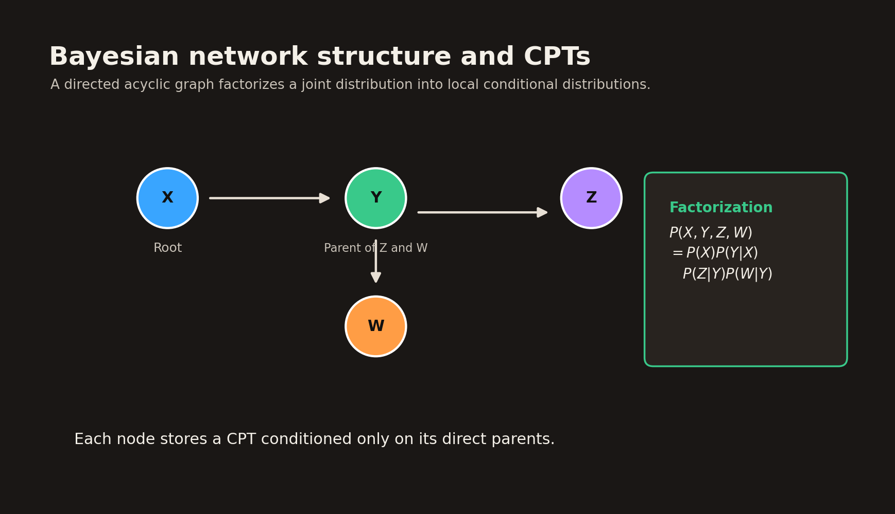
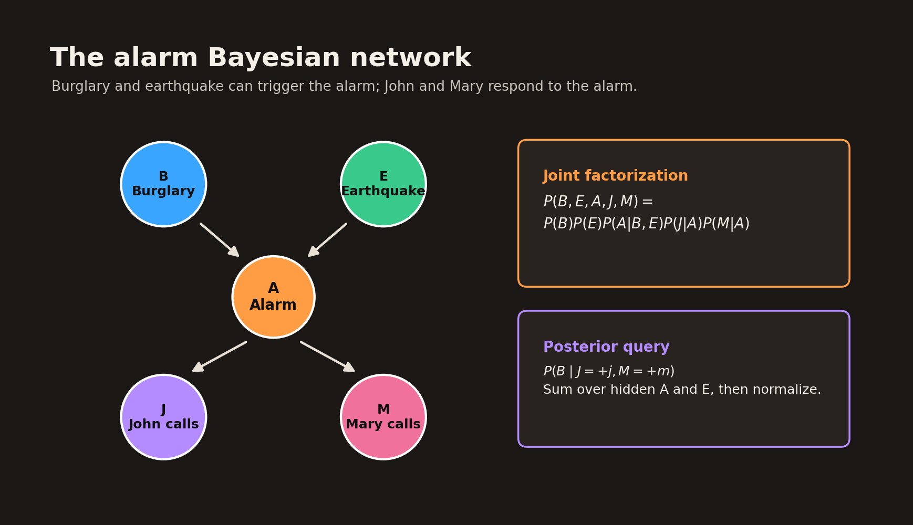
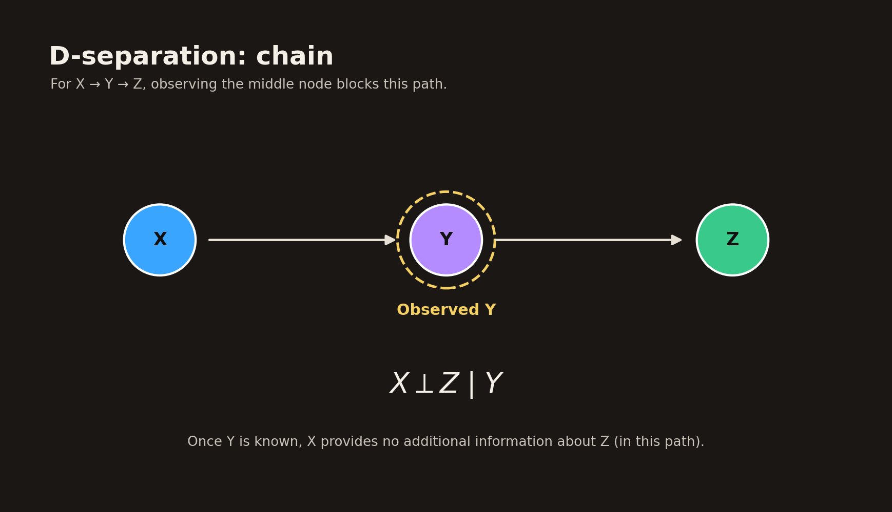
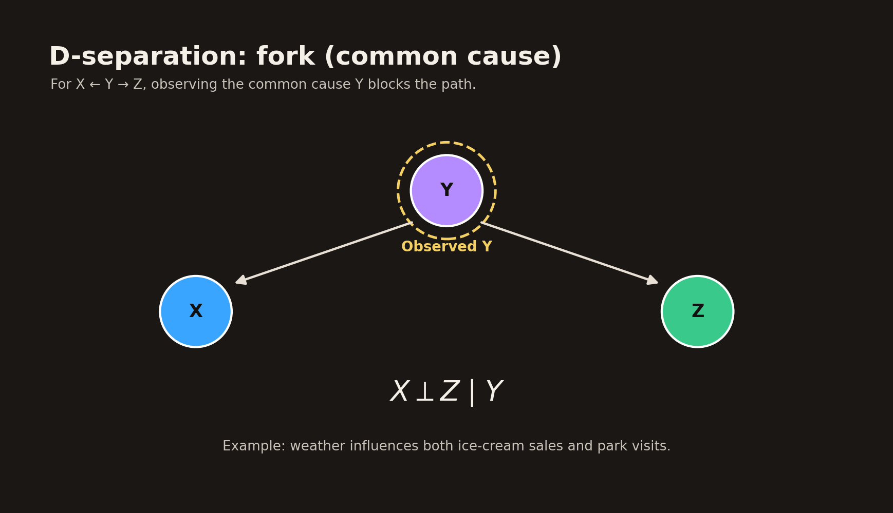
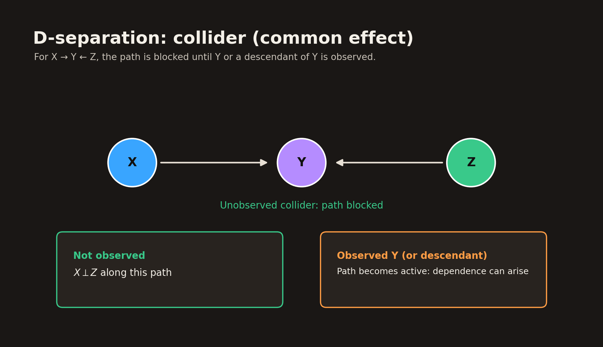
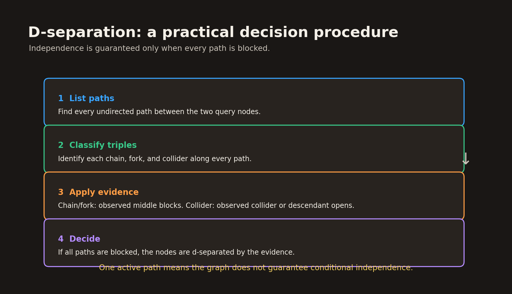
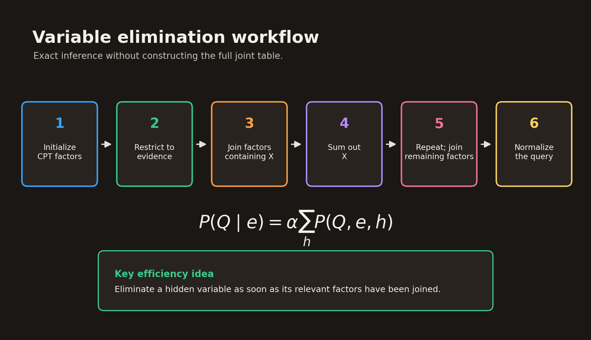
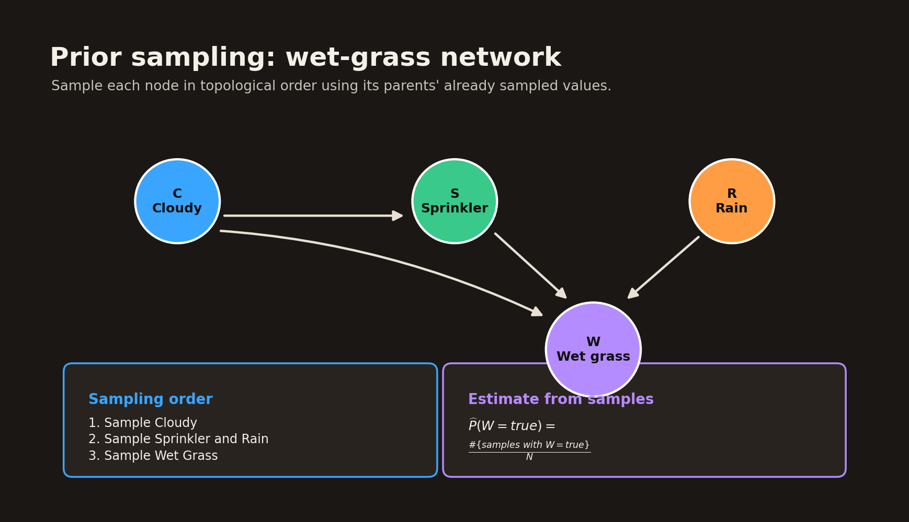
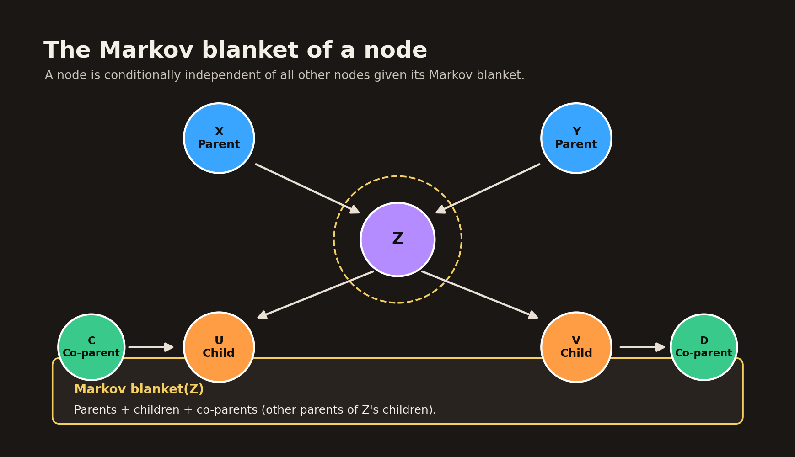

# Bayesian Networks, Causality, and Uncertain Reasoning

## 1. Why probabilistic reasoning is needed

Classical logic is useful when facts are deterministic: a proposition is true or false, and conclusions follow from rules. Many real-world problems are not so clean. An observation may be noisy, several explanations may be possible, and the system may not know the true state of the world.

Consider a person with a cough. There may be many possible causes, and the symptom alone does not identify one with certainty. Similarly, in the lecture's Ghostbusters grid-world example, a ghost occupies one hidden square while sensors report colors related to distance:

- Red: the ghost is on the sensed square.
- Orange: the ghost is one or two squares away.
- Yellow: the ghost is three or four squares away.
- Green: the ghost is at least five squares away.

The sensors are noisy, so a red reading is evidence for a nearby ghost, not a guarantee. The agent therefore maintains a **belief distribution** over possible ghost locations rather than committing to one location.

A probabilistic reasoning problem typically contains:

1. **Observed variables (evidence):** information currently available, such as sensor readings or symptoms.
2. **Unobserved variables:** quantities the agent wants to infer, such as the ghost's location or the disease causing a symptom.
3. **A probabilistic model:** a description of how variables relate.
4. **Inference:** the process of updating beliefs or computing a quantity of interest from the model and evidence.

The key shift is from asking only “Is this state possible?” to asking “How probable is this state given what I have observed?” Bayesian networks provide a compact way to represent these relationships. The lecture also situates them alongside Hidden Markov Models and particle filters as tools for maintaining beliefs under uncertainty.

## 2. Probability foundations

### 2.1 Experiments, sample spaces, and events

An **experiment** is a process with an outcome. A deterministic experiment has a known outcome under the stated conditions; a random experiment has an outcome that is not known in advance. Rolling a die is a standard random experiment.

The **sample space** \(S\) is the set of all possible outcomes. For one roll of a six-sided die,

\[
S=\{1,2,3,4,5,6\}.
\]

An individual outcome is a **sample point**. A sample space may be finite or infinite.

An **event** is any subset of the sample space. For example, the event “the die shows a number less than 3” is

\[
A=\{1,2\}.
\]

For a fair die, the event “the result is odd” is \(\{1,3,5\}\), so

\[
P(A)=\frac{3}{6}=0.5.
\]

For repeated experiments, the relative frequency of an event can be used to estimate its probability:

\[
P(A)\approx \frac{n(A)}{n},
\]

where \(n\) is the number of trials and \(n(A)\) is the number of trials in which \(A\) occurred. This is an empirical estimate; it generally becomes more stable as the number of trials grows.

### 2.2 Probability axioms and basic rules

A probability measure \(P\) assigns a number to each event and satisfies:

\[
0\leq P(A)\leq 1,
\qquad
P(\varnothing)=0,
\qquad
P(S)=1.
\]

For mutually exclusive (disjoint) events \(A_1,\ldots,A_n\),

\[
P\left(\bigcup_{i=1}^{n}A_i\right)
=\sum_{i=1}^{n}P(A_i).
\]

Two events are **mutually exclusive** when they cannot occur at the same time. A single die roll cannot be both 2 and 5, for example.

For an event \(A\), its complement \(A^c\) means that \(A\) does not occur. Since \(A\) and \(A^c\) partition the sample space,

\[
P(A)+P(A^c)=1,
\qquad
P(A)=1-P(A^c).
\]

For arbitrary events \(A\) and \(B\), the addition rule is

\[
P(A\cup B)=P(A)+P(B)-P(A\cap B).
\]

The intersection is subtracted because outcomes in \(A\cap B\) would otherwise be counted twice.

### 2.3 Random variables and domains

A **random variable (RV)** represents an uncertain aspect of the world. It is usually written with a capital letter. Examples include:

- \(R\): whether it is raining;
- \(T\): whether the weather is hot or cold;
- \(D\): the time required to drive to work;
- \(L\): the location of the ghost.

Every random variable has a **domain** of possible values. For example,

\[
R\in\{\text{true},\text{false}\},\qquad
T\in\{\text{hot},\text{cold}\}.
\]

A random variable may be discrete (a finite or countable set of values) or continuous (for example, a duration in \([0,\infty)\)).

For a discrete variable \(X\) with possible values \(x_1,\ldots,x_k\), its probability distribution specifies

\[
P(X=x_i)=p_i,
\qquad
p_i\geq 0,
\qquad
\sum_{i=1}^{k}p_i=1.
\]

A distribution must assign a probability to every possible value, and those probabilities must sum to one.

### 2.4 Joint distributions

A **joint probability distribution** over \(X_1,\ldots,X_n\) assigns a probability to every complete assignment:

\[
P(X_1=x_1,\ldots,X_n=x_n).
\]

A valid joint distribution has nonnegative entries and sums to one over all assignments:

\[
P(x_1,\ldots,x_n)\geq 0,
\qquad
\sum_{x_1,\ldots,x_n}P(x_1,\ldots,x_n)=1.
\]

If each of \(n\) variables has \(d\) possible values, a full joint table contains \(d^n\) entries. For binary variables this is \(2^n\). This exponential growth is a central reason to seek compact representations such as Bayesian networks.

A probabilistic model consists of random variables and their domains, possible assignments, and a normalized joint distribution. A useful model also captures the fact that many variables interact directly with only a small subset of all other variables.

### 2.5 Marginalization

A **marginal distribution** describes one or more variables after the remaining variables have been summed out. This operation is called **marginalization** or **summing out**.

For two variables \(T\) and \(W\),

\[
P(T=t)=\sum_w P(T=t,W=w).
\]

For example, suppose the joint distribution is:

| Temperature \(T\) | Weather \(W\) | \(P(T,W)\) |
| --- | --- | ---: |
| hot | sun | 0.4 |
| hot | rain | 0.1 |
| cold | sun | 0.2 |
| cold | rain | 0.3 |

Then

\[
P(T=\text{hot})=0.4+0.1=0.5,
\]

\[
P(T=\text{cold})=0.2+0.3=0.5.
\]

Similarly,

\[
P(W=\text{sun})=0.4+0.2=0.6,
\qquad
P(W=\text{rain})=0.1+0.3=0.4.
\]

Marginalization removes variables that are not part of the quantity being requested while preserving the total probability mass.

### 2.6 Conditional probability

A **conditional probability** measures the probability of an event given that another event is known to have occurred:

\[
P(A\mid B)=\frac{P(A\cap B)}{P(B)},
\qquad P(B)>0.
\]

Equivalently, the joint and conditional probabilities are related by

\[
P(A,B)=P(B)P(A\mid B).
\]

The conditioning event changes the reference set. Rather than considering every possible outcome, we consider only outcomes consistent with \(B\).

Using the temperature-weather table above,

\[
P(W=\text{sun}\mid T=\text{cold})
=\frac{P(W=\text{sun},T=\text{cold})}{P(T=\text{cold})}
=\frac{0.2}{0.5}=0.4.
\]

Thus, among cold cases, the probability of sun is 0.4.

A **conditional distribution** is a distribution over one variable for each fixed value of another variable. For example, \(P(W\mid T=\text{hot})\) and \(P(W\mid T=\text{cold})\) are two different distributions. Each one sums to one over the values of \(W\).

### 2.7 Normalization

Sometimes we can compute numbers proportional to the desired conditional probabilities without first computing the denominator explicitly. We can then normalize them.

Suppose the unnormalized values for two possible outcomes are \(q_1\) and \(q_2\). Their normalized probabilities are

\[
P_1=\frac{q_1}{q_1+q_2},
\qquad
P_2=\frac{q_2}{q_1+q_2}.
\]

More generally, for a query variable \(Q\) and evidence \(e\),

\[
P(Q=q\mid e)
=
\frac{P(Q=q,e)}
{\sum_{q'}P(Q=q',e)}.
\]

The denominator is a normalization constant. Dividing by it ensures that the posterior distribution over the query values sums to one.

### 2.8 Independence and conditional independence

Two variables \(X\) and \(Y\) are **independent** if knowing one does not change the distribution of the other:

\[
P(X,Y)=P(X)P(Y).
\]

Equivalently, when the relevant probabilities are defined,

\[
P(X\mid Y)=P(X).
\]

They are **conditionally independent given \(Z\)** if, once \(Z\) is known, learning \(Y\) gives no additional information about \(X\):

\[
X\perp Y\mid Z
\]

and

\[
P(X,Y\mid Z)=P(X\mid Z)P(Y\mid Z).
\]

Conditional independence is not the same as ordinary independence. Two variables may be dependent before conditioning and independent after conditioning.

For example, traffic \(T\) and umbrella use \(U\) may be associated because both are related to rain \(R\). Once rain is known, the model may assume

\[
T\perp U\mid R.
\]

The lecture also uses a toothache example: if toothache \(T\) and another symptom \(Pr\) are conditionally independent given cavity \(C\), then

\[
P(T,Pr,C)=P(C)P(T\mid C)P(Pr\mid C).
\]

This is simpler than representing every possible interaction between the symptoms.

### 2.9 Chain rule

The probability chain rule is an exact identity:

\[
P(X,Y,Z)=P(X)P(Y\mid X)P(Z\mid X,Y).
\]

For four variables,

\[
P(X,Y,Z,W)
=P(X)P(Y\mid X)P(Z\mid X,Y)P(W\mid X,Y,Z).
\]

The chain rule itself does not assume independence. Conditional-independence assumptions can simplify its terms. For example, if \(Z\perp X\mid Y\) and \(W\perp \{X,Y\}\mid Z\), then

\[
P(X,Y,Z,W)
=P(X)P(Y\mid X)P(Z\mid Y)P(W\mid Z).
\]

This distinction is important: the chain rule always holds, while a Bayesian network's graph asserts a particular set of conditional-independence relationships that makes the factorization compact.

### 2.10 Bayes' theorem and diagnostic reasoning

Bayes' theorem reverses a conditional probability:

\[
P(H\mid E)=\frac{P(E\mid H)P(H)}{P(E)}.
\]

Here:

- \(H\) is a hypothesis;
- \(E\) is observed evidence;
- \(P(H)\) is the **prior** probability;
- \(P(E\mid H)\) is the **likelihood**;
- \(P(H\mid E)\) is the **posterior** probability.

The prior represents belief before the evidence. The posterior represents the updated belief after the evidence.

For a binary hypothesis \(H\),

\[
P(E)=P(E\mid H)P(H)+P(E\mid \neg H)P(\neg H).
\]

This is the law of total probability and supplies the denominator.

**Why base rates matter.** A test can have high sensitivity and specificity while a positive result still has a modest probability of indicating the condition when the condition is rare. A positive test is not itself the posterior probability of disease. The prior prevalence must be combined with the test's true-positive and false-positive rates.

The lecture poses a virus-testing comparison:

- Test A: sensitivity \(0.95\), false-positive rate \(0.10\);
- Test B: sensitivity \(0.90\), false-positive rate \(0.05\);
- prevalence: \(0.01\).

For Test A,

\[
P(V\mid A^+)
=\frac{0.95(0.01)}
{0.95(0.01)+0.10(0.99)}
=\frac{0.0095}{0.1085}
\approx 0.0876.
\]

For Test B,

\[
P(V\mid B^+)
=\frac{0.90(0.01)}
{0.90(0.01)+0.05(0.99)}
=\frac{0.009}{0.0585}
\approx 0.1538.
\]

Despite its slightly lower sensitivity, Test B's positive result is more indicative of infection because its false-positive rate is lower. This illustrates why diagnostic reasoning must use both the test characteristics and the base rate.

The lecture also asks about a disease with prevalence \(1/10{,}000=0.0001\) and a test with 99% sensitivity and 99% specificity. The posterior after a positive result is

\[
P(D\mid +)
=\frac{0.99(0.0001)}
{0.99(0.0001)+0.01(0.9999)}
\approx 0.0098.
\]

That is about 0.98%, not 99%. The example demonstrates the base-rate effect.

A further lecture exercise concerns a witness who identifies a taxi as blue under dim lighting, where color discrimination is 75% reliable. The important distinction is between “the taxi is blue” and “the taxi appears blue to the witness.” To infer the actual color, the reliability of the observation must be combined with the prior proportions of blue and green taxis. If 9 out of 10 taxis are green, the prior strongly favors green and can outweigh the imperfect witness report.

## 3. Bayesian networks

### 3.1 Definition and components

A **Bayesian network (BN)** is a graphical probabilistic model that represents a joint probability distribution compactly. It contains:

1. **Nodes:** random variables.
2. **Directed edges (arcs):** direct probabilistic dependencies represented by the model.
3. **Conditional Probability Tables (CPTs):** the local probability distribution of each node given its parents.

A Bayesian network is a **directed acyclic graph (DAG)**. Directed means edges have an orientation; acyclic means following directed edges can never return to the starting node.

For variables \(X_1,\ldots,X_n\), the joint distribution factorizes as

\[
P(X_1,\ldots,X_n)
=\prod_{i=1}^{n}P(X_i\mid Parents(X_i)).
\]

The probability associated with each node depends only on its direct parents in the graph. This is the local structure that makes a BN efficient.

*Figure: A node's CPT specifies its distribution for each assignment of its parent variables.*

### 3.2 Parents, children, roots, and node ordering

If an edge points from \(X\) to \(Y\), then \(X\) is a **parent** of \(Y\), and \(Y\) is a **child** of \(X\). A node with no parents is a **root node**. Its local distribution is simply its prior or marginal distribution, such as \(P(X)\).

A valid topological ordering places every parent before its children. Such an ordering exists for every DAG and is useful for constructing the network, evaluating its factorization, and generating samples. The lecture's node-ordering guidance is to place causes before effects; for example, burglary before alarm before John calling. A poor ordering can make the graph less intuitive and may require more edges and larger CPTs.

The direction of an edge expresses the dependency structure assumed by the model. It should not be selected merely because one conditional probability can be calculated from another.

The lecture's traffic example illustrates a small network with low pressure \(L\), rain \(R\), traffic \(T\), roof drips \(D\), football match \(F\), and cavity \(C\). Its displayed relationships include \(L\rightarrow R\rightarrow T\), \(R\rightarrow D\), and \(F\rightarrow T\), while \(C\) is shown as a separate variable. The corresponding factorization is

\[
P(L,R,F,T,D,C)=P(L)P(F)P(C)P(R\mid L)P(T\mid R,F)P(D\mid R).
\]

This example shows how the graph determines the parent set for each CPT and how a variable such as traffic can have more than one direct parent.

### 3.3 Causal interpretation and the danger of reverse causality

The lecture often describes arrows using cause-and-effect language. For example,

\[
\text{Rain}\rightarrow\text{Traffic}
\]

means traffic depends on rain in the proposed model.

The lecture contrasts this with the reverse arrow, \(\text{Traffic}\rightarrow\text{Rain}\). Observational data may show that rain and traffic are associated, and it is possible to calculate \(P(\text{Rain}\mid\text{Traffic})\). But that conditional probability does not establish that traffic causes rain.

**Correlation is not causation.** Two variables may move together because one influences the other, because of a common cause, or because of another structure. The direction of a causal relationship requires assumptions or evidence beyond simply observing an association.

The material introduces this caution but does not develop a full intervention calculus or a formal treatment of counterfactuals. Those topics should not be inferred from the lecture's arrow diagrams alone.

### 3.4 The alarm network

A central lecture example contains five Boolean variables:

- \(B\): burglary occurs;
- \(E\): earthquake occurs;
- \(A\): alarm goes off;
- \(J\): John calls;
- \(M\): Mary calls.

The graph is

\[
B\rightarrow A\leftarrow E,
\qquad
A\rightarrow J,
\qquad
A\rightarrow M.
\]

Burglary and earthquake are root causes in the model. The alarm depends on both. John and Mary each depend on the alarm.

The factorization is

\[
P(B,E,A,J,M)
=P(B)P(E)P(A\mid B,E)P(J\mid A)P(M\mid A).
\]

To calculate a complete assignment, select the relevant prior or CPT entry for each node and multiply them.

For the assignment \(B=+b,E=-e,A=+a,J=-j,M=+m\), the lecture gives:

\[
\begin{aligned}
P(+b,-e,+a,-j,+m)
={}&P(+b)P(-e)P(+a\mid +b,-e)\\
&\times P(-j\mid +a)P(+m\mid +a)\\
={}&0.001\times0.998\times0.94\\
&\times0.10\times0.70\\
={}&0.0000656684.
\end{aligned}
\]

The complement is used for John not calling:

\[
P(-j\mid +a)=1-P(+j\mid +a)=1-0.90=0.10.
\]

This result is the probability of that one complete assignment, not the probability of burglary given calls. To compute the latter, inference is required.

*Figure: The alarm network and its five random variables.*

### 3.5 How compact is a Bayesian network?

A full joint table for \(n\) binary variables contains \(2^n\) entries, although one entry is determined by normalization, leaving \(2^n-1\) independent numbers.

A BN stores local CPTs instead. For a binary node with \(k\) binary parents, there are \(2^k\) parent configurations and one independent probability per configuration (the other outcome is its complement). Thus, the number of independent CPT parameters for that node is \(2^k\).

In the alarm network:

| Node | Parents | Number of parent configurations | Independent probabilities |
| --- | --- | ---: | ---: |
| \(B\) | none | 1 | 1 |
| \(E\) | none | 1 | 1 |
| \(A\) | \(B,E\) | 4 | 4 |
| \(J\) | \(A\) | 2 | 2 |
| \(M\) | \(A\) | 2 | 2 |
| **Total** |  |  | **10** |

A full joint distribution over five binary variables has 32 entries, or 31 independent parameters. The network uses 10 independent local parameters.

For \(N\) binary nodes with at most \(k\) parents each, a rough upper bound on the number of independent CPT parameters is \(N2^k\). The important point is that storage grows linearly with the number of nodes when the number of parents per node is bounded, while the full joint grows exponentially in \(N\).

For example, with \(N=10\) binary nodes and at most \(k=3\) parents per node:

\[
\text{Full joint entries}=2^{10}=1024,
\]

\[
\text{BN CPT parameters}\leq 10\times2^3=80.
\]

The savings depend on the network being sparse. A node with many parents still requires a large CPT.

### 3.6 Bayesian-network semantics and local Markov assumption

The key local assumption is that each node is conditionally independent of its **non-descendants** given its parents. Informally, once the direct parents of a node are known, its other non-descendants provide no additional information about it under the BN model.

For example, if the graph contains

\[
X\rightarrow Y\rightarrow Z,
\]

then the model asserts

\[
Z\perp X\mid Y.
\]

The corresponding factorization is

\[
P(X,Y,Z)=P(X)P(Y\mid X)P(Z\mid Y).
\]

The graph therefore encodes more than a list of arrows: it also encodes conditional-independence assumptions. Those assumptions are what permit the joint distribution to be factored into smaller local terms.

## 4. Conditional independence and d-separation

### 4.1 Why graph-based independence tests are useful

A BN can contain many paths between variables. Calculating a full joint distribution merely to answer whether two variables are independent would be wasteful. **D-separation** is a graphical criterion for determining whether a set of observed variables blocks every path between two other variables.

If \(X\) and \(Y\) are d-separated by evidence set \(Z\), then the network entails

\[
X\perp Y\mid Z.
\]

If they are not d-separated, the graph does not guarantee that conditional independence. Dependence may still disappear for special numerical parameter choices, but it cannot be concluded from the graph alone.

### 4.2 The three canonical structures

All path reasoning can be understood through three connected-node patterns.

#### A. Chain: \(X\rightarrow Y\rightarrow Z\)

Without observing \(Y\), information can flow along the chain from \(X\) to \(Z\). Once \(Y\) is observed, the path is blocked:

\[
X\perp Z\mid Y.
\]

Example: rainy clouds \(\rightarrow\) rain \(\rightarrow\) traffic jam. If we already know whether it is raining, knowing about the clouds does not provide additional information about traffic under this model.

#### B. Fork or common cause: \(X\leftarrow Y\rightarrow Z\)

The middle node \(Y\) is a common cause of \(X\) and \(Z\). Without observing \(Y\), \(X\) and \(Z\) may be dependent because they share a cause. Conditioning on \(Y\) blocks the path:

\[
X\perp Z\mid Y.
\]

Example: weather affects both ice-cream sales and park visits. Once the weather is known, the sales figure gives no additional information about park visits under the assumed model.

#### C. Collider or common effect: \(X\rightarrow Y\leftarrow Z\)

The middle node \(Y\) is a common effect of \(X\) and \(Z\). When \(Y\) and its descendants are not observed, the path is blocked. Observing \(Y\), or one of its descendants, activates the path and can make \(X\) and \(Z\) dependent.

\[
X\perp Z
\quad\text{(along this path when the collider is unobserved),}
\]

but generally

\[
X\not\!\perp Z\mid Y.
\]

Example: having a good job and being highly skilled may both contribute to being hired by a top company. If we know that someone was hired, evidence about one factor changes how plausible the other factor is. This is sometimes called explaining away.

**Important contrast:** observing the middle node blocks a chain and a fork, but activates a collider. This reversal is one of the most important facts in d-separation.

### 4.3 Active paths and the general d-separation procedure

A path between \(X\) and \(Y\) is active given evidence \(Z\) if every triple along that path is active under the chain/fork/collider rules. A path is blocked if at least one triple is blocked.

To test d-separation:

1. List all undirected paths between \(X\) and \(Y\).
2. Examine each triple on every path.
3. For a chain or fork, the triple is blocked when its middle node is observed.
4. For a collider, the triple is active when the collider or one of its descendants is observed; otherwise it is blocked.
5. A path is active only if every triple on it is active.
6. \(X\) and \(Y\) are d-separated if every path is blocked.

One active path is enough for the graph not to guarantee conditional independence. Every path must be blocked to establish d-separation.

### 4.4 Worked path example

The lecture considers two paths between \(T\) and \(D\):

\[
T\leftarrow R\rightarrow D
\qquad\text{and}\qquad
T\rightarrow S\leftarrow D.
\]

The first path is a fork with common cause \(R\). If \(R\) is not observed, that path is active. The second path is a collider at \(S\), and is blocked when neither \(S\) nor a descendant of \(S\) is observed.

Because the fork path remains active, \(T\) and \(D\) are not d-separated by the empty evidence set. If we condition on both \(R\) and \(S\), the fork is blocked by observing \(R\), but the collider path is activated by observing \(S\). Therefore the paths must be evaluated together; it is not valid to conclude independence merely because one path is blocked.

The lecture's exercise text also contains the intermediate claim \(T\perp D\mid R,S\), which conflicts with the path analysis just described if \(S\) is indeed the collider. Under the standard d-separation rule, conditioning on collider \(S\) opens the second path. The graph image/text extraction for that exercise does not fully preserve all labels, so the exact intended evidence set or diagram may be ambiguous. The general chain/fork/collider rules above are the reliable method to apply.

### 4.5 Common mistakes in d-separation

- Treating every observed middle node as blocking every path. This is wrong for colliders.
- Checking only one path. Independence requires all paths to be blocked.
- Forgetting that observing a descendant of a collider can also activate the collider path.
- Treating “not d-separated” as proof of dependence for every possible numerical parameterization. It means the graph does not guarantee independence.
- Confusing statistical association with causal direction.

## 5. Bayesian inference

### 5.1 What inference asks

**Inference** means computing a useful quantity from a probabilistic model. The lecture emphasizes two common questions:

- **Posterior inference / belief update:** Given evidence, what is the probability of an unobserved variable?
- **Maximum a posteriori (MAP) inference:** What is the most probable assignment of hidden variables given the evidence?

For example, in the alarm network, we may ask

\[
P(B\mid J=+j,M=+m).
\]

This asks how likely a burglary is after observing that both John and Mary called.

The evidence is not the same as the query. Variables that are neither query variables nor observed evidence are hidden variables. Their possible values must be accounted for, usually by summing over them.

### 5.2 Inference by enumeration

Inference by enumeration uses the factorization of the joint distribution, enumerates the possible assignments of hidden variables, sums the appropriate joint probabilities, and normalizes the result.

For a query \(Q\), evidence \(e\), and hidden variables \(H\),

\[
P(Q\mid e)
=\alpha\sum_h P(Q,e,h),
\]

where \(\alpha\) is a normalization constant chosen so that the probabilities over \(Q\) sum to one.

The basic steps are:

1. Select assignments consistent with the evidence.
2. Expand their joint probabilities using the BN factorization.
3. Sum over all hidden-variable assignments.
4. Normalize the resulting values over the query variable.

In the alarm network, to compute \(P(B\mid +j,+m)\), the evidence is John and Mary calling. The hidden variables include the alarm \(A\) and earthquake \(E\). We compute unnormalized values for \(B=+b\) and \(B=-b\), summing over the four combinations of \(A\) and \(E\) in each case:

\[
P(B,+j,+m)
=\sum_{a,e}P(B,e,a,+j,+m).
\]

Using the factorization,

\[
P(B,+j,+m)
=\sum_{a,e}P(B)P(e)P(a\mid B,e)P(+j\mid a)P(+m\mid a).
\]

Then normalize:

\[
P(B\mid +j,+m)
=\frac{P(B,+j,+m)}
{\sum_{b\in\{+b,-b\}}P(b,+j,+m)}.
\]

The lecture's extracted slides provide the setup and intermediate factor tables for this example, but not every numerical entry of the alarm CPT is preserved consistently in the text extraction. The method and the fully readable local factors are shown; a final numeric posterior should not be reconstructed from missing or uncertain entries.

### 5.3 Why enumeration becomes expensive

If there are \(h\) hidden binary variables, enumeration may require considering \(2^h\) assignments for each query assignment. For example, ten hidden binary variables create

\[
2^{10}=1024
\]

possible hidden assignments. With many variables, enumeration can become expensive even when the BN itself is compact.

The key opportunity is that many factors do not involve all variables. We can avoid building a large joint table by eliminating variables as soon as they are no longer needed. This leads to variable elimination.

## 6. Factors and variable elimination

### 6.1 What is a factor?

A **factor** is a function that maps an assignment of a set of variables to a number. A probability table is a special kind of factor, but a factor created during inference need not itself be normalized.

Examples include:

- \(P(X,Y)\): a joint factor over \(X,Y\);
- \(P(X)\): a one-variable marginal factor;
- \(P(A\mid B,E)\): a factor over \(A,B,E\);
- \(P(y\mid x)\): a distribution over \(Y\) for one fixed value of \(X\).

The **scope** of a factor is the set of variables on which it depends. The number of variables in its scope determines the dimensionality of its table. A factor over five binary variables has \(2^5=32\) entries.

When evidence is observed, we can restrict a factor to the observed value. Fixing a variable removes that variable's dimension from the factor. Summing over a variable also removes its dimension, but by adding the entries corresponding to its possible values.

### 6.2 The two core operations

Variable elimination uses two main operations.

**Join (multiply) factors.** Combine factors that share variables. For every compatible assignment, multiply their values. The resulting factor has the union of their scopes.

For example, if \(f_1(R,X)\) and \(f_2(R,Y)\) share \(R\), their join is

\[
g(R,X,Y)=f_1(R,X)f_2(R,Y).
\]

**Eliminate (sum out) a variable.** To eliminate \(R\) from \(g(R,X,Y)\), sum over all values of \(R\):

\[
h(X,Y)=\sum_r g(r,X,Y).
\]

The resulting factor no longer depends on \(R\).

### 6.3 Variable elimination algorithm

To compute \(P(Q\mid e)\):

1. **Initialize factors:** start with the local CPTs of the network.
2. **Apply evidence:** restrict each factor containing an evidence variable to the observed value.
3. **Choose a hidden variable:** select a variable that is neither a query variable nor an evidence variable.
4. **Join relevant factors:** multiply all current factors that contain that hidden variable.
5. **Eliminate it:** sum over its possible values, producing a smaller factor.
6. **Repeat:** continue until all hidden variables have been eliminated.
7. **Join remaining factors:** combine the factors that remain over query and evidence variables.
8. **Normalize:** normalize over the query values to obtain the posterior.

### 6.4 Enumeration versus variable elimination

Enumeration joins all relevant factors to form the joint distribution and then sums out hidden variables. Variable elimination interleaves joining and summing out:

| Inference by enumeration | Variable elimination |
| --- | --- |
| Builds a large joint factor before eliminating hidden variables | Eliminates hidden variables as early as possible |
| Can create many unnecessary intermediate entries | Reuses smaller intermediate factors |
| Often exponential in the number of hidden variables | Cost depends strongly on the largest intermediate factor |
| Straightforward conceptually | More efficient when the graph permits small factors |

The essential idea is: **do not compute the whole joint distribution if only a small part is needed.**

### 6.5 Variable elimination in the alarm network

For the alarm network,

\[
P(B,E,A,J,M)=P(B)P(E)P(A\mid B,E)P(J\mid A)P(M\mid A).
\]

Suppose the query is \(P(B\mid j,m)\). First restrict the John and Mary factors to the observed values:

\[
f_J(A)=P(j\mid A),
\qquad
f_M(A)=P(m\mid A).
\]

The initial factors are

\[
P(B),\quad P(E),\quad P(A\mid B,E),\quad f_J(A),\quad f_M(A).
\]

One possible elimination order is:

1. Join \(P(A\mid B,E)\), \(f_J(A)\), and \(f_M(A)\) on \(A\).
2. Sum out \(A\), producing a factor over \(B,E\).
3. Join that result with \(P(E)\).
4. Sum out \(E\), producing a factor over \(B\).
5. Join with \(P(B)\).
6. Normalize over \(B\).

The lecture shows an intermediate table in which a factor over \(E,B\) is multiplied by \(P(E)\), followed by a factor over \(B\). The final normalization turns the unnormalized values into the posterior distribution over burglary.

### 6.6 Why elimination order matters

Different elimination orders can create very different intermediate factors. Consider a hub variable \(Z\) connected to many binary variables \(X_1,\ldots,X_{n-1}\), with factors involving \(Z\) and each \(X_i\).

- If \(Z\) is eliminated first, all neighboring variables may be combined into one large factor over \(X_1,\ldots,X_{n-1}\).
- If the \(X_i\) variables are eliminated first, each can be summed out locally, leaving smaller factors involving \(Z\).

In the lecture's six-variable binary illustration, eliminating the hub first can create a factor with \(2^6=64\) entries, while eliminating the neighbors first can keep the largest factor at two entries.

The computational and memory cost of variable elimination is governed by the largest intermediate factor, not merely by the number of variables in the original network.

There is no universally optimal ordering. Finding an optimal elimination order is generally NP-hard. Practical heuristics include:

- **Min-degree:** prefer eliminating a variable with few current neighbors.
- **Min-fill:** prefer eliminating a variable that introduces the fewest new connections (fill-in edges) among its neighbors.

These heuristics aim to avoid creating large intermediate factors. They do not guarantee the globally optimal order.

## 7. Approximate inference by sampling

### 7.1 Why sampling is useful

Exact inference can be computationally expensive in large or densely connected networks. Sampling provides an alternative: generate representative assignments from the model and estimate probabilities using their frequencies or weights.

If \(N\) samples are generated, an ordinary frequency estimate is

\[
\widehat{P}(X=x)
=\frac{\#\{\text{samples with }X=x\}}{N}.
\]

Larger sample sets generally produce more stable estimates, although sampling error remains and convergence depends on the method and model.

### 7.2 Sampling a discrete distribution

To sample a discrete variable, first draw a uniform random number

\[
u\sim Uniform[0,1).
\]

Then partition the interval \([0,1)\) into intervals whose lengths equal the outcome probabilities.

For \(C\in\{\text{Red},\text{Green},\text{Blue}\}\), suppose

\[
P(C)=\{0.6,0.1,0.3\}.
\]

Use the intervals:

| Outcome | Probability | Interval |
| --- | ---: | --- |
| Red | 0.6 | \(0\leq u<0.6\) |
| Green | 0.1 | \(0.6\leq u<0.7\) |
| Blue | 0.3 | \(0.7\leq u<1\) |

If \(u=0.83\), the selected outcome is Blue. Repeating this process yields samples whose frequencies approximate the specified distribution.

### 7.3 Prior sampling

**Prior sampling** generates complete assignments from the BN's joint distribution without conditioning on evidence.

The algorithm follows a topological order:

1. Start with root nodes and sample from their prior distributions.
2. Sample each child from its CPT conditioned on the already sampled parent values.
3. Continue until every node has a value.
4. Repeat to obtain many complete samples.

For the lecture's wet-grass network,

\[
C\rightarrow S,\qquad C\rightarrow R,\qquad (S,R)\rightarrow W,
\]

where:

- \(C\): Cloudy;
- \(S\): Sprinkler;
- \(R\): Rain;
- \(W\): Wet Grass.

The joint distribution factorizes as

\[
P(C,S,R,W)=P(C)P(S\mid C)P(R\mid C)P(W\mid S,R).
\]

A sample is generated in the order \(C,S,R,W\). For example, the assignment \(+c,-s,+r,+w\) has probability

\[
P(+c)P(-s\mid +c)P(+r\mid +c)P(+w\mid -s,+r).
\]

Each generated sample represents one complete possible state of the world. After generating many samples, count the values of \(W\) to estimate \(P(W)\), or filter/count the assignments relevant to another probability.

For instance, if five samples contain four \(+w\) and one \(-w\), the empirical estimate is

\[
\widehat{P}(W)=\langle 0.8,0.2\rangle.
\]

The estimate becomes more reliable as more representative samples are generated.

### 7.4 Rejection sampling

Prior samples do not directly account for evidence. **Rejection sampling** estimates a conditional probability by generating prior samples and retaining only those that match the observed evidence.

To estimate \(P(C\mid S=+s)\):

1. Generate a sample from the prior BN.
2. Check whether the sampled value of \(S\) is \(+s\).
3. Reject the sample if it does not match the evidence.
4. Among the retained samples, count the values of \(C\).
5. Normalize those counts to estimate the conditional distribution.

In the lecture's five-sample illustration, only samples 2 and 3 satisfy \(S=+s\). One retained sample has \(+C\), and the other has \(-C\), giving the rough estimate

\[
\widehat{P}(C\mid +s)=\langle 0.5,0.5\rangle.
\]

This is only an estimate from two accepted samples, not an exact answer.

**Limitation:** if the evidence is rare, most prior samples may be rejected. The method can then waste substantial computation and leave very few samples for estimating the posterior.

### 7.5 Likelihood weighting

**Likelihood weighting** addresses the inefficiency of rejection sampling by fixing evidence variables to their observed values rather than sampling and discarding them.

For each weighted sample:

1. Fix every evidence variable to its observed value.
2. Sample each non-evidence variable in topological order, using its CPT and sampled parent values.
3. For each evidence variable \(E_i=e_i\), multiply the sample's weight by the likelihood of that evidence value given its parents:

\[
w=\prod_{i}P(E_i=e_i\mid Parents(E_i)).
\]

4. Use weighted counts to estimate the query distribution.

A non-evidence variable does not receive an additional weight: it was sampled from its conditional distribution, so its probability is already represented in how often its values occur. Evidence variables are fixed rather than sampled, so their likelihood must be included in the sample weight.

For a network with Shape and Color, suppose Color is observed to be Blue. The lecture gives an illustration of weighted samples:

| Sample | Shape | Fixed Color | Weight |
| --- | --- | --- | ---: |
| 1 | Pyramid | Blue | 0.6 |
| 2 | Sphere | Blue | 0.8 |
| 3 | Cube | Blue | 0.9 |
| 4 | Sphere | Blue | 0.5 |

The weighted totals are:

- Pyramid: \(0.6\);
- Sphere: \(0.8+0.5=1.3\);
- Cube: \(0.9\).

Their normalized estimates are

\[
P(\text{Pyramid}\mid Blue)\approx\frac{0.6}{2.8},
\]

\[
P(\text{Sphere}\mid Blue)\approx\frac{1.3}{2.8},
\qquad
P(\text{Cube}\mid Blue)\approx\frac{0.9}{2.8}.
\]

Thus, the approximate distribution is approximately \((0.214,0.464,0.321)\).

**Strength:** evidence is incorporated during sampling, so samples are not thrown away simply because they disagree with the evidence.

**Limitation:** non-evidence variables are sampled in topological order before evidence values at their descendants can influence them. Consequently, evidence may affect downstream variables through their sampled parents, but it does not cause upstream variables to be resampled. If evidence is strong information about an ancestor, likelihood weighting can generate many upstream assignments poorly matched to that evidence; their weights may be very small.

### 7.6 Gibbs sampling

**Gibbs sampling** is a Markov chain Monte Carlo method. It fixes the evidence variables and repeatedly resamples one non-evidence variable conditioned on the current values of all the other variables.

The algorithm is:

1. Fix all observed variables to their evidence values.
2. Initialize the non-evidence variables, often randomly.
3. Repeat for many iterations:
   - Select a non-evidence variable \(X_i\).
   - Compute its conditional distribution given the current values of the other variables.
   - Sample a new value for \(X_i\) from that conditional distribution.
4. After an initial burn-in period, record samples.
5. Estimate posterior probabilities from the recorded sample frequencies.

For a binary variable,

\[
X_i\sim P(X_i\mid \text{all other current variables}).
\]

The Markov chain is designed so that, under the required conditions, its stationary distribution is the desired posterior distribution conditioned on the evidence. The lecture describes convergence as the point at which sample frequencies stop changing substantially. In practice, apparent stability is a diagnostic, not a mathematical proof that a finite run has converged.

### 7.7 Markov blanket

Computing \(P(X_i\mid\text{all other variables})\) by using the entire network would be expensive. The **Markov blanket** of a node \(X\) is the set consisting of:

1. The parents of \(X\);
2. The children of \(X\);
3. The other parents of \(X\)'s children (co-parents).

A node is conditionally independent of all other nodes given its Markov blanket. Therefore,

\[
P(X\mid \text{all other variables})
=P(X\mid MarkovBlanket(X)).
\]

For Gibbs sampling, this means that a variable can be resampled using only its local neighborhood in the network rather than recomputing the entire joint distribution.

### 7.8 Comparing the sampling methods

| Method | How evidence is handled | Main advantage | Main limitation |
| --- | --- | --- | --- |
| Prior sampling | Ignored during generation | Simple; samples from the joint distribution | Does not directly target a posterior |
| Rejection sampling | Samples inconsistent with evidence are discarded | Simple conditional-probability estimate | Very inefficient for rare evidence |
| Likelihood weighting | Evidence is fixed and contributes a weight | Avoids rejecting samples; evidence affects weights | Upstream variables are not resampled to fit downstream evidence |
| Gibbs sampling | Evidence is fixed; hidden variables are repeatedly resampled conditionally | Evidence can influence variables throughout the network | Requires burn-in and sufficient mixing; successive samples are dependent |

The methods are alternatives for different computational situations. Prior sampling is useful for generating joint samples; rejection sampling is straightforward when evidence is common; likelihood weighting avoids waste from rejecting rare evidence; Gibbs sampling allows evidence to influence hidden variables through repeated local updates.

## 8. Putting the ideas together

The chapter's concepts form a coherent pipeline:

1. **Probability** provides a language for representing uncertainty.
2. **Random variables and joint distributions** describe uncertain states and their relationships.
3. **Marginalization and conditioning** extract probabilities relevant to a question or evidence.
4. **Bayes' theorem** explains how evidence updates prior beliefs.
5. **Conditional independence** identifies relationships that can be simplified.
6. **Bayesian networks** encode a joint distribution as local conditional distributions in a DAG.
7. **D-separation** reads conditional independences from the graph without expanding the full joint.
8. **Inference** computes posterior beliefs or most likely explanations.
9. **Variable elimination** performs exact inference while controlling intermediate factor sizes.
10. **Sampling methods** approximate inference when exact computation is too costly.

The most important practical lesson is to exploit structure. A full joint distribution can be exponentially large, but a sparse Bayesian network may represent the same model compactly. Conditional independence reduces the representation; d-separation reveals independence; variable elimination exploits local factors; and sampling provides approximate answers when exact inference is expensive.

## 9. Exam-oriented checks and common pitfalls

Before solving a Bayesian-network problem, check the following:

- Identify every random variable and its domain.
- Draw the DAG and verify that it is acyclic.
- List the parents of each node and identify root nodes.
- Write the joint factorization as the product of local CPTs.
- Check that every CPT row is a valid distribution and sums to one.
- Distinguish a joint probability from a conditional probability.
- When computing a posterior, identify query, evidence, and hidden variables separately.
- Sum over hidden variables; do not simply ignore them.
- Normalize the final query values.
- For d-separation, inspect every undirected path and classify each triple.
- Remember that observing a collider (or its descendant) opens a path.
- For variable elimination, eliminate only hidden variables and pay attention to factor sizes and ordering.
- For likelihood weighting, multiply the likelihoods of fixed evidence values.
- For Gibbs sampling, keep evidence fixed and resample only non-evidence variables.

### Quick conceptual questions

1. Why is a noisy sensor reading evidence rather than proof of a hidden state?
2. What is the difference between a joint distribution and a marginal distribution?
3. Why does conditional probability require a nonzero conditioning probability?
4. How does Bayes' theorem combine a prior and a likelihood?
5. Why can a test with high sensitivity still have a low positive predictive value?
6. What does a node's CPT represent?
7. Why does a Bayesian network need to be acyclic?
8. How does a BN avoid storing the full joint distribution?
9. What is the difference between the chain rule and a BN factorization?
10. Why does observing the middle node block a chain and a fork but activate a collider?
11. What is the difference between an active path and a d-separated pair?
12. Why does enumeration become expensive as the number of hidden variables grows?
13. What are the join and eliminate operations in variable elimination?
14. Why can a poor elimination order create very large factors?
15. Why does rejection sampling perform poorly when evidence is rare?
16. How does likelihood weighting use evidence differently from rejection sampling?
17. Why can likelihood weighting fail to adjust upstream variables adequately?
18. Which variables belong to the Markov blanket of a node?
19. Why does Gibbs sampling discard an initial burn-in period?
20. Why does observational correlation alone not establish causal direction?

## 10. Scope notes and source limitations

The lecture title includes causality, but the supplied slides primarily develop probabilistic reasoning, Bayesian-network structure, conditional independence, d-separation, exact inference, and sampling-based approximate inference. Causality is introduced through the interpretation of directed edges and the warning that correlation does not establish causal direction. The lecture does not provide a complete treatment of interventions, do-calculus, or counterfactual reasoning; these have therefore not been added as if they were lecture topics.

Some slides are largely graphical, and some extracted CPT entries or mathematical symbols are incomplete. The notes preserve the readable formulas and worked values, and flag the d-separation exercise whose extracted text appears internally inconsistent. Where a complete numerical posterior cannot be verified from the readable source, the method is explained without fabricating a result.
