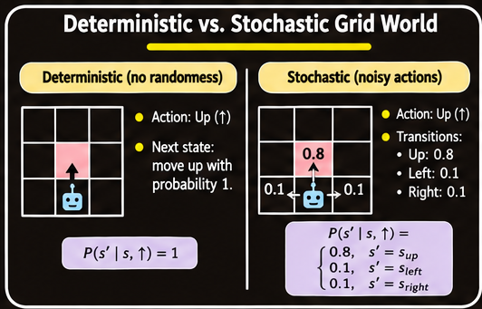
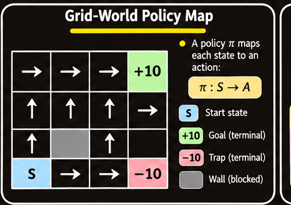
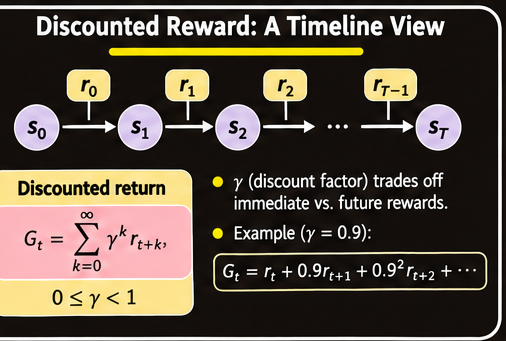
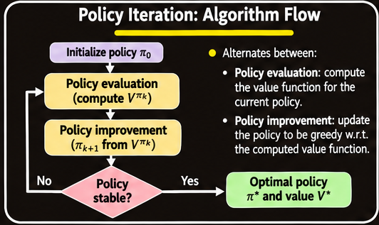
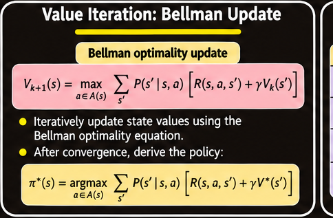
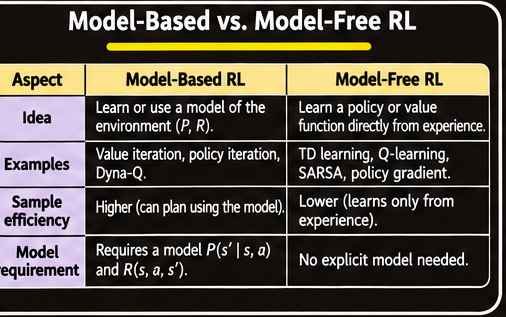
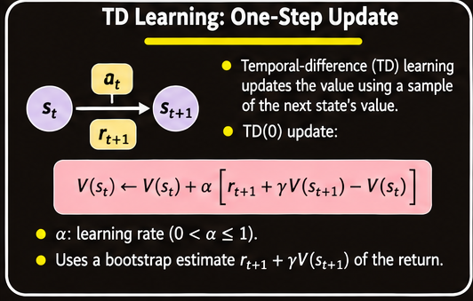
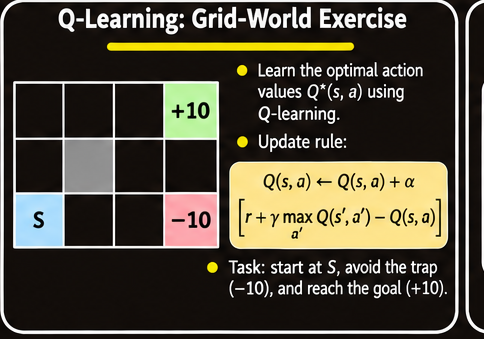
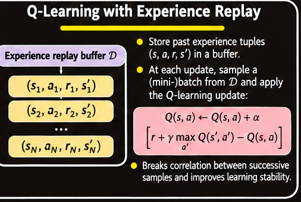

# Reinforcement Learning

## 1. Overview: Learning to Make Decisions Through Experience

An intelligent agent interacts with an environment. It observes the current situation, chooses an action, and receives a result. In a deterministic setting, an action may have a predictable outcome. In many real environments, however, actions are uncertain: the same action can lead to different next states.

**Reinforcement learning (RL)** studies how an agent can learn to make good sequential decisions from experience. The agent receives rewards or penalties and aims to maximize its cumulative reward over time. Unlike supervised learning, it is not necessarily given the correct action for every situation. It must discover useful behaviour by interacting with the environment.

The lecture develops RL from the framework of **Markov Decision Processes (MDPs)**. It first considers how to solve an MDP when its transition and reward model is known, using policies, value functions, Bellman equations, policy iteration, and value iteration. It then considers the learning setting, where the model is not known and the agent must estimate values or action values from experience.

The main distinction is:

- **Planning in a known MDP:** the agent knows how actions affect the environment and what rewards result, and computes a good policy.
- **Reinforcement learning:** the agent does not initially know the complete model or the best policy, and learns through observed transitions and rewards.

## 2. Markov Decision Processes

### 2.1 From deterministic to stochastic environments

In deterministic search, such as breadth-first search, depth-first search, or A*, an action leads to a known next state. A plan can therefore be represented as a fixed sequence of actions.

Real environments often contain uncertainty. A robot may command an arm to move north, but mechanical noise may cause it to move slightly left or right. A grid-world agent may intend to move north but, because of stochastic movement, end up in a neighbouring cell.

A **stochastic transition** is represented by a probability distribution over possible next states. For example, when the agent chooses North:

- It moves North with probability 0.8.
- It moves West with probability 0.1.
- It moves East with probability 0.1.

If a movement would hit a wall or leave the grid, the agent remains in its current cell. The action is the agent's choice; the transition outcome is partly determined by the environment.

### 2.2 Formal definition

A **Markov Decision Process** is a mathematical framework for sequential decision-making under uncertainty. The lecture represents an MDP using the components below.

| Symbol | Component | Meaning |
| --- | --- | --- |
| $S$ | States | All possible situations the agent can occupy |
| $A$ | Actions | Choices available to the agent |
| $P(s'\mid s,a)$ | Transition model | Probability that action $a$ in state $s$ leads to next state $s'$ |
| $R(s,a,s')$ | Reward function | Immediate reward for taking $a$ in $s$ and reaching $s'$ |
| $\gamma$ | Discount factor | Relative importance of future rewards, with $0\leq\gamma\leq1$ |

At each time step:

1. The agent observes its current state $s$.
2. It chooses an action $a$.
3. The environment produces a next state $s'$ according to $P(s'\mid s,a)$.
4. The agent receives the corresponding reward $R(s,a,s')$.
5. The process repeats.

For every state-action pair, transition probabilities over all possible next states sum to one:

$$
\sum_{s'\in S}P(s'\mid s,a)=1.
$$

The reward is associated with the transition in the lecture's notation: it can depend on the current state, chosen action, and resulting state.

### 2.3 The Markov property

The word *Markov* refers to the assumption that the current state contains the information needed to predict the distribution of the next state. Given the current state and action, the next-state distribution does not additionally depend on the full history of earlier states and actions.

In conditional-probability form, the assumption is:

$$
P(S_{t+1}=s'\mid S_t=s,A_t=a,\text{history})
=P(s'\mid s,a).
$$

This does not mean the environment is deterministic. It means that its uncertainty can be described using the current state and action without retaining the entire past. A state representation that omits information needed to predict the future may fail to satisfy this assumption.

### 2.4 Why the objective is a policy, not a fixed path

In deterministic search, a plan such as `[Up, Right, Right, Down]` can specify what to do from one starting point. In a stochastic environment, the same action may lead to different states. The agent must be prepared to respond differently depending on which state actually occurs.

A **policy**, denoted by $\pi$, specifies the action to take in each state. For a deterministic policy:

$$
\pi:S\rightarrow A,\qquad \pi(s)=a.
$$

A policy is a complete state-to-action rule. Under the fully observable assumption used in the lecture, the agent can inspect its current state and consult the policy to choose an action.

A **stochastic policy** instead specifies action probabilities:

$$
\pi(a\mid s)=P(A_t=a\mid S_t=s),
$$

which is useful when a policy randomizes among actions. Most of the lecture's worked policy examples use a deterministic action choice, with a stochastic policy appearing in the Bellman expectation derivation.

An **optimal policy** $\pi^*$ maximizes expected cumulative reward from the states of the MDP. The output of solving an MDP is therefore a policy rather than one fixed sequence of moves.

### 2.5 Expected reward and cost

Because transitions are stochastic, a single path cost is not enough to characterize an agent's performance. Different runs may produce different outcomes. The relevant quantity is the **expected reward**, which averages possible outcomes according to their probabilities.

The objective is to find a policy that maximizes expected cumulative reward. Equivalently, if a problem is formulated in terms of costs, the agent may seek to minimize expected cumulative cost.

## 3. Returns, Discounting, and Time Horizons

### 3.1 Return

The **return** is the cumulative reward obtained from a time step onward. For a discounted infinite-horizon task, the return from time $t$ is:

$$
G_t=R_{t+1}+\gamma R_{t+2}+\gamma^2R_{t+3}+\cdots
=\sum_{k=0}^{\infty}\gamma^kR_{t+k+1}.
$$

Here, $R_{t+1}$ is the reward received after the current action, and each later reward is multiplied by an additional power of $\gamma$.

The return satisfies a useful one-step identity:

$$
\boxed{G_t=R_{t+1}+\gamma G_{t+1}}.
$$

This follows by writing the return beginning one step later and multiplying it by $\gamma$. It is the basic reason that value functions can be expressed recursively.

### 3.2 The discount factor

The discount factor $\gamma$ controls how much future rewards contribute to the present value.

- When $\gamma$ is close to 1, future rewards retain much of their value. The agent is more willing to wait for a larger later reward.
- When $\gamma$ is close to 0, distant rewards contribute very little. The agent becomes more focused on immediate reward.
- With $\gamma=1$, rewards are not discounted. This is often suitable for finite episodic tasks, but an infinite sum need not be finite.

Discounting has two roles in the lecture: it represents a preference for sooner rewards and, when $0\leq\gamma<1$ with bounded rewards, helps keep infinite-horizon returns finite and supports convergence of dynamic-programming methods.

For example, with $\gamma=0.5$, the sequence of rewards $[1,2,3]$ has discounted utility:

$$
U([1,2,3])=1+0.5(2)+0.5^2(3)=2.75.
$$

Reversing the same rewards gives:

$$
U([3,2,1])=3+0.5(2)+0.5^2(1)=4.25.
$$

The total undiscounted reward is the same in both cases, but the second sequence is preferred because more reward arrives earlier.

A second example illustrates how discounting can change an action choice. From state $d$, suppose the agent can reach a reward of $+10$ at state $a$ in three steps, or a reward of $+1$ at state $e$ in one step. Ignoring intermediate rewards, the discounted values are $10\gamma^3$ and $\gamma$, respectively.

| Discount factor | Reward at $a$ | Reward at $e$ | Better choice |
| ---: | ---: | ---: | --- |
| $1.0$ | $10$ | $1$ | West, toward $a$ |
| $0.1$ | $0.01$ | $0.1$ | East, toward $e$ |

A high discount factor favours the larger delayed reward; a low discount factor can favour the smaller immediate reward. If two rewards are equally far away, discounting scales both by the same power of $\gamma$, so their relative ordering is unchanged for positive $\gamma$.

### 3.3 Horizons and episodes

A **horizon** describes how long the agent is allowed to act.

- **Finite horizon:** the task ends after a fixed number of steps, such as a game with a fixed number of moves remaining.
- **Infinite horizon:** the process is modelled as continuing indefinitely.
- **Indefinite horizon:** the task ends at a terminal event, but the number of steps before termination is not fixed in advance.

An **episode** is one run of an episodic task, ending at a terminal state before a new run begins. A continuing task has no terminal state and keeps running.

For finite-horizon problems, the optimal action can depend on how much time remains. Such a policy is generally **non-stationary**: the action rule may change with the time step. For continuing or infinite-horizon settings, stationary policies are often studied.

An **absorbing state** is a terminal state that, once entered, cannot be left. The lecture's racing example uses an overheated state as an absorbing terminal state.

## 4. State Values and Action Values

A value function summarizes expected future reward. It allows the agent to compare states or actions without explicitly simulating every possible future trajectory.

### 4.1 State-value function

For a policy $\pi$, the state-value function is:

$$
\boxed{V^\pi(s)=\mathbb{E}_\pi[G_t\mid S_t=s]}.
$$

It answers: *If I start in state $s$ and follow policy $\pi$, what discounted return should I expect?*

The subscript/policy superscript matters: a state can have different values under different policies because the future actions differ.

### 4.2 Action-value function

The action-value function is:

$$
\boxed{Q^\pi(s,a)=\mathbb{E}_\pi[G_t\mid S_t=s,A_t=a]}.
$$

It answers: *If I start in state $s$, take action $a$ now, and then follow policy $\pi$, what return should I expect?*

The distinction is:

- $V^\pi(s)$ evaluates being in a state and following the policy.
- $Q^\pi(s,a)$ evaluates taking a particular first action and then following the policy.

An analogy is a city and its roads: $V(s)$ describes how good it is to be in the city, while $Q(s,a)$ describes how good it is to take a particular road out of it.

### 4.3 Relationship between $V^\pi$ and $Q^\pi$

If the policy can choose among actions probabilistically, the state value is the policy-weighted average of the action values:

$$
\boxed{V^\pi(s)=\sum_a\pi(a\mid s)Q^\pi(s,a)}.
$$

For a deterministic policy, all probability is assigned to its selected action, so $V^\pi(s)=Q^\pi(s,\pi(s))$.

## 5. Bellman Expectation Equations

### 5.1 The one-step decomposition

The Bellman equations express a value as two parts:

1. The immediate reward from the next transition.
2. The discounted value of the state reached afterward.

Start with the definition of the state value and use the return identity:

$$
V^\pi(s)=\mathbb{E}_\pi[G_t\mid S_t=s]
$$

$$
=\mathbb{E}_\pi[R_{t+1}+\gamma G_{t+1}\mid S_t=s].
$$

Conditioning on the action selected by the policy and the next state reached gives the Bellman expectation equation:

$$
\boxed{
V^\pi(s)=\sum_a\pi(a\mid s)\sum_{s'}P(s'\mid s,a)
\left[R(s,a,s')+\gamma V^\pi(s')\right]
}.
$$

The two sums have distinct roles:

- The inner sum averages over possible next states using the environment's transition probabilities.
- The outer sum averages over possible actions using the policy's action probabilities.

If the policy is deterministic and the next state is also deterministic, the equation reduces to:

$$
V^\pi(s)=R(s,\pi(s),s')+\gamma V^\pi(s').
$$

### 5.2 Bellman equation for action values

For a particular first action $a$, the action-value function averages over the next state and then follows policy $\pi$:

$$
\boxed{
Q^\pi(s,a)=\sum_{s'}P(s'\mid s,a)
\left[R(s,a,s')+\gamma\sum_{a'}\pi(a'\mid s')Q^\pi(s',a')\right]
}.
$$

This equation evaluates the selected first action without changing the policy that is followed afterward.

### 5.3 Numerical example of a Bellman expectation calculation

Suppose a robot is in state $S$, with $\gamma=0.9$. Its policy chooses Left with probability $0.6$ and Right with probability $0.4$. The known next-state values are $V^\pi(S_1)=5$ and $V^\pi(S_2)=3$.

| Action | Next state | Probability | Immediate reward |
| --- | --- | ---: | ---: |
| Left | $S_1$ | $0.8$ | $2$ |
| Left | $S_2$ | $0.2$ | $0$ |
| Right | $S_1$ | $0.3$ | $4$ |
| Right | $S_2$ | $0.7$ | $1$ |

First calculate the action values under the given policy's continuation values.

For Left:

$$
Q^\pi(S,\text{Left})
=0.8(2+0.9\cdot5)+0.2(0+0.9\cdot3)
=5.74.
$$

For Right:

$$
Q^\pi(S,\text{Right})
=0.3(4+0.9\cdot5)+0.7(1+0.9\cdot3)
=5.14.
$$

Now average these action values using the policy probabilities:

$$
V^\pi(S)=0.6(5.74)+0.4(5.14)=5.50.
$$

The result is the expected return from state $S$ when the robot follows the specified policy. It is not necessarily the maximum achievable value, because the policy itself may not be optimal.

## 6. Solving a Known MDP: Evaluation, Improvement, and Optimality

When the transition model and reward function are known, the agent can use dynamic programming to calculate values and improve its policy. The lecture organizes this process into policy evaluation, policy improvement, policy iteration, Bellman optimality, and value iteration.

### 6.1 Policy evaluation

**Policy evaluation** answers: *How good is this fixed policy?* The policy is held constant while the value of each state is calculated.

For a fixed policy $\pi$, the Bellman expectation equation is:

$$
V^\pi(s)=\sum_a\pi(a\mid s)\sum_{s'}P(s'\mid s,a)
\left[R(s,a,s')+\gamma V^\pi(s')\right].
$$

For a deterministic policy, the action is already specified by $\pi(s)$, so the policy's value is found by averaging over possible next states after that action.

In a simple deterministic example, suppose the fixed policy moves from state $A$ to state $B$, receiving reward $2$, and $V^\pi(B)=5$ with $\gamma=0.9$. Then:

$$
V^\pi(A)=2+0.9(5)=6.5.
$$

Policy evaluation does not itself discover a better policy. It measures the performance of the policy currently being followed.

For a known policy, values can be computed by repeated Bellman updates. In the lecture's two-state example, $A\rightarrow B$ gives reward $2$, $B\rightarrow T$ gives reward $5$, $T$ is terminal with value zero, and $\gamma=0.9$. Starting from zero estimates, the update propagates the value of $B$ back to $A$:

| Iteration | $V(A)$ | $V(B)$ |
| --- | ---: | ---: |
| Initial | $0$ | $0$ |
| 1 | $2$ | $5$ |
| 2 | $6.5$ | $5$ |
| 3 | $6.5$ | $5$ |

The values stabilize at $V^\pi(A)=6.5$ and $V^\pi(B)=5$.

### 6.2 Policy improvement

After evaluating a policy, we can ask whether a different action would produce a higher expected return. This is **policy improvement**.

The action value under the current policy is:

$$
Q^\pi(s,a)=\sum_{s'}P(s'\mid s,a)
\left[R(s,a,s')+\gamma V^\pi(s')\right].
$$

The improved policy chooses an action with the largest value:

$$
\boxed{\pi_{\mathrm{new}}(s)=\arg\max_a Q^\pi(s,a)}.
$$

The immediate reward alone is not enough to decide which action is best. The action must be judged by its immediate reward plus the discounted value of what follows.

For example, at state $A$ let $\gamma=0.9$. Left gives immediate reward $2$ and leads to state $B$ with value $5$. Right gives immediate reward $4$ and leads to state $C$ with value $3$:

$$
Q^\pi(A,\text{Left})=2+0.9(5)=6.5,
$$

$$
Q^\pi(A,\text{Right})=4+0.9(3)=6.7.
$$

Therefore the improved policy chooses Right, even though the choice with the lower immediate reward has a more valuable continuation.

### 6.3 Policy iteration

**Policy iteration** repeatedly performs two steps:

1. **Policy evaluation:** calculate $V^\pi(s)$ for the current policy.
2. **Policy improvement:** replace the current action choices with actions that maximize $Q^\pi(s,a)$.

The process repeats until the policy no longer changes. At that point, the policy is stable. For a finite discounted MDP with exact policy evaluation and greedy policy improvement, this procedure converges to an optimal policy.

The lecture's small example illustrates this cycle. At state $A$, the agent can choose:

- **Direct:** receive reward $+1$ and enter terminal state $T$.
- **Detour:** receive reward $0$ and move to state $B$; at $B$, receive reward $+0.5$ and enter $T$.

With $\gamma=0.9$ and terminal value zero, the initial policy chooses Detour. Its values are $V^\pi(B)=0.5$ and $V^\pi(A)=0+0.9(0.5)=0.45$. Comparing actions gives:

$$
Q(A,\text{Direct})=1,\qquad Q(A,\text{Detour})=0.45.
$$

The policy improves to Direct. Evaluating the improved policy gives $V(A)=1$, after which Direct remains better. The policy is stable and optimal for this example.

### 6.4 Bellman optimality equation

Policy evaluation follows a specified policy by averaging over its action choices. An optimal value function instead considers the best available action in each state.

The **Bellman optimality equation** is:

$$
\boxed{
V^*(s)=\max_a\sum_{s'}P(s'\mid s,a)
\left[R(s,a,s')+\gamma V^*(s')\right]
}.
$$

The key difference is the maximization over actions. The transition probabilities still average over the environment's uncertain outcomes, but the agent chooses the action with the highest expected return.

Once $V^*(s)$ is known, an optimal policy can be extracted by:

$$
\boxed{
\pi^*(s)=\arg\max_a\sum_{s'}P(s'\mid s,a)
\left[R(s,a,s')+\gamma V^*(s')\right].
}
$$

Keep the two results distinct:

- $V^*(s)$ tells us the best achievable expected return from state $s$.
- $\pi^*(s)$ tells us which action achieves that value.

### 6.5 Value iteration

**Value iteration** directly applies the Bellman optimality update repeatedly. Unlike policy iteration, it does not perform a separate full policy-evaluation phase at every iteration.

$$
\boxed{
V_{k+1}(s)=\max_a\sum_{s'}P(s'\mid s,a)
\left[R(s,a,s')+\gamma V_k(s')\right]
}.
$$

Here, $V_k(s)$ is the current estimate and $V_{k+1}(s)$ is the updated estimate. The update uses the previous iteration's values for successor states. Repeated states need not be expanded repeatedly as separate branches of a search tree; one value is stored for each state and updated.

For a finite discounted MDP, the value estimates converge to the optimal values under the standard assumptions for value iteration. A greedy policy can then be extracted using the converged values.

#### Worked example: two states

Consider two states, $A$ and $B$, with terminal state $T$ of value zero and $\gamma=0.9$:

- At $A$, Direct gives reward $+1$ and terminates.
- At $A$, Detour gives reward $0$ and moves to $B$.
- At $B$, the only action gives reward $+0.5$ and terminates.

Initialize $V_0(A)=V_0(B)=0$. The updates are:

$$
V_{k+1}(A)=\max\{1,\;0+0.9V_k(B)\},
$$

$$
V_{k+1}(B)=0.5.
$$

The first update gives $V_1(A)=1$ and $V_1(B)=0.5$. The next update leaves these values unchanged:

$$
V_2(A)=\max\{1,0.9(0.5)\}=1,\qquad V_2(B)=0.5.
$$

The optimal action at $A$ is Direct, because its value $1$ exceeds the Detour value $0.45$.

#### Value iteration in a three-state example

The lecture also works through an MDP with states $A,B,C$, actions $a_1,a_2$, discount factor $\gamma=0.1$, and initial values all equal to zero. Its first value-iteration update gives:

$$
V_1(A)=6.00,\qquad V_1(B)=1.00,\qquad V_1(C)=2.50.
$$

Using these values to compare actions gives the greedy policy:

$$
\pi_1(A)=a_1,\qquad \pi_1(B)=a_1,\qquad \pi_1(C)=a_2.
$$

A further value update gives:

$$
V_2(A)=6.35,\qquad V_2(B)=1.35,\qquad V_2(C)=2.68.
$$

Each iteration accounts for another step of discounted future reward. The sequence of values is:

| Iteration | $V(A)$ | $V(B)$ | $V(C)$ |
| --- | ---: | ---: | ---: |
| $V_0$ | $0$ | $0$ | $0$ |
| $V_1$ | $6.00$ | $1.00$ | $2.50$ |
| $V_2$ | $6.35$ | $1.35$ | $2.68$ |

### 6.6 Policy iteration versus value iteration

| Feature | Policy iteration | Value iteration |
| --- | --- | --- |
| Main target | A policy and its values | Optimal state values |
| Core steps | Evaluate policy, then improve it | Apply Bellman optimality updates |
| Policy evaluation | Explicit phase | No separate full evaluation phase per iteration |
| Maximization over actions | During policy improvement | In every value update |
| Stopping condition | Policy is stable | Value changes are sufficiently small |
| Final policy | Available after stable improvement | Extracted greedily from final values |

Both methods assume that the transition and reward model is known. They are dynamic-programming methods for planning, not by themselves methods for learning an unknown environment from raw experience.

## 7. From MDP Planning to Reinforcement Learning

### 7.1 What changes when the model is unknown?

In the planning sections, the agent is assumed to know the states, actions, transition probabilities, and rewards. In reinforcement learning, some of this information is unknown. The agent must use interaction data to learn how the environment behaves or how valuable actions are.

The lecture motivates RL with examples of trial-and-error learning, such as a baby learning from outcomes and bees discovering useful foraging routes. The computational agent similarly receives feedback from the environment and adjusts its behaviour.

### 7.2 Passive and active reinforcement learning

The lecture distinguishes two goals:

- **Passive RL — evaluate a policy.** The agent is given a policy and follows it. It learns how good the states are under that policy. For example, a racing policy may say to drive Slow in both Cool and Warm states. The question is: *How good is this policy?*
- **Active RL — find the best policy.** The agent chooses actions and learns which choices lead to the greatest long-term reward. In the racing example, it must decide when to drive Slow or Fast. The question is: *Which policy should I follow to maximize reward?*

This distinction is about the learning objective: passive RL evaluates a supplied behaviour rule, whereas active RL must discover better action choices.

### 7.3 Model-based and model-free reinforcement learning

A second distinction concerns whether the agent learns an explicit model of the environment.

- **Model-based RL:** learn or estimate the transition and reward model, then use planning methods with that model.
- **Model-free RL:** do not first construct an explicit transition model; instead, learn state values, action values, or a policy directly from experience.

### 7.4 Learning a model from experience

A model-based agent uses observed experience to estimate the environment's transition probabilities and rewards. For a state-action pair $(s,a)$, repeated observations of next states provide evidence about $P(s'\mid s,a)$. The reward observations provide evidence about the reward associated with those transitions.

Once these quantities have been estimated, the agent has a learned model that can be used for planning. The quality of the resulting policy depends on how accurately the estimated model represents the environment. The lecture introduces transition-probability estimation, reward estimation, and their combination into a learned model; the extracted slide text does not provide a complete numeric dataset for these estimates, so no additional numerical example is asserted here.

## 8. Model-Free Policy Evaluation: Direct Evaluation

### 8.1 Monte Carlo direct evaluation

**Direct evaluation**, also called **Monte Carlo policy evaluation** in the lecture, estimates the value of a fixed policy using actual experience rather than a transition model.

The procedure is:

1. Follow the given policy to generate complete episodes.
2. Record the rewards obtained after visiting each state.
3. For each visit, calculate the return from that point to the end of the episode.
4. Collect the observed returns for each state.
5. Estimate the value of a state by averaging its observed returns.

For a state $s$ with observed returns $G^{(1)},\ldots,G^{(N)}$, the sample estimate is:

$$
\hat V(s)=\frac{1}{N}\sum_{i=1}^{N}G^{(i)}.
$$

This directly estimates how much return is obtained on average when the agent starts from that state and follows the policy.

### 8.2 Worked example from the lecture

The lecture collects the following returns across four episodes:

| State | Observed returns | Estimated value |
| --- | --- | ---: |
| $A$ | $-10$ | $-10$ |
| $B$ | $8, 8$ | $8$ |
| $C$ | $9, 9, 9, -11$ | $4$ |
| $D$ | $10, 10, 10$ | $10$ |
| $E$ | $8, -12$ | $-2$ |

For example, state $C$ has four observed returns, so:

$$
\hat V(C)=\frac{9+9+9-11}{4}=4.
$$

The estimate for $E$ is:

$$
\hat V(E)=\frac{8+(-12)}{2}=-2.
$$

The estimate is an average of the returns actually observed. More episodes can change the estimate.

### 8.3 Limitations of direct evaluation

The lecture highlights four limitations:

1. **Must wait until the episode ends.** The complete return is not available until all later rewards have been observed. This can be slow for long episodes.
2. **High variance.** A return sums many rewards, so a lucky or unlucky episode can strongly affect the estimate.
3. **Wastes information.** The method does not use intermediate information about successor-state values while an episode is still unfolding.
4. **Cannot directly handle continuing tasks with no terminal episode.** If the task never ends, a complete episode return may not be available.

These limitations motivate incremental methods that update estimates after individual transitions.

## 9. Incremental Learning and Temporal-Difference Updates

### 9.1 Exponential moving average

A normal average requires retaining the samples or an equivalent running total and count. An **exponential moving average (EMA)** updates an estimate incrementally:

$$
V_{\mathrm{new}}(s)=(1-\alpha)V_{\mathrm{old}}(s)+\alpha G,
$$

where $G$ is a newly observed target and $\alpha$ is the learning rate.

- A small $\alpha$ makes the estimate change slowly and gives more weight to its past value.
- A large $\alpha$ makes it respond quickly to the latest observation.
- If the learning rate decreases appropriately over time, estimates can converge under suitable conditions.

This incremental averaging idea leads into temporal-difference learning.

### 9.2 Temporal-difference learning for state values

**Temporal-difference (TD) learning** updates the value of a state after observing a single transition. In the lecture's TD value-learning section, the policy is fixed: the agent is evaluating that policy rather than choosing a new optimal action.

Suppose the agent observes a transition from state $s$ to state $s'$ and receives reward $r$. The one-step TD target is:

$$
r+\gamma V(s').
$$

The TD update is:

$$
\boxed{V(s)\leftarrow V(s)+\alpha\left[r+\gamma V(s')-V(s)\right]}.
$$

The quantity in square brackets is the **TD error**: the difference between the one-step target and the current estimate. The update moves the current value toward the target by a fraction $\alpha$.

### 9.3 Numerical TD updates

In the lecture's example, the learning rate is $\alpha=0.5$ and $\gamma=1$. Initially, $V(B)=0$ and $V(C)=0$. The observed transition is $B\rightarrow C$ with reward $-2$.

The target is:

$$
-2+1\cdot V(C)=-2.
$$

The update is:

$$
V(B)\leftarrow 0+0.5[-2-0]=-1.
$$

Thus, $V(B)$ becomes $-1$.

Next, the observed transition is $C\rightarrow D$ with reward $-2$, and the lecture gives $V(D)=8$. With the current estimate $V(C)=0$:

$$
\text{Target}=-2+1\cdot8=6,
$$

$$
V(C)\leftarrow0+0.5(6-0)=3.
$$

The updated value of $C$ is $3$. The update can happen immediately after each transition; the algorithm does not need to wait for the episode to finish.

### 9.4 Why learn action values?

State-value TD learning evaluates a fixed policy. To improve action selection without first knowing the transition model, the agent needs to estimate the value of taking different actions. This motivates learning **Q-values**.

For an optimal policy, the best value of a state is related to its action values by:

$$
V^*(s)=\max_a Q^*(s,a).
$$

The maximum appears because an optimal agent chooses the action with the highest expected return. The next section uses this idea to update action values directly from sampled transitions.

## 10. Q-Learning

### 10.1 The Q-learning update rule

**Q-learning** is a model-free method that learns action values from transitions. After the agent takes action $a$ in state $s$, receives reward $r$, and reaches state $s'$, it updates the corresponding Q-value using the best currently estimated action value at the next state:

$$
\boxed{
Q(s,a)\leftarrow Q(s,a)+\alpha\left[r+\gamma\max_{a'}Q(s',a')-Q(s,a)\right]
}.
$$

Equivalently, the update target is:

$$
r+\gamma\max_{a'}Q(s',a').
$$

The terms are:

- $Q(s,a)$: current estimate for taking action $a$ in state $s$.
- $\alpha$: learning rate, controlling how much the new target changes the old estimate.
- $r$: immediate reward observed on the transition.
- $\gamma$: discount factor.
- $\max_{a'}Q(s',a')$: highest estimated value among actions available in the next state.

Q-learning uses the maximum next-state action value rather than an average under a fixed policy. This is what makes the update target optimality-oriented: it estimates the value of acting optimally after the observed transition.

For a terminal next state, there is no future action value. The future-value term is therefore zero, and the update target is just the immediate reward:

$$
Q(s,a)\leftarrow Q(s,a)+\alpha[r-Q(s,a)].
$$

### 10.2 Numerical example

The lecture gives:

- Learning rate $\alpha=0.2$.
- Discount factor $\gamma=0.9$.
- Current value $Q(s,a)=4.0$.
- Immediate reward $r=2$.
- Next-state action values $5$, $3$, and $6$.

First find the maximum next-state value:

$$
\max_{a'}Q(s',a')=\max(5,3,6)=6.
$$

The target is:

$$
r+\gamma\max_{a'}Q(s',a')=2+0.9(6)=7.4.
$$

Update the current Q-value:

$$
Q_{\mathrm{new}}(s,a)=4+0.2(7.4-4)=4.68.
$$

If the next state is terminal, the future value is zero:

$$
Q_{\mathrm{new}}(s,a)=4+0.2(2-4)=3.60.
$$

| Scenario | Future value | Updated Q-value |
| --- | ---: | ---: |
| Non-terminal next state | $6$ | $4.68$ |
| Terminal next state | $0$ | $3.60$ |

The update moves the old Q-value toward the target. The learning rate determines how much of the gap is applied in one step.

### 10.3 Q-value iteration and extracting a policy

Once Q-values have been learned, a greedy policy selects an action with the largest Q-value in each state:

$$
\pi(s)\in\arg\max_a Q(s,a).
$$

If multiple actions share the maximum value, each is greedy; a tie-breaking rule may choose among them. The lecture's Q-value iteration discussion emphasizes that $\max_a Q(s,a)$ represents the best action available at a state, which is why it appears in optimal value updates.

### 10.4 Q-learning on the lecture's grid-world exercise

The lecture includes a $3\times3$ grid-world exercise. The state is a grid cell $(i,j)$, the agent can move up, down, left, right, or stay, and valid actions cannot cross the border. The terminal state is the top-right cell $(2,2)$. Rewards are attached to the current state, as specified in the exercise, and the given parameters are $\gamma=0.9$ and $\alpha=1$.

The reward grid shown in the exercise is:

| | $j=0$ | $j=1$ | $j=2$ |
| --- | ---: | ---: | ---: |
| $i=2$ | $0$ | $0$ | $+2$ |
| $i=1$ | $-1$ | $-10$ | $0$ |
| $i=0$ | $0$ | $-1$ | $0$ |

Rows and columns are indexed from zero, starting at the bottom-left. The initial state is $(0,0)$ and the terminal state is $(2,2)$.

The exercise asks the student to:

1. Formalize the grid world as an MDP.
2. Determine for which discount factors staying in the initial state forever is optimal.
3. Simulate Q-learning using the specified sequence of transitions.
4. State the greedy policy after the Q-table has been updated.

The lecture's worked comparison for the first two policies considers staying at $(0,0)$ forever, which yields zero reward, and moving along a shortest safe path to the terminal state. For the stated reward timing, the path return is:

$$
G=0+\gamma(-1)+\gamma^2(0)+\gamma^3(2)=-\gamma+2\gamma^3.
$$

Staying is strictly better when:

$$
0>-\gamma+2\gamma^3
\quad\Longleftrightarrow\quad
\gamma(1-2\gamma^2)>0.
$$

For $\gamma\in[0,1]$, this is true for $0<\gamma<1/\sqrt{2}\approx0.7071$. At $\gamma=0$ and $\gamma=1/\sqrt{2}$, the two policies tie.

For the Q-learning simulation, the lecture specifies $\alpha=1$ and $\gamma=0.9$, and initializes each allowed action's Q-value using the immediate reward of its current state. With $\alpha=1$, the update fully replaces the previous Q-value with the sampled target:

$$
Q(s,a)\leftarrow r(s)+0.9\max_{a'}Q(s',a').
$$

The lecture then carries out ten sequential updates. The transitions are treated as separate experiences, but all updates modify the same Q-table, so later updates can use values learned by earlier ones.

| Step | Updated state-action pair | New Q-value |
| ---: | --- | ---: |
| 1 | $Q((0,0),(+1,0))$ | $-0.9$ |
| 2 | $Q((1,0),(0,+1))$ | $-10$ |
| 3 | $Q((1,1),(+1,0))$ | $-10$ |
| 4 | $Q((2,1),(0,+1))$ | $1.8$ |
| 5 | $Q((2,1),(0,-1))$ | $0$ |
| 6 | $Q((2,0),(0,+1))$ | $1.62$ |
| 7 | $Q((1,1),(0,-1))$ | $-10.9$ |
| 8 | $Q((1,0),(+1,0))$ | $0.458$ |
| 9 | $Q((0,0),(+1,0))$ | $0.4122$ |
| 10 | $Q((1,0),(0,+1))$ | $-10$ |

The final greedy-action diagram reports ties among all valid actions at the two leftmost cells in the top row; at the terminal cell, the listed action is down. In the bottom row, all valid actions tie at the leftmost cell, every valid action except Up is greedy at the middle cell, and Up is greedy at the rightmost cell. This conclusion is specific to the Q-table and the initialization/update sequence in the exercise.

## 11. Q-Learning with a Replay Buffer

### 11.1 Why replay is useful

Q-learning updates value information one transition at a time. In a chain such as:

$$
s_0\rightarrow s_1\rightarrow s_2\rightarrow s_3\rightarrow\text{reward},
$$

information about the reward at the end must be propagated backward through the preceding state-action pairs. Without replay, each observed transition may be used once and then discarded. To update an earlier transition again, the agent may need to encounter the same situation again in the real environment.

This can be inefficient: the agent must revisit earlier states to keep propagating information backward.

### 11.2 What a replay buffer stores

A **replay buffer** stores observed transitions:

$$
(s,a,r,s').
$$

The learner can later reuse these stored experiences rather than requiring the environment to produce the same transition again. The lecture compares this to taking notes during a lesson: without notes, an example may be seen only once; with a notebook, earlier examples can be reviewed repeatedly and in a mixed order.

Replay therefore allows the agent to:

- Reuse older transitions for multiple learning updates.
- Learn from experiences collected at different times.
- Sample stored experiences in a mixed order rather than relying only on the latest transition.
- Make more learning use of each interaction with the environment.

The lecture associates replay buffers with DQN (Deep Q-Networks). A replay buffer is a training mechanism that stores experiences; it is not itself the Q-learning update rule.

## 12. Putting the Concepts Together

The lecture's overall progression can be summarized as follows:

1. An MDP describes sequential decisions with probabilistic transitions and rewards.
2. A policy specifies what action to take in each state.
3. The return sums immediate and future rewards, with discounting controlling the importance of later outcomes.
4. State values and action values estimate the expected return under a policy.
5. Bellman expectation equations evaluate a fixed policy.
6. Policy improvement, policy iteration, and value iteration solve a known MDP by using the transition and reward model.
7. Reinforcement learning addresses the case where the agent must learn from experience because the model or best policy is not known.
8. Direct evaluation estimates state values from complete episode returns; TD learning updates state values from one-step transitions.
9. Q-learning learns action values from sampled transitions and uses the maximum next-state Q-value in its target.
10. Replay buffers let the learner reuse stored transitions rather than relying only on fresh environment interactions.

The central conceptual boundary is between **planning with a known model** and **learning from experience**. Bellman equations provide the common foundation: planning applies them using a known model, while model-free methods use observed rewards and transitions to update value estimates.

## 13. Key Distinctions to Remember

| Concepts | Main distinction |
| --- | --- |
| Plan vs. policy | A plan is one action sequence; a policy maps states to actions. |
| Deterministic vs. stochastic transition | A deterministic action has one known outcome; a stochastic action has a distribution over outcomes. |
| $V^\pi(s)$ vs. $Q^\pi(s,a)$ | State value evaluates following a policy from a state; action value evaluates a chosen first action followed by the policy. |
| Bellman expectation vs. optimality | Expectation evaluates a fixed policy; optimality maximizes over available actions. |
| Policy iteration vs. value iteration | Policy iteration alternates evaluation and improvement; value iteration repeatedly applies optimality updates. |
| Passive vs. active RL | Passive RL evaluates a given policy; active RL learns which policy to follow. |
| Model-based vs. model-free RL | Model-based RL learns a model and plans; model-free RL learns values or policies directly from experience. |
| Direct evaluation vs. TD learning | Direct evaluation waits for episode returns; TD learning updates from individual transitions. |
| TD value learning vs. Q-learning | TD value learning evaluates a fixed policy's state values; Q-learning learns action values using a maximum over next-state actions. |
| Q-learning vs. replay buffer | Q-learning is an update rule; replay is a way to store and reuse observed transitions. |

## 14. Review Questions from the Lecture

Use these prompts to test whether the main ideas can be applied, not merely recalled.

1. Why is a policy a more appropriate solution to a stochastic MDP than a fixed sequence of actions?
2. What is the Markov property, and what information must a state contain for it to hold?
3. How does changing $\gamma$ affect a choice between an immediate small reward and a larger delayed reward?
4. What is the difference between a state-value function and an action-value function?
5. In the Bellman expectation equation, what does each summation average over?
6. Why does policy evaluation not necessarily produce an optimal policy?
7. How does policy improvement use the values computed during policy evaluation?
8. What is the difference between policy iteration and value iteration?
9. How do passive RL and active RL differ in their objectives?
10. What are the advantages and limitations of Monte Carlo direct evaluation?
11. Why can TD learning update a value before an episode ends?
12. Why does Q-learning use $\max_{a'}Q(s',a')$ in its update target?
13. What changes in the Q-learning update when the next state is terminal?
14. Why can a replay buffer make learning more efficient?

The lecture also includes numerical exercises on Bellman expectation values, policy improvement, value iteration over a three-state MDP, a Q-learning update with a terminal/non-terminal next state, and a $3\times3$ grid-world Q-learning simulation. Rework these examples by hand to practise the equations and the order in which updates use current estimates.

## 15. Scope and Source Notes

These notes follow the sequence and terminology of the supplied *Reinforcement Learning* lecture for CSL7610, Indian Institute of Technology Jodhpur. The slide deck contains several visual-only worked examples and exercises; the key visible calculations from the Bellman expectation example, policy iteration example, value-iteration examples, and Q-learning exercises have been incorporated above.

Some slide pages in the PDF are image-based or contain little extractable text. The model-based transition/reward estimation slides are therefore described at the conceptual level without inventing a numerical worked example. The Q-learning replay-buffer section is presented at the level shown in the lecture; detailed DQN network architecture and training refinements are outside the supplied material.
