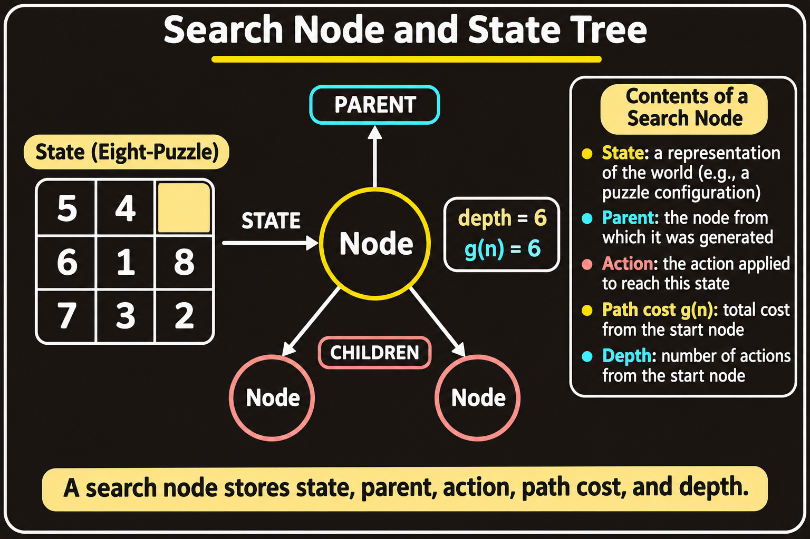
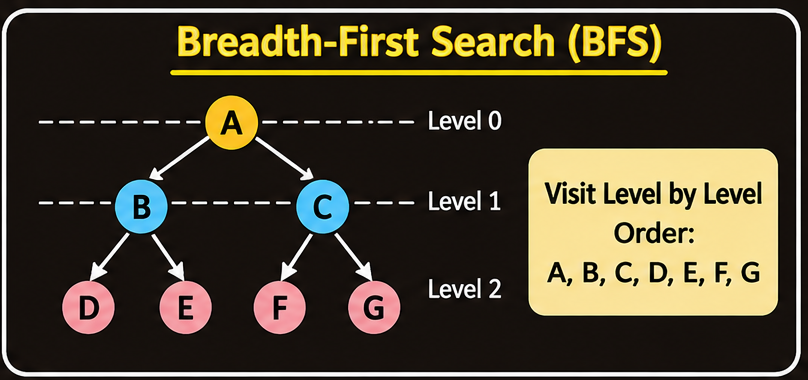
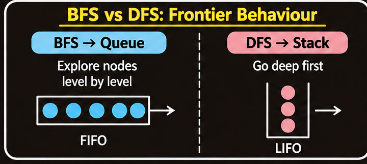
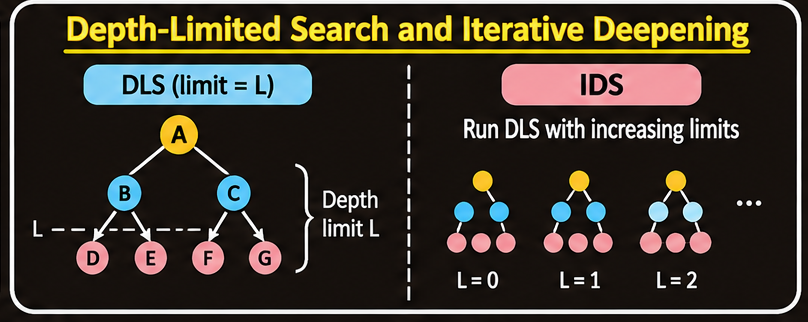
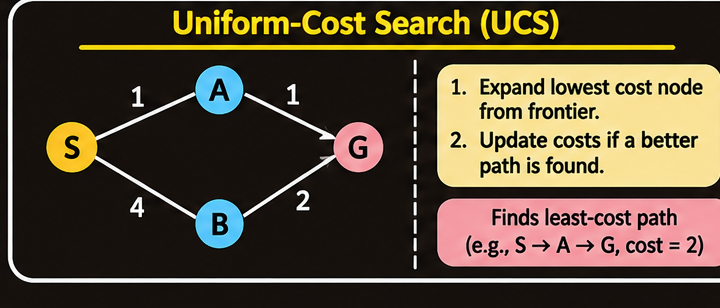
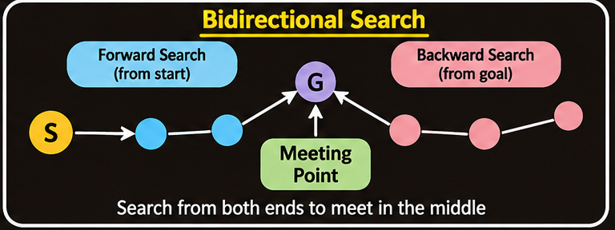

# Uninformed Search

## 1. Overview

An intelligent agent often needs to decide **which sequence of actions will take it from its current situation to a desired goal**. Search is the systematic process of exploring possible actions and the states they produce in order to find such a sequence.

A search algorithm does not necessarily know which direction is promising. In **uninformed search** (also called *blind search*), the algorithm uses only the information contained in the problem definition:

- the initial state;
- the available actions and transition model;
- the goal test; and
- the path cost, when costs are part of the problem.

It does not use a heuristic estimate of how close a state is to the goal. Different uninformed search strategies mainly differ in **which generated node they choose to expand next**.

The central strategies covered in this chapter are:

- Breadth-First Search (BFS);
- Depth-First Search (DFS);
- Depth-Limited Search (DLS);
- Iterative Deepening Search (IDS);
- Uniform-Cost Search (UCS); and
- Bidirectional Search.

Understanding their data structures, guarantees, and complexity helps determine which method is suitable for a particular problem.

## 2. Agents, Environments, and the Motivation for Search

### 2.1 Agents and rational behaviour

An **agent** is anything that perceives its environment through sensors and acts on it using actuators. For example:

- A thermostat senses temperature and controls a heater switch.
- A robot vacuum senses its surroundings using sensors such as a camera or lidar and acts through its wheels and brushes.

An **intelligent agent** can perceive its environment, reason and make decisions, and act to achieve goals. It may also learn from experience. Important properties include:

- **Reactivity:** responding to changes in the environment.
- **Proactiveness:** taking goal-directed action rather than only reacting.
- **Social ability:** interacting with other agents when required.
- **Learning ability:** improving behaviour from experience.

A **rational agent** selects actions that maximize expected performance given what it knows. Rationality does not mean perfection: a rational agent makes the best decision possible with its available information and resources. It should pursue goals efficiently, adapt to new situations, and make sensible decisions under uncertainty.

Rationality provides a measurable objective for AI. It motivates methods such as search (planning paths to goals), reinforcement learning (learning reward-maximizing behaviour), and decision theory (choosing actions under uncertainty).

### 2.2 Types of task environments

An environment can be described along several dimensions. These distinctions affect how an agent must reason and search.

| Dimension | Meaning | Example |
| --- | --- | --- |
| Fully observable | The agent can access the complete state. | Chess, GPS navigation |
| Partially observable | The agent receives incomplete or noisy information. | Poker, autonomous driving |
| Deterministic | An action has a predictable outcome. | Calculator, route planning |
| Stochastic | Action outcomes are uncertain. | Stock trading, weather prediction |
| Episodic | Each decision is independent of other episodes. | Image classification |
| Sequential | Current actions affect future states. | Chess, dialogue systems |
| Static | The environment does not change while the agent thinks. | Crossword puzzle |
| Dynamic | The environment can change over time. | Real-time strategy games |
| Discrete | There are limited, distinct states or actions. | Turn-based games |
| Continuous | States or actions can take values in a continuous range. | Robot movement, video analysis |
| Single-agent | No other agent influences the decision. | Solitaire |
| Multi-agent | Multiple agents interact. | Soccer, auctions |

Search is especially natural when the task can be represented as a sequence of state transitions. It is used in problem solving, natural-language processing, computer vision, machine learning, and motion planning. For example, a route planner searches sequences of roads, while a puzzle solver searches sequences of legal moves.

## 3. Formulating a Search Problem

A search algorithm can only work effectively after the task has been represented precisely.

### 3.1 State-space search terminology

A **state** is a representation of the world at a particular point in time. The collection of states reachable from the initial state by valid actions is the **state space**.

| Term | Meaning |
| --- | --- |
| State | Representation of the world at a particular point in time. |
| Initial state | The agent's starting state before taking any actions. |
| Action | A possible move available in a state. |
| Operator | A formal rule describing how an action changes a state. |
| Transition model | A function specifying the result of applying an action to a state. |
| State space | All states reachable from the initial state through valid actions. |
| Goal test | A function that checks whether a state satisfies the goal condition. |
| Goal state | A state that satisfies the goal test. |
| Path | A sequence of actions (or corresponding states) from the start to a state. |
| Path cost | The cumulative cost of the actions along a path, commonly written $g(n)$. |
| Solution | A path from the initial state to a goal state. |
| Search tree | A tree of search nodes representing the exploration process; it is not necessarily the actual environment. |
| Search node | A record containing a state, parent, action, path cost, and depth. |
| Frontier (open list) | Generated nodes waiting to be expanded. |
| Explored set | States that have already been expanded, used to avoid revisiting them. |

A **search tree** and the underlying **state space** are not identical. A state-space graph describes possible transitions in the problem. A search tree records the paths by which the algorithm reaches states. The same state can appear through more than one path in a search tree unless repeated-state checking prevents it.

Each search node normally stores:

- `STATE`: the represented problem state;
- `PARENT`: the node from which it was generated;
- `ACTION`: the action used to reach it;
- `PATH-COST`: the accumulated cost $g(n)$; and
- `DEPTH`: the number of edges from the root.

The parent links allow the algorithm to reconstruct the solution path after finding a goal.

### 3.2 The four components of problem formulation

A search problem is specified by:

1. **Initial state:** where the agent starts.
2. **Operators/actions:** the legal transitions from each state.
3. **Goal test:** the condition that determines whether the objective has been reached.
4. **Path cost:** the cost accumulated along a sequence of actions.

For a route-finding task, the initial state might be Arad, actions correspond to driving along roads, the goal test checks whether the current city is Bucharest, and path cost may be total road distance.

The route example can be expressed as:

- Goal: be in Bucharest.
- States: cities.
- Operators: drive between connected cities.
- Solution: a sequence of cities such as Arad, Sibiu, Făgăraș, Bucharest, provided each consecutive pair is connected and the final city passes the goal test.

The best solution depends on the path-cost definition. The route with the fewest roads need not be the route with the smallest total distance.

### 3.3 Standard search-problem examples

#### Eight-puzzle

The 8-puzzle contains eight numbered tiles and one blank space on a $3\times3$ board. The task is to reach a specified arrangement by sliding a tile into the blank.

- **State:** the arrangement of all eight tiles and the blank.
- **Initial state:** the supplied starting arrangement.
- **Actions/operators:** move the blank one cell up, down, left, or right, when legal.
- **Goal state:** tiles ordered from 1 to 8, with the blank in the final position.
- **Path cost:** one per move, so total cost equals the number of moves.

The puzzle illustrates why a state must contain enough information to determine which actions are legal and what state each action produces.

#### Towers of Hanoi

The Towers of Hanoi consists of three rods (A, B, and C) and $N$ disks of different sizes. Initially, all disks are stacked on one rod in decreasing size from bottom to top. The goal is to move the complete stack to a target rod.

Rules:

- Move only one disk at a time.
- Only the top disk of a rod can be moved.
- A larger disk must never be placed on a smaller disk.

Its search formulation is:

- **State:** the rod on which each disk is located.
- **Initial state:** all disks are on Pole A.
- **Operators:** move the top disk from one rod to another, subject to the rules.
- **Goal:** all disks are on Pole C in the correct order.
- **Path cost:** one per move.

#### Missionaries and cannibals

Three missionaries and three cannibals must cross a river in a boat that carries one or two people. Cannibals must never outnumber missionaries on either river bank when missionaries are present; the slide also states the safety constraint for the boat.

A state can be represented by the numbers of missionaries and cannibals on the near bank and the boat's location. The initial state has everyone on the near bank. An operator moves a permitted combination of one or two people across the river. The goal is to move everyone to the far bank. Each crossing has cost 1.

This problem shows how constraints restrict the set of legal successor states. A successor that violates a safety constraint must not be generated.

## 4. Graphs and Search Trees

Many search problems are naturally represented using graphs.

### 4.1 Graph terminology

An **undirected graph** is written $G=(V,E)$, where:

- $V$ is the set of vertices (nodes);
- $E$ is the set of edges connecting pairs of vertices.

For example, a graph may have:

$$
V=\{1,2,3,4,5\}
$$

and

$$
E=\{(1,2),(1,4),(1,5),(2,3),(2,4),(3,5)\}.
$$

If $n=|V|$ and $m=|E|$, then $n$ is the number of vertices and $m$ is the number of edges.

For an edge $e=(u,v)$:

- $u$ is a **neighbour** of $v$;
- $u$ and $v$ are **adjacent**;
- the edge is **incident** on both endpoints; and
- $u$ and $v$ are the **endpoints** of the edge.

A **path** is a sequence of vertices $v_1,v_2,\ldots,v_k$ such that every consecutive pair is connected by an edge. In the example graph, $1-4-2$ is a path, while $1-3-4$ is not, because the required consecutive edges do not both exist.

The **distance** between two vertices is the minimum number of edges in any path connecting them. In the example, $\operatorname{distance}(1,2)=1$ and $\operatorname{distance}(1,3)=2$.

A **cycle** is a path that starts and ends at the same vertex, has more than two edges, and does not repeat any of its other vertices. Thus, $1-2-4-1$ is a cycle. A sequence that repeats a vertex before closing, such as $1-2-4-1-5$, is not a cycle under this definition.

The **level** or **depth** of a node is the number of edges on the path from the start node to that node.

An undirected graph is **connected** if every pair of vertices has a path between them. A **tree** is an undirected graph that is connected and contains no cycle.

### 4.2 Search tree versus environment graph

The search process grows a tree from the initial node:

- the root represents the initial state;
- children represent states reached by one legal action;
- each edge represents an action;
- depth counts the number of actions from the root.

The environment may contain cycles and multiple routes to the same state, while a tree has no cycles. The search algorithm therefore needs a policy for repeated states. Graph-search algorithms commonly maintain an explored set and also check whether a generated state is already waiting in the frontier.



*The search node stores more than the state itself: parent and action information allow reconstruction of the path, while depth and path cost support analysis and strategy decisions.*

## 5. The General Uninformed Search Procedure

The general search procedure maintains a **frontier** (also called the open list). The frontier contains generated nodes that have not yet been expanded. The search strategy determines how the next node is selected and how newly generated children are inserted.

A simplified version is:

```text
OPEN ← [initial state]

while OPEN is not empty:
    node ← remove the first node from OPEN

    if GOAL(node):
        return success

    children ← EXPAND(node)
    OPEN ← QUEUE-FUNCTION(OPEN, children)

return failure
```

The `QUEUE-FUNCTION` is the key point of variation:

- FIFO queue: remove the oldest inserted node first (BFS).
- LIFO stack: remove the newest inserted node first (DFS).
- Priority queue: remove the node with the smallest path cost (UCS).

A graph-search implementation additionally tracks an **explored set** to avoid repeatedly expanding states. The algorithm may also check the frontier before inserting a child, preventing duplicate pending entries.

### 5.1 How search strategies are evaluated

Search strategies are compared using several properties:

- **Completeness:** Is the algorithm guaranteed to find a solution whenever one exists?
- **Time complexity:** How many nodes may be generated or expanded?
- **Space complexity:** How much memory may be required at the peak?
- **Optimality:** Does the algorithm return a least-cost solution, or at least a shortest (shallowest) solution?
- **Use of domain knowledge:** Does it use only the problem definition, or does it use additional information such as a heuristic?

Uninformed algorithms do not use heuristic knowledge to estimate distance to the goal. Their decisions are based on depth, insertion order, or accumulated path cost.

## 6. Breadth-First Search (BFS)

### 6.1 Core idea

**Breadth-First Search (BFS)** expands the shallowest unexpanded node first. It explores the search tree level by level:

1. Expand the root.
2. Expand all nodes at depth 1.
3. Expand all nodes at depth 2.
4. Continue until a goal is found or the frontier becomes empty.

BFS uses a **FIFO (First-In, First-Out) queue**. New children are inserted at the end of the queue, and the oldest node is removed from the front.

The branching factor, denoted by $b$, is the maximum number of successors generated from any node. Unless an order is specified, the order in which children are inserted can affect the order of expansion and which equal-depth solution is returned. In tree diagrams, children are commonly considered from left to right.



*BFS finishes shallower levels before expanding deeper nodes; the queue preserves the order in which nodes were discovered.*

### 6.2 Graph-search BFS algorithm

A graph-search version maintains both a frontier and an explored set.

```text
BREADTH-FIRST-SEARCH(problem):
    node ← node(problem.INITIAL-STATE, PATH-COST = 0)

    if GOAL-TEST(node.STATE):
        return SOLUTION(node)

    frontier ← FIFO queue containing node
    explored ← empty set

    loop:
        if frontier is empty:
            return failure

        node ← POP(frontier)       // shallowest node
        add node.STATE to explored

        for each action in ACTIONS(node.STATE):
            child ← CHILD-NODE(node, action)

            if child.STATE is not in explored
               and child.STATE is not in frontier:

                if GOAL-TEST(child.STATE):
                    return SOLUTION(child)

                INSERT(child, frontier)
```

The exact placement of the goal test matters when showing a trace. In the pseudocode above, the goal test is applied to a newly generated child. Therefore, the algorithm can return as soon as it generates a goal at the next shallowest depth, without later expanding other nodes already in the queue at that depth.

### 6.3 Worked trace: the A-to-F graph

Consider the undirected graph with adjacency lists:

| Node | Adjacent nodes |
| --- | --- |
| A | B, C |
| B | A, C, D, E |
| C | A, B, F |
| D | B, E |
| E | B, D, F |
| F | C, E |

Let A be the start and F the goal. Generate neighbours alphabetically, and do not insert a node already in the frontier or explored set.

| Step | Node expanded | Frontier after expansion (front to back) | Explored set |
| --- | --- | --- | --- |
| 1 | A | B, C | A |
| 2 | B | C, D, E | A, B |
| 3 | C | D, E, F | A, B, C |

When C is expanded, F is generated and passes the goal test. The algorithm returns the path:

$$
A\rightarrow C\rightarrow F
$$

The expansion order is A, B, C. Notice that D and E remain in the frontier; they are not expanded because the goal is found first.

### 6.4 Completeness and optimality

BFS is **complete** when the branching factor is finite: if a goal exists at some finite depth, level-by-level expansion eventually reaches it.

BFS returns a **shallowest goal** because it explores nodes in nondecreasing order of depth. If every action has the same cost (for example, every edge costs 1), the shallowest path is also a least-cost path. Under that condition, BFS is optimal.

However, BFS is not generally optimal when action costs differ. For example:

- Path 1: $A\rightarrow C\rightarrow F$, with costs $100+1=101$.
- Path 2: $A\rightarrow B\rightarrow E\rightarrow F$, with costs $1+1+1=3$.

BFS prefers the two-edge path through C because it is shallower, even though its total cost is much higher. For varying positive costs, Uniform-Cost Search is the appropriate uninformed strategy.

### 6.5 Time and space complexity

Let:

- $b$ be the branching factor;
- $d$ be the depth of the shallowest goal.

In the worst case, BFS generates nodes at depths 0 through $d$, and may also generate nodes at depth $d+1$ while expanding nodes at depth $d$. The geometric growth is dominated by the deepest level:

$$
1+b+b^2+\cdots+b^{d+1}=O(b^{d+1}).
$$

Thus:

- **Time:** $O(b^{d+1})$.
- **Space:** $O(b^{d+1})$.

BFS has exponential time and memory growth. It must keep a large frontier in memory, especially when the branching factor or solution depth is large.

The lecture's illustrative resource table makes this growth concrete: as depth increases from 2 to 16, the estimated number of nodes rises from roughly $10^2$ to $10^{16}$, with the associated memory estimate rising from kilobytes to exabytes. The exact runtime and memory depend on implementation and hardware, but the exponential trend is the important lesson.

### 6.6 When BFS is useful

BFS is a good choice when:

- the goal is expected to be shallow;
- all actions have equal cost;
- a shortest path in number of steps is required; and
- the search space is small enough that the frontier fits in memory.

Its main weakness is memory consumption. Even when the goal is not very deep, a large branching factor can make the frontier enormous.

## 7. Depth-First Search (DFS)

### 7.1 Core idea

**Depth-First Search (DFS)** expands the deepest available node first. It follows one branch as far as possible, then backtracks when that branch cannot be continued.

DFS uses a **LIFO (Last-In, First-Out) stack**. New children are pushed onto the top of the stack, and the most recently inserted child is expanded next.

This is the reverse of BFS's queue behaviour:

- BFS uses FIFO and explores broadly, level by level.
- DFS uses LIFO and follows one branch deeply before exploring alternatives.

When neighbours are generated in alphabetical order and pushed one by one onto a LIFO stack, the last inserted neighbour is popped first. Therefore, if the intention is to visit the alphabetically first neighbour first, the implementation must push neighbours in reverse order. Always state whether the given order refers to generation or actual expansion.



*The same search tree can be traversed broadly with a FIFO queue or deeply with a LIFO stack.*

### 7.2 Graph-search DFS algorithm

```text
DEPTH-FIRST-SEARCH(problem):
    node ← MAKE-NODE(problem.INITIAL-STATE)

    if GOAL-TEST(node.STATE):
        return SOLUTION(node)

    frontier ← LIFO stack containing node
    explored ← empty set

    loop:
        if frontier is empty:
            return failure

        node ← POP(frontier)
        add node.STATE to explored

        for each action in ACTIONS(node.STATE):
            child ← CHILD-NODE(node, action)

            if child.STATE is not in explored
               and child is not in frontier:

                if GOAL-TEST(child.STATE):
                    return SOLUTION(child)

                INSERT(child, frontier)
```

As with BFS, the explored set and frontier check prevent unnecessary repeated work in a graph. The returned path is reconstructed using parent links.

### 7.3 Completeness

DFS is **not complete in general** when the search space can contain an infinite-depth branch. Suppose the root has a left branch that continues forever and a right child that is the goal. A left-first DFS can keep following the infinite branch and never reach the goal.

If the search tree is finite and repeated states are handled correctly, DFS will eventually exhaust the tree and find a goal if one exists. The general completeness warning concerns infinite-depth or cyclic search spaces and search implementations without adequate repeated-state handling.

### 7.4 Time and space complexity

Let:

- $b$ be the branching factor;
- $m$ be the maximum depth of the search tree.

In the worst case, DFS may visit the entire search tree:

$$
1+b+b^2+\cdots+b^m=O(b^m).
$$

Its worst-case time complexity is therefore $O(b^m)$.

DFS does not normally keep every generated node in memory. It stores the current path and the unexpanded siblings along that path. This gives a space bound of:

$$
O(bm).
$$

This is much smaller than BFS's exponential frontier in many deep problems. It is why DFS can be practical when memory is the main constraint.

### 7.5 Optimality and limitations

DFS is **not optimal**. It returns the first goal it encounters, which may be deeper or more expensive than another available goal.

For example, if a goal is directly below the root at depth 1 but DFS first follows a left branch to another goal at depth 3, it may return the deeper solution. The first goal encountered is not necessarily the shallowest or least costly.

DFS is useful when:

- memory is limited;
- solutions may be deep;
- any valid solution is acceptable; and
- the search tree is finite or depth is otherwise controlled.

It is risky when a branch may be infinite, when the goal is shallow but in a later branch, or when the shortest/least-cost solution is required.

## 8. Depth-Limited Search (DLS)

### 8.1 Motivation and definition

DFS can become trapped in an infinitely deep branch. **Depth-Limited Search (DLS)** addresses this by imposing a maximum search depth, called the **depth limit** $L$.

DLS behaves like DFS but does not expand nodes at depth $L$. This prevents the search from going deeper than the specified limit.

Inputs:

- initial state;
- goal test;
- depth limit $L$.

Possible outcomes:

- **Solution:** a goal is found at depth $L$ or less.
- **Cutoff:** the search reaches the depth limit while there may still be unexplored successors.
- **Failure:** the search exhausts the reachable part within the limit without encountering a goal or a cutoff.

The distinction between cutoff and failure is important. A cutoff means the limit may have prevented the algorithm from finding a solution; failure means the explored region did not contain a solution and there was no unresolved depth boundary.

### 8.2 Recursive algorithm

```text
DEPTH-LIMITED-SEARCH(problem, limit):
    return RECURSIVE-DLS(
        MAKE-NODE(problem.INITIAL-STATE), problem, limit
    )

RECURSIVE-DLS(node, problem, limit):
    if GOAL-TEST(node.STATE):
        return SOLUTION(node)

    else if limit = 0:
        return cutoff

    else:
        cutoff_occurred ← false

        for each action in ACTIONS(node.STATE):
            child ← CHILD-NODE(node, action)
            result ← RECURSIVE-DLS(child, problem, limit - 1)

            if result = cutoff:
                cutoff_occurred ← true
            else if result is not failure:
                return result

        if cutoff_occurred:
            return cutoff
        else:
            return failure
```

The goal test is performed before the limit check. Therefore, a goal exactly at the limit is accepted. A non-goal node at the limit returns cutoff instead of being expanded.

### 8.3 Properties and choosing a limit

DLS inherits DFS's depth-first behaviour and memory efficiency, but the limit prevents it from descending indefinitely.

- **Completeness:** not complete in general. It can find a solution if the limit is at least the solution depth and the relevant search region is finite with finite branching; a too-small limit can cut off the solution.
- **Optimality:** not optimal in general, because it follows depth-first order and may find a non-shallowest goal within the limit.
- **Time:** $O(b^L)$.
- **Space:** $O(bL)$.

DLS is useful when there is a meaningful upper bound on solution depth. For example, if the solution is known to require no more than 10 moves, set $L=10$ and avoid exploring deeper states.

## 9. Iterative Deepening Search (IDS)

### 9.1 Core idea

**Iterative Deepening Search (IDS)** repeatedly runs DLS with an increasing depth limit:

$$
\operatorname{DLS}(0),\;
\operatorname{DLS}(1),\;
\operatorname{DLS}(2),\;\ldots
$$

It stops when a run returns a solution or a result other than cutoff.

IDS combines two useful properties:

- DFS-like low memory use, because each individual iteration is depth-limited DFS;
- BFS-like completeness and shallow-solution behaviour, because the limit increases one level at a time.

A simplified algorithm is:

```text
ITERATIVE-DEEPENING-SEARCH(problem):
    for depth = 0, 1, 2, ...:
        result ← DEPTH-LIMITED-SEARCH(problem, depth)

        if result is not cutoff:
            return result
```

The algorithm first checks the root, then all nodes up to depth 1, then all nodes up to depth 2, and so on. Earlier levels are revisited in each iteration.

### 9.2 Why repeated work is not too expensive

At first, IDS may seem wasteful because it regenerates shallow nodes many times. However, in a tree with branching factor $b>1$, most nodes are near the deepest level.

If the shallowest goal is at depth $d$:

- nodes at depth 1 are revisited in approximately $d$ iterations;
- nodes at depth 2 are revisited in approximately $d-1$ iterations;
- this repetition decreases with depth;
- nodes at depth $d$ are generated only in the final iteration.

The total number of generated nodes is proportional to:

$$
1\cdot d+b\cdot(d-1)+b^2\cdot(d-2)+\cdots+b^d\cdot1.
$$

The deepest level dominates this sum, so the asymptotic time remains:

$$
O(b^d).
$$

The repeated upper-level work adds only a relatively small factor compared with the number of nodes at the deepest level.

### 9.3 Properties

- **Completeness:** yes, for finite branching when a goal exists at finite depth.
- **Optimality:** yes when all step costs are equal; it finds a shallowest goal. It is not generally least-cost when action costs differ.
- **Time:** $O(b^d)$.
- **Space:** $O(bd)$.

IDS is especially useful when the solution depth is unknown, the search space may be very deep, and memory is limited. It often offers a practical compromise between BFS and DFS.



*DLS explores only to its current limit; IDS gradually raises that limit until it reaches a solution.*

## 10. Uniform-Cost Search (UCS)

### 10.1 Why BFS is not enough for different costs

BFS chooses nodes according to depth. That is appropriate when every action has equal cost, but not when different actions have different costs.

**Uniform-Cost Search (UCS)** expands the node with the smallest accumulated path cost. It therefore uses a **priority queue** rather than a FIFO queue or LIFO stack.

For a node $n$, the path cost is:

$$
g(n)=\sum_{a\in\operatorname{path}(\text{start},n)} c(a),
$$

where $c(a)$ is the cost of an action (or edge). The priority queue orders nodes by increasing $g(n)$.

### 10.2 Graph-search algorithm

```text
UNIFORM-COST-SEARCH(problem):
    node ← MAKE-NODE(problem.INITIAL-STATE)
    node.PATH-COST ← 0

    frontier ← priority queue ordered by PATH-COST
    INSERT(node, frontier)
    explored ← empty set

    loop:
        if frontier is empty:
            return failure

        node ← POP(frontier)   // lowest path cost

        if GOAL-TEST(node.STATE):
            return SOLUTION(node)

        add node.STATE to explored

        for each action in ACTIONS(node.STATE):
            child ← CHILD-NODE(node, action)

            if child.STATE is not in explored
               and child.STATE is not in frontier:
                INSERT(child, frontier)

            else if child.STATE is in frontier
                    with higher PATH-COST:
                replace that frontier entry with child
```

The replacement rule is essential. A state may first be discovered by an expensive route and later by a cheaper one. The priority queue must retain the cheaper path.

The goal test is applied when a node is removed from the priority queue, not merely when it is generated. This is what supports UCS's least-cost guarantee under the usual positive-cost assumptions.

### 10.3 Worked example: the S-to-G graph

Consider an undirected weighted graph with the following edge costs:

| Edge | Cost |
| --- | ---: |
| S–A | 1 |
| A–G | 10 |
| S–B | 5 |
| B–G | 5 |
| S–C | 15 |
| C–G | 5 |

Start at S and search for G. The priority queue is ordered by path cost $g(n)$.

1. Remove S with cost 0. Insert A(1), B(5), and C(15).
2. Remove A(1). The path S–A–G gives G cost $1+10=11$. Insert G(11).
3. Remove B(5). The path S–B–G gives G cost $5+5=10$. Replace the frontier entry G(11) with G(10).
4. Remove G(10). Since G is now the lowest-cost node removed from the priority queue and it passes the goal test, terminate.

The returned path is:

$$
S\rightarrow B\rightarrow G
$$

with total path cost:

$$
5+5=\boxed{10}.
$$

The path S–A–G has only two edges as well, but costs 11. UCS selects the cheaper route.



*The key UCS operation is replacing an existing frontier path when a lower accumulated cost is discovered.*

### 10.4 Completeness and optimality

UCS is complete and optimal under the standard condition that every step cost is bounded below by a positive constant $\varepsilon>0$.

The first goal **removed from the priority queue** has minimum path cost. If a cheaper goal path existed, some node on that path with cost below the selected goal would have had to be removed first, causing the cheaper route to be considered before the more expensive goal.

If all edge costs are equal and positive, UCS expands nodes in increasing depth order and behaves like BFS (apart from tie-breaking details).

UCS can use substantial time and memory. It may expand many low-cost paths before reaching a goal whose path contains fewer but more expensive edges.

### 10.5 Complexity

Let:

- $b$ be the branching factor;
- $C^*$ be the cost of an optimal solution;
- $\varepsilon$ be the minimum positive step cost.

UCS may expand all nodes whose path cost is less than or equal to $C^*$. Since each step costs at least $\varepsilon$, a path of cost at most $C^*$ can contain at most approximately $C^*/\varepsilon$ steps. The usual worst-case bound is exponential in this ratio, commonly written:

$$
O\left(b^{1+\lfloor C^*/\varepsilon\rfloor}\right).
$$

The lecture summarizes the growth as $O(b^{C^*/\varepsilon})$. The additional constant/exponent offset in the more explicit bound depends on how generated nodes and the frontier boundary are counted; both expressions communicate the key point that UCS can be exponential in the optimal solution cost measured in minimum-step-cost units.

The space requirement has the same exponential order because UCS stores the frontier and explored states.

## 11. Bidirectional Search

### 11.1 Core idea

**Bidirectional Search** runs two searches simultaneously:

- a forward search from the initial state;
- a backward search from the goal state.

The searches proceed until their frontiers meet at a common state. The complete solution is formed by joining the path from the start to the meeting state with the reversed path from the goal to that meeting state.

The lecture's diagram depicts two expanding search trees: one rooted at `Start` and one rooted at `Goal`. Instead of one search tree growing to depth $d$, each search may only need to grow to roughly depth $d/2$.



*The final route is assembled from the forward path to the meeting state and the backward path from that state to the goal.*

For branching factor $b$ and solution depth $d$, a typical comparison is:

- one-directional BFS: $O(b^d)$;
- bidirectional BFS: approximately $O(b^{d/2})$ work from each direction, giving an exponential reduction when the assumptions are satisfied.

### 11.2 Requirements and challenges

Bidirectional search is not automatically applicable to every problem. It requires:

1. A clearly defined goal state (or a manageable representation of goal states).
2. A way to generate predecessor states for backward expansion.
3. A reliable test for whether the two frontiers have intersected.
4. A method to join the two partial paths correctly.

**Backward search:** To expand backward, the algorithm must generate the predecessors of a state. If every action is reversible, predecessor generation is straightforward and may coincide with successor generation. Otherwise, computing predecessors can be difficult.

**Goal representation:**

- For a single goal state, such as a particular 8-puzzle arrangement or a destination city on a map, backward search is relatively direct.
- For multiple goal states, one can introduce a dummy goal connected to all goal states, or otherwise initialize the backward search from the complete goal set.
- If the goal is a condition rather than one explicit state (for example, “no queen attacks another” in N-Queens), identifying all goal states or their predecessors can be difficult.

### 11.3 When it is useful

Bidirectional search can be very effective when the start and goal are both known, backward transitions can be generated efficiently, and the two search frontiers can be checked for intersection. It is less suitable when there are many implicit goal states or when predecessor generation is difficult.

The $O(b^{d/2})$ advantage is a typical idealized bound, not an unconditional guarantee. The two directions must be coordinated correctly, and the stopping rule must preserve the desired solution guarantee.

## 12. Comparing Uninformed Search Strategies

The following table summarizes the main properties. Here, $b$ is the branching factor, $d$ is the depth of the shallowest solution, $m$ is the maximum search-tree depth, $L$ is the DLS depth limit, $C^*$ is the optimal solution cost, and $\varepsilon$ is the minimum positive step cost.

| Strategy | Frontier structure | Complete? | Optimal? | Time | Space |
| --- | --- | --- | --- | --- | --- |
| BFS | FIFO queue | Yes, for finite branching | Yes, if all step costs are equal | $O(b^{d+1})$ | $O(b^{d+1})$ |
| DFS | LIFO stack | No, in general | No | $O(b^m)$ | $O(bm)$ |
| DLS | Depth-limited DFS | No, in general | No | $O(b^L)$ | $O(bL)$ |
| IDS | Repeated depth-limited DFS | Yes, for finite branching | Yes, if all step costs are equal | $O(b^d)$ | $O(bd)$ |
| UCS | Priority queue by $g(n)$ | Yes, if step costs are at least $\varepsilon>0$ | Yes, under the same positive-cost condition | Exponential in $C^*/\varepsilon$ | Exponential in $C^*/\varepsilon$ |
| Bidirectional BFS | Two frontiers, typically queues | Under suitable conditions | Yes for unit-cost BFS in both directions with a correct meeting rule | Approximately $O(b^{d/2})$ | Approximately $O(b^{d/2})$ |

### 12.1 BFS versus DFS

**BFS tends to outperform DFS when:**

- the goal is shallow;
- the shortest path in number of steps is required;
- the branching factor and search space are manageable; and
- enough memory is available for the frontier.

**DFS tends to outperform BFS when:**

- memory is limited;
- a solution may be deep;
- any valid solution is acceptable; and
- the search space is finite or depth is controlled.

DFS may find a deep solution quickly if it happens to follow the right branch, but this is not guaranteed. BFS has a stronger shallow-solution guarantee but can run out of memory.

### 12.2 Choosing between DLS and IDS

Use DLS when a meaningful depth bound is known. It prevents exploration beyond that bound, but choosing a limit that is too small can hide a solution.

Use IDS when the solution depth is unknown. It tests progressively deeper limits, preserving DFS-like memory use while obtaining BFS-like completeness and shallowest-solution behaviour for equal step costs.

### 12.3 Choosing UCS instead of BFS

Use BFS when all actions have equal cost and the objective is the fewest actions. Use UCS when actions have different costs and the objective is minimum total path cost.

The distinction is:

- BFS prioritizes **depth**.
- UCS prioritizes **accumulated cost** $g(n)$.

A path with fewer edges may be more expensive than a path with more edges. UCS handles that difference; BFS does not.

## 13. Limitations of Uninformed Search

Uninformed search treats states without heuristic guidance about their closeness to the goal. This creates several limitations:

| Limitation | Explanation |
| --- | --- |
| Wasted exploration | BFS may expand many nodes at depth $d$ even when the goal lies close along one branch. |
| High memory use | BFS stores a large frontier, which can grow exponentially. |
| Blind exploration | DFS may continue deeply in an unhelpful branch and delay or miss a goal. |
| No goal-directed prioritization | Except for accumulated path cost in UCS, the methods do not estimate which state is closer to the goal. |

The common theme is that uninformed strategies have no heuristic estimate of future progress. They may therefore spend substantial resources exploring states that do not contribute to a useful solution.

## 14. Key Takeaways

- Search turns goal-directed behaviour into a systematic exploration of states and actions.
- A well-formulated search problem specifies the initial state, legal operators, goal test, and path cost.
- The frontier contains generated nodes waiting for expansion; the explored set records states already expanded.
- Search strategies differ mainly in how they choose the next frontier node.
- BFS expands shallowest nodes first. It is complete and finds a shortest path when all step costs are equal, but it can require exponential memory.
- DFS follows one branch deeply. It is memory-efficient but is not generally complete or optimal.
- DLS prevents DFS from exceeding a chosen depth, distinguishing cutoff from failure.
- IDS increases the depth limit gradually, combining BFS-like completeness and shallow-solution behaviour with DFS-like space use.
- UCS expands the lowest accumulated path cost first and is optimal under positive step-cost assumptions.
- Bidirectional search can reduce the effective search depth when backward expansion and goal representation are manageable.
- Uninformed search can waste effort because it has no heuristic estimate of how promising a state is.

## 15. Practice Questions from the Lecture

Use these questions to practise maintaining the frontier and explored set, drawing search trees, and reasoning about solution guarantees.

1. **BFS on the A–F graph:** Start at A and search for F. Generate neighbours alphabetically. After each expansion, show the FIFO frontier and explored set. Draw the BFS search tree, write the expansion order, and give the returned path.
2. **BFS on the state-space graph:** Use the undirected unit-cost graph with vertices $a,b,c,d,e,f,g$ shown in the lecture. Start at $a$, search for $g$, and generate successors alphabetically. Use graph-search BFS, avoiding insertion of a state already in the frontier or explored set. Show the frontier and explored set after every expansion, draw the search tree, state the expansion order and solution path, and justify completeness and optimality.
3. **DFS on the A–F graph:** Start at A and search for F using a LIFO stack. State precisely how neighbour generation order maps to stack insertion order. Show the frontier and explored set after each expansion, draw the search tree, give the expansion order, and report the returned path.
4. **UCS on the weighted S–G graph:** Use a priority queue ordered by $g(n)$ and alphabetical tie-breaking. Show the queue and explored set after each iteration, identify the node removed at each step, record any replacement by a cheaper path, and give the final path and total cost.
5. Explain why BFS is optimal for equal edge costs but not for arbitrary edge costs.
6. Give an example of an infinite branch that causes DFS to miss a reachable goal.
7. Explain the difference between `cutoff` and `failure` in DLS.
8. Explain why IDS can revisit upper-level nodes without losing its $O(b^d)$ time bound.
9. State the condition under which UCS is complete and optimal.
10. Identify the main requirements that make bidirectional search practical, and explain why backward search may be difficult.


