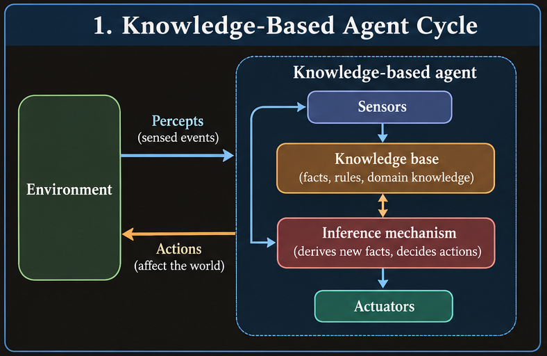
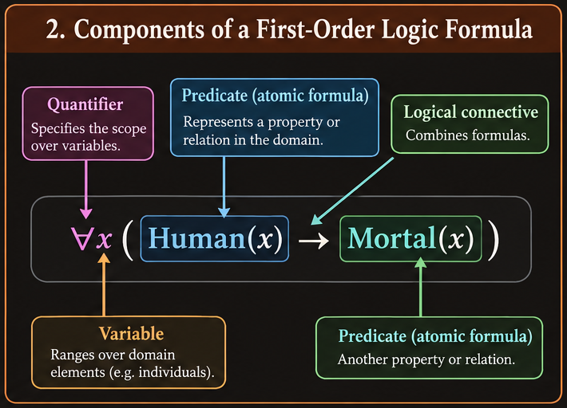
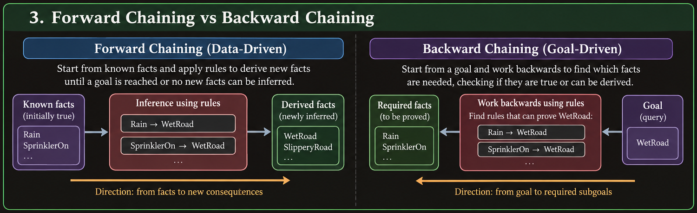

# Knowledge Representation

## 1. Why knowledge representation matters

An intelligent agent senses its environment, interprets what it perceives, decides what to do, and acts. Knowledge supports the decision: without relevant facts and rules, an agent may be able to search through possible actions but cannot reliably choose an appropriate one.

**Knowledge representation (KR)** is the way information about the world is encoded so an agent can use it. The objective is not merely to store data. A useful representation supports **inference**: deriving information that was not explicitly stored but follows from what is known.

For example:

- Fact: All humans are mortal.
- Fact: Socrates is human.
- Inference: Socrates is mortal.

Search and KR solve related but different problems. A maze solver may mainly need to search states and paths. A medical assistant also needs domain knowledge about symptoms, diseases, and treatments. Knowledge-based reasoning can guide search, explain conclusions, and help select actions.

A knowledge-based agent typically has:

1. **A knowledge base (KB):** stored sentences representing facts and rules.
2. **A representation language:** syntax for expressing those sentences precisely.
3. **An inference mechanism:** procedures that derive consequences from the KB.
4. **Perception and action mechanisms:** interfaces through which the agent receives information and affects its environment.

*Planned visual: show percepts entering an agent, the KB supplying facts and rules to an inference component, and the selected action returning to the environment.*

A formal language is useful because natural language can be ambiguous. For instance, “John is tall” can be represented as `Tall(John)`. The representation is the stored symbol or formula; its **interpretation** assigns meaning to that symbol in a world. The inference mechanism then uses the representation to reach conclusions. A language without a way to reason over it is insufficient, and an inference mechanism without knowledge has nothing meaningful to process.

## 2. Knowledge bases, syntax, and semantics

A **knowledge base** is a collection of sentences in a formal language. Sentences must obey the language's syntax to be well-formed.

- **Syntax** concerns form: whether an expression follows the construction rules.
- **Semantics** concerns meaning: what an expression says and whether it is true under an interpretation.
- A **model** or interpretation specifies a possible world and assigns meanings or truth values to its symbols.

For example, `x + y = 4` is syntactically well-formed. Under an interpretation where `x = 2` and `y = 2`, it is true; where `x = 1` and `y = 1`, it is false. A well-formed sentence is not necessarily true.

In classical propositional logic, every proposition under a given interpretation is either true or false. This is a simplifying assumption: real-world agents may have incomplete or uncertain information, but classical logic itself does not assign a third “unknown” truth value.

The distinction between syntax and semantics is essential. A string may be grammatically valid without describing the actual world, and a system must not confuse “the formula is well-formed” with “the formula is true.”

## 3. Propositional logic

**Propositional logic (PL)** represents complete statements that have truth values. A proposition must be sufficiently definite to be true or false. “It is raining” can be a proposition; a vague statement such as “It is raining heavily” may require a defined threshold before it can be evaluated precisely.

An **atomic proposition** is represented by a symbol such as `P`, `Q`, or `R`. For example:

- `P`: It is raining.
- `Q`: The ground is wet.
- `R`: The road is slippery.

Compound propositions are built using logical connectives.

### 3.1 Logical connectives

| Symbol | Name | Meaning | True when |
| --- | --- | --- | --- |
| `¬P` | Negation | Not P | P is false |
| `P ∧ Q` | Conjunction | P and Q | Both P and Q are true |
| `P ∨ Q` | Disjunction | P or Q | At least one is true; inclusive OR |
| `P → Q` | Implication | If P, then Q | False only when P is true and Q is false |
| `P ↔ Q` | Biconditional | P if and only if Q | P and Q have the same truth value |

The truth table for the principal connectives is:

| P | Q | `¬P` | `P ∧ Q` | `P ∨ Q` | `P → Q` | `P ↔ Q` |
| --- | --- | --- | --- | --- | --- | --- |
| T | T | F | T | T | T | T |
| T | F | F | F | T | F | F |
| F | T | T | F | T | T | F |
| F | F | T | F | F | T | T |

**Implication deserves special care.** `P → Q` rules out exactly one case: P holds while Q does not. If P is false, the implication is true in classical logic. This is called *vacuous truth*; it does not mean P caused Q. The formula is equivalent to `¬P ∨ Q`.

If “it rains” implies “the roads are wet,” that does not establish the converse. Roads may be wet because of sprinklers or cleaning. The **converse** `Q → P` is not generally equivalent to `P → Q`.

The biconditional means both directions hold:

$$
P \leftrightarrow Q \equiv (P \rightarrow Q) \land (Q \rightarrow P)
$$

### 3.2 Syntax and well-formed formulas

A **well-formed formula (WFF)** is constructed according to the grammar of the logic. Proposition symbols are sentences; if `P` and `Q` are sentences, then expressions such as `¬P`, `P ∧ Q`, and `(P ∨ Q) → R` are also sentences.

Parentheses determine grouping. For example:

- `(P ∧ Q) ∨ R` means “P and Q, or R.”
- `P ∧ (Q ∨ R)` means “P, and either Q or R.”

These are not equivalent in general. Parentheses should be used whenever they remove ambiguity.

The lecture gives this precedence order, from highest to lowest:

1. `¬` (NOT)
2. `∧` (AND)
3. `∨` (OR)
4. `→` (implication)
5. `↔` (biconditional)

Implication and biconditional are commonly treated as right-associative in the lecture's convention; use parentheses rather than relying on precedence when an expression is complicated.

### 3.3 Translating English into propositional logic

The first step is to assign a clear proposition symbol to each simple statement. Then translate the relationship between those statements.

Examples:

- “It is raining and the ground is wet”: `P ∧ Q`.
- “It is not raining”: `¬P`.
- “If it rains, the ground is wet”: `P → Q`.
- “The light is on if and only if the switch is up”: `L ↔ S`.
- “Either I take the bus or the train, or both”: `B ∨ T`.

Watch for the difference between “P only if Q” and “P if Q”:

- “P only if Q” means `P → Q`.
- “P if Q” means `Q → P`.
- “P if and only if Q” means `P ↔ Q`.

Propositional logic treats each atomic sentence as a whole. It cannot directly express internal structure such as “every student studies” or “Alice likes Bob.” First-order logic addresses this limitation.

## 4. Truth tables, equivalence, and normal forms

### 4.1 Truth-table evaluation

A truth table lists every possible truth assignment to the atomic propositions and evaluates the compound formula in each row. With `n` independent proposition symbols, there are `2^n` assignments.

To evaluate a formula:

1. List all truth assignments.
2. Compute the smallest subexpressions first.
3. Apply the connective definitions.
4. Read the final column.

Truth tables can determine whether a formula is always true, sometimes true, or never true, and whether two formulas have the same truth value in every interpretation.

### 4.2 Tautology, contradiction, and satisfiability

- A **tautology** is true under every interpretation, such as `P ∨ ¬P`.
- A **contradiction** is false under every interpretation, such as `P ∧ ¬P`.
- A formula is **satisfiable** if it is true under at least one interpretation.
- A formula is **unsatisfiable** if no interpretation makes it true.

A sentence can be satisfiable without being a tautology. For example, `P ∧ Q` is true when both P and Q are true, but false under other assignments.

### 4.3 Logical equivalence

Two formulas are **logically equivalent** when they have the same truth value under every interpretation. Equivalence is written `α ≡ β`. It can be checked by comparing truth-table columns or by applying equivalence laws.

Important laws include:

| Law | Equivalence |
| --- | --- |
| Double negation | `¬¬P ≡ P` |
| Idempotence | `P ∧ P ≡ P`; `P ∨ P ≡ P` |
| Commutativity | `P ∧ Q ≡ Q ∧ P`; `P ∨ Q ≡ Q ∨ P` |
| Associativity | `(P ∧ Q) ∧ R ≡ P ∧ (Q ∧ R)`; similarly for `∨` |
| Distributivity | `P ∧ (Q ∨ R) ≡ (P ∧ Q) ∨ (P ∧ R)` |
| Distributivity | `P ∨ (Q ∧ R) ≡ (P ∨ Q) ∧ (P ∨ R)` |
| De Morgan | `¬(P ∧ Q) ≡ ¬P ∨ ¬Q` |
| De Morgan | `¬(P ∨ Q) ≡ ¬P ∧ ¬Q` |
| Implication | `P → Q ≡ ¬P ∨ Q` |
| Biconditional | `P ↔ Q ≡ (P → Q) ∧ (Q → P)` |

For implications, distinguish the related forms:

- Original: `P → Q`.
- Converse: `Q → P`.
- Inverse: `¬P → ¬Q`.
- Contrapositive: `¬Q → ¬P`.

The original and contrapositive are equivalent. The converse and inverse are equivalent to each other, but are not generally equivalent to the original implication.

### 4.4 Conjunctive and disjunctive normal forms

A **literal** is a proposition or its negation. A **clause** is a disjunction of literals.

- **Conjunctive normal form (CNF):** a conjunction (AND) of clauses, where each clause is an OR of literals. Example: `(P ∨ ¬Q) ∧ (R ∨ Q)`.
- **Disjunctive normal form (DNF):** a disjunction (OR) of terms, where each term is an AND of literals. Example: `(P ∧ Q) ∨ (¬P ∧ R)`.

CNF is particularly useful for resolution and SAT algorithms. DNF can make satisfying cases explicit. To convert a formula into CNF, a common procedure is:

1. Eliminate biconditionals and implications.
2. Push negations inward using De Morgan's laws and double negation.
3. Distribute OR over AND until the formula is a conjunction of clauses.
4. Simplify duplicate or redundant literals where possible.

For example:

$$
P \rightarrow Q \equiv \neg P \lor Q
$$

The formula `¬(P ∧ Q)` becomes `¬P ∨ ¬Q`; the formula `¬(P ∨ Q)` becomes `¬P ∧ ¬Q`.

## 5. Models, entailment, and arguments

A **model** is an interpretation under which a sentence or set of sentences is true. Let `M(α)` denote the set of models in which formula `α` is true.

A knowledge base `KB` **entails** a sentence `α`, written

$$
KB \models \alpha
$$

when every model that satisfies the KB also satisfies `α`. Entailment is semantic: it describes what follows in all possible worlds consistent with the premises. If even one model satisfies the KB while making `α` false, the entailment does not hold.

Entailment differs from syntactic derivation. The notation `KB ⊢ α` means that a proof procedure derives `α` from the KB using specified inference rules. A good inference system aims to align derivability with entailment.

An **argument** consists of premises and a conclusion. An argument is valid if, whenever all premises are true, the conclusion must also be true. Validity does not guarantee that the premises are factually true.

Example:

1. All humans are mortal.
2. Socrates is human.
3. Therefore, Socrates is mortal.

The reasoning form is valid; whether an argument is sound additionally requires its premises to be true.

## 6. Inference in propositional logic

Inference is the process of deriving conclusions from facts and rules. A knowledge-based agent uses inference to answer queries or choose actions.

### 6.1 Core inference rules

| Rule | Form | Meaning |
| --- | --- | --- |
| Modus ponens | `P`, `P → Q` ⟹ `Q` | If P is true and P implies Q, conclude Q |
| Modus tollens | `P → Q`, `¬Q` ⟹ `¬P` | If Q is false, P cannot hold under the rule |
| And introduction | `P`, `Q` ⟹ `P ∧ Q` | Combine known facts |
| And elimination | `P ∧ Q` ⟹ `P` (or `Q`) | Extract a conjunct |
| Or introduction | `P` ⟹ `P ∨ Q` | A true disjunct makes the OR true |
| Hypothetical syllogism | `P → Q`, `Q → R` ⟹ `P → R` | Chain implications |
| Resolution | `P ∨ A`, `¬P ∨ B` ⟹ `A ∨ B` | Eliminate complementary literals |

For example, if the KB contains `July → Rain` and `July`, modus ponens derives `Rain`. If it also contains `Rain → WetRoad`, another application derives `WetRoad`.

### 6.2 Soundness and completeness

An inference procedure is **sound** if it derives only conclusions that logically follow from the KB:

$$
KB \vdash \alpha \;\Rightarrow\; KB \models \alpha
$$

It is **complete** if it can derive every sentence that logically follows from the KB:

$$
KB \models \alpha \;\Rightarrow\; KB \vdash \alpha
$$

Soundness prevents unjustified conclusions. Completeness ensures that no entailed conclusion is missed by the procedure, within the logic and proof system being considered.

### 6.3 Truth-table enumeration

Truth-table enumeration tests every possible interpretation and checks whether the KB entails a query.

1. Enumerate all assignments to the proposition symbols.
2. Identify rows where every KB sentence is true.
3. Check whether the query is true in all such rows.
4. If a KB-true row makes the query false, entailment fails; otherwise it holds.

This method is conceptually straightforward and sound and complete for propositional entailment. Its cost grows exponentially: `n` proposition symbols require `2^n` rows, so exhaustive enumeration quickly becomes impractical.

### 6.4 Natural deduction

Natural deduction builds a proof as a sequence of steps, each justified by a premise or inference rule. It can be more compact than a truth table when only a few rules are needed.

A proof should clearly identify the premises, the rule applied at each step, and the conclusion. The lecture's examples emphasize deriving a target statement from the KB by chaining implications and applying rules such as modus ponens.

### 6.5 Resolution and refutation

**Resolution** is an inference rule especially suited to formulas in clause form. Given clauses containing complementary literals, combine them while removing that pair:

$$
(A \lor P),\;(B \lor \neg P)\;\Rightarrow\;(A \lor B)
$$

The result is called a **resolvent**.

To prove that `KB ⊨ α` by **resolution refutation**:

1. Convert every KB sentence to CNF.
2. Add the negation `¬α` of the query.
3. Convert that negated query to clauses.
4. Repeatedly resolve pairs of clauses.
5. If the empty clause `□` is derived, the augmented set is inconsistent. Therefore, `KB ∧ ¬α` is unsatisfiable and `KB ⊨ α`.
6. If no new clauses can be produced and no contradiction is found, the procedure has not established the entailment.

The empty clause represents a contradiction: it contains no literal that could make it true.

A lecture example describes a unicorn using propositions such as `M` (mythical), `I` (immortal), `Mammal`, and `Horned`. Its rules can be formalized as `M → I`, `¬M → Mammal`, and `(I ∨ Mammal) → Horned`. Converting these rules to clauses and deriving `Horned` demonstrates how a conclusion can follow from several conditional statements.

### 6.6 Monotonicity

Classical propositional logic is **monotonic**: adding premises cannot invalidate a conclusion already entailed by the original KB. If `KB ⊨ α`, then `KB ∪ Δ ⊨ α` for any additional set of premises `Δ`.

This property follows from the model definition: adding premises can only remove models, not create a model that was previously excluded. Non-monotonic systems, used in some forms of commonsense reasoning, can retract conclusions when new information arrives.

## 7. Why propositional logic is limited

Propositional logic treats each proposition as an indivisible unit. It cannot directly express that many objects share a property or that two objects stand in a relation. For example, encoding “Alice is a student,” “Bob is a student,” and “Carol is a student” as unrelated atoms does not express the general rule “all students study.”

**First-order logic (FOL)** extends propositional logic with objects, predicates, functions, variables, and quantifiers. This makes it possible to express general rules compactly and apply them to individual objects.

## 8. First-order logic

### 8.1 Components and terms

- **Constants** name particular objects, such as `Alice`, `John`, or `Nono`.
- **Variables** such as `x`, `y`, and `z` range over objects in the domain.
- **Predicates** express properties or relations. `Red(ball1)` says that `ball1` is red; `Loves(Alice, Bob)` expresses a relation between two objects.
- **Function symbols** map objects to objects. For example, `MotherOf(Alice)` denotes an object.
- **Terms** are expressions that denote objects: constants, variables, or functions applied to terms.
- An **atomic sentence** is a predicate applied to the appropriate number of terms, such as `Dog(Tommy)` or `Loves(x, y)`.
- A **literal** is an atomic sentence or its negation.
- Logical connectives combine formulas as in propositional logic.

Predicates have arity: `Student(x)` is unary, while `Loves(x, y)` is binary. The number and types of arguments must be used consistently.

*Planned visual: use a labeled syntax tree for a formula such as `∀x (Student(x) → Studies(x))`, identifying the quantifier, variable, predicates, arguments, and connective.*

### 8.2 Quantifiers

FOL has two central quantifiers:

- **Universal quantifier** `∀x`: “for every x.”
- **Existential quantifier** `∃x`: “there exists at least one x.”

Examples:

$$
\forall x\;(Human(x) \rightarrow Mortal(x))
$$

This means every object that is human is mortal. The implication is important: it does not say every object in the domain is human.

$$
\exists x\;(Student(x) \land Intelligent(x))
$$

This means at least one object is both a student and intelligent. The conjunction is important because the same object must satisfy both predicates.

Typical translations:

- “All mammals drink milk”: `∀x (Mammal(x) → DrinksMilk(x))`.
- “Some student passed”: `∃x (Student(x) ∧ Passed(x))`.
- “No cats are reptiles”: `∀x (Cat(x) → ¬Reptile(x))`, equivalently `¬∃x (Cat(x) ∧ Reptile(x))`.
- “Every student likes some book”: `∀x (Student(x) → ∃y (Book(y) ∧ Likes(x, y)))`.

### 8.3 Quantifier scope and order

The scope of a quantifier is the formula it governs. Parentheses make that scope explicit.

Quantifier order can change meaning:

- `∀x ∃y Likes(x, y)`: every person likes at least one thing; the thing may differ for each person.
- `∃y ∀x Likes(x, y)`: there is one thing that everyone likes.

These are not equivalent. A common translation error is to use the same quantifier order for statements that imply different dependencies.

Negation moves across quantifiers by changing the quantifier:

$$
\neg \forall x\;P(x) \equiv \exists x\;\neg P(x)
$$

$$
\neg \exists x\;P(x) \equiv \forall x\;\neg P(x)
$$

In words, “not everyone has property P” means someone lacks P; “there does not exist an object with P” means every object lacks P.

### 8.4 Free and bound variables

A variable occurrence is **bound** if it lies within the scope of a quantifier for that variable. Otherwise, it is **free**. A sentence with no free variables is a closed formula and can be assigned a truth value under an interpretation. For example, `∀x Student(x)` binds `x`; `Student(x)` leaves `x` free.

Before applying inference rules or substituting terms, check variable scope. Reusing a variable name carelessly can accidentally change which quantifier binds an occurrence.

## 9. FOL inference: substitution, unification, and generalized modus ponens

### 9.1 Substitution and grounding

A **substitution** maps variables to terms. For example, `{x/Alice}` changes `Student(x)` to `Student(Alice)`. Applying a substitution is often written `SUBST(θ, α)`.

A formula is **ground** if it contains no variables. `Student(Alice)` is ground; `Student(x)` is not. Ground instances can be treated like propositional statements, but function symbols can generate infinitely many ground terms, such as `A`, `F(A)`, `F(F(A))`, and so on. This is one reason unrestricted grounding is not generally a practical inference method.

Universal statements can be instantiated for particular objects. From `∀x (Human(x) → Mortal(x))`, instantiate `x = Socrates` to obtain `Human(Socrates) → Mortal(Socrates)`.

Existential statements require care. From `∃x Student(x)`, one may introduce a **new witness constant** for the existentially guaranteed object in a proof procedure. The new name must not be treated as a previously known individual unless the premises justify that identification.

### 9.2 Unification

**Unification** finds a substitution that makes two expressions identical. It is central to FOL inference because a rule with variables must be matched to known facts.

Example:

- Pattern: `Knows(x, MotherOf(x))`
- Fact: `Knows(Alice, MotherOf(Alice))`
- Unifier: `{x/Alice}`

A substitution should be applied consistently to all occurrences of a variable. A unifier must not assign a variable a term containing that same variable in a way that creates an impossible infinite expression (the **occurs check**). For instance, unifying `x` with `F(x)` fails in standard first-order unification.

If two clauses reuse variable names independently, **standardize them apart** first by renaming variables so they are distinct. This avoids accidental variable capture or false dependencies.

A **most general unifier (MGU)** is a unifier that makes the expressions match without imposing more specific substitutions than necessary. It allows later inference steps to retain as much generality as possible.

### 9.3 Generalized modus ponens

Generalized modus ponens (GMP) extends modus ponens to rules with variables and multiple premises. If the KB contains a rule

$$
P_1' \land P_2' \land \cdots \land P_n' \rightarrow Q'
$$

and facts `P1, …, Pn` that can be unified with the rule's premises using one consistent substitution `θ`, then infer `SUBST(θ, Q')`.

For example:

- Rule: `Student(x) ∧ Studies(x) → Pass(x)`.
- Facts: `Student(Alice)` and `Studies(Alice)`.
- Substitution: `{x/Alice}`.
- Conclusion: `Pass(Alice)`.

The same substitution must make all rule premises match. Matching only one premise is not sufficient.

### 9.4 Horn clauses

A **Horn clause** is a disjunction of literals with at most one positive (unnegated) literal. Definite Horn clauses have exactly one positive literal and can be written as rules, for example:

`¬Student(x) ∨ ¬Studies(x) ∨ Pass(x)`

equivalent to:

`Student(x) ∧ Studies(x) → Pass(x)`.

Horn clauses are important because they support efficient rule-based inference. A fact is a clause with one positive literal and no premises; a rule with a positive conclusion is a definite clause. Goals or queries can be represented as atoms to be proved.

## 10. Propositional satisfiability and DPLL

The **DPLL algorithm** is a backtracking procedure for deciding satisfiability of a propositional formula in CNF. It improves on naive enumeration by simplifying the clause set before branching.

Its main ideas are:

1. **Unit propagation:** if a clause has one unassigned literal, that literal must be true for the clause to be satisfied. Assign it and simplify the remaining clauses.
2. **Pure-literal elimination:** if a proposition appears only positively or only negatively in all remaining clauses, assign it the polarity that satisfies those occurrences.
3. **Branching:** if simplification does not decide the formula, choose an unassigned proposition, try one truth value, and backtrack if it leads to contradiction.
4. **Termination:** an empty clause means contradiction on that branch; no remaining clauses means all clauses are satisfied.

For example, in `(P) ∧ (¬P ∨ Q)`, the unit clause forces `P = true`. The second clause then forces `Q = true`. In contrast, `(P) ∧ (¬P)` immediately contains contradictory unit clauses and is unsatisfiable.

DPLL is complete for propositional CNF satisfiability: it will find a satisfying assignment if one exists, or determine that none exists. Its practical performance depends heavily on branching heuristics and the amount of simplification possible.

## 11. Forward and backward chaining

Chaining methods exploit the rule structure of Horn-clause knowledge bases. Both use rules and facts, but they differ in direction.

### 11.1 Forward chaining: data-driven inference

Forward chaining starts with known facts and repeatedly applies any rule whose premises are satisfied, adding the resulting conclusions. It is useful when the system needs to derive all consequences of incoming data or react to new facts.

Procedure:

1. Put the initial facts in working memory.
2. Find a rule whose premises match known facts.
3. Apply unification or substitution to the rule.
4. Add the inferred conclusion if it is not already known.
5. Continue until the query is found or no new facts can be derived.

Example:

- Facts: `Student(Alice)`, `Studies(Alice)`.
- Rule: `Student(x) ∧ Studies(x) → Pass(x)`.
- Derived fact: `Pass(Alice)`.

In FOL, existential information may require witness introduction before chaining, and variables in rules must be consistently substituted. Forward chaining can perform unnecessary work if the KB contains many rules and the query concerns only a small part of the domain. Indexing facts and matching rule premises efficiently can reduce this cost.

### 11.2 Backward chaining: goal-driven inference

Backward chaining begins with a query and asks what would have to be true for the query to follow. It matches the goal against the conclusion of a rule and creates subgoals from that rule's premises.

Procedure:

1. Start with a query, such as `Pass(Alice)`.
2. Find a fact or rule whose conclusion unifies with the query.
3. If it is a rule, substitute consistently and make its premises into subgoals.
4. Prove each subgoal from facts or other rules.
5. Succeed if all required subgoals succeed; fail if all applicable routes fail.

For the rule `Student(x) ∧ Studies(x) → Pass(x)`, proving `Pass(Alice)` creates the subgoals `Student(Alice)` and `Studies(Alice)`. If both are facts, the query succeeds.

Backward chaining is query-focused and underlies logic-programming systems such as Prolog. It can repeat subgoals, loop on recursive rules, or explore many alternatives. Memoization, indexing, and careful rule design can help. The result also depends on the operational search strategy: a poor rule order can delay or prevent finding a proof even when one exists.

*Planned visual: contrast the data-driven direction `facts → applicable rules → conclusions` with the goal-driven direction `query → matching rule → subgoals → facts`.*

## 12. First-order resolution

Resolution in FOL is the lifted version of propositional resolution: complementary literals can be resolved when unification makes them identical apart from negation.

Suppose two clauses, standardized apart, contain `P(x)` and `¬P(Alice)`. The MGU `{x/Alice}` permits resolution. Apply the unifier to the remaining literals, remove the complementary pair, and combine what remains into the resolvent.

To prove `KB ⊨ α` by FOL resolution refutation:

1. Add `¬α` to the KB.
2. Convert all formulas to clause form.
3. Standardize variables apart.
4. Use unification to find complementary literals and resolve clauses.
5. If the empty clause is derived, the query is entailed.

### 12.1 Converting FOL formulas to clause form

The standard transformation includes:

1. Eliminate `↔` and `→`.
2. Move negations inward using De Morgan's laws and quantifier-negation laws.
3. Rename bound variables so distinct quantifiers use distinct variable names.
4. Move universal quantifiers to the front if using **prenex normal form (PNF)**.
5. **Skolemize** existential quantifiers.
6. Drop universal quantifiers, which are implicit in clause variables.
7. Distribute OR over AND to obtain CNF.
8. Split the conjunction into separate clauses.

**Skolemization** removes existential quantifiers by replacing existential variables with new constants or functions. If an existential object does not depend on any universally quantified variable, use a new Skolem constant. If it depends on universally quantified variables, use a Skolem function of those variables.

For example:

$$
\forall x\;\exists y\;Likes(x,y)
$$

can be Skolemized as:

$$
Likes(x, f(x))
$$

The function `f(x)` represents a witness that may depend on `x`. Replacing `y` with one constant would incorrectly force every `x` to use the same witness. Skolemization preserves satisfiability, which is what resolution refutation requires; it is not generally equivalence in the original vocabulary.

### 12.2 Example pattern: criminality rule

The lecture includes a knowledge base in which it is a crime for an American to sell weapons to hostile nations; Nono is an enemy of America, owns missiles, and those missiles are weapons. A typical formalization includes predicates such as `American(x)`, `Weapon(y)`, `Sells(x,y,z)`, `Hostile(z)`, `Missile(y)`, and `Owns(x,y)`.

A rule can be represented as:

`American(x) ∧ Weapon(y) ∧ Sells(x, y, z) ∧ Hostile(z) → Criminal(x)`.

A second rule can state that missiles are weapons:

`Missile(y) → Weapon(y)`.

Facts about the seller, missile ownership, and hostile status can be used to instantiate the rules and derive `Criminal(West)` when the relevant sale and nationality facts are present. In resolution refutation, negate the target `Criminal(West)`, convert the premises to clauses, and resolve complementary literals until the empty clause is obtained.

The key lesson is the procedure: encode domain knowledge carefully, convert it to clauses without changing satisfiability, unify variables with constants or terms, and resolve until a contradiction proves the target. Every domain fact required by the conclusion must actually be in the KB or derivable from it.

## 13. Choosing an inference strategy

| Method | Direction or mechanism | Useful when | Main limitation |
| --- | --- | --- | --- |
| Truth-table enumeration | Tests all interpretations | Small propositional KBs; transparent correctness checks | Exponential number of assignments |
| Natural deduction | Applies proof rules | A short, readable derivation is desired | Proof search can be difficult |
| Resolution | Refutation using clauses | Automated theorem proving; CNF available | Clause growth and search can be large |
| DPLL | Backtracking SAT search with simplification | Propositional CNF satisfiability | Worst-case exponential search |
| Forward chaining | Facts to consequences | Many conclusions or continuously arriving data | May derive irrelevant facts |
| Backward chaining | Query to supporting premises | A focused query and rule-based KB | Repeated subgoals and recursion can cause loops |

No single method is best for every task. Select based on the representation, the query, and whether the system needs one answer or many consequences.

## 14. Common mistakes and exam checks

- **Reversing an implication:** `P → Q` does not imply `Q → P`.
- **Misreading inclusive OR:** `P ∨ Q` permits both P and Q to be true.
- **Confusing syntax with truth:** a well-formed formula may be false.
- **Confusing entailment with proof notation:** `KB ⊨ α` is semantic; `KB ⊢ α` refers to derivability in a proof system.
- **Using an invalid quantifier pattern:** “all students pass” is `∀x (Student(x) → Pass(x))`, not `∀x (Student(x) ∧ Pass(x))`.
- **Changing quantifier order:** `∀x∃y` and `∃y∀x` usually express different claims.
- **Forgetting a consistent substitution:** every occurrence of a variable must receive the same substitution within an inference step.
- **Failing to standardize clauses apart:** same-named variables in separate clauses may be independent.
- **Incorrect Skolemization:** a witness may need to depend on the universal variables in scope.
- **Claiming resolution succeeded without contradiction:** in refutation, the empty clause is the decisive result.
- **Treating failure to find a proof as disproof:** a search procedure may be incomplete, badly ordered, or not yet exhausted.

## 15. Chapter synthesis

Knowledge representation gives an intelligent agent a formal way to store facts and rules and use them for reasoning. Propositional logic provides truth-functional connectives, truth tables, equivalences, models, entailment, and proof rules. Its atoms cannot expose the internal structure of objects and relations, so first-order logic introduces predicates, terms, variables, functions, and quantifiers.

Automated inference relies on representations that support efficient reasoning. CNF and resolution make contradiction-based proof possible; unification lets first-order rules apply to specific objects; Horn clauses enable chaining; DPLL searches propositional CNF efficiently in practice; forward chaining derives consequences from facts, while backward chaining works from a query toward its supporting conditions. Across all these techniques, correctness depends on preserving logical meaning, applying substitutions consistently, and distinguishing what is known from what merely seems plausible.

## Further review prompts

1. Explain the difference between syntax, semantics, a model, and entailment.
2. Give a truth-table row in which `P → Q` is false, and explain why all other rows make it true.
3. Translate “Every student likes some book” into FOL and explain the quantifier order.
4. Compare CNF and DNF, and explain why resolution uses clause form.
5. State the difference between soundness and completeness.
6. Outline resolution refutation for proving `KB ⊨ α`.
7. Explain how unification supports generalized modus ponens.
8. Compare forward chaining and backward chaining using the same rule base.
9. Describe unit propagation, pure-literal elimination, and branching in DPLL.
10. Explain why Skolem functions may need universally quantified variables as arguments.

