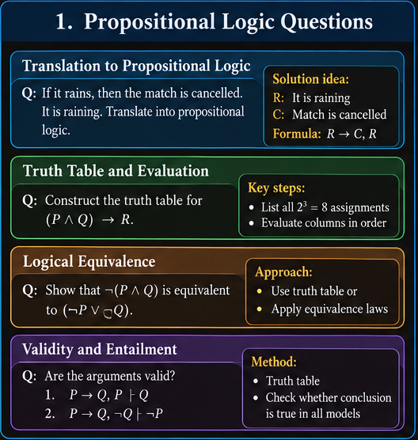
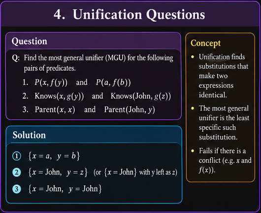
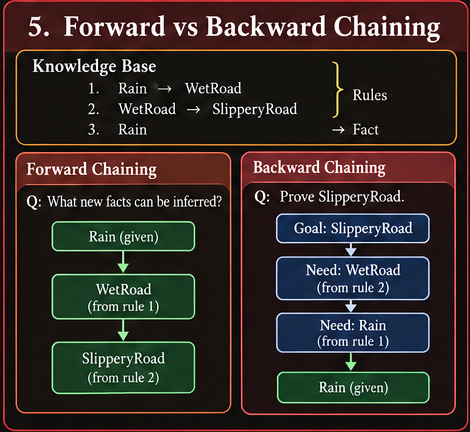
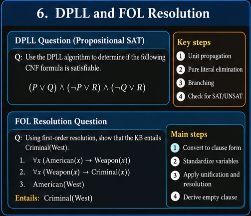

# Knowledge Representation — Question Bank

## Purpose and scope

This question bank is organized around the topics and worked examples in the *Knowledge Representation* lecture PDF. It is intended as a practice companion: it collects question formats across the chapter, rather than claiming these are predictions of an exam paper.

The questions are grouped by skill and topic. **★** marks a core practice question. Images are visual topic maps; the written questions below are the authoritative question text.

## Contents

1. Propositional logic and English translation
2. Truth tables, equivalence, validity, and satisfiability
3. Propositional inference and resolution refutation
4. First-order logic (FOL) translation and quantifiers
5. FOL transformations and clause form
6. Substitution and unification
7. Generalized modus ponens and Horn clauses
8. DPLL and propositional SAT
9. Forward chaining
10. Backward chaining
11. First-order resolution
12. Conceptual and comparison questions
13. Mixed practice sets

---

## 1. Propositional logic and English translation

### A. Translate English into propositional logic

1. ★ Let `L` mean “the light is on” and `F` mean “the fan is off.” Translate:
   - The light is on.
   - The fan is off.
   - The light is on or the fan is off.
   - If the light is on and the fan is off, then the room is uncomfortable. Let `U` mean “the room is uncomfortable.”
2. ★ Let `R` mean “it is raining,” `M` mean “the ground is muddy,” and `C` mean “the match is canceled.” Translate: “If it is raining and the ground is muddy, then the match will be canceled.”
3. Let `P` mean “I study,” `Q` mean “I pass,” and `R` mean “I celebrate.” Translate:
   - If I study, I pass.
   - I pass only if I study.
   - I study if I pass.
   - I pass if and only if I study.
   - If I pass, I celebrate.
4. Let `B` mean “I take the bus” and `T` mean “I take the train.” Translate “I take the bus or the train, or both.”
5. Translate “The alarm sounds only if smoke is detected,” using `A` for alarm and `S` for smoke detected.
6. Translate “Neither the server is online nor the backup is available,” using `O` and `B`.
7. Write a formula for “If it is not raining, then the match is not canceled,” using `R` and `C`.
8. Translate a short English paragraph of your own into propositional logic. Define every proposition symbol before writing the formula.

### B. Identify propositions and parse formulas

9. Decide which of the following are propositions with a definite truth value, and explain: “The door is open”; “Please close the door”; “Is the door open?”; “7 is prime.”
10. Identify the main connective in each formula: `¬P ∨ Q`, `(P ∧ Q) → R`, `P ↔ (Q ∨ R)`.
11. Add parentheses to make the intended grouping explicit in `¬P ∨ Q ∧ R → S`.
12. Given a precedence convention, fully parenthesize `¬P ∧ Q ∨ R → S ↔ T`.
13. Explain why `P → Q` and `Q → P` do not mean the same thing.

## 2. Truth tables, equivalence, validity, and satisfiability

### A. Truth-table construction

14. ★ Construct the complete truth table for `(P ∧ Q) → R`.
15. Construct the truth table for `¬(P ∨ Q)`.
16. Construct the truth table for `(P → Q) ∧ (Q → R)`.
17. Construct a truth table for `(P ↔ Q) ∨ R`.
18. How many rows are needed for a truth table with 2, 3, 4, and `n` distinct proposition symbols?
19. Evaluate `P → Q` for all four combinations of truth values for `P` and `Q`. Identify the one row in which it is false.

### B. Equivalence and laws

20. ★ Use a truth table to show that `¬(P ∧ Q)` is equivalent to `¬P ∨ ¬Q`.
21. Use logical laws to simplify `¬¬P ∧ (P ∨ Q)`.
22. Show that `P → Q` is equivalent to `¬P ∨ Q`.
23. Show that `P ↔ Q` is equivalent to `(P → Q) ∧ (Q → P)`.
24. Determine whether `P → Q` and its contrapositive `¬Q → ¬P` are equivalent.
25. For `P → Q`, write its converse and inverse, then state which forms are equivalent.
26. Use De Morgan’s laws to rewrite `¬(P ∨ (Q ∧ R))` so that negation applies only to atomic propositions.

### C. Tautology, contradiction, satisfiability, and validity

27. ★ Classify each formula as a tautology, contradiction, or contingent formula:
   - `P ∨ ¬P`
   - `P ∧ ¬P`
   - `P → Q`
   - `(P ∧ Q) → P`
28. Determine whether `(P ∨ Q) ∧ ¬P` is satisfiable. Give a satisfying assignment if one exists.
29. Determine whether `{P → Q, P, ¬Q}` is satisfiable.
30. Given premises `P → Q` and `P`, determine whether the conclusion `Q` follows.
31. Explain the difference between a valid argument and an argument whose premises happen to be true.
32. Define a countermodel to an entailment claim and give a small example.

### D. Normal forms

33. ★ Convert `P → Q` into CNF.
34. Convert `¬(P ∧ Q) → R` into CNF, showing each transformation.
35. Convert `(P ∧ Q) ∨ R` into CNF.
36. Convert `(P ∨ Q) ∧ R` into DNF.
37. Identify whether `(P ∨ ¬Q) ∧ (R ∨ Q)` is in CNF and explain why.
38. Explain the difference between CNF and DNF and state why clause form is useful for resolution.

## 3. Propositional inference and resolution refutation

### A. Apply inference rules

39. ★ From `P` and `P → Q`, derive `Q` and name the inference rule.
40. From `P → Q` and `¬Q`, derive a conclusion using modus tollens.
41. From `P → Q` and `Q → R`, derive a formula connecting `P` and `R`.
42. From `P ∧ Q`, derive each conjunct separately.
43. From `P`, derive `P ∨ Q`. Explain why this is valid.
44. Identify the invalid step in the argument: “If it rains, the road is wet. The road is wet. Therefore, it rained.”
45. Explain the difference between `KB ⊨ α` and `KB ⊢ α`.
46. Define soundness and completeness for an inference procedure.

### B. Resolution in propositional logic

47. ★ Resolve `(P ∨ Q)` and `(¬P ∨ R)` and write the resolvent.
48. Resolve `(A ∨ B)` and `(¬B ∨ C)`.
49. Given clauses `(P ∨ Q)`, `(¬P ∨ R)`, and `¬Q`, derive any further clauses possible using resolution.
50. ★ Use resolution refutation to show that `{P → Q, P} ⊨ Q`.
51. Use resolution refutation to test whether `{P → Q, Q → R, P} ⊨ R`.
52. Given a KB and query `α`, list the steps for proving `KB ⊨ α` by refutation.
53. Explain what the empty clause represents and why deriving it completes a refutation proof.
54. If resolution produces no new clauses before an empty clause appears, what can be concluded about the current proof attempt? Explain the role of exhaustive search and the proof procedure.
55. Explain monotonicity: if `KB ⊨ α`, what happens to that entailment when more premises are added?

## 4. First-order logic translation and quantifiers

### A. Identify FOL components

56. In `∀x (Student(x) → Studies(x))`, identify the quantifier, variable, predicates, connective, and scope.
57. Identify the constants, variables, predicates, and function terms in `Loves(Alice, MotherOf(x))`.
58. State whether each formula has free variables: `Student(Alice)`, `Student(x)`, `∀x Student(x)`, `∀x Loves(x,y)`.
59. Explain the difference between a predicate and a function symbol. Give an example of each.

### B. Translate English into FOL

Use a suitable domain and define predicates where necessary.

60. ★ Translate “All humans are mortal.”
61. Translate “Socrates is a human.”
62. Translate “There exists a person who loves every cat.”
63. Translate “No student failed the exam.”
64. Translate “Some student passed the exam.”
65. Translate “Every student likes some book.”
66. Translate “There is a book that every student likes.”
67. Translate “Every person has a mother.”
68. Translate “Not every bird can fly.”
69. Translate “Every cat is an animal, and some animals are black.”
70. Translate “Anyone who studies hard and attends lectures passes the exam.”
71. Translate “Anyone who passes the exam and submits the project gets a certificate.”
72. Translate “All students who enjoy learning like solving puzzles.”
73. Explain the difference between `∀x∃y Likes(x,y)` and `∃y∀x Likes(x,y)`. Give an English interpretation of each.
74. Translate “Either Jack or Curiosity killed the cat named Tuna.” Define predicates and constants.
75. Explain why “All students pass” should normally be represented as `∀x (Student(x) → Pass(x))`, rather than `∀x (Student(x) ∧ Pass(x))`.

### C. Quantifier laws and equivalence

76. ★ Rewrite `¬∀x P(x)` using an existential quantifier.
77. Rewrite `¬∃x P(x)` using a universal quantifier.
78. Negate `∀x (Student(x) → Passed(x))` and simplify the result.
79. Negate `∃x (Cat(x) ∧ Black(x))` and simplify the result.
80. Explain why truth-table enumeration over propositional symbols does not directly solve general FOL validity over arbitrary domains.

## 5. FOL transformations and clause form

81. ★ Convert `∀x (Human(x) → Mortal(x))` into clausal form.
82. Convert `∀x (Student(x) ∧ Studies(x) → Pass(x))` into a clause.
83. Eliminate implications and move negations inward in a given FOL formula.
84. Rename bound variables to standardize a formula apart.
85. Convert a formula into prenex normal form (PNF), with all quantifiers at the front.
86. ★ Skolemize `∀x ∃y Likes(x,y)`. Explain why a Skolem function is required.
87. Skolemize `∃y Loves(Alice,y)`. Explain why a new Skolem constant is sufficient in this case.
88. Explain how Skolemization differs from logical equivalence in the original vocabulary and what property it preserves.
89. Convert a formula containing `∀` and `∃` into clause form, showing each transformation.
90. Explain why universal quantifiers are usually omitted from the final clause notation.

## 6. Substitution and unification

91. ★ Find a most general unifier for `P(x, f(y))` and `P(a, f(b))`.
92. Find a unifier for `Knows(x, g(y))` and `Knows(John, g(z))`.
93. Determine whether `Parent(x,x)` and `Parent(John,Mary)` unify. Explain why or why not.
94. Find the MGU, if one exists, for `Loves(John,x)` and `Loves(y,Mary)`.
95. Determine whether `P(x)` and `P(f(x))` unify under standard first-order unification. Explain the occurs check.
96. Apply substitution `{x/Alice, y/Bob}` to `Knows(x,y) ∧ Likes(y,x)`.
97. Explain why a substitution must be applied consistently to all occurrences of a variable in an inference step.
98. Explain why clauses are standardized apart before first-order resolution.
99. Given a rule `Student(x) ∧ Studies(x) → Pass(x)` and facts `Student(Alice)` and `Studies(Alice)`, identify the substitution and derive the conclusion.

## 7. Generalized modus ponens and Horn clauses

100. ★ Apply generalized modus ponens to `Student(x) ∧ Studies(x) → Pass(x)` with facts `Student(Alice)` and `Studies(Alice)`.
101. Given `King(x) ∧ Greedy(x) → Evil(x)`, `King(John)`, and `Greedy(John)`, derive the conclusion.
102. Identify whether a clause is a Horn clause. Explain the “at most one positive literal” condition.
103. Convert `Student(x) ∧ Studies(x) → Pass(x)` into disjunctive clause form.
104. Distinguish a fact, a definite clause, and a goal/query in a Horn-clause system.
105. Explain why the same substitution must satisfy all premises of a generalized modus ponens rule.

## 8. DPLL and propositional SAT

106. ★ Use unit propagation to simplify `(P) ∧ (¬P ∨ Q)`.
107. Determine whether `(P) ∧ (¬P)` is satisfiable.
108. Apply pure-literal elimination to a CNF formula where a variable appears only positively or only negatively.
109. Trace DPLL on a given CNF formula, showing unit propagation, pure-literal elimination, branching, and backtracking.
110. Explain the meaning of an empty clause and an empty set of remaining clauses in DPLL.
111. Explain the difference between SAT and UNSAT.
112. Compare exhaustive truth-table enumeration with DPLL.
113. Why can a poor branching choice increase the amount of search required?

## 9. Forward chaining

114. ★ Given facts `Student(Alice)`, `Studies(Alice)`, and the rule `Student(x) ∧ Studies(x) → Pass(x)`, use forward chaining to derive new facts.
115. Given `Rain → WetRoad`, `WetRoad → SlipperyRoad`, and fact `Rain`, show every forward-chaining step.
116. Given a rule-based KB, determine whether a specified query is reached by forward chaining.
117. Solve the “West is a criminal” problem using the supplied facts and rules. List the derived facts in order.
118. Given `Missile(M1)`, `Owns(Nono,M1)`, and relevant rules, derive the applicable weapon and sale facts.
119. Explain why forward chaining is data-driven.
120. Describe the repeated matching and irrelevant inference problems associated with forward chaining.
121. Explain how indexing, incremental matching, or RETE-style approaches can reduce repeated work.
122. Explain why ordinary forward chaining does not automatically explore alternative cases for a disjunctive query.

## 10. Backward chaining

123. ★ Given `Rain → Wet`, `Sprinkler → Wet`, `Cloudy → Rain`, and fact `Cloudy`, prove or fail to prove query `Wet` using backward chaining.
124. Given `Student(x) ∧ Studies(x) → Pass(x)` and facts for Alice, prove `Pass(Alice)` backward from the goal.
125. Given `LikesIceCream(x) → Happy(x)` and fact `LikesIceCream(Alice)`, prove `Happy(Alice)`.
126. ★ Use backward chaining to determine whether Alice gets a certificate from the facts and rules about studying hard, attending lectures, passing, and submitting the project.
127. For a given query, identify the rules whose consequents can match the goal.
128. Draw a goal/subgoal tree for a backward-chaining problem.
129. Explain how unification is used to match a goal with a rule consequent.
130. Identify repeated-subgoal and infinite-loop risks in a recursive rule base.
131. Compare the search work performed by forward and backward chaining on the same KB.

## 11. First-order resolution

132. ★ Resolve clauses containing complementary literals after finding the necessary unifier.
133. Given `[Animal(F(x)) ∨ Loves(G(x),x)]` and `[¬Loves(u,v) ∨ ¬Kills(u,v)]`, calculate the unifier and resolvent.
134. Explain the difference between propositional resolution and lifted first-order resolution.
135. ★ Use first-order resolution refutation to prove `Criminal(West)` from the criminality KB in the lecture. Show the negated goal, clauses, unifiers, resolvents, and empty clause.
136. Convert the criminality rules into clause form before beginning resolution.
137. Given the Tuna/cat/animal knowledge base, formalize the facts and rules and test the query “Did Curiosity kill the cat?”
138. Identify complementary literals in two clauses and determine whether a unifier exists.
139. Explain why first-order resolution requires standardizing clauses apart.
140. Explain the role of Skolem functions in first-order resolution.
141. State the steps for a complete resolution-refutation attempt and identify what the empty clause proves.
142. Given two clauses, apply a unifier to every remaining literal before writing the resolvent.

## 12. Conceptual and comparison questions

143. Define knowledge representation and explain why an agent needs a knowledge base and inference mechanism.
144. Compare syntax and semantics.
145. Explain the difference between a model, satisfiability, validity, and entailment.
146. Compare propositional logic and first-order logic, with one example of what FOL can express more compactly.
147. Compare semantic entailment (`⊨`) and syntactic derivation (`⊢`).
148. Explain soundness and completeness and why they matter for automated reasoning.
149. Compare natural deduction, truth-table enumeration, and resolution.
150. Compare CNF and DNF and explain why resolution uses clauses.
151. Compare DPLL with resolution-based refutation for propositional reasoning.
152. Compare forward chaining and backward chaining, including the direction of reasoning and typical use cases.
153. Explain monotonic reasoning and how adding premises affects an existing entailment.
154. Explain why FOL quantifier order matters.
155. Explain why a Skolem function may depend on universally quantified variables.
156. Discuss the main limitations of forward and backward chaining.

## 13. Mixed practice sets

### Set A — Foundations

1. Translate three English statements into propositional logic.
2. Build a truth table for a three-variable formula.
3. Determine whether an argument is valid.
4. Convert a formula into CNF.
5. Prove a simple entailment by resolution refutation.

### Set B — First-order logic

1. Translate universal and existential English statements into FOL.
2. Negate a quantified statement and simplify it.
3. Convert an implication-containing FOL formula to clause form.
4. Find an MGU for two predicates.
5. Apply generalized modus ponens to a rule and facts.

### Set C — Inference algorithms

1. Run DPLL on a small CNF formula.
2. Derive facts using forward chaining.
3. Prove a query using backward chaining.
4. Resolve two first-order clauses with unification.
5. Prove `Criminal(West)` by FOL resolution refutation.

### Set D — Explain and compare

1. Explain syntax, semantics, models, and entailment.
2. Explain soundness versus completeness.
3. Compare forward and backward chaining.
4. Explain CNF, Skolemization, and unification.
5. Explain what deriving the empty clause means.

---

## Suggested way to use this bank

- First attempt the starred questions without notes.
- For calculation questions, show every intermediate row, substitution, clause, or inference step.
- For translation questions, define every proposition symbol, predicate, constant, and function.
- For proof questions, state the target clearly and show the exact rule used at every step.
- Mark any question you cannot solve, then revisit the corresponding lecture section.

## Coverage note

This is a topic-organized practice bank derived from the lecture's subject matter and examples. It combines repeated question patterns into reusable exercises and includes additional practice variations based on the same concepts. It is not a verbatim extraction of every question printed on every slide, and it does not provide worked solutions yet.
