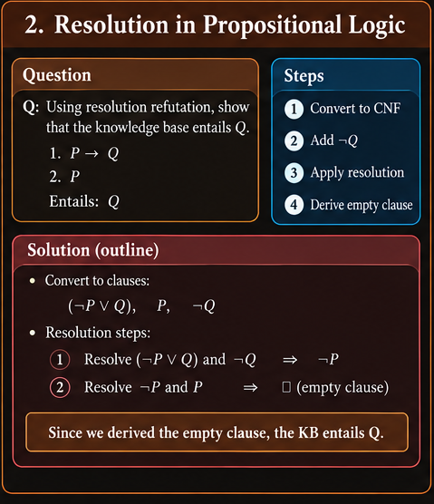
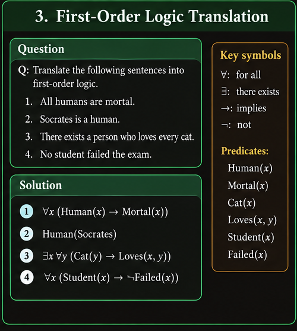

# Knowledge Representation — Problem-Solving Methods

## Purpose

This guide teaches reusable procedures for solving unfamiliar Knowledge Representation questions. It is a companion to:

- `Knowledge Representation` — concepts and explanations.
- `Knowledge Representation Question Bank` — practice questions.

The aim is to learn **how to approach a problem**, not to memorize answers. The guide follows the logic topics and terminology used in the lecture material. Small examples illustrate the procedures; they are teaching examples, not claimed verbatim extracts from the lecture.

## How to use this guide

For every problem:

1. **Classify it:** identify the logic and task.
2. **Normalize the input:** define symbols, write premises clearly, and remove ambiguity.
3. **Choose a method:** use the procedure appropriate to the task.
4. **Show intermediate work:** write transformations, substitutions, clauses, or newly derived facts.
5. **State the result:** answer the exact question asked.
6. **Verify:** check the result using a truth condition, a rule application, a substitution, or a contradiction.

### Quick method selector

| If the question asks you to… | Start with… |
| --- | --- |
| Translate an English statement | Define symbols/predicates, then encode the sentence structure |
| Evaluate a formula or classify it | Truth table or logical laws |
| Show an argument is valid using resolution | Negate the query, convert to clauses, resolve to the empty clause |
| Represent “all”, “some”, or “none” | First-order logic quantifiers and predicates |
| Convert FOL to clauses | Eliminate implications, push negations inward, standardize variables, Skolemize, distribute, drop universal quantifiers |
| Match two predicate expressions | Unification and the occurs check |
| Infer a conclusion from Horn rules | Generalized Modus Ponens or forward chaining |
| Check whether a goal can be established from rules | Backward chaining |
| Search a propositional CNF for a satisfying assignment | DPLL |
| Prove a FOL query by contradiction | FOL clause conversion, unification, and resolution |

---

## 1. Propositional logic: translation, truth tables, and normal forms

### 1.1 Translating English into propositional logic

**Use this when:** a question gives simple statements and asks you to express their relationships with `¬`, `∧`, `∨`, `→`, or `↔`.

#### Procedure

1. Split the sentence into its simplest truth-valued statements.
2. Assign one symbol to each statement and write down what each symbol means.
3. Identify the main relationship: negation, conjunction, disjunction, condition, or equivalence.
4. Translate the relationship, using parentheses to make the scope explicit.
5. Read your formula back in English and check that it says the original sentence.

#### Useful language patterns

| English phrase | Typical form |
| --- | --- |
| not P | `¬P` |
| P and Q | `P ∧ Q` |
| P or Q, or both | `P ∨ Q` |
| if P, then Q | `P → Q` |
| P only if Q | `P → Q` |
| P if Q | `Q → P` |
| P if and only if Q | `P ↔ Q` |
| neither P nor Q | `¬P ∧ ¬Q` or `¬(P ∨ Q)` |
| not both P and Q | `¬(P ∧ Q)` |

**Direction check:** “P only if Q” makes Q a necessary condition for P, so write `P → Q`. “P if Q” means Q is sufficient for P, so write `Q → P`.

Example: Let `R` mean “it rains” and `W` mean “the road is wet.” “If it rains, the road is wet” becomes `R → W`. Do not reverse it to `W → R`.

### 1.2 Building a truth table

**Use this when:** you must evaluate a formula under every assignment, compare formulas, or classify a formula.

#### Procedure

1. Count the distinct proposition symbols, \(n\).
2. Create \(2^n\) rows, one for every assignment of T/F to those symbols.
3. Add columns for subformulas, starting with the innermost or simplest components.
4. Evaluate each connective using its truth condition.
5. Read the final column to answer the question.

#### Key checks

- A formula is a **tautology** if the final column is true in every row.
- It is a **contradiction** if the final column is false in every row.
- It is **contingent** if it is true in some rows and false in others.
- A formula is **satisfiable** if at least one row makes it true.
- Two formulas are equivalent if their final columns match on every row.

For implication, `P → Q` is false only when P is true and Q is false. This is the most common truth-table error.

### 1.3 Checking entailment with a countermodel

To test whether premises \(\{P_1,\ldots,P_k\}\) entail a query \(Q\):

1. Look for an assignment where **every premise is true and Q is false**.
2. If such an assignment exists, it is a countermodel, so entailment fails.
3. If no assignment satisfies that condition, the premises entail Q.

Equivalent satisfiability test: \(\{P_1,\ldots,P_k,\neg Q\}\) is unsatisfiable exactly when the premises entail Q.

Keep the distinction clear:
- `KB ⊨ Q` is a semantic claim: Q is true in every model of KB.
- `KB ⊢ Q` is a proof claim: Q can be derived using a specified inference system.

### 1.4 Simplifying formulas with logical laws

Use equivalence laws to replace a subformula with an equivalent one while preserving the formula's truth value.

Common patterns:

| Law | Equivalent form |
| --- | --- |
| Implication elimination | `P → Q` ≡ `¬P ∨ Q` |
| Biconditional elimination | `P ↔ Q` ≡ `(P → Q) ∧ (Q → P)` |
| De Morgan | `¬(P ∧ Q)` ≡ `¬P ∨ ¬Q` |
| De Morgan | `¬(P ∨ Q)` ≡ `¬P ∧ ¬Q` |
| Double negation | `¬¬P` ≡ `P` |
| Contrapositive | `P → Q` ≡ `¬Q → ¬P` |

When asked to simplify, name the law used at each important step. Do not treat the converse `Q → P` as equivalent to `P → Q`.

### 1.5 Converting propositional formulas to CNF or DNF

**CNF** is an AND of clauses, where each clause is an OR of literals.  
**DNF** is an OR of terms, where each term is an AND of literals.

#### CNF workflow

1. Eliminate `↔` and `→`.
2. Push negations inward using De Morgan's laws and double-negation elimination.
3. Distribute OR over AND until the formula is an AND of OR-clauses.
4. Check that every clause is a disjunction of literals.

#### DNF workflow

1. Eliminate `↔` and `→`.
2. Push negations inward.
3. Distribute AND over OR until the formula is an OR of AND-terms.
4. Check that every term is a conjunction of literals.

**Sanity check:** CNF has ANDs outside and ORs inside; DNF has ORs outside and ANDs inside. If a formula becomes much longer after distribution, that can be normal.

---

## 2. Propositional inference and resolution refutation

### 2.1 Applying inference rules

**Use this when:** the task asks you to derive a conclusion from premises or identify the rule that justifies a step.

For each proposed step:

1. Write the available premises or already derived formulas.
2. Match them against the premises required by a rule.
3. Apply the rule only if its full pattern matches.
4. Write the new formula and name the rule.
5. Do not infer the converse of an implication without a valid reason.

Examples of common patterns:

- **Modus Ponens:** from `P` and `P → Q`, derive `Q`.
- **Modus Tollens:** from `P → Q` and `¬Q`, derive `¬P`.
- **Conjunction elimination:** from `P ∧ Q`, derive `P` and derive `Q`.
- **Conjunction introduction:** from `P` and `Q`, derive `P ∧ Q`.
- **Disjunction introduction:** from `P`, derive `P ∨ Q`.

A valid conclusion must follow from the rule pattern, not merely seem plausible in the story.

### 2.2 One-step propositional resolution

A **literal** is a proposition symbol or its negation. To resolve two clauses:

1. Find a complementary pair: a literal `P` in one clause and `¬P` in the other.
2. Remove that pair.
3. Combine the remaining literals into one clause.
4. Simplify duplicate literals if present.

Example:

- `(P ∨ Q)`
- `(¬P ∨ R)`
- Resolvent: `(Q ∨ R)`

Resolution does not permit removing unrelated literals. If the clauses have no complementary pair, that pair cannot be resolved directly.

### 2.3 Resolution refutation for propositional entailment

**Use this when:** you must prove `KB ⊨ Q` by resolution.

#### Procedure

1. Write all KB premises.
2. Negate the query: add `¬Q`.
3. Convert every formula to CNF.
4. Split the CNF into a set of clauses.
5. Repeatedly resolve clauses containing complementary literals.
6. If you derive the **empty clause** `□`, a contradiction has been reached; the refutation succeeds and `KB ⊨ Q`.
7. If the process reaches a fixed point without the empty clause, that derivation has not proved entailment. For a complete resolution procedure, exhaustive closure without contradiction establishes that the clause set is satisfiable, so the entailment does not hold.

#### What to show in an answer

- The original premises and negated query.
- The clause set after CNF conversion.
- Each parent-clause pair and its resolvent.
- The empty clause, if obtained.
- A final sentence stating what the result means for the original entailment.

**Important:** the empty clause is not an ordinary clause with a missing literal. It represents falsity. It is derived when resolution eliminates all literals.

### 2.4 Common resolution mistakes

- Forgetting to negate the query before refutation.
- Resolving clauses that do not contain complementary literals.
- Dropping a remaining literal from the resolvent.
- Treating failure to find a short proof as proof that entailment is false.
- Stopping before checking whether newly derived clauses enable another resolution.

---

## 3. First-order logic: translating quantifiers and reading scope

### 3.1 Choose predicates before writing quantifiers

**Use this when:** an English statement contains categories, relationships, named objects, “all,” “some,” “none,” or “every.”

First define the vocabulary. For example:

- `Student(x)`: x is a student.
- `Passed(x)`: x passed.
- `Likes(x,y)`: x likes y.
- `Alice`: a constant denoting a particular individual.

Then encode the sentence's logical structure. A predicate describes a property or relation; a constant names an individual; a variable ranges over the domain.

### 3.2 Quantifier patterns

| English structure | Typical pattern |
| --- | --- |
| Every A is B | `∀x (A(x) → B(x))` |
| Some A is B | `∃x (A(x) ∧ B(x))` |
| No A is B | `∀x (A(x) → ¬B(x))` or `¬∃x (A(x) ∧ B(x))` |
| Not every A is B | `∃x (A(x) ∧ ¬B(x))` |
| Every A relates to some B | `∀x (A(x) → ∃y (B(y) ∧ R(x,y)))` |
| Some A relates to every B | `∃x (A(x) ∧ ∀y (B(y) → R(x,y)))` |

The implication in “every A is B” restricts the universal statement to A objects. The conjunction in “some A is B” asserts that at least one object satisfies both conditions.

### 3.3 Quantifier order matters

Compare:

- `∀x ∃y R(x,y)`: for each x, there is some y; the y may differ for different x.
- `∃y ∀x R(x,y)`: there is one y that relates to every x.

When translating, ask: **does the English sentence require one shared object, or can the object vary with each person/object?** Put the quantifiers in the order that matches that dependency.

### 3.4 Negating quantified formulas

Use the quantifier-negation laws:

- `¬∀x P(x)` ≡ `∃x ¬P(x)`
- `¬∃x P(x)` ≡ `∀x ¬P(x)`

Procedure:

1. Put the negation in front of the whole formula.
2. Swap each quantifier crossed by the negation: `∀` becomes `∃`, and `∃` becomes `∀`.
3. Push negation through connectives using De Morgan's laws.
4. Remove implications if the task asks for a simplified form.
5. Check the English meaning: negating “everyone passed” should mean “someone did not pass,” not “everyone failed.”

### 3.5 Scope and free variables

A variable occurrence is **bound** if it lies within the scope of a quantifier for that variable. Otherwise, it is free.

When asked to identify scope or free variables:

1. Locate every quantifier.
2. Mark the part of the formula governed by that quantifier.
3. Identify which occurrences of its variable lie inside that scope.
4. Any variable occurrence not bound by a corresponding quantifier is free.

Do not assume every variable in a formula is bound. For example, `∀x Likes(x,y)` binds x but leaves y free.

---

## 4. Converting first-order logic to clause form

This procedure is essential for first-order resolution and for many questions involving Skolemization.

### 4.1 Standard clause-form pipeline

Given a FOL formula, apply the steps in this order:

1. **Eliminate implications and biconditionals.** Replace them with formulas using `¬`, `∧`, and `∨`.
2. **Move negations inward.** Apply De Morgan's laws and quantifier-negation laws so negation applies only to atomic formulas.
3. **Standardize variables apart.** Rename bound variables so different quantifiers do not unintentionally share a variable name.
4. **Move quantifiers to the front** if prenex normal form is required, while preserving variable scope.
5. **Skolemize existential quantifiers.** Replace each existential variable with a fresh Skolem constant or function, depending on the universal variables in whose scope it occurs.
6. **Drop universal quantifiers.** In standard clause notation, remaining variables are understood to be universally quantified.
7. **Convert the quantifier-free matrix to CNF.** Distribute OR over AND.
8. **Split the conjunction into clauses.** Each disjunction becomes a separate clause.

Keep the order straight. In particular, do not simply delete an existential quantifier; it must be eliminated by Skolemization.

### 4.2 Choosing a Skolem constant or function

- Use a fresh **Skolem constant** when the existential witness does not depend on any enclosing universal variable.
- Use a fresh **Skolem function** when the witness may depend on one or more enclosing universal variables.

Examples:

- `∃y Loves(Alice,y)` can be represented with a fresh constant, e.g. `Loves(Alice, k)`.
- `∀x ∃y Likes(x,y)` requires a function depending on x, e.g. `Likes(x, f(x))`.

The names `k` and `f` are placeholders; use fresh symbols that do not already have meanings in the KB.

Skolemization preserves satisfiability, not necessarily equivalence in the original vocabulary. Do not claim that the Skolemized formula has exactly the same models over the original symbols.

### 4.3 Final clause-form checklist

Before moving to resolution, verify:

- No implication or biconditional remains.
- Negations occur only immediately before atoms.
- Bound variables have been standardized apart where necessary.
- Existential quantifiers have been Skolemized correctly.
- The matrix is in CNF.
- Each clause is a disjunction of literals.
- Universal quantifiers are implicit in the final clauses.

---

## 5. Substitution and unification

### 5.1 What unification is trying to do

Unification finds a substitution that makes two expressions identical. A substitution maps variables to terms, such as `{x/Alice, y/f(z)}`. A **most general unifier (MGU)** makes the expressions match without adding unnecessary restrictions.

### 5.2 Unification algorithm

Given two terms or predicate expressions:

1. **Check the outer structure.** Predicate/function names and arities must match.
2. **Compare corresponding arguments.**
3. If the arguments are identical, continue.
4. If one argument is a variable, try binding it to the other term.
5. Apply each new binding consistently to the remaining equations and to the substitution already being built.
6. If two different constants must be equated, or matching function symbols have incompatible structures, fail.
7. Apply the **occurs check**: do not bind a variable to a term containing that same variable.
8. When all equations are satisfied, report the substitution and verify that applying it makes the original expressions identical.

### 5.3 Miniature example

Unify `P(x, f(y))` with `P(Alice, f(Bob))`.

- Predicate symbols and arities match.
- First arguments give `x = Alice`.
- Second arguments have matching `f` symbols, so compare their arguments: `y = Bob`.
- Substitution: `{x/Alice, y/Bob}`.
- Applying it to both expressions produces `P(Alice, f(Bob))`.

### 5.4 Failure cases to recognize

- **Predicate/arity mismatch:** `P(x)` and `Q(x)` cannot unify.
- **Conflicting constants:** `P(Alice)` and `P(Bob)` cannot unify if Alice and Bob are distinct constants.
- **Function mismatch:** `P(f(x))` and `P(g(x))` cannot unify when f and g are different function symbols.
- **Occurs-check failure:** `P(x)` and `P(f(x))` require `x = f(x)`, which standard first-order unification rejects.

### 5.5 Substitution discipline

When applying a substitution:

1. Replace every occurrence of each variable according to the substitution.
2. Do not change constants or function symbols unless the substitution explicitly maps a variable to a term containing them.
3. Apply the same substitution consistently across every premise and conclusion in the inference step.
4. Re-check the resulting expressions rather than relying on visual similarity.

For resolution, standardize the parent clauses apart before unifying so identically named variables from separate clauses are not accidentally treated as the same variable.

---

## 6. Generalized Modus Ponens and Horn clauses

### 6.1 Generalized Modus Ponens (GMP)

For a rule of the form:

`P1 ∧ P2 ∧ ... ∧ Pn → Q`

and matching facts for every premise under one consistent substitution \(\theta\), infer `Qθ`.

#### Procedure

1. Write the rule and all its premises.
2. Find facts that match the first premise.
3. Record the variable bindings required by that match.
4. Match each remaining premise using the **same consistent bindings**.
5. If every premise matches, apply the substitution to the conclusion.
6. Add the resulting conclusion as a derived fact.

Example:

- Rule: `Student(x) ∧ Studies(x) → Pass(x)`
- Facts: `Student(Alice)`, `Studies(Alice)`
- Match both premises with `{x/Alice}`.
- Infer `Pass(Alice)`.

If the premises require incompatible bindings for the same variable, the rule cannot fire for that match.

### 6.2 Recognizing Horn clauses

A Horn clause has at most one positive (unnegated) literal.

- A **fact** can be represented as a unit positive clause, e.g. `Student(Alice)`.
- A **definite clause/rule** has exactly one positive conclusion literal, e.g. `¬Student(x) ∨ ¬Studies(x) ∨ Pass(x)`.
- A **goal/query** is the proposition whose derivability is being tested; it is not automatically a stored fact.

The rule `Student(x) ∧ Studies(x) → Pass(x)` becomes `¬Student(x) ∨ ¬Studies(x) ∨ Pass(x)` by eliminating implication.

---

## 7. Forward chaining

### 7.1 When to use forward chaining

Forward chaining is **data-driven**. Start from known facts and repeatedly apply rules whose premises are satisfied. Use it when the question asks what can be inferred from a fact set, asks for a derivation trace, or asks whether a target is eventually reached by forward inference.

### 7.2 Manual forward-chaining procedure

1. **Initialize the fact set** with all facts given in the problem.
2. **Inspect each rule.** A rule is applicable only when all its premises match facts already known.
3. **Find a consistent substitution** for any rule variables.
4. **Fire the rule:** apply the substitution to the conclusion.
5. **Add the conclusion** if it is not already in the fact set.
6. **Repeat the scan.** New facts may enable rules that were previously inapplicable.
7. Stop when the requested goal is derived, if only that goal is needed, or when no new facts can be added if the task asks for the full closure.

### 7.3 How to write the trace

Use a table like this:

| Step | Rule/premises matched | Substitution | New fact |
| --- | --- | --- | --- |
| 0 | Initial facts | — | List the given facts |
| 1 | Rule whose premises are all known | Bind rule variables | Derived conclusion |
| 2 | Another newly applicable rule | Bind variables | Derived conclusion |

Keep a separate set of known facts and avoid adding the same fact repeatedly. A rule with three premises cannot fire after matching only two of them.

### 7.4 Termination and correctness checks

For a finite set of ground facts and a finite, function-free Horn-rule knowledge base, forward chaining reaches a fixed point: eventually no new facts can be added. If function symbols can generate an unbounded sequence of new terms, termination is not guaranteed in general.

Before finalizing:

- Were all initial facts included?
- Did every fired rule have all premises satisfied?
- Was the substitution consistent across the whole rule?
- Was every new fact derived by a stated rule?
- Did you stop at the right point for the question?

### 7.5 Common mistakes

- Treating a rule conclusion as a fact before its premises are satisfied.
- Forgetting to rescan rules after adding a new fact.
- Repeatedly adding a fact that is already known.
- Stopping after one pass even though a new fact enables another rule.
- Reporting only the target when the question explicitly asks for every derived fact.

---

## 8. Backward chaining

### 8.1 When to use backward chaining

Backward chaining is **goal-driven**. Start with the query and look for rules that could establish it. The premises of a chosen rule become subgoals.

### 8.2 Manual backward-chaining procedure

1. Write the target query as the current goal.
2. If it matches a known fact under a consistent substitution, that branch succeeds.
3. Otherwise, find a rule whose conclusion can unify with the goal.
4. Apply the unifier to the rule and turn all its premises into subgoals.
5. Prove every subgoal. If the rule has several premises, all must succeed for that rule application to prove the goal.
6. If a branch fails, try another applicable rule or match.
7. The original query succeeds if at least one complete proof branch succeeds.

### 8.3 A goal tree

Represent a goal as a node. If a rule has premises `A ∧ B → G`, then proving G through that rule requires proving **both** A and B. This is an AND branch. If different rules can conclude G, they provide alternative ways to prove G; these are OR alternatives.

### 8.4 Forward vs. backward chaining

| Feature | Forward chaining | Backward chaining |
| --- | --- | --- |
| Starting point | Known facts | Query/goal |
| Direction | Facts toward consequences | Goal toward supporting premises |
| Strategy | Data-driven | Goal-driven |
| Typical question | “What can be inferred?” | “Can this goal be proved?” |
| Stop condition | Goal found or no new facts | Goal proved or all relevant proof branches fail |
| Potential inefficiency | May derive facts irrelevant to the query | May revisit subgoals without suitable loop control |

### 8.5 Backward-chaining checks

- Does the rule conclusion actually match the goal?
- Were its premises all turned into subgoals?
- Were substitutions propagated into every subgoal?
- Does each successful branch terminate at known facts?
- If a branch fails, did you consider other rules that could prove the same goal?

A repeated goal is not automatically proved. Use the inference strategy and any loop-control assumptions stated in the question.

---

## 9. DPLL and propositional SAT

### 9.1 What DPLL is checking

DPLL tests whether a propositional formula in CNF is satisfiable. It simplifies the clause set using assignments and deterministic rules, then branches when needed.

### 9.2 Manual DPLL procedure

1. Convert the formula to CNF if it is not already in CNF.
2. **Check for an empty clause.** An empty clause means the current branch is a conflict.
3. **Check whether all clauses are satisfied.** If so, the current assignment is a satisfying assignment.
4. Apply **unit propagation**: if a clause has one remaining literal, assign that literal true and simplify the formula.
5. Apply **pure-literal elimination**: if a variable appears with only one polarity in the remaining formula, assign it to satisfy those occurrences.
6. Repeat simplification while it makes progress.
7. If unresolved clauses remain, choose an unassigned variable and branch on one value.
8. If that branch conflicts, backtrack and try the other value.
9. If every branch conflicts, the formula is unsatisfiable. If any branch satisfies all clauses, it is satisfiable.

### 9.3 How assignments simplify clauses

- Assigning `P = true` satisfies every clause containing `P`; remove those clauses.
- In clauses containing `¬P`, remove that literal because it is false.
- A unit clause `(Q)` forces `Q = true`.
- A unit clause `(¬Q)` forces `Q = false`.
- If a clause loses every literal and is not satisfied, it becomes the empty clause and signals conflict.

### 9.4 How to present a DPLL trace

At each stage, record:

| Stage | Action | Assignment | Remaining clauses/result |
| --- | --- | --- | --- |
| 1 | Initial CNF | None | Original clauses |
| 2 | Unit propagation/pure literal | State the forced value | Simplified clauses |
| 3 | Branch | State chosen variable/value | New branch |
| 4 | Conflict or success | State the reason | Backtrack or report model |

Do not skip the conflict step when backtracking. The reason a branch fails is part of the method.

### 9.5 Common DPLL errors

- Forgetting to remove clauses already satisfied by an assignment.
- Removing a literal that was assigned true rather than false.
- Calling a literal “pure” when both it and its negation occur.
- Claiming unsatisfiability after only one branch fails.
- Claiming satisfiability without giving an assignment that satisfies every clause.

---

## 10. First-order resolution

First-order resolution combines clause conversion, unification, and propositional-style resolution. The complementary literals need not be textually identical before substitution; they must become complementary under a unifier.

### 10.1 FOL resolution procedure

1. Translate the KB and query into FOL if necessary.
2. Negate the query and add it to the KB.
3. Convert every formula to clause form using the pipeline in Section 4.
4. Standardize variables apart across clauses.
5. Choose two clauses containing complementary predicate literals that can unify.
6. Find an MGU that makes the selected literals complementary.
7. Apply the MGU to both clauses.
8. Resolve the selected literals and combine the remaining literals into the resolvent.
9. Repeat, using new clauses as needed.
10. Deriving the empty clause proves that the KB entails the original query by refutation.

### 10.2 What makes FOL resolution different?

In propositional resolution, `P` and `¬P` are complementary when their symbols match exactly. In FOL resolution, `P(x)` and `¬P(Alice)` can be complementary after unification with `{x/Alice}`.

Example pattern:

- `¬Human(x) ∨ Mortal(x)`
- `Human(Socrates)`
- Resolve after `{x/Socrates}` to obtain `Mortal(Socrates)`.

This example illustrates one inference step; a full refutation proof must still include the negated query and derive the empty clause.

### 10.3 FOL resolution answer checklist

- Was the query negated?
- Were implications and quantifiers handled correctly during clause conversion?
- Were existential quantifiers Skolemized, rather than simply deleted?
- Were clauses standardized apart?
- Does the unifier really make the selected literals complementary?
- Was the same substitution applied consistently?
- Was the resolvent formed from all remaining literals?
- Was the empty clause derived before claiming success?

### 10.4 Frequent failure points

- Forgetting to standardize variables apart.
- Unifying expressions with different predicate symbols or arities.
- Ignoring the occurs check.
- Resolving before applying the MGU.
- Treating Skolemization as ordinary equivalence.
- Claiming entailment merely because several useful clauses were derived.

---

## 11. Conceptual and comparison questions

These questions test whether you understand what a method guarantees, not just how to execute it.

### 11.1 Entailment, proof, soundness, and completeness

- **Entailment (`KB ⊨ α`):** α is true in every model in which KB is true.
- **Derivability (`KB ⊢ α`):** α can be derived using the proof rules of a formal system.
- **Soundness:** everything the system derives is semantically entailed.
- **Completeness:** every semantic consequence in the stated scope can be derived by the system.

For comparison questions, define each term and then state the relationship. Do not use “true,” “valid,” and “provable” as if they were interchangeable.

### 11.2 Choosing between methods

- Use truth tables for small propositional formulas when all assignments can be enumerated.
- Use resolution when the problem asks for a clause-based proof or refutation.
- Use forward chaining to derive consequences from available facts and rules.
- Use backward chaining when a particular goal is the focus.
- Use DPLL to decide propositional CNF satisfiability through simplification and branching.
- Use FOL resolution when quantified predicates and unification are involved.

The question's requested output matters: a method may be able to answer a query but still be a poor fit if the question specifically asks for a derivation trace using another method.

### 11.3 How to explain an algorithm in an exam

A strong algorithm answer normally contains:

1. **Purpose:** what problem the algorithm solves.
2. **Input representation:** e.g. facts/rules, CNF clauses, or FOL clauses.
3. **Ordered steps:** what happens first, next, and repeatedly.
4. **Termination/success condition:** how the procedure knows it can stop.
5. **Correctness intuition:** why the procedure's steps support the result.
6. **Limitation or assumption:** when relevant, such as function-free finite Horn rules for guaranteed forward-chaining termination.

---

## 12. Master checklists

### Before solving

- [ ] Identify the exact task and requested output.
- [ ] Define every proposition symbol, predicate, constant, and function used.
- [ ] Separate given facts from conditional rules.
- [ ] Check quantifier scope and implication direction.
- [ ] Choose a method suited to the question.

### While solving

- [ ] Show intermediate steps rather than jumping to the conclusion.
- [ ] Apply substitutions consistently.
- [ ] In clause conversion, follow the transformation order.
- [ ] In chaining, fire a rule only when every premise is satisfied.
- [ ] In DPLL, show simplification, branching, conflict, and backtracking.
- [ ] In resolution, record parent clauses and each resolvent.

### Before submitting

- [ ] Did I answer the exact question asked?
- [ ] Is every inference justified?
- [ ] Did I use the right success or stopping condition?
- [ ] If claiming a refutation, did I derive the empty clause?
- [ ] If claiming satisfiability, can I show a satisfying assignment?
- [ ] If claiming unification, does the substitution make both expressions identical?
- [ ] If claiming a derived fact, can I point to the rule and its satisfied premises?

## Final study strategy

1. Read the relevant concept section in `Knowledge_Representation.md`.
2. Study the corresponding procedure in this guide.
3. Solve a few matching questions from `Knowledge_Representation_Question_Bank.md` without looking at worked examples.
4. Compare your method—not just your final answer—against the checklist.
5. Reattempt any question where you skipped a step or could not explain why the method applies.
