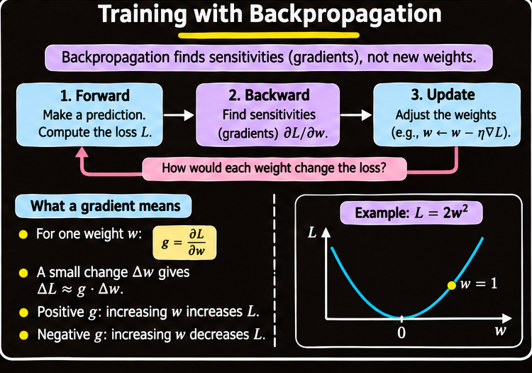
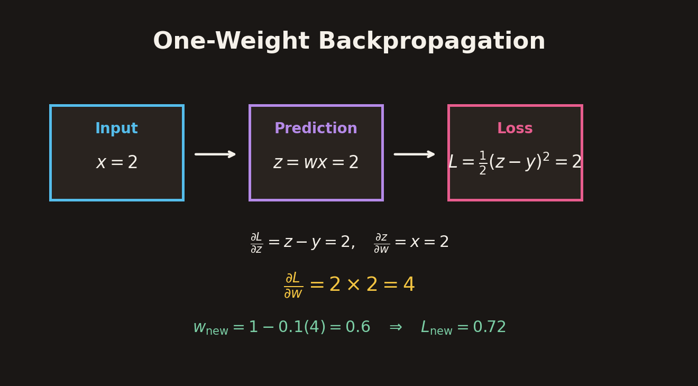
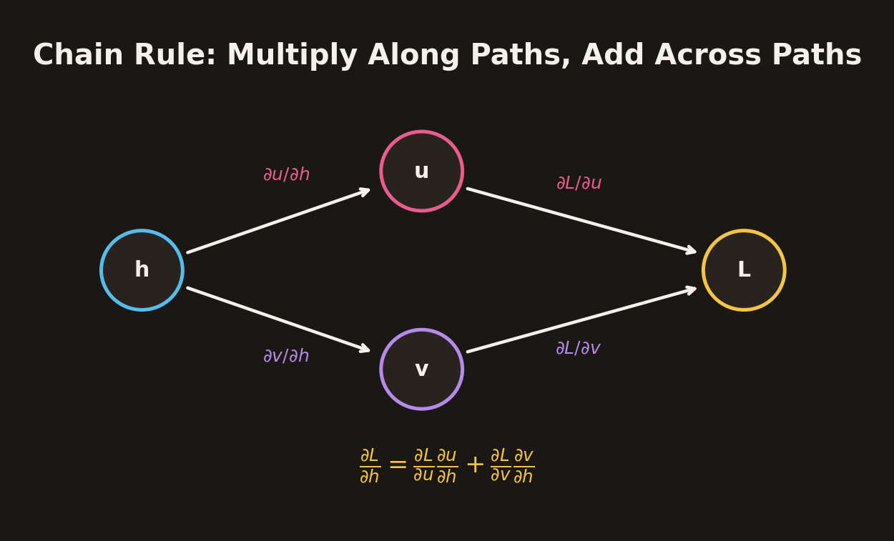
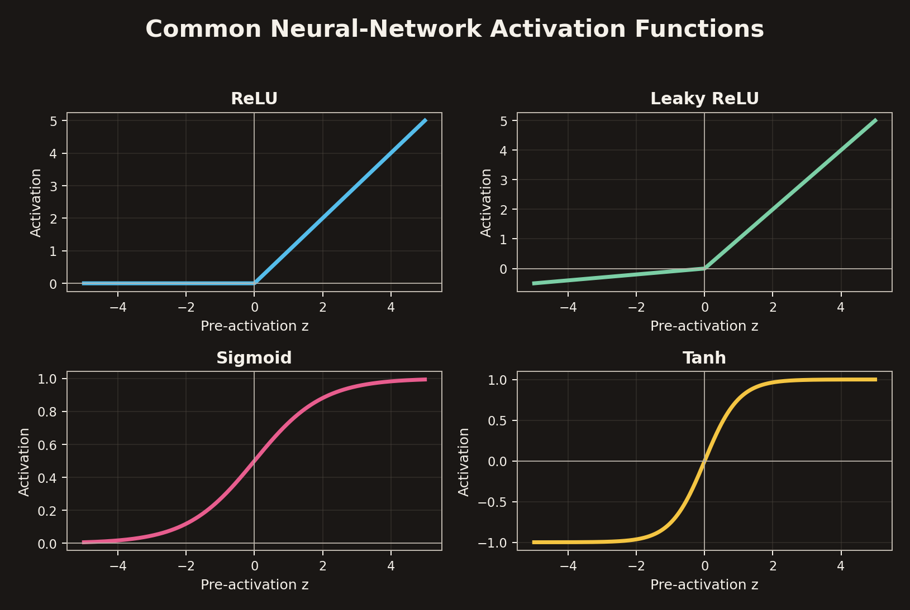
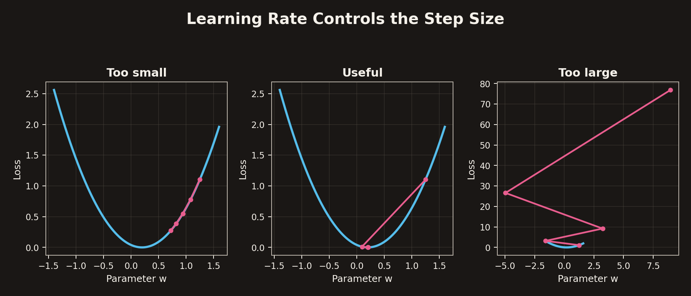
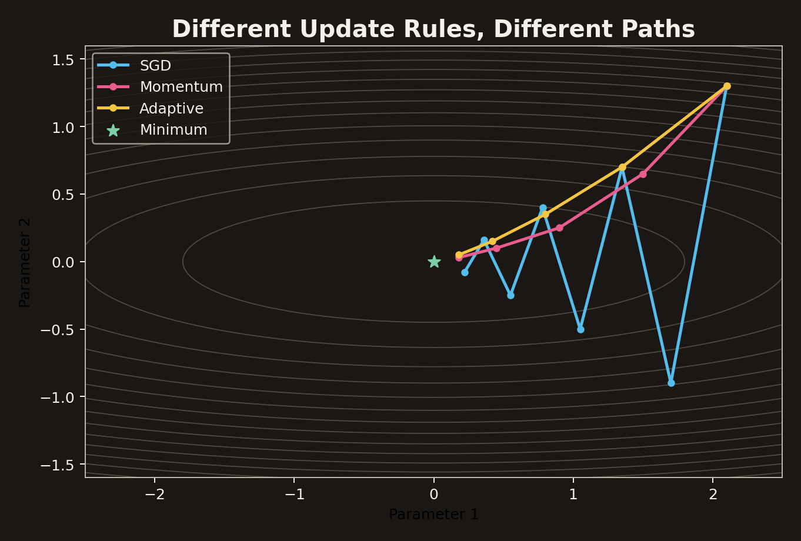
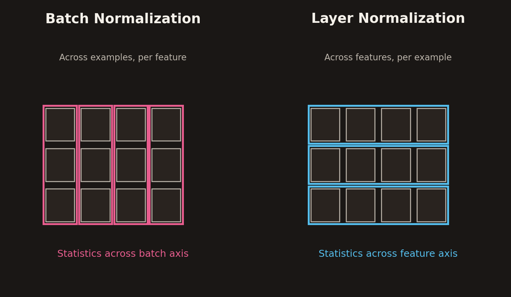
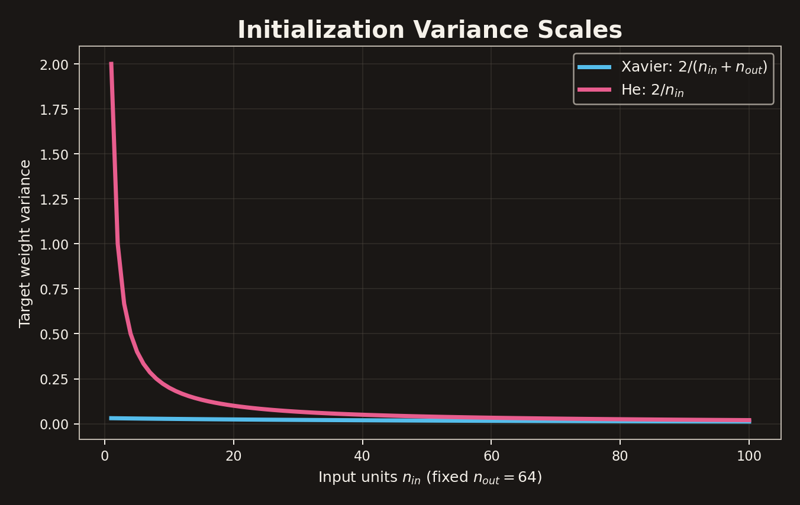
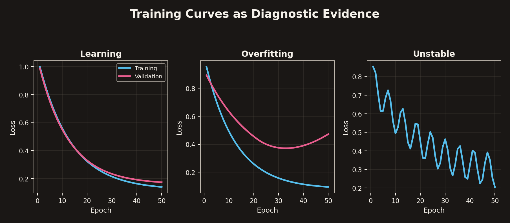
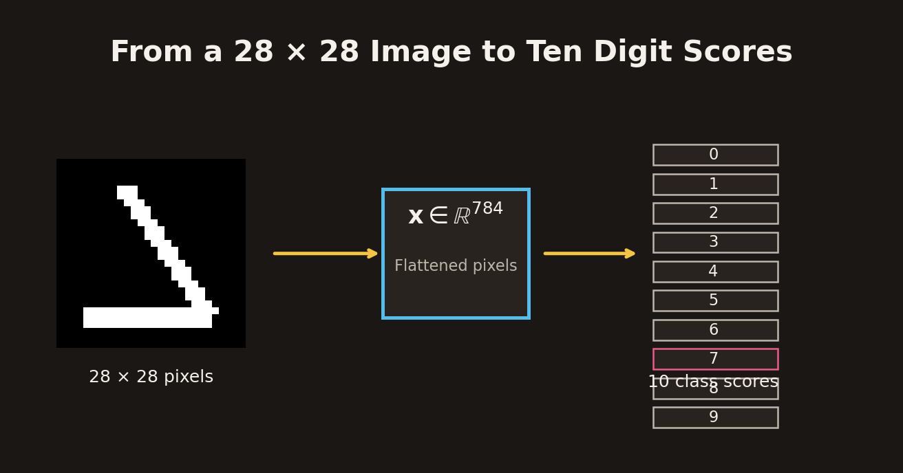

# Backpropagation, Gradient Descent and Neural Network Training

## 1. Overview

Training a neural network requires three distinct operations:

1. **Forward computation:** use the current weights and biases to produce a prediction.
2. **Differentiation (backpropagation):** determine how sensitive the loss is to each parameter.
3. **Optimization:** use the gradients to update the parameters.

These operations have different jobs. The forward pass computes values, backpropagation computes derivatives, and the optimizer changes parameters. Confusing these roles makes neural-network training difficult to understand and debug.

This chapter develops the chain rule from a one-weight example, extends it to multiple layers and vector-valued networks, and then studies gradient-descent update strategies. It also covers activation functions, normalization, initialization, training diagnostics, and a disciplined workflow for testing changes.

## 2. The Training Loop: Compute, Differentiate, Update

### 2.1 The three operations

A neural network with parameters $\theta$ maps an input $x$ to a prediction:

$$
\hat{y}=f_\theta(x).
$$

A loss function compares the prediction with the target:

$$
L=L(f_\theta(x),y).
$$

The training loop is:

1. Compute the prediction using the current parameters.
2. Compute the loss.
3. Differentiate the loss with respect to the parameters.
4. Update the parameters using an optimizer.
5. Repeat for further examples or batches.

In compact form:

$$
\boxed{
\text{Forward pass}
\rightarrow
\text{Loss}
\rightarrow
\text{Backpropagation}
\rightarrow
\text{Optimizer update}
}
$$



### 2.2 Backpropagation finds sensitivities, not new weights

Backpropagation computes derivatives such as:

$$
\frac{\partial L}{\partial w_j}.
$$

This derivative measures how much the loss changes when parameter $w_j$ is nudged by a small amount, with other parameters held fixed.

For a small parameter change $\Delta w$:

$$
\Delta L
\approx
\frac{\partial L}{\partial w}\Delta w.
$$

A positive derivative means a small positive change in the parameter increases the loss locally. A negative derivative means a small positive change decreases it locally.

Backpropagation does not itself decide how far to move the parameter. The optimizer uses the computed gradient and its own update rule to choose the change.

## 3. Derivatives and the Chain Rule

### 3.1 A gradient is a local sensitivity

Consider a scalar loss depending on one weight:

$$
L=2w^2.
$$

The derivative is:

$$
\frac{dL}{dw}=4w.
$$

At $w=1$:

$$
\frac{dL}{dw}=4.
$$

For a small change $\Delta w=0.01$:

$$
\Delta L\approx4(0.01)=0.04.
$$

The derivative is a local slope, not a probability, a loss value, or a learning rate.

For a model with many parameters, the gradient collects all partial derivatives:

$$
\nabla_\theta L
=
\begin{bmatrix}
\frac{\partial L}{\partial\theta_1}\\
\frac{\partial L}{\partial\theta_2}\\
\vdots\\
\frac{\partial L}{\partial\theta_p}
\end{bmatrix}.
$$

### 3.2 A one-weight forward example

Let:

$$
x=2,\qquad w=1,\qquad z=wx.
$$

The prediction is:

$$
z=1\times2=2.
$$

With target $y=0$ and squared loss:

$$
L=\frac{1}{2}(z-y)^2
=\frac{1}{2}(2-0)^2
=2.
$$

The forward pass computes the prediction and loss. Backpropagation begins at the loss and moves backward through the computation.

### 3.3 Start the backward pass at the loss

For:

$$
L=\frac{1}{2}(z-y)^2,
$$

the derivative with respect to the prediction is:

$$
\frac{\partial L}{\partial z}=z-y.
$$

At $z=2$ and $y=0$:

$$
\frac{\partial L}{\partial z}=2.
$$

If the prediction increases by a small amount $\Delta z=0.01$, then:

$$
\Delta L\approx2(0.01)=0.02.
$$

The loss derivative is the first sensitivity propagated backward.

### 3.4 Apply the chain rule

Because $z=wx$, the local derivative from weight to prediction is:

$$
\frac{\partial z}{\partial w}=x.
$$

The chain rule combines the two local derivatives:

$$
\boxed{
\frac{\partial L}{\partial w}
=
\frac{\partial L}{\partial z}
\frac{\partial z}{\partial w}
}
$$

Substituting:

$$
\frac{\partial L}{\partial w}
=
2\times2=4.
$$

The gradient is $4$. It is not yet a parameter update.

### 3.5 The optimizer performs the update

A basic gradient-descent update is:

$$
\boxed{
w_{\text{new}}
=
w_{\text{old}}-\eta\frac{\partial L}{\partial w}
}
$$

For learning rate $\eta=0.1$:

$$
w_{\text{new}}
=
1-0.1(4)
=
0.6.
$$

Recompute the prediction and loss using the new weight:

$$
z_{\text{new}}=0.6(2)=1.2,
$$

$$
L_{\text{new}}
=
\frac{1}{2}(1.2-0)^2
=
0.72.
$$

The loss decreased from $2$ to $0.72$ in this illustrative step.



The learning rate is a chosen optimizer setting. It is not produced by backpropagation.

## 4. Backpropagation Through Multiple Layers

### 4.1 A two-layer example

Consider a network with one hidden ReLU unit:

$$
a=w_1x,
\qquad
h=\operatorname{ReLU}(a),
$$

followed by an output layer:

$$
z=w_2h.
$$

Use the values:

$$
x=2,\qquad w_1=1,\qquad w_2=3.
$$

The hidden pre-activation is:

$$
a=w_1x=1(2)=2.
$$

Because $a>0$:

$$
h=\operatorname{ReLU}(2)=2.
$$

The output is:

$$
z=w_2h=3(2)=6.
$$

For target $y=0$ and squared loss:

$$
L=\frac{1}{2}(z-y)^2
=\frac{1}{2}(6)^2=18.
$$

### 4.2 Differentiate at the output layer

The output sensitivity is:

$$
\frac{\partial L}{\partial z}=z-y=6.
$$

The output weight gradient is:

$$
\frac{\partial L}{\partial w_2}
=
\frac{\partial L}{\partial z}
\frac{\partial z}{\partial w_2}
=
6h
=
6(2)=12.
$$

The sensitivity passed to the hidden activation is:

$$
\frac{\partial L}{\partial h}
=
\frac{\partial L}{\partial z}
\frac{\partial z}{\partial h}
=
6w_2
=
6(3)=18.
$$

The same incoming sensitivity can answer different derivative questions depending on the local operation.

### 4.3 Continue through the hidden layer

Since $h=\operatorname{ReLU}(a)$ and $a=2>0$:

$$
\frac{\partial h}{\partial a}=1.
$$

Therefore:

$$
\frac{\partial L}{\partial a}
=
\frac{\partial L}{\partial h}
\frac{\partial h}{\partial a}
=
18(1)=18.
$$

The first weight gradient is:

$$
\frac{\partial L}{\partial w_1}
=
\frac{\partial L}{\partial a}
\frac{\partial a}{\partial w_1}
=
18x
=
18(2)=36.
$$

The full gradient, ordered as $(w_1,w_2)$, is:

$$
\boxed{
\nabla_{\mathbf{w}}L=[36,12]
}
$$

No weights have changed during this calculation. The gradients are computed first; the optimizer updates them afterward.

### 4.4 Multiply along a path, add across paths

If a hidden value $h$ influences a loss through two separate downstream branches $u$ and $v$, then:

$$
\frac{\partial L}{\partial h}
=
\frac{\partial L}{\partial u}
\frac{\partial u}{\partial h}
+
\frac{\partial L}{\partial v}
\frac{\partial v}{\partial h}.
$$

The rule is:

- **Multiply** local derivatives along a path.
- **Add** derivative contributions from different paths.

This is how backpropagation handles dense connections, skip connections, and shared computations.



## 5. Vector and Matrix Form of Backpropagation

### 5.1 A layer as a vector operation

A fully connected layer can be written:

$$
\mathbf{a}=W\mathbf{x}+\mathbf{b},
\qquad
\mathbf{h}=\phi(\mathbf{a}),
$$

where:

- $\mathbf{x}$ is the input feature vector.
- $W$ is the weight matrix.
- $\mathbf{b}$ is the bias vector.
- $\mathbf{a}$ is the pre-activation vector.
- $\phi$ is applied elementwise to produce $\mathbf{h}$.

The forward pass computes the affine transformation and then applies the activation.

### 5.2 Compute the activation sensitivity

Let:

$$
\boldsymbol{\delta}
=
\frac{\partial L}{\partial\mathbf{a}}
$$

be the gradient with respect to the pre-activation vector.

By the chain rule:

$$
\boxed{
\boldsymbol{\delta}
=
\frac{\partial L}{\partial\mathbf{h}}
\odot
\phi'(\mathbf{a})
}
$$

where $\odot$ denotes elementwise multiplication.

### 5.3 Parameter gradients

For:

$$
\mathbf{a}=W\mathbf{x}+\mathbf{b},
$$

the gradients are:

$$
\boxed{
\frac{\partial L}{\partial W}
=
\boldsymbol{\delta}\mathbf{x}^T
}
$$

and:

$$
\boxed{
\frac{\partial L}{\partial\mathbf{b}}
=
\boldsymbol{\delta}
}
$$

The gradient passed to the preceding layer is:

$$
\boxed{
\frac{\partial L}{\partial\mathbf{x}}
=
W^T\boldsymbol{\delta}
}
$$

The transpose is important: the backward signal uses the transpose of the forward weight matrix.

For a batch of examples, the same operations are applied to the batch representation and the parameter gradients are accumulated or averaged according to the loss reduction convention.

### 5.4 Backpropagation through a deep network

For a sequence of layers:

$$
\mathbf{h}_0=\mathbf{x},
$$

$$
\mathbf{a}_\ell
=
W_\ell\mathbf{h}_{\ell-1}+\mathbf{b}_\ell,
$$

$$
\mathbf{h}_\ell
=
\phi_\ell(\mathbf{a}_\ell),
$$

the backward pass repeatedly applies:

$$
\boldsymbol{\delta}_\ell
=
\left(W_{\ell+1}^T\boldsymbol{\delta}_{\ell+1}\right)
\odot\phi_\ell'(\mathbf{a}_\ell).
$$

The gradient for each layer's weights is:

$$
\frac{\partial L}{\partial W_\ell}
=
\boldsymbol{\delta}_\ell\mathbf{h}_{\ell-1}^T.
$$

This repeated multiplication by weights and activation derivatives is the mathematical basis of gradient propagation through depth.

## 6. Activations Shape the Forward Signal and Backward Gradient

Nonlinear activation functions allow a network to represent nonlinear relationships. Without nonlinear activations between layers, stacking affine transformations would still produce a single affine transformation.

### 6.1 ReLU

The rectified linear unit is:

$$
\boxed{
\operatorname{ReLU}(z)=\max(0,z)
}
$$

Its derivative, away from the nondifferentiable point at zero, is:

$$
\operatorname{ReLU}'(z)
=
\begin{cases}
0,&z<0,\\
1,&z>0.
\end{cases}
$$

ReLU keeps the positive side open and avoids positive-side saturation. However, a unit that remains negative receives zero gradient through the activation and may stop updating. This is often called the **dying ReLU** problem.

### 6.2 Leaky ReLU

Leaky ReLU uses a small nonzero slope on the negative side:

$$
\boxed{
\operatorname{LeakyReLU}(z)
=
\max(\alpha z,z)
}
$$

where $\alpha$ is a small positive constant, such as $0.1$.

For negative inputs, the derivative is $\alpha$ rather than zero. This allows some gradient to pass through a unit even when its pre-activation is negative.

### 6.3 Sigmoid

The logistic sigmoid is:

$$
\boxed{
\sigma(z)=\frac{1}{1+e^{-z}}
}
$$

Its output range is $(0,1)$, making it useful for binary probabilities and gates.

Its derivative is:

$$
\boxed{
\sigma'(z)=\sigma(z)(1-\sigma(z))
}
$$

The derivative is at most $1/4$ and approaches zero for large positive or negative inputs. When activations saturate near zero or one, local gradients become small.

### 6.4 Hyperbolic tangent

The hyperbolic tangent is:

$$
\boxed{
\tanh(z)=\frac{e^z-e^{-z}}{e^z+e^{-z}}
}
$$

Its output range is $(-1,1)$ and it is centered at zero. Its derivative is:

$$
\boxed{
\frac{d}{dz}\tanh(z)=1-\tanh^2(z)
}
$$

Like sigmoid, tanh saturates for large-magnitude inputs, causing small local derivatives.

### 6.5 Activation comparison

| Activation | Output range | Main advantage | Main caution |
| --- | --- | --- | --- |
| ReLU | $[0,\infty)$ | Simple, no positive-side saturation | Negative units can receive zero gradient |
| Leaky ReLU | $(-\infty,\infty)$ | Retains a small negative-side gradient | Negative slope is a design choice |
| Sigmoid | $(0,1)$ | Natural probability-like output | Saturation and small derivatives |
| Tanh | $(-1,1)$ | Zero-centered output | Saturation and small derivatives |



### 6.6 Depth and vanishing or exploding gradients

Backpropagation through many layers multiplies local derivatives. In a simplified chain:

$$
\frac{\partial L}{\partial\mathbf{h}_0}
\propto
\prod_{\ell=1}^{K}
\frac{\partial\mathbf{h}_\ell}
{\partial\mathbf{h}_{\ell-1}}.
$$

If typical derivative magnitudes are consistently below one, repeated multiplication can make gradients very small. This is the **vanishing-gradient** problem. If magnitudes are consistently above one, gradients can grow rapidly, producing the **exploding-gradient** problem.

For example, repeated multiplication by $0.5$ gives:

$$
0.5^{20}\approx9.54\times10^{-7}.
$$

Repeated multiplication by $1.5$ gives:

$$
1.5^{20}\approx3325.3.
$$

These are illustrative scalar products, but they show why the scale of activations, weights, and derivatives matters in deep networks.

## 7. Loss Functions and Classification Signals

### 7.1 Logits and softmax

For a multiclass classifier, the network produces a vector of logits:

$$
\mathbf{z}=[z_1,z_2,\ldots,z_C].
$$

The softmax converts logits into class probabilities:

$$
\boxed{
p_k
=
\frac{e^{z_k}}{\sum_{j=1}^{C}e^{z_j}}
}
$$

The probabilities are nonnegative and sum to one.

For example, logits:

$$
\mathbf{z}=[2,1,0]
$$

produce approximate probabilities:

$$
\mathbf{p}=[0.665,0.245,0.090].
$$

The largest probability corresponds to the predicted class.

### 7.2 Cross-entropy loss

For a target class $y$ represented by a one-hot vector, the cross-entropy loss is:

$$
\boxed{
L
=
-\sum_{k=1}^{C}y_k\log p_k
}
$$

If the correct class is $c$, this reduces to:

$$
L=-\log p_c.
$$

The loss rewards probability assigned to the correct class. A low correct-class probability produces a larger loss; a high correct-class probability produces a smaller loss.

For logits, the usual softmax-cross-entropy derivative has a compact form:

$$
\boxed{
\frac{\partial L}{\partial z_k}=p_k-y_k
}
$$

This is analogous to the binary sigmoid-cross-entropy derivative $p-y$.

## 8. The Optimizer Turns Gradients into Parameter Updates

### 8.1 Stochastic gradient descent

The basic stochastic gradient descent (SGD) update is:

$$
\boxed{
\theta_t
=
\theta_{t-1}-\eta g_t
}
$$

where $g_t$ is the current gradient estimate and $\eta$ is the learning rate.

SGD follows the current slope. It does not keep a separate history of past directions and does not automatically rescale each parameter coordinate.

### 8.2 One sample, mini-batch, or full batch

The gradient can be estimated using different amounts of training data.

| Update strategy | Gradient computed from | Typical update frequency |
| --- | --- | --- |
| Stochastic / one-sample | One training example | After every example |
| Mini-batch | A small group of examples | After each mini-batch |
| Full batch | Entire training set | Once per full pass |

For a dataset of 700 examples:

- One-sample SGD makes 700 updates per epoch.
- Full-batch gradient descent makes one update per epoch.
- A mini-batch size of 32 makes 21 full mini-batches plus a final batch of 28, for 22 updates per epoch.

The exact number of updates depends on dataset size, batch size, and whether the final incomplete batch is retained.

A mini-batch gradient is commonly the average loss gradient across the batch:

$$
g_t
=
\frac{1}{B}
\sum_{i=1}^{B}
\nabla_\theta L_i(\theta).
$$

### 8.3 A minimal training loop

A standard training iteration has the structure:

```python
model.train()

for x, y in train_loader:
    optimizer.zero_grad()
    logits = model(x)
    loss = criterion(logits, y)
    loss.backward()
    optimizer.step()
```

The operations are:

1. Clear gradients left from the previous iteration.
2. Run the forward pass to compute logits.
3. Compute the loss against the target.
4. Run backpropagation to compute gradients.
5. Let the optimizer update the parameters.

The forward pass, loss, differentiation, and update must occur in this order.

## 9. Learning Rate and Momentum

### 9.1 Learning rate controls step size

The learning rate $\eta$ scales the update:

$$
\theta_t=\theta_{t-1}-\eta g_t.
$$

A learning rate that is too small can make training very slow. A useful learning rate can make steady progress. A learning rate that is too large can overshoot a minimum, oscillate, or diverge.



The gradient gives a local direction, not a guaranteed safe distance. A direction that points downhill can still lead to a higher loss if the step is too large.

### 9.2 Momentum

Momentum accumulates a moving direction from current and previous gradients:

$$
\boxed{
v_t=\beta v_{t-1}+g_t
}
$$

The parameter update is:

$$
\boxed{
\theta_t=\theta_{t-1}-\eta v_t
}
$$

where $\beta$ controls how much of the previous update direction is retained.

Momentum can reduce zig-zagging in narrow valleys by preserving a consistent direction across successive steps. It can also overshoot if the accumulated direction is no longer appropriate.

When $\beta=0$, the velocity is just the current gradient and the rule reduces to SGD.

## 10. Adaptive Optimizers

Adaptive optimizers adjust the effective step size for different parameter coordinates using accumulated gradient information.

### 10.1 AdaGrad

AdaGrad accumulates squared gradients coordinate by coordinate:

$$
\boxed{
s_t=s_{t-1}+g_t^2
}
$$

The update is:

$$
\boxed{
\theta_t
=
\theta_{t-1}
-
\eta\frac{g_t}{\sqrt{s_t}+\epsilon}
}
$$

The operations on vectors are elementwise. Coordinates with large accumulated squared gradients receive smaller effective updates; coordinates with smaller accumulated gradients can receive relatively larger updates.

AdaGrad can be useful for sparse gradients. Its limitation is that the accumulated squared-gradient sum never decreases, so the effective learning rate can become extremely small over time.

### 10.2 RMSProp

RMSProp replaces the ever-growing sum with an exponential moving average:

$$
\boxed{
s_t
=
\rho s_{t-1}
+
(1-\rho)g_t^2
}
$$

The update is:

$$
\boxed{
\theta_t
=
\theta_{t-1}
-
\eta\frac{g_t}{\sqrt{s_t}+\epsilon}
}
$$

Because old squared gradients gradually lose influence, the scale estimate can adapt to more recent gradient magnitudes. This avoids AdaGrad's permanently increasing accumulator.

### 10.3 Adam

Adam combines momentum-like direction information with RMSProp-like scale information.

First moment estimate:

$$
m_t
=
\beta_1m_{t-1}
+
(1-\beta_1)g_t.
$$

Second moment estimate:

$$
v_t
=
\beta_2v_{t-1}
+
(1-\beta_2)g_t^2.
$$

Because these moving averages are often initialized at zero, early estimates are biased toward zero. Adam applies bias corrections:

$$
\hat{m}_t
=
\frac{m_t}{1-\beta_1^t},
\qquad
\hat{v}_t
=
\frac{v_t}{1-\beta_2^t}.
$$

The parameter update is:

$$
\boxed{
\theta_t
=
\theta_{t-1}
-
\eta
\frac{\hat{m}_t}{\sqrt{\hat{v}_t}+\epsilon}
}
$$

Adam combines:

- **Direction memory:** the first moment remembers a smoothed gradient direction.
- **Scale adaptation:** the second moment tracks recent squared-gradient magnitudes.
- **Bias correction:** early moving-average estimates are adjusted for zero initialization.

### 10.4 Optimizer comparison

| Optimizer | Main idea | Useful property | Limitation or caution |
| --- | --- | --- | --- |
| SGD | Current gradient only | Simple baseline | Can zig-zag and is sensitive to learning rate |
| Momentum | Smoothed gradient direction | Can accelerate consistent movement | Can overshoot |
| AdaGrad | Accumulated squared gradients | Coordinate-wise adaptation; useful for sparse gradients | Effective step sizes can become too small |
| RMSProp | Exponential average of squared gradients | Adapts to recent gradient scale | Requires tuning decay and learning rate |
| Adam | First and second moments with bias correction | Combines direction memory and adaptive scale | Still requires validation and tuning |



The optimizer should be selected and tuned empirically. A more elaborate optimizer does not guarantee better validation performance.

## 11. Feature Scaling and Normalization

### 11.1 Standardize input features

Features measured in different units can have very different numeric scales. Large-scale features may dominate optimization or distance calculations.

A common standardization is:

$$
\boxed{
\tilde{x}_j
=
\frac{x_j-\mu_{\text{train},j}}
{\sigma_{\text{train},j}+\epsilon}
}
$$

where:

- $\mu_{\text{train},j}$ is the training-set mean for feature $j$.
- $\sigma_{\text{train},j}$ is the training-set standard deviation.
- $\epsilon$ is a small stabilizing constant.

For example, raw measurements:

$$
[150,7,7,6]
$$

with training means:

$$
[120,10,5,5]
$$

and standard deviations:

$$
[30,3,2,2]
$$

become:

$$
[1,-1,1,0.5].
$$

The statistics must be computed from the training set and then reused for validation and test data. Computing separate statistics from the test set leaks information from the evaluation data into the training pipeline.

### 11.2 Batch normalization

Batch normalization standardizes activations using statistics estimated over a mini-batch, then applies a learned scale and shift:

$$
\hat{a}
=
\frac{a-\mu_B}{\sqrt{\sigma_B^2+\epsilon}},
$$

$$
\boxed{
u=\gamma\hat{a}+\beta
}
$$

where $\gamma$ and $\beta$ are trainable parameters.

The normalization controls activation scale, while the learned affine transformation allows the network to choose a useful scale and offset after normalization.

### 11.3 Layer normalization

Layer normalization computes normalization statistics across the hidden features of an individual example rather than across examples in a mini-batch.

| Method | Normalization axes | Typical statistics |
| --- | --- | --- |
| Batch normalization | Across examples in the batch, for each feature | Batch mean and variance |
| Layer normalization | Across hidden features within each example | Per-example feature mean and variance |

The choice of normalization axes changes which values are grouped together to compute the mean and variance. The two methods are not interchangeable in every architecture or training setting.



## 12. Weight Initialization and Symmetry Breaking

### 12.1 Why initialization matters

Training begins from an initial parameter setting. If every neuron in a layer starts with identical weights, those neurons receive identical inputs, compute identical outputs, and receive identical gradients. They remain redundant rather than learning different features.

Random initialization breaks this symmetry by giving units different starting parameters.

The goal is not merely to use random values. The scale of the initial weights should keep activations and gradients at reasonable magnitudes as signals pass through layers.

### 12.2 Xavier initialization

For a layer with $n_{\text{in}}$ input units and $n_{\text{out}}$ output units, the Xavier variance is:

$$
\boxed{
\operatorname{Var}(W_{ij})
=
\frac{2}{n_{\text{in}}+n_{\text{out}}}
}
$$

Xavier initialization is commonly associated with linear or tanh-like activations and aims to balance signal variance across layers.

### 12.3 He initialization

For ReLU-like activations, He initialization uses:

$$
\boxed{
\operatorname{Var}(W_{ij})
=
\frac{2}{n_{\text{in}}}
}
$$

The larger variance compensates for the fact that ReLU sets negative pre-activations to zero.

### 12.4 Common initialization distributions

A desired variance can be used with different distributions.

**Normal initialization:**

$$
W_{ij}\sim\mathcal{N}(0,\sigma_W^2).
$$

**Uniform initialization:**

$$
W_{ij}\sim\mathcal{U}(-a,a),
\qquad
a=\sqrt{3}\sigma_W.
$$

For a uniform distribution on $[-a,a]$, the variance is $a^2/3$, so the stated choice gives variance $\sigma_W^2$.

**Orthogonal initialization:**

An orthogonal matrix $Q$ satisfies:

$$
Q^TQ=I.
$$

Orthogonal initialization uses orthogonal weight directions, with appropriate scaling when needed. It is another way to control signal propagation through a layer.

### 12.5 Xavier versus He

| Method | Variance | Typical activation context |
| --- | --- | --- |
| Xavier / Glorot | $2/(n_{\text{in}}+n_{\text{out}})$ | Linear or tanh-like activations |
| He / Kaiming | $2/n_{\text{in}}$ | ReLU and related activations |

Initialization variance is not the same as the actual range of every sampled weight. The distribution determines how individual values are drawn around the target scale.



## 13. Diagnosing Training Behavior

### 13.1 Inspect signal magnitudes

Activations and gradients should be inspected across layers. If magnitudes become extremely small, signals may be vanishing. If they become extremely large, signals may be exploding.

A healthy initialization and suitable activation/normalization choices help preserve useful signal scales.

### 13.2 Training and validation curves

Training loss alone does not reveal whether a model generalizes. Compare training and validation behavior over epochs.

Common patterns include:

- **Not learning:** training loss remains high or changes very little.
- **Overfitting:** training loss continues to decrease while validation loss worsens.
- **Unstable training:** loss oscillates or changes erratically, potentially because the learning rate or gradient scale is unsuitable.



A validation curve is a diagnostic signal, not a verdict on its own. It should be interpreted in the context of the dataset, metric, training duration, and experimental setup.

### 13.3 Match the intervention to the symptom

| Symptom | Possible intervention | What to inspect |
| --- | --- | --- |
| Plateau or very slow progress | Revisit learning rate | Whether steps are too small |
| Exploding gradients | Clip gradient norm | Magnitude of backpropagated gradients |
| Overfitting | Regularize or use dropout / weight decay | Training-validation gap |
| Dead or inactive ReLU units | Inspect activation distributions; consider a leaky activation | Fraction of units with zero output |
| Unstable activation scale | Check normalization statistics | Means and variances across layers |
| Redundant hidden units | Break symmetry with independent initialization | Whether units begin with identical weights |

Gradient-norm clipping rescales a gradient when its norm exceeds a threshold $\tau$:

$$
g
\leftarrow
g\min\left(1,\frac{\tau}{\|g\|_2}\right).
$$

This limits the size of an unusually large gradient vector. It does not fix every cause of unstable training, but it can prevent a single extreme gradient from producing an excessively large update.

## 14. A Practical Training and Debugging Workflow

### 14.1 Start from a small, controlled baseline

Before making a complex model or tuning many settings, construct a small training experiment with a clear data pipeline, objective, gradients, and update rule.

A useful sequence is:

1. **Data:** verify inputs, targets, shapes, and preprocessing.
2. **Objective:** verify that the loss matches the task and target encoding.
3. **Gradients:** check that gradients are finite and have expected shapes.
4. **Update:** verify that an optimizer step changes parameters and can reduce loss on a tiny batch.

A tiny-batch test is useful for detecting implementation mistakes before committing to a long training run.

### 14.2 Keep training, validation, and test roles separate

A representative split used in the course example is:

| Partition | Number of examples | Purpose |
| --- | ---: | --- |
| Training | 700 | Fit model parameters |
| Validation | 150 | Choose hyperparameters and monitor generalization |
| Test | 150 | Final evaluation after choices are fixed |

These numbers are an example, not a universal split rule.

- The **training set** is used to compute gradients and update model parameters.
- The **validation set** helps choose architecture, optimizer settings, and stopping decisions.
- The **test set** is held back for final evaluation and should not guide repeated model tuning.

### 14.3 Change one thing at a time

When debugging or improving a model, changing several components simultaneously makes it difficult to identify the cause of an improvement or failure.

A controlled experiment should:

1. Establish a baseline.
2. Record the metric and relevant diagnostics.
3. Change one intervention.
4. Train under comparable conditions.
5. Compare validation behavior.
6. Keep or reject the change based on evidence.

Potential interventions include changing the activation, normalization method, initialization, optimizer, learning rate, or regularization. The selected intervention should match the observed symptom.

### 14.4 Read curves as hypotheses, not verdicts

A curve can suggest a likely issue, but it does not prove a single cause. For example:

- A flat training curve may indicate a learning-rate problem, a data or label issue, an implementation bug, or an unsuitable model.
- A widening training-validation gap may suggest overfitting.
- Oscillations may indicate a learning rate that is too large, noisy gradients, or poor scaling.

Use curves to formulate a diagnosis, then test one plausible intervention.

## 15. Images as Vectors: A Classification Example

An image can be represented as a vector of pixel values. A grayscale image of size $28\times28$ contains:

$$
28\times28=784
$$

pixel values. Flattening the image produces a vector in:

$$
\mathbb{R}^{784}.
$$

A digit classifier can map this vector to ten output scores, one for each digit class $0,1,\ldots,9$.

The model therefore has:

- 784 input features.
- A sequence of learned hidden representations.
- 10 output logits or class scores.



Each hidden layer builds a new feature vector from the previous representation. These learned features are numerical coordinates, not necessarily directly interpretable measurements.

## 16. Key Takeaways

- The training loop consists of forward computation, loss evaluation, backpropagation, and optimizer update.
- Backpropagation computes parameter sensitivities; the optimizer changes the parameters.
- The chain rule multiplies local derivatives along a path and adds contributions from multiple paths.
- Vector backpropagation uses matrix transposes to propagate sensitivities to earlier layers.
- Nonlinear activations make depth useful; stacking affine layers without nonlinearities remains affine.
- ReLU can have zero gradients on its negative side, while sigmoid and tanh can saturate and produce small derivatives.
- Deep networks can experience vanishing or exploding gradients because local derivatives are multiplied through layers.
- Softmax converts multiclass logits to probabilities, and cross-entropy rewards probability assigned to the correct class.
- SGD uses the current gradient; momentum adds direction memory; AdaGrad and RMSProp adapt coordinate-wise scale; Adam combines both ideas with bias correction.
- The learning rate controls the update magnitude and can cause slow progress or unstable steps when poorly chosen.
- Feature scaling should use training-set statistics, reused for validation and test data.
- Batch normalization and layer normalization differ in the axes over which their statistics are calculated.
- Xavier and He initialization use different variance rules suited to different activation families.
- Independent random initialization breaks hidden-unit symmetry.
- Training and validation curves help diagnose learning, overfitting, and instability.
- A tiny-batch experiment is a useful first test of the data, objective, gradients, and update implementation.
- The test set should be reserved for final evaluation rather than repeated model selection.

## 17. Notation Reference

| Symbol | Meaning |
| --- | --- |
| $\theta$ | All trainable model parameters |
| $x,\mathbf{x}$ | Input or input feature vector |
| $y$ | Target label |
| $\hat{y}$ | Model prediction |
| $L$ | Loss function |
| $w,W$ | Scalar weight or weight matrix |
| $b,\mathbf{b}$ | Scalar bias or bias vector |
| $z,\mathbf{z}$ | Scalar score or vector of logits |
| $a,\mathbf{a}$ | Pre-activation |
| $h,\mathbf{h}$ | Activation or hidden feature vector |
| $\nabla_\theta L$ | Gradient of loss with respect to parameters |
| $\eta$ | Learning rate |
| $g_t$ | Gradient estimate at step $t$ |
| $v_t$ | Momentum velocity |
| $s_t$ | Accumulated or moving-average squared gradient |
| $m_t$ | Adam first moment estimate |
| $\hat{m}_t,\hat{v}_t$ | Bias-corrected Adam moments |
| $\epsilon$ | Small numerical stabilizer |
| $\gamma,\beta$ | Learned scale and shift in normalization |
| $n_{\text{in}},n_{\text{out}}$ | Number of input and output units in a layer |
| $B$ | Mini-batch size |
| $\tau$ | Gradient clipping threshold |

## 18. Technical Notes and Scope

- The scalar squared-loss examples are teaching examples for the chain rule. They are not the same objective as the multiclass cross-entropy example.
- The displayed two-layer ReLU example assumes a positive hidden pre-activation, so the ReLU derivative is one.
- ReLU is nondifferentiable at zero; implementations use a conventional subgradient at that point.
- The standardization formula uses training-set statistics. The small $\epsilon$ is included for numerical stability, especially when a feature has very small variance.
- Batch normalization's training-time batch statistics and inference-time running statistics are distinct implementation details; the chapter focuses on the normalization axes and learned affine transformation.
- The Xavier and He formulas specify target weight variance. Exact sampling distributions and scaling conventions can vary by implementation.
- The training/validation/test counts are an illustrative example and should not be treated as a universal data-splitting recommendation.
- Optimizer behavior depends on learning rate, batch size, data scale, architecture, and other hyperparameters. No optimizer is guaranteed to be best for every task.
