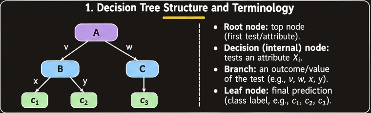
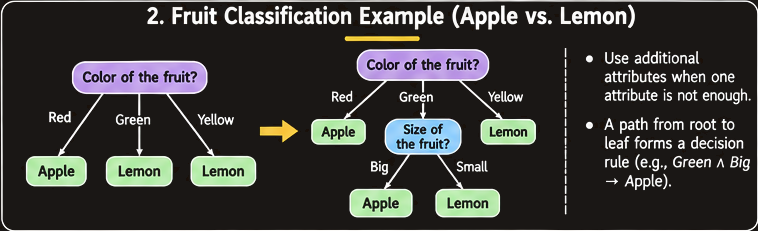
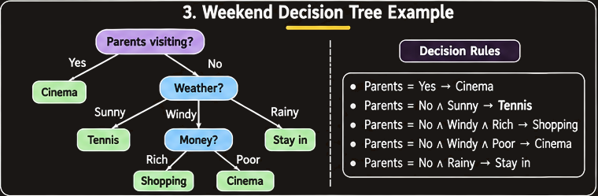
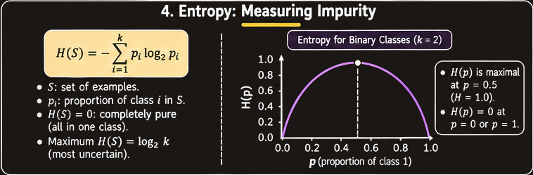
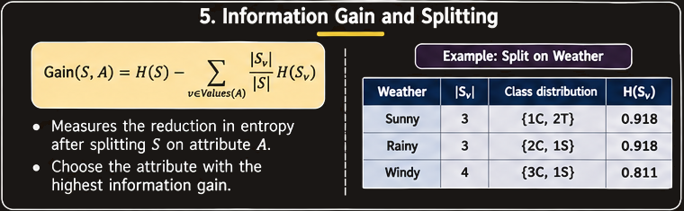
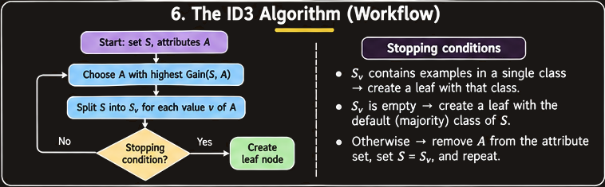
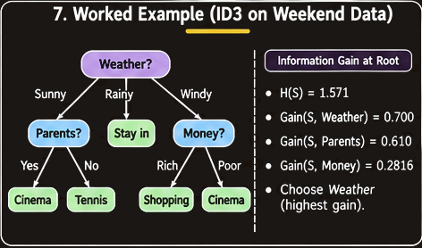
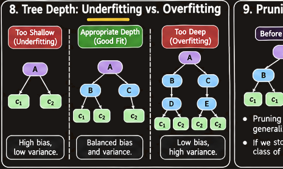

# Decision Trees and the ID3 Algorithm

## 1. Overview

A **decision tree** is a supervised-learning model that makes a prediction by applying a sequence of tests to input features. Each test determines which branch to follow, and the final leaf gives the predicted class or value.

The two supplied lectures cover the same topic from complementary angles:

- **Decision Trees:** the structure of a tree, how to read its rules, and how it can classify examples.
- **The ID3 Algorithm and tree control:** how a tree can be learned from labelled examples using entropy and information gain, and how its size can be controlled.

The central questions are:

1. What are the parts of a decision tree?
2. How does a tree turn feature values into a prediction?
3. How does ID3 choose the next attribute?
4. How are entropy and information gain calculated?
5. How can tree depth and pruning help control overfitting?
6. What other measures of impurity can be used in tree learning?

## 2. What Is a Decision Tree?

A decision tree represents a sequence of decisions in a tree-shaped structure. It can be viewed as a set of rules for categorizing examples.

### 2.1 Main Components

The slides introduce the following terms:

- **Root node:** the top node of the tree. It is the first test applied to an example.
- **Decision node / internal node:** a node that tests one or more features.
- **Branch / edge:** a connection from a node that corresponds to a possible value or outcome of the test.
- **Child node:** a node reached by following a branch from its parent.
- **Parent node:** the node immediately above a child.
- **Sibling nodes:** nodes that share the same parent.
- **Leaf node / terminal node:** a node with no further decision branches. It gives the prediction.
- **Subtree:** a node together with the descendants below it.

The tree diagram in the first decision-tree lecture labels the root, parent, child, siblings, edge, subtree, and leaf. These terms describe the general tree structure, while root, decision nodes, branches, and leaves describe how that structure is used for prediction.

### 2.2 Features and Predictions

Each internal node tests a feature, or a set of features. Each outgoing branch selects a value or outcome of that test. Each leaf represents the prediction for the target variable \(Y\).

The slides state that features can be:

- Discrete
- Continuous / numeric
- Categorical

For a classification tree, the leaf predicts a class label. For a regression tree, a leaf predicts a numerical value.

A tree can be represented as a function:

\[
f(X_1,X_2,\ldots,X_p)\in\mathcal{F}
\]

where \(X_1,\ldots,X_p\) are explanatory variables and \(\mathcal{F}\) is the family of decision-tree functions.

### 2.3 Decision Nodes and Leaf Nodes

A decision node has two or more branches, each representing a value or outcome of the attribute being tested. A leaf node gives a result that does not require further classification tests.

For example, a fruit-classification tree can first test the colour of a fruit:

- Red → Apple
- Yellow → Lemon
- Green → test the size of the fruit:
  - Big → Apple
  - Small → Lemon

The first colour test is the root. The size test is an internal node. Apple and Lemon are leaf predictions.

## 3. Reading a Decision Tree as Rules

A decision tree can be translated into logical rules by following each path from the root to a leaf.

Each path can be written in the form:

> If condition 1 and condition 2 and ... and condition n, then predict the leaf result.

For example, the weekend decision tree in the lecture contains the rule:

\[
\text{no\_parents}\land\text{sunny\_day}
\Rightarrow \text{play\_tennis}
\]

This means: if the parents are not visiting and the weather is sunny, the prediction is to play tennis.

The same tree can be interpreted as a sequence of tests:

1. Start at the root.
2. Check the feature shown at that node.
3. Follow the branch matching the example's value.
4. Continue until reaching a leaf.
5. Return the leaf's prediction.

### 3.1 Weekend Decision Example: Rule-Based Tree

One of the lectures gives the following decision rules:

- If the parents are visiting, go to the cinema.
- If the parents are not visiting:
  - If it is sunny, play tennis.
  - If it is windy:
    - If money is rich, go shopping.
    - If money is poor, go to the cinema.
  - If it is rainy, stay in.

The corresponding tree is:

1. Test **Parents Visiting?**
2. If Yes → Cinema.
3. If No → test **Weather**.
4. If Sunny → Play tennis.
5. If Rainy → Stay in.
6. If Windy → test **Money**:
   - Rich → Shopping.
   - Poor → Cinema.

This example illustrates how a compact tree can encode a collection of conditional rules.

## 4. Learning a Decision Tree from Examples

A decision tree can be designed by learning from labelled examples. The task is not to translate a person's reasoning process directly into a tree. Instead, the learning algorithm uses a training dataset to decide which attributes should appear at which positions.

The major design question is:

**Which attribute should be placed at each decision node, including the root?**

The ID3 algorithm answers this question using **information gain**.

## 5. Entropy: Measuring Impurity

**Entropy** measures the impurity or uncertainty of a set of labelled examples. It is used to describe how mixed the class labels are within a dataset or node.

- A completely homogeneous set, in which every example belongs to the same class, has entropy 0.
- In a binary classification problem, a set divided equally between the two classes has entropy 1.
- A more mixed set has greater entropy than a homogeneous set.

### 5.1 Entropy for Binary Classification

Let:

- \(p_+\) be the proportion of positive examples.
- \(p_-\) be the proportion of negative examples.

Then:

\[
Entropy(S)=-p_+\log_2(p_+)-p_-\log_2(p_-)
\]

The proportions satisfy:

\[
p_+ + p_- = 1
\]

### 5.2 Entropy for Multiple Classes

For a dataset with classes \(c_1,c_2,\ldots,c_m\), let \(p_i\) be the proportion of examples belonging to class \(c_i\).

\[
Entropy(S)=-\sum_{i=1}^{m}p_i\log_2(p_i)
\]

A term with probability zero is treated as zero:

\[
0\log_2(0)=0
\]

This convention avoids an undefined numerical term when a class is absent from a subset.

### 5.3 Interpreting Entropy

For a binary class distribution:

| Positive proportion | Negative proportion | Entropy |
| ---: | ---: | ---: |
| 1.0 | 0.0 | 0 |
| 0.75 | 0.25 | Approximately 0.811 |
| 0.5 | 0.5 | 1 |
| 0.25 | 0.75 | Approximately 0.811 |
| 0.0 | 1.0 | 0 |

Entropy is highest when the two classes are equally represented and lowest when only one class is present.

## 6. Information Gain

**Information gain (IG)** measures the decrease in entropy after splitting a dataset on an attribute.

It answers the question:

> Which attribute creates the most homogeneous branches?

The procedure is:

1. Calculate the entropy of the original dataset.
2. Split the dataset according to the possible values of an attribute.
3. Calculate the entropy of each resulting subset.
4. Weight each subset's entropy by its size relative to the original dataset.
5. Subtract the weighted entropy after the split from the entropy before the split.

For dataset \(S\) and attribute \(A\):

\[
Gain(S,A)=Entropy(S)-
\sum_{v\in Values(A)}
\frac{|S_v|}{|S|}Entropy(S_v)
\]

where:

- \(Values(A)\) is the set of possible values of attribute \(A\).
- \(S_v\) is the subset of examples for which attribute \(A\) has value \(v\).
- \(|S_v|\) is the number of examples in that subset.
- \(|S|\) is the number of examples in the original dataset.

The weighted sum is the entropy remaining after the split. A larger information gain means a greater reduction in entropy.

### 6.1 How to Choose an Attribute

Calculate the information gain for each currently available attribute. Choose the attribute with the highest information gain as the next decision node.

If a branch contains examples from only one class, its entropy is zero and it can become a leaf. If the branch still contains multiple classes, it needs further splitting unless a stopping rule is reached.

## 7. The ID3 Algorithm

The **ID3 algorithm** was introduced by J. Ross Quinlan in 1979, as stated in the lecture.

ID3:

- Uses information gain to select the next attribute.
- Builds the tree from the top down.
- Proceeds recursively on branches that still contain mixed classes.
- Does not backtrack in the version described in the slides.
- Places a leaf when no further attribute choice is needed.

### 7.1 ID3 Step by Step

Given a set of labelled examples \(S\) and a set of available attributes:

1. Calculate the information gain for each available attribute.
2. Choose the attribute \(A\) with the highest gain.
3. Make \(A\) the current decision node.
4. For every value \(v\) that \(A\) can take, create a branch labelled \(v\).
5. Let \(S_v\) be the examples in \(S\) whose attribute \(A\) has value \(v\).
6. For each branch:
   - If \(S_v\) contains examples from only one category, make that category a leaf.
   - If \(S_v\) is empty, use the default category: the category with the most examples in the current parent set \(S\).
   - Otherwise, remove \(A\) from the available attributes, replace \(S\) with \(S_v\), and repeat the selection process.
7. Continue until the branches are classified or a stopping condition is reached.

**Important:** At every recursive step, replace the current dataset with the subset belonging to that branch. The second lecture explicitly emphasizes this point: when working on a branch, calculate the next information gains using that branch's subset, not the original full dataset.

### 7.2 Empty Branches and Default Categories

A branch can be empty if an attribute value does not occur in the current subset. The lecture's ID3 description says to use the **default category**, defined as the category containing the most examples in the current set \(S\), as the leaf label for that empty branch.

This is distinct from the pure-branch case:

- **Pure branch:** examples exist, and all have the same class.
- **Empty branch:** no examples take that attribute value in the current subset, so the default category is used.

## 8. Worked Example 1: The Weekend Dataset

The second decision-tree lecture provides a dataset containing ten weekends. The goal is to predict the decision for a weekend from weather, whether parents are visiting, and the amount of money available.

### 8.1 Training Data

| Weekend | Weather | Parents | Money | Decision |
| --- | --- | --- | --- | --- |
| W1 | Sunny | Yes | Rich | Cinema |
| W2 | Sunny | No | Rich | Tennis |
| W3 | Windy | Yes | Rich | Cinema |
| W4 | Rainy | Yes | Poor | Cinema |
| W5 | Rainy | No | Rich | Stay in |
| W6 | Rainy | Yes | Poor | Cinema |
| W7 | Windy | No | Poor | Cinema |
| W8 | Windy | No | Rich | Shopping |
| W9 | Windy | Yes | Rich | Cinema |
| W10 | Sunny | No | Rich | Tennis |

The weekend identifier (W1, W2, and so on) identifies each row. The attributes used in the lecture's information-gain comparison are **Weather**, **Parents**, and **Money**.

### 8.2 Entropy of the Full Dataset

The class counts are:

- Cinema: 6
- Tennis: 2
- Stay in: 1
- Shopping: 1

Therefore:

\[
Entropy(S)=
-\frac{6}{10}\log_2\frac{6}{10}
-\frac{2}{10}\log_2\frac{2}{10}
-\frac{1}{10}\log_2\frac{1}{10}
-\frac{1}{10}\log_2\frac{1}{10}
\]

\[
Entropy(S)\approx1.571
\]

This is the starting impurity before any attribute is selected.

### 8.3 Compare Information Gain

The lecture gives the following information-gain values for the full dataset:

| Attribute | Information gain |
| --- | ---: |
| Weather | 0.700 |
| Parents | 0.610 |
| Money | 0.2816 |

Weather has the largest information gain, so it is selected as the root node.

\[
A_{\text{root}}=\text{Weather}
\]

The reason is that splitting on Weather produces the greatest reduction in entropy among the attributes compared.

### 8.4 Examine the Sunny Branch

The Sunny subset is:

\[
S_{\text{sunny}}=\{W1,W2,W10\}
\]

| Weekend | Weather | Parents | Money | Decision |
| --- | --- | --- | --- | --- |
| W1 | Sunny | Yes | Rich | Cinema |
| W2 | Sunny | No | Rich | Tennis |
| W10 | Sunny | No | Rich | Tennis |

This subset contains two classes:

- Cinema: 1 example.
- Tennis: 2 examples.

It is neither empty nor pure, so ID3 must split it further.

Weather cannot be selected again because it has already been used along this path. The remaining candidate attributes are Parents and Money.

The lecture gives:

| Attribute | Gain on \(S_{\text{sunny}}\) |
| --- | ---: |
| Parents | 0.918 |
| Money | 0 |

Therefore, Parents is selected for the Sunny branch.

### 8.5 Finish the Sunny Branch

The Parents split produces:

- Parents = Yes → W1 → Cinema.
- Parents = No → W2 and W10 → Tennis.

Both resulting branches are pure, so they become leaves.

The resulting rules are:

- If Weather = Sunny and Parents = Yes, predict Cinema.
- If Weather = Sunny and Parents = No, predict Tennis.

### 8.6 What the Slides Show for the Other Branches

The slide showing the partially constructed tree places Weather at the root, with Sunny, Windy, and Rainy branches. It explicitly works through the Sunny branch and shows the Parents split there. The displayed tree leaves the Windy and Rainy branch boxes unlabelled in that slide.

The lecture does not provide the complete recursive information-gain calculations for those two branches in the extracted material. This chapter therefore does not invent further ID3 splits or present unshown leaf labels as if they were calculated in the slides.

## 9. Worked Example 2: A Small Information-Gain Calculation

The first decision-tree lecture gives a smaller example to demonstrate the information-gain formula.

There are four examples:

\[
S=\{s_1,s_2,s_3,s_4\}
\]

The binary class distribution contains:

- One positive example: \(s_1\).
- Three negative examples: \(s_2,s_3,s_4\).

Attribute \(A\) has three possible values:

- \(s_1\) and \(s_2\) have value \(v_2\).
- \(s_3\) has value \(v_3\).
- \(s_4\) has value \(v_1\).

Thus:

\[
S_{v_1}=\{s_4\},\quad
S_{v_2}=\{s_1,s_2\},\quad
S_{v_3}=\{s_3\}
\]

### 9.1 Calculate the Original Entropy

The class proportions are:

\[
p_+=\frac14,\qquad p_-=\frac34
\]

Therefore:

\[
\begin{aligned}
Entropy(S)
&=-\frac14\log_2\frac14-\frac34\log_2\frac34\\
&\approx0.811
\end{aligned}
\]

### 9.2 Calculate the Weighted Entropy of the Subsets

For \(v_1\), the subset contains only \(s_4\), a negative example. It is pure, so:

\[
Entropy(S_{v_1})=0
\]

Its weighted contribution is:

\[
\frac{|S_{v_1}|}{|S|}Entropy(S_{v_1})
=\frac14(0)=0
\]

For \(v_2\), the subset contains one positive and one negative example:

\[
Entropy(S_{v_2})=1
\]

Its weighted contribution is:

\[
\frac{|S_{v_2}|}{|S|}Entropy(S_{v_2})
=\frac24(1)=0.5
\]

For \(v_3\), the subset contains only \(s_3\), a negative example. It is pure:

\[
Entropy(S_{v_3})=0
\]

Its weighted contribution is:

\[
\frac{|S_{v_3}|}{|S|}Entropy(S_{v_3})
=\frac14(0)=0
\]

### 9.3 Calculate Information Gain

The total weighted entropy after the split is:

\[
0+0.5+0=0.5
\]

Therefore:

\[
\begin{aligned}
Gain(S,A)
&=Entropy(S)-0.5\\
&=0.811-0.5\\
&=0.311
\end{aligned}
\]

The information gain for this attribute is approximately **0.311 bits**.

## 10. Choosing Tree Depth

The depth of a decision tree controls how many consecutive decisions can be made along a path.

The lecture emphasizes that tree depth must be chosen carefully:

- If the tree is too deep, it can overfit the training data.
- If the tree is too shallow, it can underfit the training data.

**Maximum depth** is a hyperparameter that can be tuned using data. The lecture also describes an alternative strategy: grow a very deep tree first, then prune it.

### 10.1 Why a Very Shallow Tree Can Be Inaccurate

If tree growth is stopped early, not all training examples will necessarily be classified correctly.

The lecture's example groups training samples at leaves and labels each leaf with the **majority class** among the training samples reaching it. A new example that reaches that leaf receives the majority label.

This makes it possible to use a smaller tree even when the leaf contains examples from more than one class.

### 10.2 Why a Very Deep Tree Can Overfit

A deep tree can continue splitting until it captures very specific patterns in the training set. This may improve training classification but can make the tree less reliable on new examples.

The aim is to choose a tree size that captures useful structure without memorizing the training data.

## 11. Pruning and Stopping Rules

**Pruning** controls tree complexity by stopping tree growth early or removing branches from a larger tree.

The second lecture lists the following stopping or pruning rules:

1. Stop when there is one instance in each leaf for a regression problem.
2. Stop when all instances in each leaf have the same label for a classification problem.
3. Stop when the number of samples in a leaf is below a chosen threshold.
4. Stop when the leaf's error is below a chosen threshold.
5. Stop when a statistical test comparing divided leaves gives a p-value larger than a chosen threshold, such as 0.05 or 0.01.

The slide repeats the minimum-leaf-size idea in two slightly different wordings; it is consolidated here as one rule.

### 11.1 Early Stopping and Majority-Class Leaves

When tree growth is stopped before all training samples are separated into pure leaves, a leaf can contain multiple classes.

The lecture's method is to label that leaf with the majority of the training samples' labels. A new instance reaching that leaf is assigned the majority label.

### 11.2 Pre-Pruning and Post-Pruning

The slides describe two broad strategies:

- **Stop early:** prevent additional splits once a stopping condition is reached.
- **Grow and prune:** first create a deep tree, then remove branches to reduce its size.

The second strategy is explicitly mentioned in the tree-depth slide. The supplied slides do not provide a detailed pruning algorithm or a worked comparison of pruning variants.

## 12. Advantages and Disadvantages of Decision Trees

### 12.1 Advantages

The lecture lists these advantages:

- **Interpretability:** A tree is easy for a human to understand as long as it is not too large.
- **Computational efficiency:** Decision trees are computationally efficient.
- **Feature flexibility:** They can handle numerical and categorical data.
- **Compact representation:** The learned tree is parametric and compact. Unlike nearest-neighbour classification, it does not require the training instances to be carried around at prediction time.
- **Ensemble building block:** Decision trees are building blocks for various ensemble methods.

### 12.2 Disadvantages

The lecture lists these disadvantages:

- Training techniques are heuristic.
- Finding a partition of the feature space that minimizes empirical error is NP-hard.
- Practical algorithms therefore use greedy approaches with limited theoretical underpinning.

ID3 is an example of a greedy approach: it chooses the currently best attribute according to information gain and continues down the tree without backtracking.

## 13. Feature Space and Possible Splits

The second lecture considers a feature space with:

- \(p\) explanatory variables \(X_1,\ldots,X_p\).
- \(n\) observations.

It gives the following counts for possible splits:

| Feature type | Number of possible splits shown in the lecture |
| --- | ---: |
| Numeric variable | \(n-1\) |
| Ordered factor with \(k\) levels | \(k-1\) |
| Unordered factor with \(k\) levels | \(2^{k-1}-1\) |

These counts illustrate that the number of candidate splits depends on the type of feature.

For a numeric feature, candidate splits can be considered between ordered observed values. For an ordered factor, splits preserve the ordering of its levels. For an unordered factor, possible groupings of levels must be considered.

The unordered-factor expression grows rapidly as the number of levels increases.

## 14. Measures of Impurity in Classification Trees

The second lecture introduces several impurity or loss measures used at tree nodes:

- Deviance
- Entropy
- Gini index
- Residual sum of squares

At node \(i\), let \(p_{ik}\) be the probability or proportion of examples in class \(k\). The slide estimates this proportion using:

\[
\hat p_{ik}=\frac{n_{ik}}{n_i}
\]

where:

- \(n_{ik}\) is the number of examples in class \(k\) at node \(i\).
- \(n_i\) is the total number of examples at node \(i\).

### 14.1 Entropy

For a node with class proportions \(p_{ik}\), the usual non-negative entropy expression is:

\[
H_i=-\sum_k p_{ik}\log(p_{ik})
\]

The ID3 slides use base-2 logarithms for information gain. The impurity slide writes the entropy expression without displaying the leading minus sign; the non-negative form above is consistent with the earlier entropy formula in the lecture.

### 14.2 Gini Index

The lecture gives the Gini index as:

\[
G_i=\sum_{j\ne k}p_{ij}p_{ik}
=1-\sum_k p_{ik}^{2}
\]

A pure node has Gini index 0 because one class has probability 1 and all other classes have probability 0.

### 14.3 Deviance

The slide gives total deviance as:

\[
D=\sum_i D_i
\]

where:

\[
D_i=-2\sum_k n_{ik}\log(p_{ik})
\]

Here, \(n_{ik}\) is the number of examples of class \(k\) in node \(i\), and \(p_{ik}\) is the class proportion at that node.

### 14.4 Residual Sum of Squares

For regression trees, the slide gives the residual sum of squares:

\[
D=\sum_{\text{cases }j}(y_j-\mu_{[j]})^2
\]

where \(\mu_{[j]}\) is the mean of the values in the node to which case \(j\) belongs.

This measures the squared deviation of each observed response from the mean response of its assigned leaf.

### 14.5 Impurity Measures at a Glance

| Measure | Formula shown or used | Role in the lecture |
| --- | --- | --- |
| Entropy | \(-\sum_k p_k\log(p_k)\) | Measures class uncertainty |
| Gini index | \(1-\sum_k p_k^2\) | Measures class impurity |
| Deviance | \(-2\sum_k n_k\log(p_k)\), summed over nodes | Measures lack of fit using class proportions |
| Residual sum of squares | \(\sum_j(y_j-\mu_{[j]})^2\) | Measures within-leaf numerical variation |

The lectures develop entropy and information gain most fully in connection with ID3. They list the other impurity measures but do not provide a worked comparison showing how a tree would differ under each one.

## 15. ID3, Tree Depth, and Overfitting: How the Ideas Connect

The concepts in the two lectures form one learning process:

1. Start with labelled examples and candidate features.
2. Calculate the impurity of the current dataset.
3. Use information gain to choose the feature that best reduces impurity.
4. Split the dataset into subsets according to the selected feature.
5. Repeat the process recursively for mixed subsets.
6. Stop when a subset is pure, empty, or a stopping rule is met.
7. Control the resulting tree's depth or prune it to reduce overfitting.
8. Use the tree by following feature-value branches from the root to a leaf.

Information gain helps choose a locally useful split. Tree-depth limits and pruning control how complex the final model becomes. These are related but different decisions: choosing the best next split does not automatically guarantee that the final tree will generalize well.

## 16. Important Questions and Self-Check

### 16.1 Conceptual Questions

1. What is a decision tree?
2. Define root node, decision node, branch, leaf, parent, child, sibling, and subtree.
3. How does a decision tree represent a set of logical rules?
4. What is the difference between an internal node and a leaf node?
5. What types of features can a decision tree handle according to the lecture?
6. What is entropy, and what does it measure?
7. What is the entropy of a completely homogeneous dataset?
8. What is the entropy of an equally divided binary dataset?
9. What is information gain?
10. Why does ID3 choose the attribute with the highest information gain?
11. Why must the current dataset be replaced with the relevant branch subset during recursive ID3?
12. What does ID3 do when a branch is empty?
13. What does ID3 do when all examples in a branch belong to the same class?
14. Why is ID3 described as a greedy, top-down algorithm with no backtracking?
15. What can happen if a decision tree is too deep?
16. What can happen if a decision tree is too shallow?
17. What is pruning, and why is it used?
18. How can a leaf be labelled if it contains examples from multiple classes?
19. List the advantages and disadvantages of decision trees.
20. What is the difference between entropy, Gini index, deviance, and residual sum of squares?

### 16.2 Numerical Practice

**Question 1 — Binary entropy**

A dataset contains 12 positive and 4 negative examples.

1. Calculate \(p_+\) and \(p_-\).
2. Calculate the entropy of the dataset.
3. Explain whether the dataset is pure or mixed.

**Question 2 — Information gain**

A dataset contains 8 examples: 4 positive and 4 negative. An attribute divides it into two subsets:

- Subset A: 3 positive and 1 negative.
- Subset B: 1 positive and 3 negative.

Calculate:

1. Entropy before the split.
2. Entropy of each subset.
3. Weighted entropy after the split.
4. Information gain.

**Question 3 — ID3 attribute selection**

A dataset has three candidate attributes with information gains:

- Weather: 0.42
- Parents: 0.18
- Money: 0.31

Which attribute should ID3 choose as the next decision node? Explain why.

**Question 4 — Small ID3 branch**

A branch contains five examples:

- Class A: 3 examples.
- Class B: 2 examples.

A further split creates one pure Class A subset and one pure Class B subset. Explain why the new branches can become leaves.

**Question 5 — Gini index**

A node contains 6 examples from Class A and 4 examples from Class B.

1. Calculate the two class proportions.
2. Calculate the Gini index.
3. What would the Gini index be if all 10 examples belonged to Class A?

**Question 6 — Tree depth**

Explain the difference between a tree that is too shallow, a tree with appropriate depth, and a tree that is too deep. Relate each to underfitting or overfitting.

**Question 7 — Feature-space splits**

A categorical feature has 4 unordered levels. Using the expression in the lecture, calculate the number of possible splits:

\[
2^{k-1}-1
\]

### 16.3 Questions Directly Based on the Slides

- Draw a tree that classifies apples and lemons using fruit colour and, when needed, fruit size.
- Convert the weekend decision rules into a decision tree.
- Use the weekend dataset to explain why Weather is selected as the root.
- For the Sunny subset, explain why Parents is selected instead of Money.
- Explain the difference between a pure branch and an empty branch in ID3.
- Show how the four-example information-gain calculation produces a gain of approximately 0.311.
- List the stopping rules for decision-tree growth given in the pruning slide.
- Explain why finding a feature-space partition that minimizes empirical error is described as NP-hard in the lecture.

## 17. Quick Revision Sheet

### Tree structure

- Root: first decision.
- Internal node: tests a feature.
- Branch: represents a feature value or outcome.
- Leaf: prediction.
- Parent and child: directly connected nodes above and below.
- Siblings: nodes with the same parent.
- Subtree: a node and its descendants.

### Entropy and information gain

- Entropy measures class impurity.
- Pure dataset: entropy 0.
- Equally divided binary dataset: entropy 1.
- Information gain is the decrease in entropy after a split.
- ID3 selects the attribute with the highest information gain.

\[
Entropy(S)=-\sum_i p_i\log_2(p_i)
\]

\[
Gain(S,A)=Entropy(S)-
\sum_{v\in Values(A)}
\frac{|S_v|}{|S|}Entropy(S_v)
\]

### ID3 algorithm

1. Calculate information gain for each available attribute.
2. Choose the attribute with the highest gain.
3. Create a branch for each value.
4. Make pure subsets leaves.
5. Use the current set's majority class for an empty branch.
6. For mixed non-empty subsets, remove the chosen attribute and recurse on that subset.

### Tree complexity

- Too shallow → underfitting.
- Too deep → overfitting.
- Maximum depth is a hyperparameter.
- Pruning or early stopping controls tree size.
- A mixed leaf can predict the majority class.

### Impurity measures

- Entropy: class uncertainty.
- Gini: \(1-\sum_k p_k^2\).
- Deviance: based on class counts and log proportions.
- Residual sum of squares: used for numerical response variation within leaves.

## 18. Source Scope and Clarifications

This chapter combines the supplied **Decision Trees** (25-page) and **The ID3 Algorithm** (15-page) PDFs.

Repeated explanations of root nodes, branches, leaves, weekend decisions, entropy, and information gain have been consolidated. The two weekend examples are kept distinct:

- The first lecture gives a rule-based example with Parents Visiting at the root, followed by Weather and sometimes Money.
- The second lecture gives a ten-row dataset in which Weather is selected as the root by information gain, then Parents is selected for the Sunny subset.

These are different presentations and are not silently merged into one tree.

The following source limitations are preserved:

- The ID3 worked example provides complete calculations for the root selection and the Sunny subset, but not complete recursive calculations for the Windy and Rainy branches. The notes do not invent those missing calculations.
- The feature-space slide gives the possible-split counts but does not work through a numerical feature-splitting example.
- The impurity slide lists deviance, entropy, Gini index, and residual sum of squares. The notes transcribe the displayed formulas and explain their roles without claiming the slides provide a comparative experiment.
- The impurity slide omits the leading negative sign in its entropy expression, while the earlier ID3 slides explicitly define entropy with a negative sign. The notes use the non-negative entropy convention established in the ID3 section.
- The pruning slide repeats the minimum-leaf-size rule in similar wording. It is consolidated into one item.
- The source slides describe stopping rules and the idea of growing a deep tree and pruning it, but do not provide a complete worked pruning algorithm.
