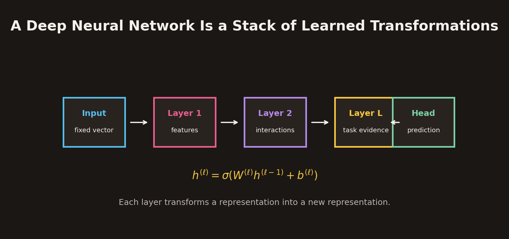
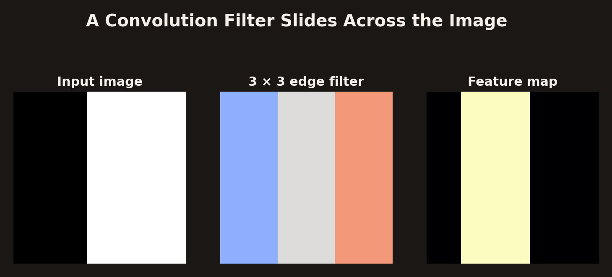
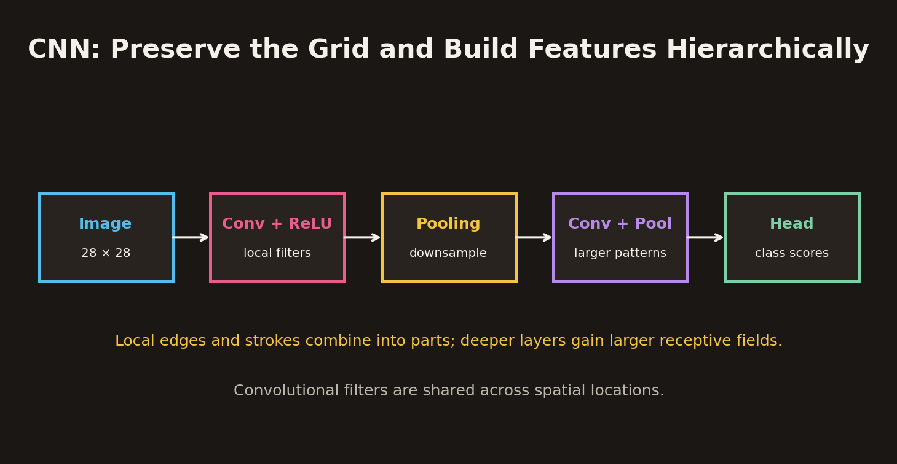
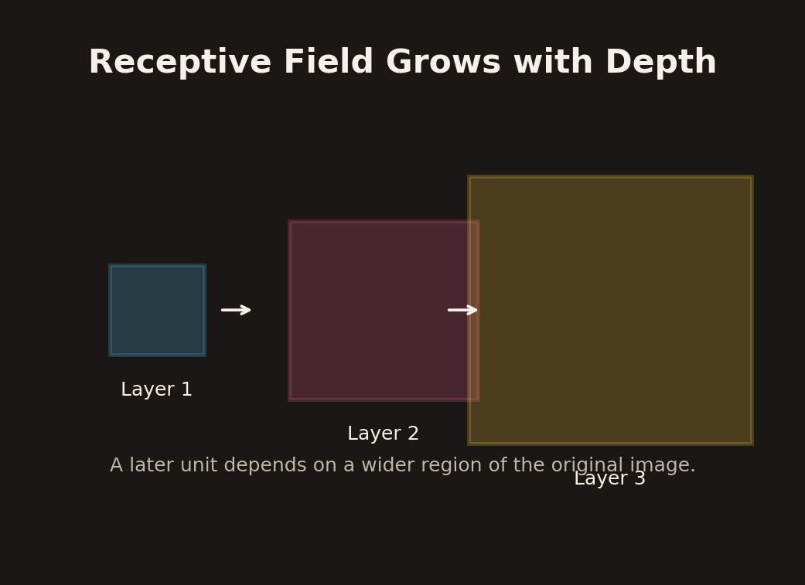
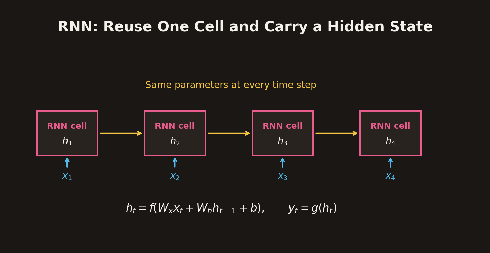
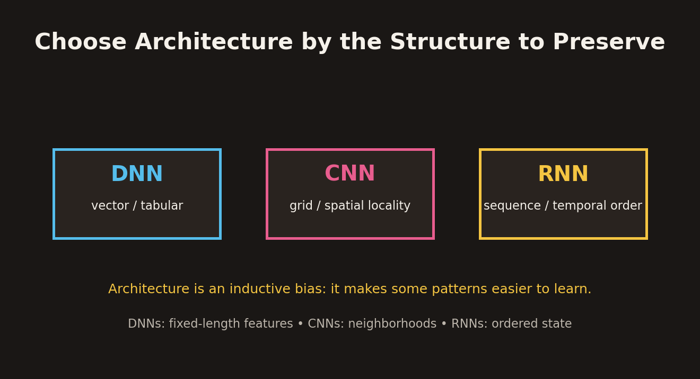

# Deep Neural Networks, CNNs and RNNs

## 1. Overview

Neural-network architecture should reflect the structure of the input data. A dense deep neural network (DNN) is a natural choice when each example can be represented as a fixed-length feature vector. Images have spatial neighborhoods, while language, speech, and time series have meaningful order and temporal dependencies.

This chapter develops three related architectures:

1. **Deep neural networks (DNNs):** stacks of learned vector transformations.
2. **Convolutional neural networks (CNNs):** networks that preserve grid structure and learn spatial filters.
3. **Recurrent neural networks (RNNs):** networks that reuse a cell over a sequence and carry a hidden state as memory.

The central design principle is to preserve the structure that makes the data meaningful: fixed-length features, spatial neighborhoods, or sequence order.

## 2. Deep Neural Networks

### 2.1 A DNN is a stack of learned transformations

A deep neural network applies multiple trainable transformations in sequence. For a fully connected layer:

$$
\mathbf{h}^{(1)}
=
\sigma\left(W^{(1)}\mathbf{x}+\mathbf{b}^{(1)}\right),
$$

$$
\mathbf{h}^{(2)}
=
\sigma\left(W^{(2)}\mathbf{h}^{(1)}+\mathbf{b}^{(2)}\right),
$$

and, for the final hidden layer $L$:

$$
\hat{\mathbf{y}}
=
\operatorname{head}\left(\mathbf{h}^{(L)}\right).
$$

Here:

- $\mathbf{x}$ is the input vector.
- $W^{(\ell)}$ and $\mathbf{b}^{(\ell)}$ are the weights and biases of layer $\ell$.
- $\sigma$ is a nonlinear activation function.
- $\mathbf{h}^{(\ell)}$ is the representation learned at layer $\ell$.
- The task head converts the final representation into predictions.

Each layer transforms one vector into another vector. Early layers can capture simple combinations of input features, while deeper layers can represent more complex interactions.

### 2.2 Turning a real-world example into a vector

The first design step is to convert the observation into numbers. Consider a transaction-fraud scoring example.

Possible input information includes:

- **Numeric:** transaction amount, time, device age, and other measured quantities.
- **Categorical:** merchant type, country, or device category.
- **Behavioral:** aggregates of past spending, location changes, or previous activity.

Numeric features may need scaling or normalization. Categorical variables can be represented using one-hot encoding or learned embeddings. Behavioral features can summarize patterns over time.

The resulting DNN input is a fixed-length vector:

$$
\mathbf{x}\in\mathbb{R}^{d}.
$$

The network produces a score or probability. For example, a model might output a fraud-risk score of 0.91. That value is a model estimate, not automatically a final decision. The decision threshold depends on the application, the costs of false alarms and missed fraud, and operational constraints.

### 2.3 Forward pass and learned hidden features

A **forward pass** sends the input through the layers to produce the output. Hidden units become learned feature detectors: they can respond to combinations of raw input columns rather than only to one original field.

For example, a hidden unit might respond to the combination of a late-night transaction and a new city. Another might capture an amount that is unusual relative to the user's history. Such interactions are learned from training data rather than supplied as a single raw input column.

### 2.4 Training the DNN

Training compares the model output with the known outcome using a loss:

$$
\mathcal{L}=\mathcal{L}(\hat{y},y).
$$

Backpropagation computes gradients through all layers. An optimizer updates the parameters:

$$
\boxed{
\theta\leftarrow\theta-\eta\nabla_\theta\mathcal{L}
}
$$

where $\eta$ is the learning rate. The weights are adjusted to reduce prediction error over the training examples.

### 2.5 What dense DNNs do not explicitly preserve

A dense DNN expects a fixed-length vector. It can process flattened image pixels or token features, but flattening may hide the structure of the original data:

- In an image, neighboring pixels form edges, strokes, and corners.
- In language, word order and context affect meaning.
- In a time series, earlier measurements can influence later values.

Specialized architectures encode useful assumptions about these structures.

## 3. Encoder-Decoder Refresher

An encoder maps an input into a representation:

$$
\mathbf{z}=f_\theta(\mathbf{x}).
$$

A decoder maps that representation to an output:

$$
\hat{\mathbf{x}}=g_\phi(\mathbf{z}).
$$

The same learned representation can be connected to different outputs, such as reconstruction, classification, or generation. The architecture of the encoder and decoder depends on the data type and task.

For images, the encoder may use convolutional layers to preserve spatial structure. For sequences, it may use recurrent layers to process ordered inputs.

## 4. Images and Convolutional Neural Networks

### 4.1 Why preserve the image grid?

An image is not merely a list of unrelated numbers. Nearby pixels are related spatially:

- Adjacent pixels form edges and boundaries.
- Short edge segments form strokes and corners.
- Local shapes combine into larger object parts.

Flattening an image into one long vector removes the explicit two-dimensional neighborhood arrangement. A CNN processes the grid directly and builds increasingly large visual features from local neighborhoods.

### 4.2 Convolution as a sliding-window dot product

A convolutional filter, or **kernel**, is a small matrix of learned weights. It is moved across the image. At each position, the kernel values are multiplied by the corresponding image patch and summed to produce one output value.

For a single-channel input $X$ and kernel $K$ of size $k_h\times k_w$, a common deep-learning cross-correlation convention is:

$$
Y_{ij}
=
\sum_{u=0}^{k_h-1}
\sum_{v=0}^{k_w-1}
K_{uv}X_{i+u,j+v}.
$$

Strict mathematical convolution reverses the kernel indices; most deep-learning libraries implement cross-correlation while calling it convolution. Since the kernel is learned, this convention does not change the model's expressive role.

Each output cell is a filter response. A strong response indicates that the local patch matches a pattern to which the filter is sensitive.

### 4.3 Padding, stride, and output size

Two common convolution settings are:

- **Padding:** add values, often zeros, around the image boundary. Padding can preserve spatial size and allow filters to cover border pixels.
- **Stride:** move the filter by more than one pixel at each step. A larger stride reduces output resolution.

For input height $H$, kernel height $K$, padding $P$, and stride $S$, the output height is:

$$
H_{out}
=
\left\lfloor
\frac{H+2P-K}{S}
\right\rfloor+1.
$$

The analogous formula applies to width. For example, a 28 × 28 input with a 3 × 3 kernel, zero padding of 1, and stride 1 produces a 28 × 28 output feature map.

### 4.4 Multiple filters produce multiple feature maps

A CNN layer normally learns many filters. Each filter produces its own feature map, so the output has a channel dimension.

A filter may become sensitive to a vertical edge, horizontal edge, diagonal edge, stroke fragment, corner-like pattern, texture, or another task-specific visual feature.

The same filter is applied at every spatial position. This is **weight sharing**.

### 4.5 Classical filters versus learned CNN filters

Classical image processing uses filters designed by people for known purposes. Examples include:

| Filter | Typical role |
| --- | --- |
| Gaussian blur | Smooth local intensity variation |
| Sobel X | Respond to horizontal intensity change across the vertical direction |
| Laplacian | Respond to second-order spatial intensity changes |
| Sharpen | Emphasize local contrast and edges |

A CNN starts with trainable filter weights and adjusts them through training. The model discovers filters that help reduce the task loss.

The distinction is about how the filter is chosen:

- Handcrafted filters are designed to detect a known visual property.
- Learned filters are shaped by data and the objective.

## 5. CNN Architecture

### 5.1 A typical CNN pipeline

A common image-classification pipeline is:

1. **Convolution + activation:** learn local filters and create feature maps.
2. **Pooling or strided convolution:** reduce spatial resolution and increase the effective context of later units.
3. **Additional convolutional blocks:** combine simple patterns into larger visual structures.
4. **Flatten or global pooling:** convert the final spatial representation into a compact feature vector.
5. **Dense task head:** produce class scores or another prediction.

A simplified architecture is:

$$
\text{Image}
\rightarrow
\text{Conv}
\rightarrow
\text{Pool}
\rightarrow
\text{Conv}
\rightarrow
\text{Pool}
\rightarrow
\text{Head}.
$$

### 5.2 Pooling and downsampling

Pooling summarizes a local region and reduces the spatial size of a feature map.

Common forms include:

- **Max pooling:** take the maximum value in each local window.
- **Average pooling:** take the mean value in each local window.

For a 2 × 2 average-pooling window:

$$
Y_{ij}
=
\frac{1}{4}
\sum_{u=0}^{1}\sum_{v=0}^{1}X_{2i+u,2j+v}.
$$

A 2 × 2 pooling operation with stride 2 halves the height and width when the dimensions are divisible by two. Pooling reduces computation and makes later features less sensitive to small spatial shifts, but it also discards precise location information.

### 5.3 Receptive field grows with depth

The **receptive field** of a unit is the region of the original input that can influence it.

An early convolutional unit sees a small local patch. A later unit combines outputs from earlier layers, so it depends on a larger region of the original image. Repeated local operations therefore build larger-scale understanding without requiring one enormous filter.

The effective receptive field and exact spatial size depend on kernel sizes, strides, padding, pooling, and network depth.

### 5.4 Why CNNs are effective for images

CNNs encode several useful inductive biases:

- **Local connectivity:** filters initially examine nearby pixels.
- **Weight sharing:** the same filter is used at many positions.
- **Hierarchical composition:** deeper layers combine local patterns into larger structures.
- **Spatial feature maps:** the model retains where patterns occur until later stages.

Weight sharing greatly reduces the number of parameters compared with a fully connected layer that independently connects every input pixel to every output unit.

## 6. LeNet-5: A Classical CNN for Handwritten Digits

LeNet-5 is a historically important CNN architecture for document and handwritten-digit recognition. Its stages illustrate the progression from raw pixels to increasingly abstract features.

The lecture gives the following architecture:

| Stage | Operation | Output representation |
| --- | --- | --- |
| Input | Grayscale image | $32\times32$ |
| C1 | Six $5\times5$ convolution filters | 6 maps of $28\times28$ |
| S2 | $2\times2$ average pooling | 6 maps of $14\times14$ |
| C3 | Convolution | 16 maps of $10\times10$ |
| S4 | $2\times2$ average pooling | 16 maps of $5\times5$ |
| C5 | Convolutional stage | 120 units |
| F6 | Fully connected stage | 84 units |
| Output | Classifier | 10 digit classes |

The early convolutional maps respond to simple visual patterns. Pooling reduces resolution. Later convolutional stages combine lower-level responses into stroke and shape detectors. The final layers convert the compact representation into ten digit scores.

The original LeNet-5 connectivity is more structured than a generic fully connected sequence; the table is a compact architectural summary of the stages and dimensions.

**Reference:** LeCun, Bottou, Bengio, and Haffner, “Gradient-Based Learning Applied to Document Recognition,” *Proceedings of the IEEE*, 1998.

## 7. Language, Speech, and Time: Recurrent Neural Networks

### 7.1 Why sequences need memory

A sequence is an ordered collection of observations:

$$
\mathbf{x}_1,\mathbf{x}_2,\ldots,\mathbf{x}_T.
$$

The order matters. In language, “not good” differs from “good” because the meaning depends on context. In speech, phonemes unfold over time. In a time series, earlier measurements may help predict future values.

A standard feed-forward network processes a fixed-size vector but does not inherently carry a state from one time step to the next. An RNN introduces a hidden state that summarizes information from previous inputs.

### 7.2 RNN recurrence

At time step $t$, the RNN receives the current input $\mathbf{x}_t$ and previous hidden state $\mathbf{h}_{t-1}$:

$$
\boxed{
\mathbf{h}_t
=
f(W_x\mathbf{x}_t+W_h\mathbf{h}_{t-1}+\mathbf{b})
}
$$

It may then produce an output:

$$
\boxed{
\mathbf{y}_t=g(W_y\mathbf{h}_t+\mathbf{b}_y)
}
$$

where:

- $W_x$ maps the current input to the hidden state.
- $W_h$ maps the previous hidden state to the current state.
- $W_y$ maps the hidden state to an output.
- $f$ and $g$ are activation or output functions.

The initial state $\mathbf{h}_0$ is often set to zero or learned as a parameter.

### 7.3 Parameter sharing through time

An RNN reuses the same $W_x$, $W_h$, and biases at every time step. The cell is repeated across the sequence, but the parameters are shared.

This is important because:

- The model can process sequences of different lengths.
- The number of parameters does not grow linearly with sequence length.
- The same transition rule is applied at each position in the sequence.

The **folded view** shows one cell with a recurrent self-loop. The **unfolded view** draws a copy of that cell at each time step to make the information flow explicit. The copies share parameters; they are not separate independently learned cells.

### 7.4 A language example

Consider the sentence:

> “the movie was not good”

As each token is read, the hidden state is updated. The state after “not” can carry information that changes how the later word “good” should be interpreted.

A simple next-token prediction setup might use:

- Input token “the” to predict “movie”.
- Input context through “the movie” to predict “was”.
- Input context through “the movie was” to predict “not”.
- Input context through “the movie was not” to predict “good”.

A sequence loss can sum cross-entropy over the predicted time steps:

$$
\mathcal{L}
=
\sum_{t=1}^{T}
\operatorname{CE}(\mathbf{y}_t,\mathbf{y}^{*}_t),
$$

where $\mathbf{y}^{*}_t$ is the desired next-token target at time $t$.

### 7.5 Many-to-one sentence representation

For sentence-level classification, the final hidden state can be used as a representation of the sequence:

$$
\mathbf{z}=\mathbf{h}_T.
$$

A classifier then maps $\mathbf{z}$ to a label, such as sentiment. The final state is intended to summarize the information accumulated from the preceding tokens.

This is a simple sequence-encoding strategy. For very long sequences, a single final state can be an information bottleneck, which motivates gated and attention-based architectures.

### 7.6 Speech and time series

The same recurrence applies when each input is not a word:

- In speech, $\mathbf{x}_t$ may represent an audio frame or acoustic feature vector.
- In time-series forecasting, $\mathbf{x}_t$ may contain measurements at time $t$.
- In sequence labelling, the model may produce an output at every time step.

The hidden state carries context from earlier frames or measurements and allows the output to depend on the sequence history.

## 8. Training RNNs Through Time

An RNN can be unfolded into a computation graph across time. Backpropagation then propagates gradients from later outputs through earlier hidden states. This is called **backpropagation through time (BPTT)**.

Because the same recurrent weights are used at every step, the gradient for a shared parameter accumulates contributions from all time steps where it is used.

A long sequence creates a deep chain of recurrent transformations. Repeated multiplication by recurrent Jacobians can cause gradients to vanish or explode:

- **Vanishing gradients:** early time steps receive very small learning signals, making long-range dependencies difficult to learn.
- **Exploding gradients:** gradients become very large and can destabilize training.

Gradient clipping can limit unusually large gradients. Gated architectures also provide more controlled paths for retaining or updating information.

## 9. Gated RNNs: LSTM and GRU

A plain RNN updates its hidden state through one recurrent transformation. It may struggle to preserve information over long time intervals.

**Long short-term memory (LSTM)** and **gated recurrent unit (GRU)** architectures introduce learned gates that control information flow.

Conceptually, gates decide:

- What information should be retained.
- What new information should be written.
- What information should be exposed as the current output.

An LSTM uses a cell state and several gates, commonly called input, forget, and output gates. A GRU uses update and reset gates and combines state and output more compactly.

| Architecture | Memory mechanism | Main idea |
| --- | --- | --- |
| Plain RNN | Hidden state | Repeated nonlinear state update |
| LSTM | Hidden state and cell state | Gates control forgetting, writing, and exposure |
| GRU | Gated hidden state | Update and reset gates regulate state changes |

Gating can improve the ability to learn longer dependencies, but it does not guarantee perfect long-range memory. Performance still depends on data, sequence length, optimization, and model capacity.

## 10. RNN Encoder-Decoder Models

An RNN encoder-decoder uses one recurrent network to read a source sequence and another recurrent network to produce a target sequence.

### Encoder

The encoder processes source tokens:

$$
\mathbf{x}_1,\mathbf{x}_2,\ldots,\mathbf{x}_T
\rightarrow
\mathbf{z}.
$$

The final state or another sequence representation becomes the context code.

### Decoder

The decoder uses that representation to produce an output sequence:

$$
\mathbf{z}
\rightarrow
\mathbf{y}_1,\mathbf{y}_2,\ldots,\mathbf{y}_S.
$$

This pattern supports tasks in which input and output sequences may differ in length, such as:

- Machine translation.
- Image captioning when the image is encoded and a caption is decoded.
- Speech-to-text.
- Sequence forecasting.

A basic encoder-decoder that compresses the entire source into one fixed-size vector can struggle with long inputs. Attention mechanisms are a later development that allow the decoder to access different parts of the encoded sequence more directly.

## 11. Choosing Between DNNs, CNNs, and RNNs

The architecture should match the structure that needs to be preserved.

| Data structure | Typical architecture | Useful inductive bias |
| --- | --- | --- |
| Fixed-length vector or tabular features | DNN / MLP | Learns interactions among vector coordinates |
| Image or spatial grid | CNN | Local neighborhoods, shared filters, spatial hierarchy |
| Ordered sequence | RNN | Recurrent state and temporal context |

These are architectural biases, not rigid rules. A DNN can process flattened images, and CNNs or RNNs can be combined in one system. The question is which structure the model should exploit and which dependencies it must preserve.

## 12. Key Takeaways

- A DNN is a stack of learned vector transformations.
- Inputs must be converted into fixed-length numeric representations before entering a standard dense network.
- Hidden units learn feature combinations and interactions, not just copies of input columns.
- CNNs preserve image-grid structure and learn local filters shared across spatial positions.
- A convolution is implemented as a sliding-window dot product (usually cross-correlation in deep-learning libraries).
- Padding and stride determine feature-map dimensions; pooling reduces spatial resolution.
- CNN depth combines local patterns into larger structures through expanding receptive fields.
- LeNet-5 demonstrates the progression from 32 × 32 pixels to feature maps, compact representations, and ten digit classes.
- RNNs process ordered sequences by combining the current input with a previous hidden state.
- RNN parameters are shared across time steps; the unfolded view makes recurrent information flow explicit.
- The final hidden state can represent a complete sequence for sentence-level tasks.
- Backpropagation through time can encounter vanishing and exploding gradients.
- LSTM and GRU gates regulate information flow to support longer memory.
- RNN encoder-decoder models map one sequence into another and support translation, captioning, speech recognition, and forecasting.
- Choose DNNs for vector structure, CNNs for spatial grids, and RNNs for ordered sequences when those biases match the task.

## 13. Notation Reference

| Symbol | Meaning |
| --- | --- |
| $\mathbf{x}$ | Input vector or sequence element |
| $\mathbf{h}^{(\ell)}$ | Hidden representation at layer $\ell$ |
| $W^{(\ell)}$ | Weight matrix at layer $\ell$ |
| $\mathbf{b}^{(\ell)}$ | Bias vector at layer $\ell$ |
| $\sigma$ | Hidden activation function |
| $\hat{\mathbf{y}}$ | Predicted output |
| $\mathcal{L}$ | Training loss |
| $\eta$ | Learning rate |
| $X$ | Input image or data matrix, depending on context |
| $K$ | Convolution kernel / filter |
| $Y$ | Convolution output feature map |
| $H,W$ | Input height and width |
| $P$ | Padding |
| $S$ | Stride |
| $H_{out},W_{out}$ | Output feature-map height and width |
| $\mathbf{x}_t$ | Input at time step $t$ |
| $\mathbf{h}_t$ | RNN hidden state at time $t$ |
| $W_x$ | Input-to-hidden weights |
| $W_h$ | Hidden-to-hidden recurrent weights |
| $W_y$ | Hidden-to-output weights |
| $\mathbf{h}_0$ | Initial hidden state |
| $\mathbf{z}$ | Encoded sequence representation |
| BPTT | Backpropagation through time |

## 14. Technical Notes and Scope

- The convolution formula is written in the cross-correlation convention used by common deep-learning libraries. Strict mathematical convolution flips the kernel, but learned filters can absorb this convention.
- The convolution output-size formula assumes integer stride and symmetric padding on both sides. Different padding conventions can produce different dimensions.
- Pooling and convolution may be interleaved in many ways; the illustrated pipeline is a common pattern rather than a mandatory architecture.
- LeNet-5 dimensions are presented as a compact summary of the lecture's architecture. The original model includes specific connectivity and subsampling details beyond a generic CNN.
- The RNN equations describe a basic recurrent cell. The exact choice of activation, output mapping, initial state, and loss depends on the sequence task.
- The simple RNN encoder-decoder uses a fixed-size context representation. Attention-based models address some limitations of this bottleneck.
- The architecture comparison is a design guide, not an assertion that each architecture can only be used for one data type.
