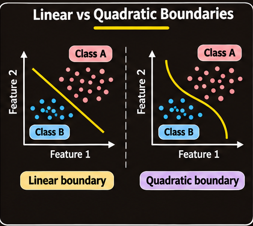
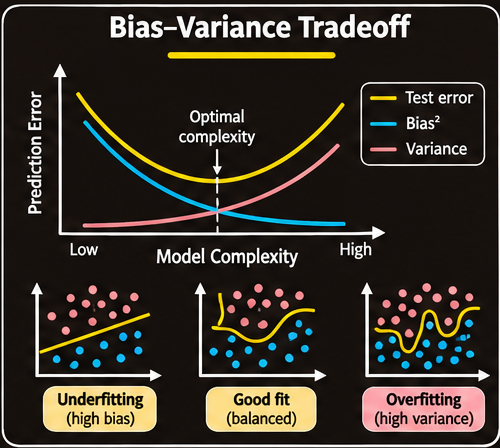
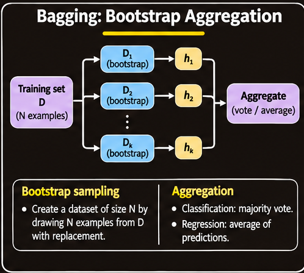
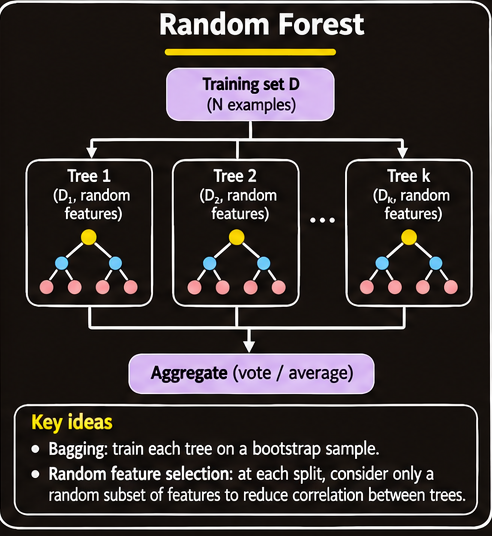
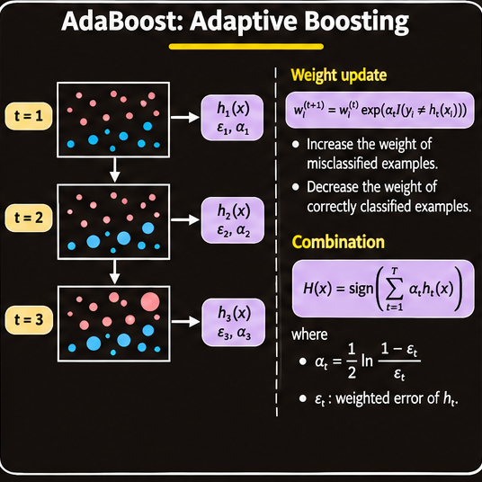
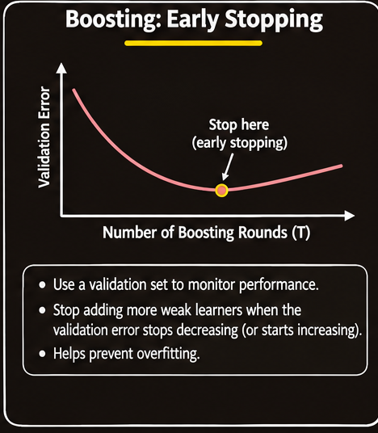

# Ensemble Learning

## 1. Overview

A **decision tree** can represent complicated relationships because it combines a sequence of feature-based decisions. This flexibility is useful, but it can also make a tree fit accidental details of its training data. A very deep tree may classify the training examples extremely well while performing poorly on new examples.

Two ways to limit this problem are:

- **Pruning:** Remove branches that contribute little to reliable prediction.
- **Early stopping:** Stop growing the tree before it becomes unnecessarily complex.

CART (Classification and Regression Trees) is a decision-tree learning framework. An alternative way to improve predictive performance is to combine several models rather than rely on one model alone. This is the central idea of **ensemble learning**.

An ensemble is useful when its component models make complementary errors. The main methods developed here are:

- **Bagging:** Train models on different bootstrap samples and aggregate their predictions. Its main benefit is variance reduction.
- **Boosting:** Train models sequentially, emphasizing examples that earlier models handled poorly. Its main aim is to combine weak learners into a strong predictor.

Random forests extend bagging by adding random feature selection, while stacking combines predictions using a separately trained model.

## 2. Linear and Nonlinear Decision Boundaries

A classifier divides feature space into regions and assigns a class to each region. The surface separating regions is called a **decision boundary**.

For two features, $x_1$ and $x_2$, a linear decision boundary has the form

$$
w_1x_1+w_2x_2+b=0,
$$

where $w_1$ and $w_2$ are feature weights and $b$ is a bias or intercept. In two dimensions this equation describes a straight line. A linear classifier is effective when the classes can be separated reasonably well by a straight boundary.

A more expressive classifier can represent curved boundaries. For example, a quadratic boundary may include squared and interaction terms:

$$
a x_1^2+b x_2^2+c x_1x_2+d x_1+e x_2+f=0.
$$

The added terms allow the boundary to bend and represent patterns that a straight line cannot capture. More generally, a nonlinear classifier can create more complicated decision regions.

*An expressive boundary can fit a curved class arrangement that a straight separator cannot represent.*

The choice of model complexity affects the bias–variance tradeoff. A boundary that is too simple may underfit; one that is unnecessarily flexible may overfit. The goal is not to make the boundary as complicated as possible, but to choose a model that captures the underlying pattern and generalizes to unseen examples.

## 3. Bias, Variance, and Generalization

A model is trained using a finite sample, so its predictions are affected both by the model class and by the particular examples selected for training. Two important sources of prediction error are **bias** and **variance**.

### 3.1 Bias

**Bias** is the systematic error caused by the assumptions or restrictions of a learning method. It describes how well the best model available within a chosen model class can represent the true relationship.

For example, if the true class boundary is strongly curved but the model is restricted to straight lines, even the best possible linear classifier will make systematic errors. The model class is too limited to capture the underlying pattern.

High bias is associated with **underfitting**:

- The model is too simple for the structure in the data.
- Important patterns are not represented.
- Training performance is often poor, and test performance is also poor.
- Adding more training examples alone does not remove the limitation of an unsuitable model class.

The course characterizes bias as the error of the best classifier in a concept class, such as the best linear separator or the best decision tree subject to a fixed number of nodes.

### 3.2 Variance

**Variance** measures how much a learned model changes when it is trained on a different sample from the same data-generating process.

A high-variance model is sensitive to the exact training examples. Small changes in the sample can produce substantially different decision boundaries or predictions. This often happens when a model is sufficiently flexible to fit noise or unusual details in the training data.

High variance is associated with **overfitting**:

- The model adapts too closely to its particular training sample.
- Training error may be very low.
- Performance on unseen examples may be substantially worse.
- A different training sample may produce a noticeably different model.

### 3.3 Understanding the Bias–Variance Tradeoff

Increasing model complexity often makes it possible to represent more patterns. For example, moving from a linear classifier to a quadratic classifier, or increasing the number of nodes in a decision tree, can reduce bias. However, the more flexible model may also become more sensitive to the training sample, increasing variance.

*Training error generally decreases as model complexity increases. Test error often decreases at first, then rises when the model begins to overfit.*

A useful conceptual summary is:

$$
\text{Prediction error}
\approx
\text{Bias contribution}
+
\text{Variance contribution}
+
\text{Irreducible noise}.
$$

The course uses the shorthand “classification error = bias + variance” to emphasize the two competing sources of model error. The exact mathematical decomposition depends on the prediction loss and assumptions; the expression above is a conceptual guide rather than a universal identity for every classification metric.

A model with both low bias and low variance is desirable. The four broad situations are:

| Bias | Variance | Typical behaviour |
| --- | --- | --- |
| Low | Low | Predictions are accurate and stable |
| High | Low | Underfitting: stable but systematically inaccurate |
| Low | High | Overfitting: expressive but sensitive to the sample |
| High | High | Both systematic error and sample sensitivity are substantial |

The practical objective is to find a suitable balance rather than minimize only one component.

## 4. Ensemble Learning

An **ensemble method** combines predictions from multiple classifiers to produce one final prediction. Instead of depending on a single learner, it uses several learners that may be useful in different parts of the input space.

The individual models are called **base learners**. An ensemble tends to work best when the base learners are both reasonably competent and complementary: they should not all make exactly the same mistakes.

Two broad strategies are:

1. Train multiple models in ways that make their predictions vary, then average or vote to reduce instability.
2. Train models sequentially so that later models focus on mistakes made by earlier models.

These strategies lead to bagging and boosting, respectively.

## 5. Voting and the Benefit of Combining Predictions

### 5.1 Majority Voting

For a binary classification problem, suppose each classifier outputs either $-1$ or $+1$. With an odd number $m$ of classifiers, a majority vote avoids a tie:

$$
H(x)=\operatorname{sign}\left(\sum_{j=1}^{m}h_j(x)\right),
$$

where $h_j(x)$ is the prediction of classifier $j$.

For example, if five classifiers predict

$$
(+1,+1,-1,+1,-1),
$$

then three vote for $+1$ and two vote for $-1$. The ensemble predicts $+1$.

For multiclass classification, the ensemble can select the class receiving the largest number of votes. For regression, predictions are commonly combined by averaging.

### 5.2 Why a Majority Can Be More Reliable

Suppose each of $m$ voters independently predicts the correct answer with probability $p$. For odd $m$, the probability that the majority is correct is

$$
P(\text{majority correct})
=
\sum_{j=(m+1)/2}^{m}
\binom{m}{j}p^j(1-p)^{m-j}.
$$

This result is associated with **Condorcet's jury theorem**.

Under the independence assumption:

- If $p>0.5$, adding more voters makes a correct majority increasingly likely.
- If $p=0.5$, voting does not provide an advantage over random guessing.
- If $p<0.5$, a majority tends to be wrong; reversing each voter's prediction would produce an accuracy greater than $0.5$.

The independence assumption is important. If all classifiers make highly correlated errors, their votes provide much less additional information. A large ensemble of nearly identical models may therefore offer only a small improvement.

### 5.3 Weak Learners

A **weak learner** is a classifier that performs better than random guessing by some positive margin. In a balanced two-class setting with labels in $\{-1,+1\}$, this means its error is less than $0.5$:

$$
\operatorname{err}_{D}(h)
=
\Pr_{(X,Y)\sim D}\big[h(X)\ne Y\big]
<0.5.
$$

Here, $D$ is a probability distribution over labelled examples, and $h$ is a classifier.

A weak learner may have high bias: by itself, it may be too simple to solve a difficult classification problem. It can nevertheless be useful if an ensemble combines many such learners effectively.

A randomly selected hyperplane classifier has expected error of $0.5$ in the setting discussed in the course, illustrating the performance of random guessing. A useful weak learner must do better than that baseline.

## 6. Bagging: Bootstrap Aggregation

### 6.1 Motivation

Averaging several predictions can reduce variance while leaving the average model's systematic bias largely unchanged. If model errors are independent and have equal variance $\sigma^2$, the variance of their average is

$$
\operatorname{Var}(\bar X)
=
\frac{\sigma^2}{n},
$$

where $n$ is the number of independent predictions being averaged.

This motivates averaging multiple models. However, a common practical difficulty is that only one labelled training dataset may be available. **Bootstrap sampling** creates multiple training samples from that one dataset.

### 6.2 Bootstrap Sampling

Let the original training dataset be

$$
D=\{(x_1,y_1),(x_2,y_2),\ldots,(x_n,y_n)\}.
$$

A bootstrap sample is created by drawing examples randomly **with replacement** from $D$.

- Each draw selects one of the original examples.
- After an example is selected, it remains available for selection again.
- The same example can therefore appear multiple times in a bootstrap sample.
- Some original examples will not appear in a particular sample.

A common choice is to draw $n$ examples from a dataset of size $n$.

### 6.3 Why Approximately 37% of Examples Are Left Out

Consider one original training example. On any one draw, the probability that it is not selected is

$$
1-\frac{1}{n}.
$$

Because the $n$ draws are made with replacement, the probability that the example is never selected is

$$
\left(1-\frac{1}{n}\right)^n.
$$

For large $n$,

$$
\left(1-\frac{1}{n}\right)^n
\longrightarrow e^{-1}
\approx 0.368.
$$

Thus, a bootstrap sample of size $n$ contains about $63.2\%$ of the distinct original examples on average, leaving about $36.8\%$—approximately $37\%$—out of that sample.

The probability of obtaining one particular ordered sequence of $n$ draws is $n^{-n}$, so the probability of reproducing the original dataset in one particular order is extremely small. Bootstrap samples are therefore generally different from the original dataset, even though they are drawn from it.

### 6.4 The Bagging Algorithm

**Input:** $n$ labelled training examples, a base learning algorithm, and the number of models $k$.

**Procedure:**

1. Repeat the following process for $j=1,\ldots,k$:
   - Draw a bootstrap sample $D_j$ from the original training set.
   - Train the base learner on $D_j$ to obtain classifier $h_j$.
2. Retain the trained classifiers $h_1,\ldots,h_k$.
3. For a new input $x$, collect predictions from all classifiers.
4. Combine the predictions:
   - **Classification:** Use majority voting.
   - **Regression:** Use the average prediction.

*Each model is trained on a different resampled dataset; their predictions are then combined.*

The base learner can be a decision tree, $k$-nearest neighbours, a perceptron, or another suitable classifier. Bagging is particularly useful with unstable, high-variance learners such as deep decision trees.

### 6.5 Why Bagging Reduces Variance

Different bootstrap samples produce different fitted models. Averaging or voting across these models reduces the effect of sample-specific fluctuations.

For independent model predictions with variance $\sigma^2$, the average has variance $\sigma^2/k$. In practice, predictions are usually not fully independent because all bootstrap samples come from the same original dataset.

If each model has variance $\sigma^2$ and every pair has correlation $\rho$, then the variance of their average is

$$
\operatorname{Var}(\bar h)
=
\sigma^2\left(\rho+\frac{1-\rho}{k}\right).
$$

As $k$ grows, the variance approaches $\rho\sigma^2$. This shows why reducing correlation between base learners matters: averaging many highly correlated models cannot eliminate the shared component of their errors.

Bagging therefore:

- Reduces variance by averaging predictions from different fitted models.
- Usually has little effect on bias.
- Is most useful when the base learner has high variance.
- Does not guarantee a large improvement if the base learners are highly correlated.

### 6.6 Out-of-Bag Examples

For each bootstrap-trained model, the original examples omitted from its bootstrap sample are called **out-of-bag (OOB) examples** for that model.

An example can receive an OOB prediction from the models whose bootstrap samples excluded it. Aggregating these predictions gives an estimate of predictive performance without training a separate validation model for every bootstrap sample.

OOB examples can also be used when estimating feature importance. The course highlights permutation importance and mean decrease in impurity as feature-importance approaches, with OOB data used for evaluation.

## 7. Random Forests

### 7.1 From Bagged Trees to Random Forests

A **random forest** is an ensemble of decision trees that combines bootstrap sampling with random feature selection.

In ordinary bagging of decision trees:

- Each tree is trained on a bootstrap sample.
- All available features may be considered when choosing a split.

In a random forest:

- Each tree is trained on a bootstrap sample.
- At each split, the tree considers only a randomly selected subset of the available features.
- The best split among that subset is selected according to the tree-learning criterion.
- The predictions of the trees are combined by voting or averaging.

If there are $p$ available features, a random forest considers a subset of size $m$, typically with $m \ll p$, at each split.

*Bootstrap sampling creates different training sets, while random feature subsets make the trees less similar.*

### 7.2 Why Random Feature Selection Helps

Suppose one feature is very strong. If every tree always considers all features, many trees may choose that same feature near the top of their structure. Their predictions can become highly correlated.

Randomly restricting the candidate features at each split makes trees explore different patterns. This tends to reduce the correlation $\rho$ between trees.

The variance expression for correlated predictions explains the benefit: reducing $\rho$ lowers the variance floor that remains even when many trees are averaged.

The comparison is:

| Property | Bagged trees | Random forest |
| --- | --- | --- |
| Data used for each tree | Bootstrap sample | Bootstrap sample |
| Features considered at each split | All $p$ features | Random subset of $m$ features |
| Tree correlation | Often higher | Usually lower |
| Ensemble variance | Can remain limited by correlation | Often reduced further |
| Bias | Similar to the individual tree | May be slightly higher |

Random feature selection can increase bias slightly because a tree may not be allowed to use the best feature at a particular split. The reduction in correlation can nevertheless produce a better overall ensemble.

### 7.3 Random Forests in Practice

Important practical properties include:

- **Number of trees:** Increasing the number of trees generally stabilizes the ensemble prediction, but increases computation. Once the error has stabilized, more trees may provide little practical benefit.
- **Feature subset size:** The number of candidate features considered at each split controls the degree of tree diversity.
- **Minimum leaf size:** This controls how small terminal regions can become and affects the complexity of individual trees.
- **Feature importance:** Mean decrease in impurity and permutation importance can help identify influential features. OOB evaluation can be used in permutation-based assessment.
- **Parallel training:** Trees can be trained independently, making random forests naturally parallelizable.
- **Robustness:** Random forests are often robust to label noise and irrelevant features, although no model is immune to poor data or severe distribution problems.
- **Class probabilities:** Vote fractions across trees can be used as class-probability estimates.

**Extremely Randomized Trees** (Extra-Trees) add further randomness by randomizing split thresholds as well as feature selection. This can reduce variance further, sometimes at the cost of a small increase in bias.

Random forests are a strong general-purpose baseline for many tabular classification and regression tasks.

## 8. Boosting

### 8.1 Motivation

Bagging trains models independently on bootstrap samples and mainly reduces variance. It does not directly target the high bias of a weak learner.

**Boosting** takes a different approach. It builds a sequence of weak learners, where each learner is trained with an emphasis on examples that previous learners handled poorly. The final model combines the learners using a weighted vote.

The aim is to construct a strong classifier from simple rules that may be inadequate on their own.

Examples of useful weak rules include:

- A simple text-based rule for distinguishing spam from non-spam email.
- A simple image feature test for face detection, such as comparing the average intensity of a dark region with that of a neighbouring light region.
- A one-level decision tree or a simple horizontal or vertical half-plane classifier.

A **weak learner** is a simple rule that performs better than random guessing. A **strong learner** is a combined model with substantially better predictive performance.

### 8.2 The General Boosting Procedure

The general idea is:

1. Choose a method for finding a simple classifier, such as a one-node decision tree.
2. Train it on the current training distribution.
3. Modify the importance of the training examples so that difficult cases receive more attention.
4. Train another weak classifier using the modified distribution.
5. Repeat for a chosen number of rounds.
6. Combine the weak classifiers using a weighted vote.

The process is sequential: the distribution used to train a later learner depends on the performance of earlier learners.

### 8.3 Error Under a Distribution

Let $D$ be a probability distribution over labelled examples, and let $h$ be a classifier. Its error with respect to $D$ is

$$
\operatorname{err}_{D}(h)
=
\Pr_{(X,Y)\sim D}[h(X)\ne Y].
$$

For a finite training set with example weights $w_i$ that sum to one, the distribution-weighted error is

$$
\operatorname{err}_{D}(h)
=
\sum_{i=1}^{n}w_i\,\mathbf{1}[h(x_i)\ne y_i],
$$

where $\mathbf{1}[\cdot]$ is the indicator function: it equals $1$ when the condition is true and $0$ otherwise.

A classifier is a weak learner under $D$ when

$$
\operatorname{err}_{D}(h)<0.5
$$

for the binary setting. The error is measured with respect to the current distribution, not necessarily the uniform distribution over the original examples.

## 9. AdaBoost: Adaptive Boosting

AdaBoost is a specific boosting algorithm that changes the weights of training examples after each round and assigns a weight to each learned classifier.

Assume a training set

$$
S=\{(x_1,y_1),\ldots,(x_n,y_n)\},
\qquad y_i\in\{-1,+1\}.
$$

Let $T$ be the number of boosting rounds. At round $t$, AdaBoost maintains a distribution $D_t(i)$ over the training examples.

### 9.1 Initial Example Weights

Initially, every example has equal weight:

$$
D_1(i)=\frac{1}{n},
\qquad i=1,\ldots,n.
$$

The weights sum to one, so they form a probability distribution over the training set.

### 9.2 Train a Weak Learner

At round $t$, train a weak learner $h_t$ to minimize its weighted error under $D_t$:

$$
\epsilon_t
=
\operatorname{err}_{D_t}(h_t)
=
\sum_{i=1}^{n}
D_t(i)\mathbf{1}[h_t(x_i)\ne y_i].
$$

A useful weak learner has $\epsilon_t<0.5$.

### 9.3 Assign a Weight to the Weak Learner

AdaBoost gives more influence to a learner with lower weighted error:

$$
\alpha_t
=
\frac{1}{2}
\ln\left(\frac{1-\epsilon_t}{\epsilon_t}\right).
$$

Interpretation:

- If $\epsilon_t<0.5$, then $\alpha_t>0$.
- If $\epsilon_t=0.5$, then $\alpha_t=0$; the learner contributes no useful information.
- If $\epsilon_t$ is small, $\alpha_t$ is large, so the learner receives more influence in the final decision.

### 9.4 Update the Example Weights

The example weights are updated according to

$$
D_{t+1}(i)
=
\frac{D_t(i)\exp\left(-\alpha_t y_i h_t(x_i)\right)}
{Z_t},
$$

where $Z_t$ is a normalization constant chosen so that the new weights sum to one.

Because $y_i$ and $h_t(x_i)$ are in $\{-1,+1\}$:

- Correct classification gives $y_i h_t(x_i)=+1$, so the unnormalized weight is multiplied by $e^{-\alpha_t}$ and decreases.
- Incorrect classification gives $y_i h_t(x_i)=-1$, so the unnormalized weight is multiplied by $e^{+\alpha_t}$ and increases.

Thus, misclassified examples become more important in the next round. Correctly classified examples become less important.

For the standard AdaBoost update,

$$
Z_t=2\sqrt{\epsilon_t(1-\epsilon_t)}.
$$

The normalization ensures

$$
\sum_{i=1}^{n}D_{t+1}(i)=1.
$$

*Each round shifts weight toward examples that the current weak learner misclassifies.*

### 9.5 Final Strong Classifier

After $T$ rounds, the weak learners are combined by a weighted vote:

$$
H(x)
=
\operatorname{sign}
\left(
\sum_{t=1}^{T}\alpha_t h_t(x)
\right).
$$

A learner with a larger $\alpha_t$ has more influence on the final prediction. The sign of the weighted sum determines the predicted class.

### 9.6 AdaBoost Algorithm Summary

**Input:** Training set $S=\{(x_i,y_i)\}_{i=1}^{n}$ with $y_i\in\{-1,+1\}$, and number of rounds $T$.

1. Initialize $D_1(i)=1/n$ for all examples.
2. For $t=1,\ldots,T$:
   - Train a weak learner $h_t$ using distribution $D_t$.
   - Calculate its weighted error $\epsilon_t$.
   - Calculate its learner weight $\alpha_t$.
   - Update the example weights using the exponential update rule.
   - Normalize the updated weights using $Z_t$.
3. Output the weighted classifier

$$
H(x)=\operatorname{sign}\left(\sum_{t=1}^{T}\alpha_t h_t(x)\right).
$$

If a learner has error at least $0.5$, it is not a useful weak learner for this binary boosting step. Standard implementations generally stop, retry, or otherwise handle this case rather than treating it as a successful boosting round.

### 9.7 Intuition from Simple Decision Regions

A weak learner may be restricted to a simple decision region, such as a horizontal or vertical half-plane. One such rule may classify only part of a complicated pattern correctly.

Boosting repeatedly changes the example weights and fits another simple rule. The later rules are encouraged to correct errors left by earlier rules. The final weighted combination can therefore form a more complicated decision region than any individual weak learner.

The key idea is that each weak classifier contributes a limited piece of the final decision, and the weighted combination assembles those pieces into a stronger classifier.

## 10. Choosing When to Stop Boosting

Adding more boosting rounds does not guarantee continual improvement on unseen data. A stopping rule should therefore use data that is separate from the training examples used to fit the weak learners.

A **validation dataset** can be used to monitor predictive error as the number of boosting rounds increases.

A practical procedure is:

1. Train the boosting model for successive rounds.
2. Evaluate the current ensemble on the validation dataset.
3. Track validation error as a function of the number of rounds.
4. Stop when validation error stops improving, or when the learning procedure can no longer find a sufficiently good weak learner.

*The useful number of boosting rounds is selected using validation performance, not by assuming that more rounds are always better.*

The training set is used to fit the learners; the validation set guides model selection and stopping. A separate test set should remain available for a final, unbiased assessment of generalization.

## 11. Comparing Ensemble Methods

The methods differ in the type of base learner they commonly use, how they combine predictions, and which part of the bias–variance tradeoff they primarily address.

| Method | Typical base learners | Main effect on bias | Main effect on variance | Combination |
| --- | --- | --- | --- | --- |
| Bagging | High-variance learners such as deep trees | Usually little change | Reduced by averaging | Vote or average |
| Random forest | Deep trees with random feature subsets | May increase slightly | Often reduced further by decorrelating trees | Vote or average |
| Boosting | Often simple, high-bias learners such as stumps or shallow trees | Often reduced through sequential fitting | Can increase; controlled with regularization and stopping | Weighted vote |
| Stacking | Different, ideally diverse models | A meta-learner can correct systematic errors | May improve if the combination generalizes well | Learned combiner |

A useful rule of thumb is:

> **Bag what overfits; boost what underfits.**

This is a practical tendency, not an absolute law. The result depends on the base learners, data, hyperparameters, and evaluation procedure.

### 11.1 Bagging Versus Boosting

| Aspect | Bagging | Boosting |
| --- | --- | --- |
| Training structure | Models are trained independently | Models are trained sequentially |
| Training data | Bootstrap samples | Reweighted examples or otherwise modified training focus |
| Main focus | Reduce variance | Build a strong learner from weak learners; often reduce bias |
| Model influence | Usually equal vote or average | Learners receive weights |
| Parallelism | Base models can be trained in parallel | Later rounds depend on earlier rounds |
| Typical base learner | Deep, unstable trees | Shallow trees or simple rules |

Bagging is attractive when the individual learner is flexible but unstable. Boosting is attractive when simple learners have systematic errors that can be corrected by subsequent learners.

### 11.2 Stacking

**Stacking** is an ensemble approach in which predictions from multiple base models are supplied to a second-level model called a **meta-learner**. The meta-learner learns how to combine the base predictions.

The base learners may be different model types, which can make their errors complementary. Stacking is included as a comparison method here; its detailed training procedure is not developed further in this chapter.

## 12. Key Ideas to Remember

- **Bias** measures systematic error from restrictions in the model class; high bias is associated with underfitting.
- **Variance** measures sensitivity to the training sample; high variance is associated with overfitting.
- Increasing model complexity often decreases bias but increases variance.
- **Ensemble learning** combines several base learners, ideally with complementary errors.
- Majority voting can improve accuracy when individual classifiers are better than random and their errors are sufficiently independent.
- **Bagging** uses bootstrap samples and aggregation to reduce variance.
- A bootstrap sample of size $n$ leaves approximately $37\%$ of the original examples out on average.
- **Random forests** add random feature selection to bagged trees, reducing correlation between trees.
- **Boosting** trains weak learners sequentially, emphasizing examples that previous learners misclassified.
- **AdaBoost** uses example-weight updates and learner weights to construct a final weighted classifier.
- A validation dataset helps choose when to stop boosting.
- Bagging is commonly used for high-variance learners; boosting is commonly used to strengthen high-bias learners.
