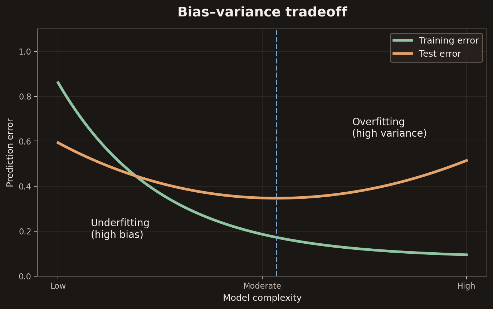
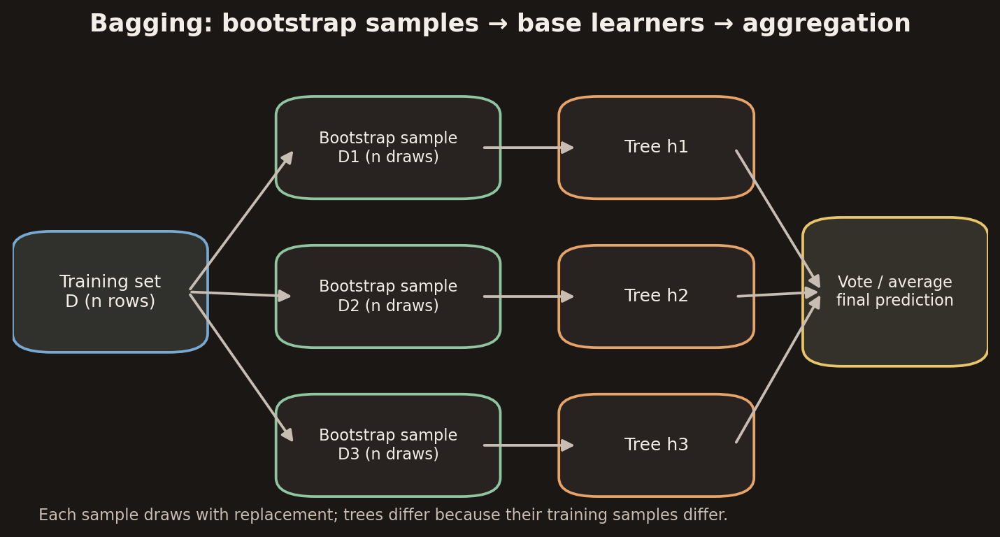
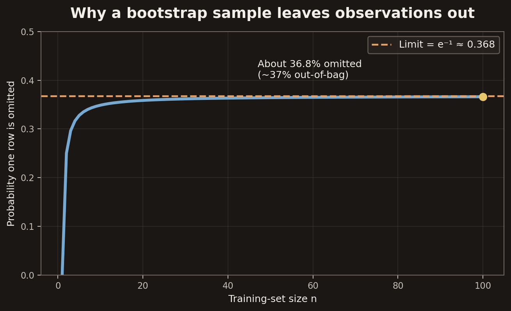
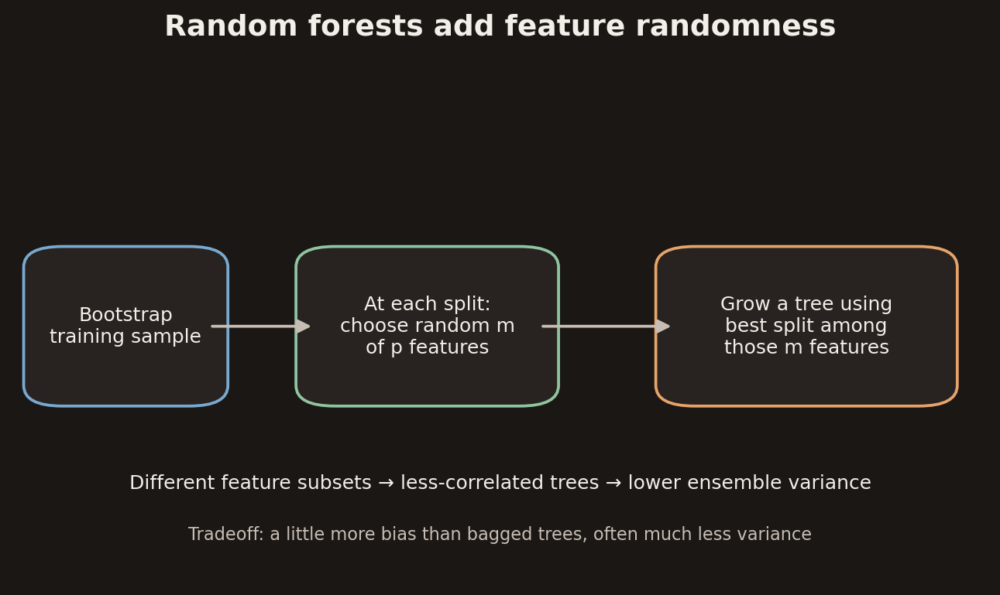
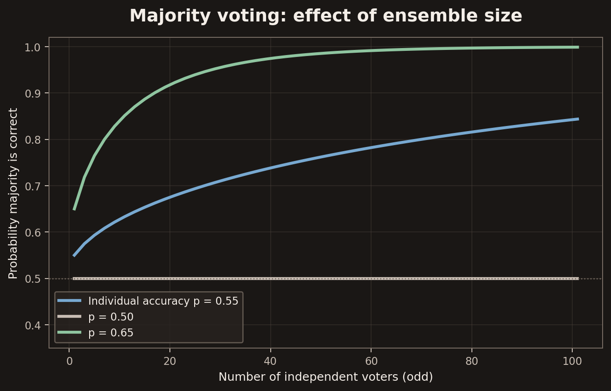
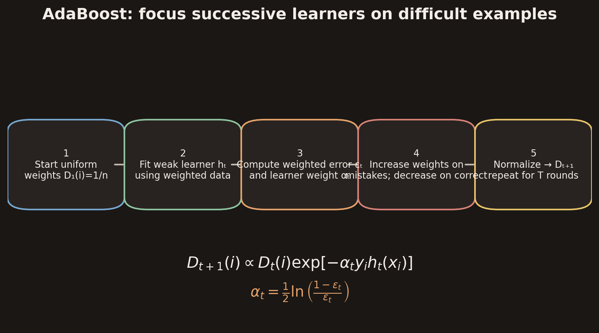
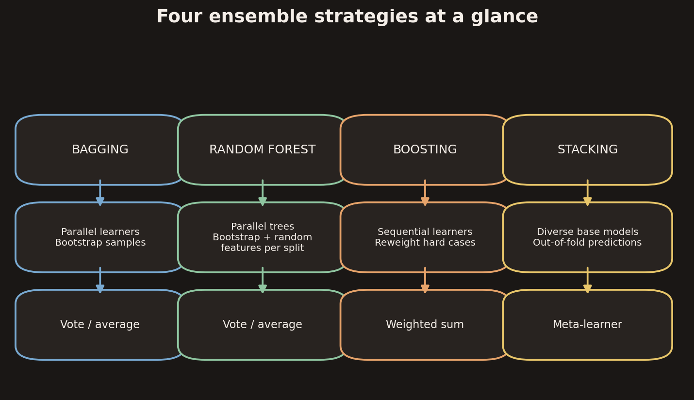

## Learning goals

By the end of this chapter, you should be able to:

1. Explain bias, variance, underfitting, overfitting, and the bias–variance tradeoff.
2. Explain why averaging can reduce variance and why the independence/correlation of learners matters.
3. Construct bootstrap samples and describe bagging.
4. Explain the out-of-bag fraction and how random forests differ from bagged trees.
5. Derive the majority-vote probability under independent, equally accurate voters.
6. Define a weak learner and explain the intuition behind boosting.
7. Follow the AdaBoost distribution update, learner weight, and final weighted classifier.
8. Explain how validation error can determine when to stop boosting.
9. Compare bagging, random forests, boosting, and stacking.

---

## 1. Decision trees: expressive, but potentially unstable

Decision trees are flexible models. They can represent complicated decision boundaries, which makes them expressive. The same flexibility can make them generalize poorly: a tree can fit details or noise in its training set rather than the underlying pattern.

The lecture identifies two controls:

- **Pruning:** remove branches that contribute little to predictive performance.
- **Early stopping:** stop tree growth before it becomes excessively complex.

CART means **Classification and Regression Trees**. The central ensemble question is: can multiple trees contribute information that is more reliable than one tree alone?

A useful distinction:

- A model's **training fit** describes how well it explains the examples used to fit it.
- **Generalization** describes how well it predicts new examples drawn from the target distribution.

A very complicated tree can have tiny training error and still have large test error.

## 2. Bias and variance

### 2.1 Bias

**Bias** is the error associated with the model class itself. It reflects how far the best model available within a chosen class is from the true relationship.

Examples:

- A linear classifier may have high bias when the true class boundary is strongly nonlinear.
- A decision tree restricted to very few nodes may be unable to represent the required structure.

The lecture describes bias as the true error of the best classifier in the concept class. In this sense, bias is an inherent limitation of the representation and does not disappear simply by collecting more training examples.

### 2.2 Variance

**Variance** measures how much the learned classifier changes when it is trained on a different training set.

A high-variance classifier is sensitive to the particular sample it receives. It may learn accidental patterns in one training set that are absent from another. This is closely associated with **overfitting**.

### 2.3 Underfitting and overfitting

- **Underfitting:** the model is too simple to capture the important structure. It has high bias.
- **Overfitting:** the model is too sensitive to the training sample and fits sample-specific details. It has high variance.

The slide on page 8 contrasts a high-bias boundary with a more flexible low-bias boundary. Page 9 illustrates variance by showing several fitted boundaries from different training samples: their disagreement is the visual signature of instability. Page 10 uses target-like concentric regions to distinguish low/high bias from low/high variance.

### 2.4 The tradeoff as model complexity increases

As model complexity increases:

- Bias often decreases, because the model can represent a wider range of patterns.
- Variance often increases, because the fitted model can react more strongly to idiosyncrasies in the training sample.

The training error generally falls as complexity grows. Test error often falls at first, then rises after the model begins to overfit. The useful operating point is near the minimum of test/generalization error, not necessarily the minimum training error.

The lecture summarizes the intuition as a bias–variance tradeoff. Its slides use the simplified phrase “classification error = bias + variance.” For formal statistical decompositions, the exact identity depends on the loss and assumptions; for squared-error regression, one commonly writes expected prediction error as bias² + variance + irreducible noise. Treat the lecture's phrase as a conceptual summary rather than a universal exact equation.

### 2.5 How ensembles fit into the tradeoff

The lecture's main motivation is to improve prediction by combining learners:

- **Bagging** mainly reduces variance by averaging models trained on different bootstrap samples.
- **Random forests** reduce variance further by making trees less correlated through feature randomness.
- **Boosting** is presented as a way to combine weak learners that focus on different parts of the input space; its sequential fitting can reduce bias.
- **Stacking** learns a combiner that can correct systematic errors made by base models.

The comparison table near the end of the lecture (pages 24 and 57) gives the rule of thumb:

> **Bag what overfits; boost what underfits.**

This is a heuristic, not a guarantee. Model choice still depends on data, validation performance, and the learning setup.

---

## 3. Why averaging can help

Suppose we have \(n\) predictions \(X_1,\ldots,X_n\), each with variance \(\sigma^2\), and suppose the predictions are independent. Their average is

\[
\bar X = \frac{1}{n}\sum_{i=1}^{n}X_i.
\]

Then

\[
\operatorname{Var}(\bar X)
= \frac{\operatorname{Var}(X)}{n}
= \frac{\sigma^2}{n}.
\]

So independent noisy estimates can average to a less variable estimate.

**Important qualification:** independence is the simplifying assumption in the lecture's page-12 formula. If model predictions are correlated, averaging helps less. If all models make nearly identical errors, the ensemble has little new information to combine.

This creates the practical challenge raised in the slides: there is only one observed training set. How can we obtain multiple models? Bagging answers this by repeatedly resampling the available training data.

## 4. Bagging — Bootstrap Aggregating

### 4.1 Bootstrap sampling

Let the training set be

\[
D=\{(x_1,y_1),\ldots,(x_n,y_n)\}.
\]

A **bootstrap sample** is formed by drawing \(n\) examples from \(D\), **with replacement**. With replacement means that:

- the same original example may be selected multiple times;
- some original examples may not be selected at all;
- each bootstrap sample has \(n\) draws when the common choice \(m=n\) is used.

Create \(k\) bootstrap samples \(D_1,\ldots,D_k\), fit a learner \(h_i\) on each sample, and combine their predictions.

### 4.2 Bagging algorithm

**Input:** labelled training examples \((x_i,y_i)\), \(i=1,\ldots,n\), and number of learners \(k\).

For each \(i=1,\ldots,k\):

1. Draw \(m\) examples from the original training set with replacement to form \(S_i\).
2. Train a base learner \(h_i\) on \(S_i\).

**Prediction:**

- Classification: use majority vote.
- Regression: average the predictions.

A common choice is \(m=n\). Even though each bootstrap sample contains \(n\) draws, it is not the same as the original training set because draws are made with replacement.

### 4.3 Why about 37% of examples are left out

For a particular training example, the probability it is not selected on one draw is

\[
1-\frac{1}{n}.
\]

The \(n\) draws are independent, so the probability that it is never selected is

\[
\left(1-\frac{1}{n}\right)^n.
\]

As \(n\) becomes large,

\[
\left(1-\frac{1}{n}\right)^n \longrightarrow e^{-1}
\approx 0.368.
\]

Therefore, a bootstrap sample of size \(n\) contains about 63.2% distinct original examples and leaves about **36.8% (roughly 37%) out**. The omitted examples for a particular tree are called its **out-of-bag (OOB)** examples.

### 4.4 Out-of-bag evaluation

An example can be evaluated using only the trees whose bootstrap samples omitted it. This gives an OOB prediction without requiring a separate validation prediction from every tree.

OOB estimates are useful for:
- estimating generalization performance;
- comparing model settings;
- computing feature importance in random forests.

OOB is not a replacement for careful test-set evaluation when an unbiased final report is required after extensive model selection.

### 4.5 What bagging changes

Bagging trains models independently and then aggregates them. For unstable, high-variance learners such as deep decision trees, different bootstrap samples can produce different trees. Averaging/voting can smooth out sample-specific fluctuations.

The lecture emphasizes:

- bagging reduces variance through averaging;
- it has little effect on bias.

Bagging is especially useful when the base learner overfits or is unstable. It is less useful when all fitted models are highly correlated.

---

## 5. Random forests

A **random forest** is an ensemble of decision trees that combines bootstrap sampling with random feature selection.

### 5.1 What changes relative to bagged trees?

For each tree:

1. Draw a bootstrap sample from the training data.
2. When considering a split, randomly select a subset of the \(p\) available features.
3. Choose the best split only among those \(m\) candidate features.
4. Continue growing the tree according to the tree-building procedure.
5. Aggregate the trees' predictions by vote or average.

In bagged trees, all \(p\) features can be considered at each split. In a random forest, only a random subset \(m \ll p\) is considered at a split.

### 5.2 Why random feature subsets help

If one or a few strong features dominate every tree, the trees can become similar. Similar trees make correlated errors, limiting the variance reduction from averaging.

Random feature subsets encourage trees to explore different splits. This tends to lower correlation between trees. The ensemble can then achieve lower variance than ordinary bagging, even though each individual tree may be slightly less accurate.

The lecture's practice comparison states:

| Property | Bagged trees | Random forest |
|---|---|---|
| Data per tree | Bootstrap sample | Bootstrap sample |
| Features per split | All \(p\) | Random \(m \ll p\) |
| Tree correlation | Higher | Lower |
| Ensemble variance | Can remain near a correlation floor | Often reduced further |
| Bias | Similar to one tree | Slightly higher |

### 5.3 Practical properties highlighted in the lecture

- **Number of trees \(B\):** increasing the number of trees generally stabilizes the ensemble; the main cost is computation.
- **Feature importance:** can be estimated using mean decrease in impurity or permutation importance, including OOB-based approaches.
- **Parallelism:** trees can be trained independently, making the method naturally parallel.
- **Robustness:** random forests are described as robust to label noise and irrelevant features.
- **Class probabilities:** vote fractions can be used as class-probability estimates.
- **Extremely Randomized Trees:** the lecture cites Geurts et al. (2006). These methods randomize split thresholds as well, often reducing variance further at the cost of some additional bias.

The lecture calls random forests a strong default baseline for tabular data. This is a useful practical starting point, not a claim that they outperform every alternative on every dataset.

---

## 6. Voting and the value of multiple classifiers

### 6.1 Majority vote

Suppose \(m\) classifiers vote between two classes and each returns either \(+1\) or \(-1\). With an odd number of voters, a simple majority avoids ties.

For predictions \(f_1(x),\ldots,f_m(x)\in\{-1,+1\}\), the majority decision can be written as

\[
H(x)=\operatorname{sign}\left(\sum_{i=1}^{m}f_i(x)\right).
\]

The lecture first motivates ensembles by observing that a randomly chosen hyperplane can have expected error 0.5 (50%). Combining useful classifiers can be much better when their errors are not perfectly aligned.

### 6.2 Condorcet's jury theorem

Assume:

1. Each voter independently makes the correct choice with probability \(p\).
2. All voters have the same correctness probability \(p\).
3. The group chooses the simple majority.

For odd \(m\), the probability that the majority is correct is

\[
P(\text{majority correct})
=
\sum_{j=(m+1)/2}^{m}
\binom{m}{j}p^j(1-p)^{m-j}.
\]

This is the binomial probability of getting at least a majority of correct votes.

Consequences under these assumptions:

- If \(p>0.5\), adding more independent voters increases the probability that the majority is correct; as \(m\) grows, it approaches 1.
- If \(p=0.5\), the group has no advantage over random guessing.
- If \(p<0.5\), majority voting makes the group increasingly likely to be wrong; in principle, reversing every vote would create voters with accuracy greater than 0.5.

**Why independence matters:** classifiers trained on the same data and using similar algorithms may make correlated mistakes. The theorem's improvement can be much smaller when the voters are correlated. Diversity among base learners is therefore important.

---

## 7. Weak learners and the motivation for boosting

The lecture defines a weak learner as a classifier that performs better than random guessing. For two classes, its error is below 0.5.

Let \(D\) be a distribution over labelled examples and \(h\) a classifier. Its error is

\[
\operatorname{err}_{D}(h)
=
\Pr_{(X,Y)\sim D}\big(h(X)\ne Y\big).
\]

Then:

\[
h \text{ is a weak learner if }
\operatorname{err}_{D}(h)<0.5.
\]

A completely random guess has error 0.5 under the balanced/symmetric setup assumed by the lecture.

The slides use two motivating tasks:

- **Spam detection:** simple rules based on words or phrases may be useful, but one rule may not be sufficient for high accuracy.
- **Face detection:** a simple feature test can compare the average darkness of a black region with a white region. Such a rule can be weak on its own but useful as one component of a larger classifier.

A **weak learner** is a simple rule-of-thumb classifier. A **strong learner** is a classifier with substantially better predictive performance.

### 7.1 Boosting's central idea

Instead of fitting one complicated classifier, boosting builds a sequence of weak learners:

1. Find a useful simple rule.
2. Modify the training distribution to emphasize examples that are difficult for the current ensemble.
3. Fit another weak learner to this modified distribution.
4. Repeat.
5. Combine the weak learners using a weighted vote.

The goal is to make different learners focus on different parts of the input space. Examples misclassified by earlier learners receive greater attention in later rounds.

The lecture's geometric example uses horizontal or vertical half-plane classifiers. A first simple boundary handles one region; the next focuses on examples that remain difficult; later boundaries add further corrections. Their weighted combination produces a more expressive final decision region.

---

## 8. AdaBoost: weighted examples and the update rule

The lecture's boosting slides use labels \(y_i\in\{-1,+1\}\). This section writes out the standard AdaBoost equations represented in the slides.

### 8.1 A distribution over training examples

Given training examples

\[
S=\{(x_1,y_1),\ldots,(x_n,y_n)\},
\]

assign each example a nonnegative weight \(D_t(i)\), with

\[
\sum_{i=1}^{n}D_t(i)=1.
\]

The weights form a probability distribution over the training examples. A high weight means that the example receives more emphasis when fitting the next weak learner.

Initially, all examples are equally weighted:

\[
D_1(i)=\frac{1}{n}.
\]

### 8.2 Weighted error of a weak learner

At round \(t\), the weak learner \(h_t\) is evaluated under the current distribution:

\[
\epsilon_t
=
\operatorname{err}_{D_t}(h_t)
=
\sum_{i=1}^{n}D_t(i)\,
\mathbf{1}[h_t(x_i)\ne y_i],
\]

where \(\mathbf{1}[\cdot]\) is the indicator function: it equals 1 when the condition is true and 0 otherwise.

This is a **weighted** error. Misclassifying a high-weight example contributes more than misclassifying a low-weight example.

### 8.3 Learner weight

The learner's contribution to the final classifier is

\[
\alpha_t
=
\frac{1}{2}
\ln\left(\frac{1-\epsilon_t}{\epsilon_t}\right).
\]

Interpretation:

- Smaller \(\epsilon_t\) gives larger \(\alpha_t\).
- If \(\epsilon_t<0.5\), then \(\alpha_t>0\).
- If \(\epsilon_t=0.5\), then \(\alpha_t=0\): the learner is no better than random under the current distribution.
- If \(\epsilon_t>0.5\), then \(\alpha_t<0\); standard AdaBoost expects a weak learner better than random, so such a learner would need to be rejected or its predictions reversed.

### 8.4 Example learner weights

Suppose a weak learner has weighted error \(\epsilon_t=0.30\). Then

\[
\alpha_t
=\frac12\ln\left(\frac{0.70}{0.30}\right)
\approx 0.424.
\]

If another learner has error \(0.10\),

\[
\alpha_t
=\frac12\ln\left(\frac{0.90}{0.10}\right)
\approx 1.099.
\]

The second learner receives a larger voting weight because its weighted error is lower.

The lecture's geometric boosting example (pages 52–54) shows three successive weak learners with weighted errors approximately 0.30, 0.21, and 0.14, and corresponding learner weights approximately 0.42, 0.65, and 0.92. The final boundary combines the three learners with those weights.

### 8.5 Updating example weights

For \(y_i,h_t(x_i)\in\{-1,+1\}\), the update is

\[
D_{t+1}(i)
=
\frac{D_t(i)\exp[-\alpha_t y_i h_t(x_i)]}{Z_t},
\]

where \(Z_t\) is a normalization constant chosen so that the new weights sum to 1.

Consider the exponent:

- Correct prediction: \(y_i h_t(x_i)=+1\), so the factor is \(e^{-\alpha_t}\), which is less than 1 when \(\alpha_t>0\). The weight decreases.
- Incorrect prediction: \(y_i h_t(x_i)=-1\), so the factor is \(e^{+\alpha_t}\), which is greater than 1. The weight increases.

Thus, misclassified examples become more important in the next round. This is exactly the behavior described on the lecture's page 48: the next distribution goes down on correctly classified examples and up on incorrectly classified examples.

For the standard AdaBoost update, the normalization factor can be written as

\[
Z_t=2\sqrt{\epsilon_t(1-\epsilon_t)}.
\]

The normalization keeps the distribution valid:

\[
\sum_i D_{t+1}(i)=1.
\]

### 8.6 Final classifier

After \(T\) rounds, combine the weak learners using their learner weights:

\[
H(x)
=
\operatorname{sign}
\left(
\sum_{t=1}^{T}\alpha_t h_t(x)
\right).
\]

A learner with lower weighted error receives a stronger vote. The final classifier is not a simple unweighted majority: it is a **weighted majority**.

### 8.7 AdaBoost procedure in one place

**Input:** labelled training set \(S\), weak-learning procedure, and maximum number of rounds \(T\).

1. Initialize \(D_1(i)=1/n\).
2. For \(t=1,\ldots,T\):
   - Fit \(h_t\) using distribution \(D_t\).
   - Compute weighted error \(\epsilon_t\).
   - Compute \(\alpha_t=\frac12\ln((1-\epsilon_t)/\epsilon_t)\).
   - Update each example weight:
     \[
     D_{t+1}(i)=
     \frac{D_t(i)e^{-\alpha_t y_i h_t(x_i)}}{Z_t}.
     \]
3. Output:
   \[
   H(x)=\operatorname{sign}\left(\sum_{t=1}^{T}\alpha_t h_t(x)\right).
   \]

The process is sequential: \(D_{t+1}\) depends on the learner fitted at round \(t\). This differs from bagging, where the bootstrap learners can be trained independently and in parallel.

---

## 9. Choosing when to stop boosting

Adding more weak learners is not automatically beneficial. The lecture recommends using a **validation dataset** to determine the stopping time.

A typical procedure:

1. Train the ensemble for successive numbers of rounds.
2. Measure validation error after each round.
3. Stop when validation error stops improving, or when no suitable weak learner can be found.
4. Retain the ensemble size that performed best on validation data.

The curve on page 56 depicts validation error against boosting iterations. The important point is to monitor performance on data not used to fit the weak learners. Training error alone can keep decreasing while generalization performance stops improving.

---

## 10. Comparing ensemble methods

The lecture's summary table (pages 24 and 57) compares bagging, random forests, boosting, and stacking.

| Method | Base learners | Main mechanism | Bias effect | Variance effect | Combination |
|---|---|---|---|---|---|
| Bagging | High-variance, low-bias learners such as deep trees | Bootstrap samples; fit independently | Roughly unchanged | Reduced by averaging | Vote / average |
| Random forest | Deep trees with random feature subsets | Bootstrap + feature randomness | Slightly higher than bagged trees | Reduced further by decorrelating trees | Vote / average |
| Boosting | Often high-bias, low-variance learners such as stumps or shallow trees | Sequentially emphasize residual/hard examples | Often reduced | Can grow; controlled by shrinkage, stopping, subsampling | Weighted sum |
| Stacking | Diverse base models | Train a meta-learner on base-model predictions | Meta-learner can correct systematic errors | Can be reduced | Learned combiner |

### 10.1 Bagging versus boosting

| Question | Bagging | Boosting |
|---|---|---|
| How are learners trained? | Independently / in parallel | Sequentially |
| How are training examples varied? | Bootstrap resampling | Reweighting examples |
| Which examples receive attention? | Different samples contain different subsets | Previously misclassified examples gain weight |
| Typical base learner | Deep, unstable tree | Weak learner, often shallow tree |
| Main intended benefit | Lower variance | Build a strong learner from weak learners |
| How are outputs combined? | Majority vote or average | Weighted vote / sum |

### 10.2 Random forest versus bagged trees

A random forest is not simply “more bagging.” It introduces an additional source of randomness at each split by restricting the candidate features. The goal is to decorrelate trees, which can improve the variance reduction from aggregation.

### 10.3 Stacking

Stacking appears in the lecture's comparison table. Its central idea is to train a **meta-learner** that combines the predictions of base learners. The base models should ideally be diverse. The meta-learner can learn when one model's prediction is more useful than another's.

The lecture does not develop a full stacking algorithm, so the key point to retain from this source is the learned-combiner distinction.

---

## 11. Common misconceptions and exam-ready distinctions

1. **Bagging is not boosting.** Bagging uses independent bootstrap samples; boosting sequentially changes the example weights.
2. **Bagging does not usually reduce bias much.** Its principal benefit is variance reduction.
3. **A random forest adds feature randomness.** This lowers tree correlation; it is not only a larger bagged forest.
4. **A bootstrap sample of size \(n\) is not the original dataset.** Sampling is with replacement, so about 37% of original examples are omitted from each sample.
5. **Out-of-bag examples are tree-specific.** A training row may be OOB for some trees and included in others.
6. **Majority voting depends on diversity.** The Condorcet result assumes independent voters with the same accuracy \(p\).
7. **A weak learner is better than random under the relevant distribution.** In the binary setup, its weighted error is below 0.5.
8. **AdaBoost weights both examples and learners.** Example weights determine what the next learner focuses on; \(\alpha_t\) determines how strongly learner \(t\) votes.
9. **AdaBoost is sequential.** The next distribution depends on the current learner's mistakes.
10. **Use validation error to choose the number of boosting rounds.** Do not choose stopping time solely from training error.

---

## 12. Formula sheet

| Topic | Formula | Meaning |
|---|---|---|
| Variance of independent average | \(\operatorname{Var}(\bar X)=\sigma^2/n\) | Averaging independent estimates reduces variance |
| Bootstrap omission probability | \((1-1/n)^n\to e^{-1}\approx0.368\) | About 37% OOB per bootstrap sample |
| Majority-vote probability | \(\sum_{j=(m+1)/2}^{m}\binom{m}{j}p^j(1-p)^{m-j}\) | Probability of a correct majority for odd \(m\) independent voters |
| Weighted error | \(\epsilon_t=\sum_i D_t(i)\mathbf{1}[h_t(x_i)\ne y_i]\) | Error under current example distribution |
| AdaBoost learner weight | \(\alpha_t=\frac12\ln\frac{1-\epsilon_t}{\epsilon_t}\) | Strength of weak learner's vote |
| AdaBoost example update | \(D_{t+1}(i)=D_t(i)e^{-\alpha_t y_i h_t(x_i)}/Z_t\) | Decrease correct-example weights; increase incorrect-example weights |
| Normalizer | \(Z_t=2\sqrt{\epsilon_t(1-\epsilon_t)}\) | Makes updated weights sum to 1 |
| Final AdaBoost classifier | \(H(x)=\operatorname{sign}(\sum_t\alpha_t h_t(x))\) | Weighted combination of weak learners |

---

## 13. Self-test questions

Try answering these without looking at the notes.

1. Why can a highly expressive decision tree have poor test performance?
2. What is the difference between bias and variance?
3. Why does averaging independent predictions reduce variance?
4. What does “with replacement” mean in bootstrap sampling?
5. Derive the probability that one particular training example is omitted from an \(n\)-draw bootstrap sample.
6. Why are roughly 37% of examples out-of-bag for a tree?
7. What is the difference between bagged trees and random forests?
8. Why does random feature selection reduce correlation among trees?
9. State the assumptions behind the majority-voting probability formula.
10. What happens to majority-vote accuracy as the number of independent voters grows when \(p>0.5\)?
11. Define a weak learner in the binary setting used by the lecture.
12. Why does boosting increase the weights of misclassified examples?
13. What does \(\alpha_t\) measure in AdaBoost?
14. Why does the AdaBoost update need a normalization constant?
15. How is the final AdaBoost classifier formed?
16. Why should validation error be monitored while boosting?

### Short answer key

1. It may fit sample-specific noise, giving high variance and overfitting.
2. Bias is error due to limitations of the model class; variance is sensitivity to the training sample.
3. Independent fluctuations partly cancel in the average.
4. A sampled row can appear more than once and some rows may not appear.
5. The omission probability is \((1-1/n)^n\).
6. This tends to \(e^{-1}\approx0.368\) as \(n\) grows.
7. Random forests restrict candidate features at each split; bagged trees generally consider all features.
8. Trees are encouraged to use different split features and become less correlated.
9. Voters are independent and have equal probability \(p\) of being correct.
10. It approaches 1 as the number of voters grows.
11. A classifier with error below 0.5 under the relevant example distribution.
12. To focus subsequent learners on examples that remain difficult.
13. The strength/weight of learner \(t\)'s vote, determined by its weighted error.
14. To make the updated example weights sum to 1 so they remain a distribution.
15. By the sign of the weighted sum \(\sum_t\alpha_t h_t(x)\).
16. Training error can keep decreasing while generalization stops improving; validation performance guides stopping.

---

## 14. Source coverage and visual references

The notes follow the sequence of the 57-page PDF:

- **Pages 2–10:** decision-tree limitations; bias, variance, underfitting, overfitting, and the bias–variance tradeoff.
- **Pages 11–17:** ensembles, averaging, bootstrap sampling, bagging, and the approximately 37% omitted-data result.
- **Pages 18–25:** random decision forests, CART decision boundaries, bagging examples, and random forests in practice.
- **Pages 26–34:** ensemble motivation, majority voting, Condorcet's jury theorem, weak learners, and the comparison of ensemble methods.
- **Pages 35–45:** boosting motivation and the geometric sequence of weak classifiers.
- **Pages 46–55:** weighted examples, AdaBoost distributions, learner weights, weight updates, and the final classifier.
- **Page 56:** validation-based stopping time.
- **Page 57:** summary comparison of bagging, random forests, boosting, and stacking.

The visuals in this chapter are newly drawn explanatory diagrams based on the lecture's concepts. They are not screenshots of the original slides. In particular, the geometric bias–variance sketch, bagging pipeline, OOB probability curve, random-forest feature-randomness diagram, majority-vote curves, AdaBoost update flow, and method comparison chart are intended to make the slide concepts easier to revise.
