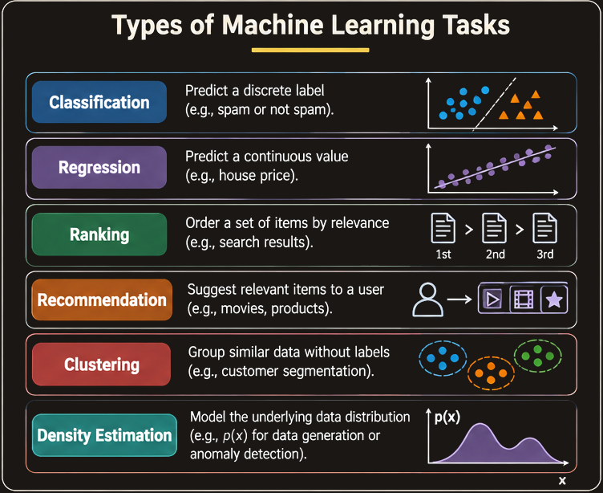
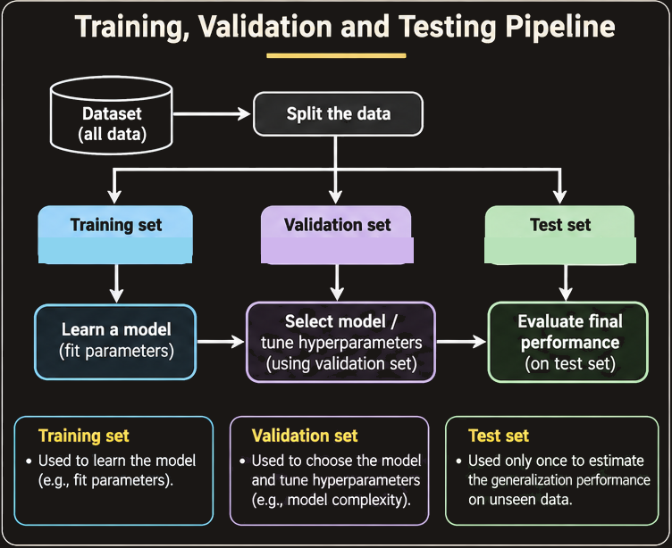
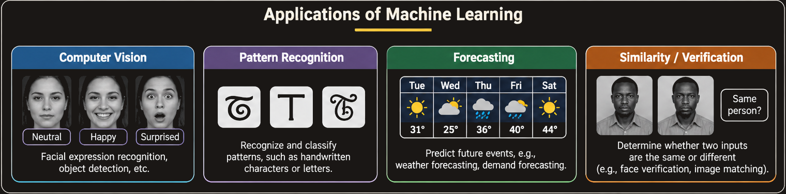

# Introduction to Machine Learning

## 1. What Is Machine Learning?

Machine learning (ML) is a way of building computer systems that improve their performance on a task by using experience or data. Instead of writing every decision rule by hand, we provide examples or observations and use a learning algorithm to infer a model that can make useful predictions or decisions.

The central idea is **learning from experience**. A system is said to learn when its performance improves as it gains experience.

Herbert Simon described learning as a process through which a system improves its performance from experience. Tom Mitchell gives a more operational definition:

> A computer program is said to learn from experience $E$ with respect to some class of tasks $T$ and performance measure $P$, if its performance at tasks in $T$, as measured by $P$, improves with experience $E$.

A well-defined machine-learning problem can therefore be described by the triple:

$$
\boxed{\langle T, P, E \rangle}
$$

where:

- **$T$ — Task:** What should the system learn to do?
- **$P$ — Performance measure:** How will we judge how well it does the task?
- **$E$ — Experience:** What data or observations will it learn from?

These three elements must be specified together. Saying that a system should “learn” is not precise enough: we must identify the task, the evidence available to the system, and the criterion by which improvement will be measured.

### 1.1 Understanding the $T$, $P$, and $E$ components

Consider a system that identifies whether an email is spam.

- **Task ($T$):** Classify an email as *spam* or *not spam*.
- **Experience ($E$):** A collection of emails, each associated with a known label. The system can use these examples to learn patterns associated with spam.
- **Performance ($P$):** A measure such as classification accuracy or error rate on emails that were not used to fit the model.

The distinction between these components is important. The task says what the system must do; experience supplies information from which it can learn; and the performance measure tells us whether learning has helped.

Another example is weather forecasting:

- **Task:** Predict a future weather quantity, such as temperature.
- **Experience:** Historical weather observations and related measurements.
- **Performance:** A prediction-error measure comparing forecasts with observed values.

The exact task and performance measure depend on the application. For example, predicting a numerical temperature is different from assigning a weather category such as *rainy* or *sunny*.

## 2. Designing a Learning System

Designing a machine-learning system is not simply a matter of selecting an algorithm. The problem must first be formulated in a way that makes learning possible.

A useful design process has four decisions.

1. **Understand the problem statement.** Identify the real-world goal, the inputs available, the desired output, and the conditions under which the system will be used.
2. **Choose exactly what is to be learned.** Specify the target function: the relationship the system is intended to infer from input data to an output or decision.
3. **Choose how to represent the target function.** Decide the form of the model. A target function might, for example, be represented by a linear equation, a decision tree, or a more complex model.
4. **Choose a learning algorithm.** Select the procedure that will use the available experience to infer the model parameters or structure.

These decisions are connected. The task determines what the target function should produce; the representation determines which functions the model can express; and the learning algorithm determines how the system searches for a suitable function using data.

A model that is too restricted may be unable to represent the relationship needed for the task. A highly flexible model may be harder to learn reliably from limited data. The choice of representation and learning procedure should therefore be guided by the problem and the available experience.

## 3. Common Machine-Learning Tasks

Machine learning is not one single kind of prediction problem. It includes several task families, each defined by the kind of output or structure we want to obtain.

### 3.1 Classification

**Classification** assigns an input to one of a set of predefined categories, also called classes.

Examples include:

- Determining whether an email is spam or not spam.
- Recognizing a handwritten character.
- Identifying a facial expression.
- Deciding whether two face images show the same person or different people.

The output is categorical. In binary classification there are two classes; in multiclass classification there are more than two.

A classifier can be viewed as a function that maps an input feature vector $x$ to a class label:

$$
f(x) \in \{C_1,C_2,\ldots,C_K\}
$$

where $K$ is the number of possible classes.

A geometric intuition is to imagine data points represented by features on a two-dimensional graph. A classifier separates the feature space into regions, with each region associated with a class. A new point is assigned the class corresponding to the region in which it falls.

### 3.2 Regression

**Regression** predicts a numerical, typically continuous, value.

Examples include:

- Predicting the price of a house from its features.
- Estimating tomorrow's temperature.
- Predicting demand or sales.

A regression model maps an input feature vector to a numerical output:

$$
f(x) \in \mathbb{R}
$$

For example, a simple linear regression model with one input feature can be written as:

$$
\hat{y} = w_0 + w_1x
$$

Here, $x$ is the input feature, $\hat{y}$ is the predicted numerical value, $w_0$ is the intercept, and $w_1$ is the coefficient that controls how the prediction changes with $x$.

In a plot, a fitted regression line summarizes the relationship the model has learned between an input feature and a numerical target. The line is a model of the relationship, not a guarantee that every observation lies exactly on it.

### 3.3 Ranking

**Ranking** orders items according to their relevance, preference, or another score.

For example, a search engine may receive a query and return a list of web pages ordered by how relevant they are estimated to be. The goal is not merely to decide whether each page is relevant or irrelevant; it is also to place the more useful results higher in the list.

Ranking is useful when users are presented with many possible items but are most likely to examine only the first few.

### 3.4 Recommendation

**Recommendation** suggests items that a user may find useful or interesting.

Examples include:

- Recommending films or programmes on a streaming service.
- Suggesting products in an online store.
- Recommending music, articles, or other content.

A recommendation system uses available information about users, items, and possibly their past interactions to produce suggestions. The objective is to help a user discover relevant choices from a large collection.

Ranking and recommendation are related but not identical. A recommendation system decides which items to suggest; ranking can be used to order those suggested items.

### 3.5 Clustering

**Clustering** groups data points according to similarity, usually without requiring predefined class labels.

Suppose each observation is represented by a point in a feature space. A clustering method attempts to form groups so that points within the same group are relatively similar, while points in different groups are relatively dissimilar.

For example, customers may be grouped according to purchasing behaviour. The groups are discovered from the data rather than supplied as known categories beforehand.

The labels assigned to clusters, such as *Cluster 1* or *Cluster 2*, are identifiers. They do not automatically have a meaningful interpretation; a person must examine the characteristics of each group to understand what it represents.

### 3.6 Density Estimation

**Density estimation** attempts to estimate the probability distribution that generated the observed data.

In practical terms, it asks which regions of the feature space contain observations frequently and which regions are relatively unlikely. A probability density model can describe how data is distributed rather than assigning each observation to a predefined class.

For a continuous random variable $X$, a probability density function $p(x)$ describes the relative concentration of probability around values of $x$. Probabilities are obtained by integrating the density over an interval:

$$
P(a \leq X \leq b) = \int_a^b p(x)\,dx
$$

A valid continuous probability density is non-negative and integrates to one over its domain.

### 3.7 Comparing the Tasks

| Task | Desired output | Example |
| --- | --- | --- |
| Classification | A category or class label | Spam or not spam |
| Regression | A numerical value | Predicted house price |
| Ranking | An ordered list | Search results ordered by relevance |
| Recommendation | Suggested items | Films suggested to a viewer |
| Clustering | Groups discovered in data | Customer segments |
| Density estimation | An estimated data distribution | Probability density of measurements |

The task type determines what kind of model output is required and influences the choice of learning method and evaluation measure.

## 4. Performance Measures

A machine-learning model needs an explicit performance measure. Without one, it is not possible to state precisely whether the model has improved.

The appropriate measure depends on the task.

### 4.1 Classification: Accuracy and Error Rate

For classification, two basic measures are **accuracy** and **error rate**.

If a model makes predictions for $N$ examples, then:

$$
\text{Accuracy} =
\frac{\text{Number of correct predictions}}{N}
$$

$$
\text{Error rate} =
\frac{\text{Number of incorrect predictions}}{N}
$$

When every example receives either a correct or incorrect prediction:

$$
\text{Error rate} = 1 - \text{Accuracy}
$$

For example, suppose a classifier correctly classifies 90 out of 100 emails. Its accuracy is:

$$
\text{Accuracy} = \frac{90}{100} = 0.90 = 90\%
$$

Its error rate is:

$$
\text{Error rate} = \frac{10}{100} = 0.10 = 10\%
$$

Accuracy is easy to interpret, but it may not tell the whole story when classes are highly imbalanced or when different kinds of mistakes have different costs. In such cases, additional measures may be needed.

### 4.2 Regression: Mean Squared Error

For regression, the lecture identifies **mean squared error (MSE)** as a performance measure.

Given $N$ examples, let $y_i$ be the true target and $\hat{y}_i$ be the model's prediction for example $i$. Then:

$$
\operatorname{MSE} =
\frac{1}{N}\sum_{i=1}^{N}(y_i-\hat{y}_i)^2
$$

The calculation proceeds as follows:

1. Find the prediction error for each example: $y_i-\hat{y}_i$.
2. Square each error so that negative and positive errors do not cancel.
3. Add the squared errors.
4. Divide by the number of examples.

For example, suppose the true values are $[3,5]$ and the predictions are $[2,7]$. The errors are $[1,-2]$, and the squared errors are $[1,4]$. Therefore:

$$
\operatorname{MSE} = \frac{1^2+(-2)^2}{2}
= \frac{1+4}{2}
= 2.5
$$

A lower MSE indicates smaller average squared prediction error on the evaluated examples. Because errors are squared, larger errors receive disproportionately greater weight. MSE is expressed in the square of the target variable's units.

### 4.3 Density Estimation: Probability Assigned to Samples

For density estimation, performance can be assessed using the probability that the model assigns to observed samples. A model that assigns higher probability to data that are representative of the actual distribution is generally more appropriate than one that assigns very low probability to those observations.

The exact evaluation procedure depends on the density model and the evaluation setup. The important point is that classification, regression, and density estimation require different notions of performance.

## 5. Machine Learning in Practice

Applying machine learning to a real problem involves more than fitting an algorithm to a dataset. The practical workflow begins with understanding the domain and ends with using the resulting knowledge.

A typical process includes:

1. **Understand the domain, prior knowledge, and goals.** Learn what the problem means in its application context, what is already known, and what outcome is useful.
2. **Integrate and select data.** Bring relevant data sources together and identify the observations needed for the task.
3. **Clean and preprocess the data.** Address data-quality issues and transform the data into a form suitable for learning.
4. **Learn models.** Apply learning algorithms to the prepared data.
5. **Interpret results.** Examine what the learned model and its performance mean in the context of the original problem.
6. **Consolidate and deploy discovered knowledge.** Turn useful results into a form that can support decisions or be used in an application.

The process is iterative. For example, model evaluation may reveal that the selected data do not adequately represent the task. The data or preprocessing steps may then need to be revisited.

## 6. The Machine-Learning Pipeline

A machine-learning pipeline organizes the stages that turn raw data into a model and then use that model to make decisions.

The lecture presents three major stages:

- **Training**
- **Validation**
- **Testing**

### 6.1 Training

**Training** is the stage in which the learning algorithm uses training data to construct a model.

In the supervised-learning pipeline shown in the lecture, the training database contains:

- **Inputs:** The observations supplied to the learning system.
- **Class labels:** The known target labels associated with those observations.

The training flow can be described as:

1. **Preprocessing:** Prepare the input data so they can be used consistently by later stages.
2. **Feature selection:** Select the features that will be used to represent the observations for learning.
3. **Learning:** Use the selected training data and labels to infer a model.
4. **Learned model:** Store the result of the learning procedure for later evaluation and use.

A **feature** is a measurable property or attribute used to represent an observation. For example, an email might be represented using features derived from its words, sender, or message structure. Feature selection determines which available features are passed to the learning algorithm.

The learned model captures patterns from the training examples. It is not enough, however, to measure success only on the same data used to construct it. A model may fit its training examples well without performing equally well on new examples.

### 6.2 Validation

**Validation** is used to evaluate candidate models and select the best one among the alternatives being considered.

The validation stage uses data that are separate from the training data. A typical process is:

1. Train a candidate model using the training dataset.
2. Evaluate its performance on the validation dataset.
3. Repeat for other candidate models or settings.
4. Compare validation performance and select the model considered best for the task.

The validation set helps estimate how well a candidate model performs on data that were not used to fit it. It also supports model selection, such as choosing between alternative model configurations.

The validation data should not be treated as additional training examples for the same evaluation. If the model is repeatedly adjusted to perform well on the validation set, decisions may become overly tailored to that set. A separate test set is therefore retained for the final evaluation.

### 6.3 Testing

**Testing** evaluates the selected model on a separate test dataset. It provides an assessment of how the final model performs on examples that were not used for training or model selection.

In the testing flow:

1. A test input is supplied.
2. The input goes through preprocessing consistent with the training pipeline.
3. The appropriate features are extracted or selected.
4. The learned model performs classification or another required prediction task.
5. The system produces a decision or prediction.

The lecture's pipeline emphasizes that preprocessing and feature handling at test time must correspond to those used when the model was trained. Otherwise, the model may receive inputs represented differently from the data on which it learned.

The test set should be kept separate from the choices made during training and validation. If test results are used repeatedly to select models or tune settings, the test set no longer provides an independent final assessment.

### 6.4 Training, Validation, and Testing Compared

| Stage | Main purpose | How the data are used |
| --- | --- | --- |
| Training | Learn model parameters or structure | The learning algorithm fits the model using training examples |
| Validation | Compare candidates and select a model | Candidate models are evaluated to guide model selection |
| Testing | Assess the selected model | The final selected model is evaluated on separate, held-out examples |

The key distinction is the role each dataset plays:

- Training data teach the model.
- Validation data guide the choice of model.
- Test data provide a final evaluation.

Keeping these roles separate helps prevent an overly optimistic estimate of performance.

## 7. Applications of Machine Learning

The lecture illustrates that machine learning is used in a wide range of applications. These examples can be understood by identifying the input, the task, and the output.

Examples include:

- **Facial-expression analysis:** An image of a face is used to infer an expression category.
- **Character recognition:** An image of a handwritten or stylized character is used to identify the character.
- **Weather forecasting:** Historical and current observations are used to predict future weather quantities or conditions.
- **Face comparison:** Two face images are compared to decide whether they show the same person or different people.
- **Driving-related systems:** Images and other sensor inputs can support perception tasks in vehicles.
- **Social-network suggestions:** Patterns in available information can be used to suggest people or connections.
- **Content recommendation:** A platform can recommend videos or other media based on available user and item information.
- **Shopping recommendations:** A system can suggest products that may be relevant to a shopper.
- **Pedestrian or face detection:** Images from a camera can be analyzed to locate people or faces.
- **Route-related applications:** Data can support route suggestions or related predictions.

These applications do not all solve the same machine-learning task. Some are classification problems, some involve numerical prediction, and others involve ranking, recommendation, or detection. Identifying the task is an essential first step in designing the system.

## 8. Key Connections and Takeaways

The ideas in this chapter fit together into one coherent workflow.

1. **Start with a well-defined learning problem.** Specify the task $T$, performance measure $P$, and experience $E$.
2. **Choose a suitable target and representation.** Decide what the system should learn and how the learned function will be represented.
3. **Match the method to the task.** Classification, regression, ranking, recommendation, clustering, and density estimation produce different kinds of outputs.
4. **Choose a meaningful performance measure.** Accuracy and error rate are basic classification measures; MSE is a regression measure; density estimation can be assessed through the probability assigned to samples.
5. **Prepare the data carefully.** Data integration, selection, cleaning, preprocessing, and feature selection affect what the learning algorithm can discover.
6. **Keep training, validation, and testing roles distinct.** Training fits the model, validation supports model selection, and testing evaluates the selected model on separate data.
7. **Interpret and use the result.** A model is useful when its performance and behaviour make sense for the original application and its results can be deployed appropriately.

The central lesson is that machine learning is a complete problem-solving process, not merely the act of running an algorithm. A sound solution begins with a precise task and suitable data, uses an appropriate learning method, evaluates performance correctly, and interprets the result in its application context.

## 9. Course Roadmap

The introductory lecture places this chapter within a broader course on machine learning. The stated course content is organized into three parts.

### 9.1 Supervised Learning

The first part covers:

- Introduction: definitions, datasets for machine learning, learning paradigms, data normalization, hypothesis evaluation, VC dimensions and distribution, bias-variance trade-off, and linear regression.
- Bayes decision theory: Bayes decision rule, minimum-error-rate classification, normal density, and discriminant functions.
- Parameter estimation: maximum-likelihood and Bayesian parameter estimation.

### 9.2 Unsupervised Learning

The second part covers:

- Discriminative methods: distance-based methods, linear discriminant functions, decision trees, random decision forests, and boosting.
- Feature selection and dimensionality reduction: PCA, LDA, ICA, SFFS, and SBFS.
- Clustering: k-means clustering, Gaussian mixture modelling, and the EM algorithm.

### 9.3 Kernels and Neural Networks

The third part covers:

- Kernel machines: kernel tricks, support vector machines (SVMs) in primal and dual forms, K-SVR, and K-PCA.
- Artificial neural networks: multilayer perceptrons (MLPs), backpropagation, and radial-basis-function networks (RBF-Nets).
- Foundations of deep learning: deep neural networks (DNNs), convolutional neural networks (CNNs), and autoencoders.

These topics are the course roadmap, not concepts developed in detail in this introductory chapter.

## 10. Quick Revision

- **Machine learning:** The study of algorithms that improve performance on a task through experience.
- **Mitchell's formulation:** A learning problem is described by $\langle T,P,E\rangle$.
- **Task:** What the system must do.
- **Performance:** How success is measured.
- **Experience:** The data or observations used for learning.
- **Classification:** Predict a category.
- **Regression:** Predict a numerical value.
- **Ranking:** Order items.
- **Recommendation:** Suggest relevant items.
- **Clustering:** Discover groups in data.
- **Density estimation:** Estimate the distribution that generated data.
- **Accuracy:** Fraction of predictions that are correct.
- **Error rate:** Fraction of predictions that are incorrect.
- **Mean squared error:** Average of squared prediction errors.
- **Training:** Fit the model.
- **Validation:** Compare candidates and select a model.
- **Testing:** Evaluate the selected model on held-out data.

## 11. Source Scope and Notes

This chapter is based on the supplied *Machine Learning* lecture, which introduces the course and the foundations of machine learning. It preserves the lecture's framing of learning through the $T$, $P$, and $E$ components; its list of task types; its performance examples; its practical workflow; and its training, validation, and testing pipeline.

The lecture lists topics such as data normalization, hypothesis evaluation, VC dimensions, bias-variance trade-off, Bayes decision theory, parameter estimation, clustering, kernels, and neural networks as course content. The introductory slides do not explain these topics in enough detail to teach them here, so they are retained as a roadmap rather than expanded as if they had been covered in this lecture.

The slides identify the training database as containing inputs and class labels. This is the supervised-learning pipeline illustrated in the lecture; not every machine-learning setting uses class labels. The detailed handling of unsupervised data is outside the scope of the supplied introductory slides.
