# Kernel Methods and Nonlinear Support Vector Machines

## 1. From Linear to Nonlinear Decision Boundaries

A large-margin classifier with a linear decision boundary works well when the classes can be separated by a straight line, plane, or hyperplane. However, real datasets are not always linearly separable in their original representation.

The central question is:

**How can a linear SVM be generalized so that it can classify data with a nonlinear decision boundary?**

The key idea is to transform each input vector into a higher-dimensional representation. A decision boundary that is nonlinear in the original input space may become linear in this expanded feature space.

### 1.1 Input Space and Feature Space

Let the original input be \(x\). A transformation maps it to a feature representation:

\[
\Phi:x\longrightarrow \phi(x).
\]

The two spaces have different roles:

- **Input space:** the space in which the original observations \(x_i\) are located.
- **Feature space:** the space containing the transformed observations \(\phi(x_i)\).

A linear operation in feature space corresponds to a potentially nonlinear operation in the original input space.

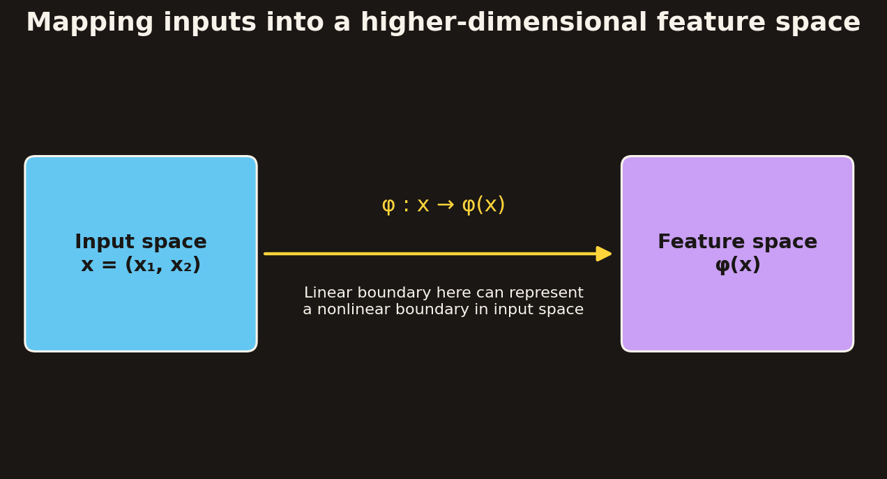

### 1.2 Why Transform the Data?

A suitable transformation can make classification easier. A dataset that is difficult to separate in the original input space may become linearly separable after transformation.

The XOR problem is a simple illustration. Consider four points with binary coordinates:

| \(x_1\) | \(x_2\) | XOR output |
|---:|---:|---:|
| 0 | 0 | 0 |
| 0 | 1 | 1 |
| 1 | 0 | 1 |
| 1 | 1 | 0 |

The two output classes cannot be separated by a single straight line in the original two-dimensional input space. Add a feature based on the product \(x_1x_2\), and the observations are represented using an additional coordinate. This illustrates how an expanded representation can make a classification problem easier.

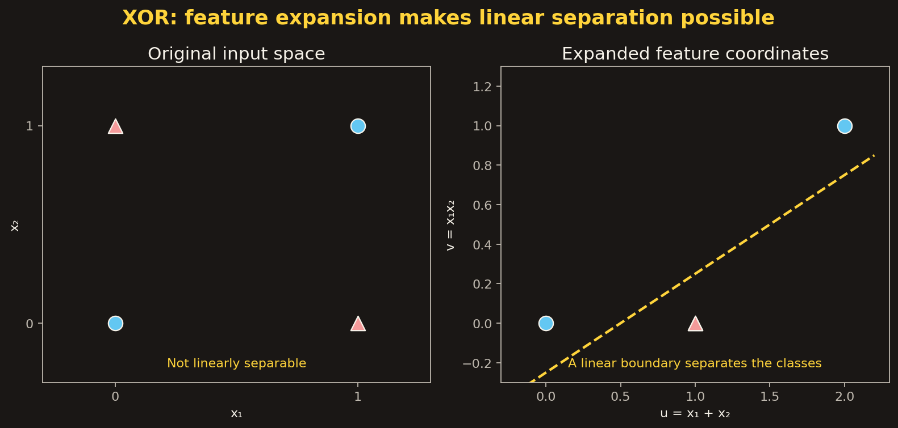

### 1.3 Nonlinear SVM: General Idea

The general procedure is:

1. Start with observations in the original input space.
2. Map each observation through \(\phi\) into a feature space.
3. Train a linear large-margin classifier in that feature space.
4. Interpret the resulting linear boundary in feature space as a nonlinear boundary in the original input space.

The transformed training set is intended to be separable, or more easily separable, in the feature space.

## 2. The Kernel Trick

The explicit feature transformation may be expensive or impractical to construct. The important observation is that the SVM optimization and prediction equations use inner products between feature vectors, rather than requiring the feature vectors themselves to be written out.

This makes it possible to calculate the required inner products directly using a **kernel function**.

### 2.1 Discriminant Function in Feature Space

For a linear SVM trained in feature space, the discriminant function is

\[
g(x)=w^\top\phi(x)+b.
\]

Using the support-vector representation of the weight vector,

\[
w=\sum_{i\in SV}\alpha_i y_i\phi(x_i),
\]

the discriminant becomes

\[
\begin{aligned}
g(x)
&=\left(\sum_{i\in SV}\alpha_i y_i\phi(x_i)\right)^\top\phi(x)+b\\
&=\sum_{i\in SV}\alpha_i y_i
\phi(x_i)^\top\phi(x)+b.
\end{aligned}
\]

The feature vectors occur only through their inner products:

\[
\phi(x_i)^\top\phi(x).
\]

### 2.2 Definition of a Kernel Function

A kernel function is defined as the inner product of two feature vectors in an expanded feature space:

\[
\boxed{
K(x_i,x_j)=\phi(x_i)^\top\phi(x_j).
}
\]

If this inner product can be calculated directly from the original inputs, there is no need to construct \(\phi(x)\) explicitly.

The kernel trick is precisely this use of a kernel function to avoid carrying out the feature transformation explicitly.

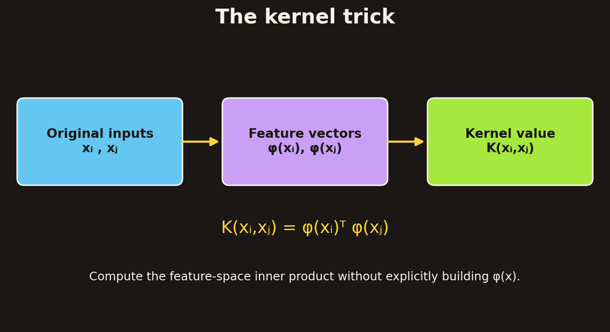

### 2.3 Why This Matters

The kernel trick has two important consequences:

- The SVM can operate as though observations had been transformed into a higher-dimensional feature space.
- The algorithm can avoid explicitly storing or calculating the potentially very large feature vectors.

The method retains the SVM's linear optimization structure in feature space while producing a nonlinear decision boundary in input space.

## 3. A Worked Feature-Map Example

Consider a two-dimensional input vector

\[
x=
\begin{bmatrix}
x_1\\x_2
\end{bmatrix}.
\]

Define the feature mapping

\[
\boxed{
\phi(x)=
\begin{bmatrix}
1\\
\sqrt{2}x_1\\
\sqrt{2}x_2\\
x_1^2\\
x_2^2\\
\sqrt{2}x_1x_2
\end{bmatrix}.
}
\]

For another input vector

\[
y=
\begin{bmatrix}
y_1\\y_2
\end{bmatrix},
\]

the inner product in feature space is

\[
\begin{aligned}
\phi(x)^\top\phi(y)
={}&1+2x_1y_1+2x_2y_2\\
&+x_1^2y_1^2+x_2^2y_2^2\\
&+2x_1x_2y_1y_2.
\end{aligned}
\]

Now expand the expression

\[
(1+x_1y_1+x_2y_2)^2.
\]

It gives

\[
\begin{aligned}
(1+x_1y_1+x_2y_2)^2
={}&1+2x_1y_1+2x_2y_2\\
&+x_1^2y_1^2+x_2^2y_2^2\\
&+2x_1x_2y_1y_2.
\end{aligned}
\]

The two expressions are identical. Therefore,

\[
\boxed{
\phi(x)^\top\phi(y)
=(1+x^\top y)^2.
}
\]

We can define the kernel directly as

\[
\boxed{
K(x,y)=(1+x^\top y)^2.
}
\]

This kernel calculates the same inner product as the six-dimensional feature map without explicitly constructing that feature map.

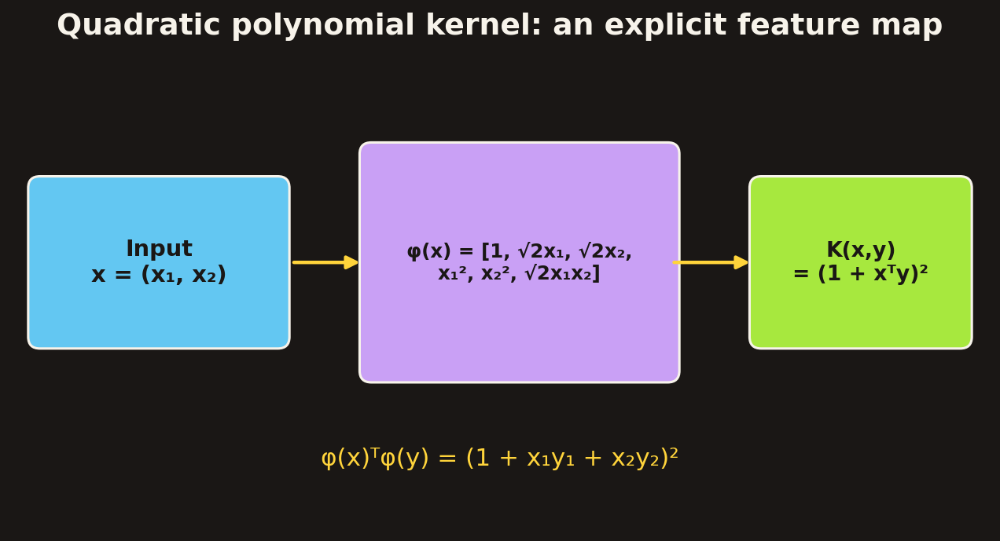

### 3.1 Interpreting the Example

The original input contains only two coordinates, but the feature map contains six coordinates:

- A constant feature.
- Two scaled first-degree features.
- Two squared features.
- One scaled interaction feature.

The kernel function computes the inner product in this expanded space directly from the original two-dimensional vectors.

This is the essential computational advantage of the kernel trick.

## 4. Kernelization of the SVM Optimization Problem

Recall the soft-margin SVM dual optimization problem:

\[
\begin{aligned}
\max_{\alpha}\quad
&W(\alpha)=
\sum_{i=1}^{n}\alpha_i
-\frac12\sum_{i=1}^{n}\sum_{j=1}^{n}
\alpha_i\alpha_jy_iy_jx_i^\top x_j\\
\text{subject to}\quad
&0\leq\alpha_i\leq C,\\
&\sum_{i=1}^{n}\alpha_i y_i=0.
\end{aligned}
\]

The training observations occur in the objective only through inner products:

\[
x_i^\top x_j.
\]

In feature space, these inner products become

\[
\phi(x_i)^\top\phi(x_j).
\]

Using the kernel definition,

\[
\phi(x_i)^\top\phi(x_j)=K(x_i,x_j),
\]

the kernelized dual problem is

\[
\boxed{
\begin{aligned}
\max_{\alpha}\quad
&W(\alpha)=
\sum_{i=1}^{n}\alpha_i
-\frac12\sum_{i=1}^{n}\sum_{j=1}^{n}
\alpha_i\alpha_jy_iy_jK(x_i,x_j)\\
\text{subject to}\quad
&0\leq\alpha_i\leq C,\\
&\sum_{i=1}^{n}\alpha_i y_i=0.
\end{aligned}
}
\]

The optimization constraints are unchanged. The modification is to replace every input-space inner product with a kernel evaluation.

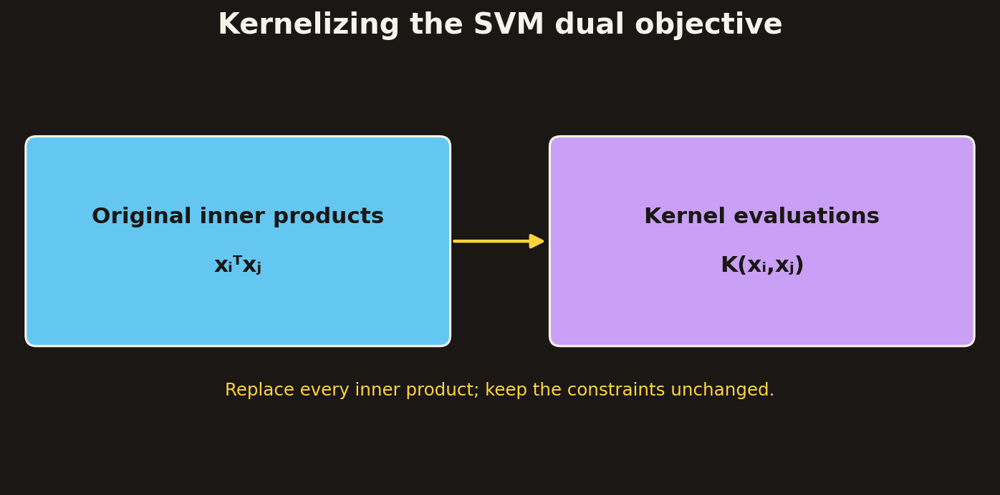

### 4.1 Kernelized Prediction

For a new observation \(z\), the original linear discriminant can be expressed as

\[
f(z)=w^\top z+b
=\sum_{j\in SV}\alpha_jy_jx_j^\top z+b.
\]

In feature space,

\[
f(z)=
\sum_{j\in SV}\alpha_jy_j
\phi(x_j)^\top\phi(z)+b.
\]

Applying the kernel function gives

\[
\boxed{
f(z)=
\sum_{j\in SV}\alpha_jy_jK(x_j,z)+b.
}
\]

The decision rule is

\[
\begin{cases}
\text{class 1},& f(z)\geq0,\\
\text{class 2},& f(z)<0.
\end{cases}
\]

Thus, prediction also requires only kernel evaluations between the test observation and the support vectors.

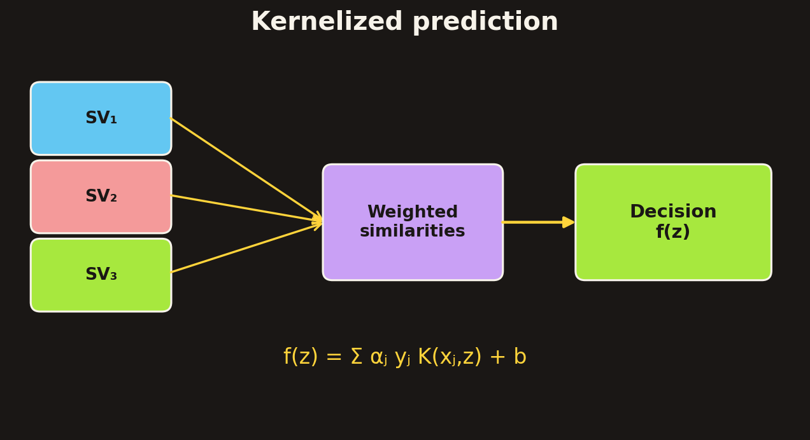

## 5. Kernel Functions as Similarity Measures

The training of an SVM requires the values \(K(x_i,x_j)\). Consequently, the input objects do not necessarily have to be ordinary numerical feature vectors.

The source highlights that an input \(x_i\) could be a sequence or a tree. A kernel can compare such objects through a similarity measure, provided that the kernel satisfies the required mathematical condition.

For a test object \(z\), the discriminant function is a weighted sum of its similarities to a selected set of training objects: the support vectors.

\[
f(z)=\sum_{j\in SV}\alpha_jy_jK(x_j,z)+b.
\]

The support vectors therefore act as reference objects for evaluating the new input.

### 5.1 Why Not Every Similarity Measure Is a Kernel?

Not every arbitrary similarity measure can be used as a valid kernel.

The source states that a kernel function should be **positive-definite**. This condition implies that the kernel matrix is positive semidefinite.

For \(n\) observations, define the kernel matrix \(K\) by

\[
K_{ij}=K(x_i,x_j).
\]

The matrix must satisfy

\[
\boxed{
c^\top Kc\geq0
\quad\text{for every vector }c\in\mathbb{R}^n.
}
\]

A symmetric matrix satisfying this inequality is positive semidefinite.

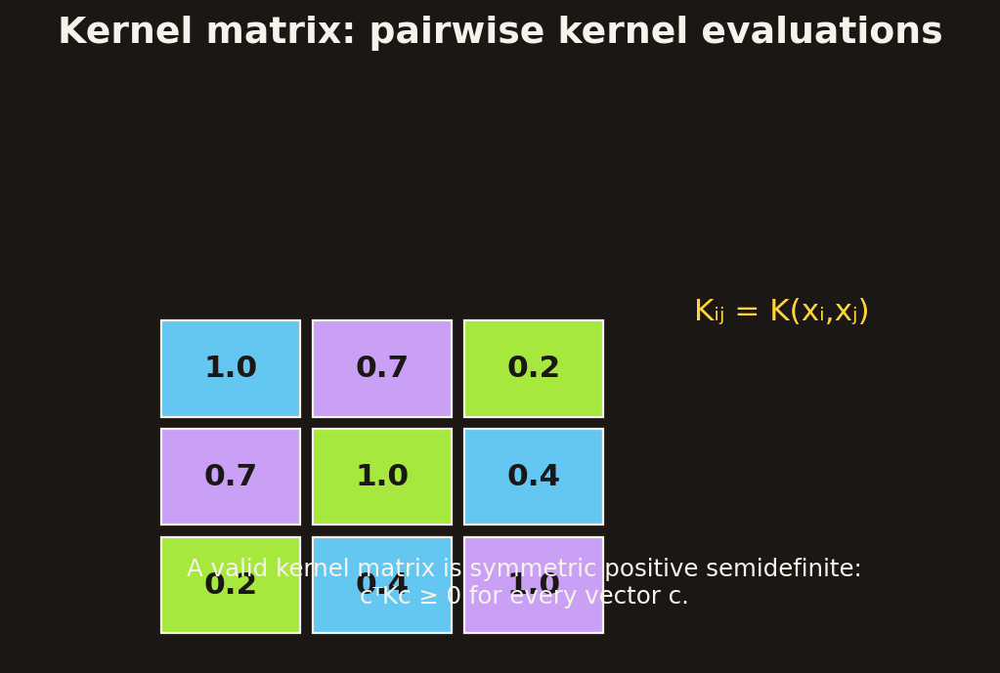

The distinction is important: a kernel is not simply any function that returns a numerical similarity score. It must have the appropriate positive-semidefinite structure.

## 6. Common Examples of Kernel Functions

The source introduces three kernel families: polynomial, radial basis function, and sigmoid kernels.

### 6.1 Polynomial Kernel

A polynomial kernel of degree \(d\) is

\[
\boxed{
K(x,y)=(x^\top y+1)^d.
}
\]

The degree \(d\) controls the polynomial order represented by the kernel.

For example:

- \(d=2\): quadratic polynomial kernel.
- \(d=3\): cubic polynomial kernel.
- \(d=4\): quartic polynomial kernel.

The quadratic example developed earlier is

\[
K(x,y)=(1+x^\top y)^2.
\]

Polynomial kernels allow the classifier to represent interactions and higher-order combinations of the original input features.

### 6.2 Radial Basis Function (RBF) Kernel

The radial basis function kernel with width parameter \(\sigma\) is

\[
\boxed{
K(x,y)=
\exp\left(
-\frac{\|x-y\|^2}{2\sigma^2}
\right).
}
\]

This kernel depends on the squared distance between the two observations.

- If \(x\) and \(y\) are close, the kernel value is close to one.
- As their distance increases, the kernel value decreases toward zero.
- The parameter \(\sigma\) controls the width of the similarity function.

The source notes that the RBF kernel is closely related to radial basis function neural networks and corresponds to an infinite-dimensional feature space.

### 6.3 Sigmoid Kernel

The sigmoid kernel is

\[
\boxed{
K(x,y)=\tanh(\kappa x^\top y+\theta).
}
\]

Here, \(\kappa\) and \(\theta\) are parameters controlling the kernel.

The source later notes a similarity between an SVM with a sigmoid kernel and a two-layer feedforward neural network.

### 6.4 Kernel Comparison

| Kernel | Formula | Main characteristic |
|---|---|---|
| Polynomial | \((x^\top y+1)^d\) | Represents polynomial feature interactions |
| RBF | \(\exp(-\|x-y\|^2/(2\sigma^2))\) | Distance-based similarity; infinite-dimensional feature space |
| Sigmoid | \(\tanh(\kappa x^\top y+\theta)\) | Related to a two-layer feedforward neural network |

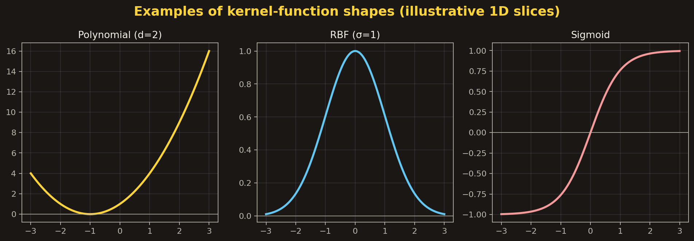

## 7. Computational Advantage of the Kernel Trick

An explicit feature transformation may create a large number of coordinates. Constructing and storing those features can be expensive.

The kernel trick avoids this by calculating the inner product directly.

The source's higher-order polynomial comparison illustrates the difference between explicitly constructing a feature representation and calculating the corresponding kernel values.

The table below reproduces the cost figures shown in the source's higher-order polynomial comparison. The source does not define all of its cost symbols, so the notation is retained rather than assigning additional meanings to them.

| Polynomial order | Traditional construction cost shown | Traditional cost for 100 inputs | Kernel-based construction cost shown | Kernel-based cost for 100 inputs |
|---|---:|---:|---:|---:|
| Quadratic | \(m^2R^2/4\) | \(2{,}500R^2\) | \(mR^2/2\) | \(50R^2\) |
| Cubic | \(m^3R^2/12\) | \(83{,}000R^2\) | \(mR^2/2\) | \(50R^2\) |
| Quartic | \(m^4R^2/48\) | \(1{,}960{,}000R^2\) | \(mR^2/2\) | \(50R^2\) |

The important qualitative point is that explicit higher-order feature construction can become increasingly expensive as polynomial degree increases. Evaluating the kernel directly avoids explicitly materializing the expanded feature vectors.

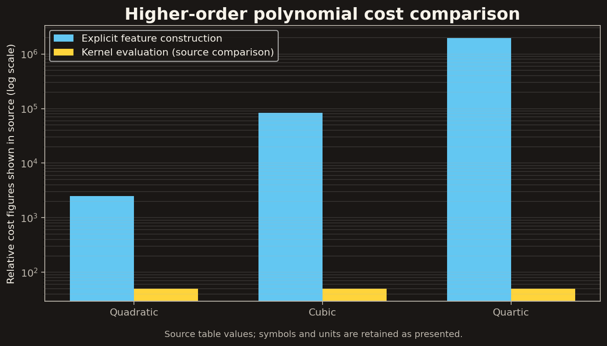

## 8. Worked Example: Polynomial Kernel SVM

Consider five one-dimensional training observations:

\[
x_1=1,\quad x_2=2,\quad x_3=4,\quad x_4=5,\quad x_5=6.
\]

The class assignments are:

- Class 1: \(1,2,6\).
- Class 2: \(4,5\).

Using the label convention \(+1\) for class 1 and \(-1\) for class 2,

\[
y_1=1,\quad y_2=1,\quad
y_3=-1,\quad y_4=-1,\quad y_5=1.
\]

Use a degree-two polynomial kernel:

\[
\boxed{
K(x,y)=(xy+1)^2
}
\]

and set

\[
C=100.
\]

### 8.1 Form the Dual Optimization Problem

There are five Lagrange multipliers, \(\alpha_1,\ldots,\alpha_5\).

The kernelized dual objective is

\[
\boxed{
\begin{aligned}
\max_{\alpha}\quad
&\sum_{i=1}^{5}\alpha_i
-\frac12\sum_{i=1}^{5}\sum_{j=1}^{5}
\alpha_i\alpha_jy_iy_j(x_ix_j+1)^2\\
\text{subject to}\quad
&0\leq\alpha_i\leq100,\\
&\sum_{i=1}^{5}\alpha_i y_i=0.
\end{aligned}
}
\]

The quadratic programming solver is used to obtain the multipliers.

### 8.2 Solution from the Source

The source gives the following values:

\[
\begin{aligned}
\alpha_1&=0,\\
\alpha_2&=2.5,\\
\alpha_3&=0,\\
\alpha_4&=7.333,\\
\alpha_5&=4.833.
\end{aligned}
\]

The support vectors are the observations with nonzero multipliers:

\[
\boxed{
SV=\{x_2=2,\ x_4=5,\ x_5=6\}.
}
\]

The first and third observations have zero multipliers and are not support vectors.

### 8.3 Construct the Discriminant Function

The kernelized discriminant is

\[
f(z)=\sum_{j\in SV}\alpha_jy_jK(x_j,z)+b.
\]

Substituting the support vectors, multipliers, labels, and polynomial kernel gives

\[
\begin{aligned}
f(z)={}&2.5(1)(2z+1)^2\\
&+7.333(-1)(5z+1)^2\\
&+4.833(1)(6z+1)^2+b.
\end{aligned}
\]

Expanding and combining terms gives the expression reported in the source:

\[
\boxed{
f(z)=0.6667z^2-5.333z+b.
}
\]

### 8.4 Recover the Bias

The support vector \(x_2=2\) belongs to class 1 and lies on the positive margin boundary. Therefore,

\[
f(2)=1.
\]

The support vector \(x_4=5\) belongs to class 2 and lies on the negative margin boundary:

\[
f(5)=-1.
\]

The support vector \(x_5=6\) belongs to class 1:

\[
f(6)=1.
\]

The source reports that all three equalities give

\[
\boxed{b=9.}
\]

Thus, the final discriminant function is

\[
\boxed{
f(z)=0.6667z^2-5.333z+9.
}
\]

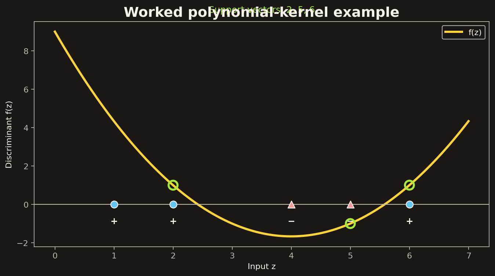

### 8.5 Interpreting the Result

The final discriminant is quadratic in the original one-dimensional input \(z\), even though the classifier is linear in the transformed feature space.

The support vectors \(2,5,6\) are sufficient to construct the discriminant. The other training points have zero multipliers and do not contribute to the prediction function.

The source also shows the discriminant values across the five input locations \(1,2,4,5,6\), with the class assignments marked along the input axis.

## 9. SVM Training Algorithm with a Kernel

The source presents the following high-level algorithm.

1. **Choose a kernel function.** Select the similarity function to use for the input data.
2. **Choose a value for \(C\).** Set the error-cost or soft-margin parameter.
3. **Solve the quadratic programming problem.** Use an available quadratic programming solver.
4. **Construct the discriminant function.** Use the resulting support vectors and their multipliers.

The resulting prediction function is

\[
f(z)=\sum_{j\in SV}\alpha_jy_jK(x_j,z)+b.
\]

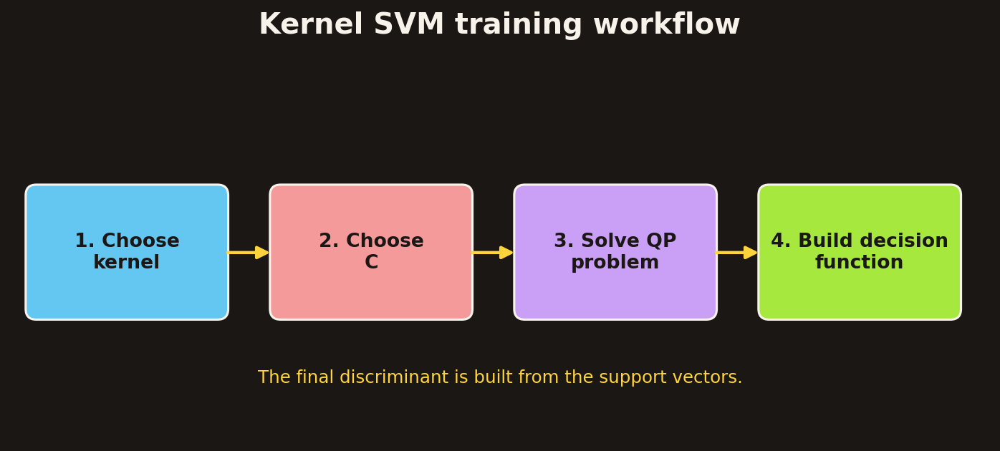

## 10. Practical Issues in Kernel SVMs

The source identifies three major choices that affect the result.

### 10.1 Choice of Kernel

Gaussian (RBF) and polynomial kernels are presented as default choices.

If these kernels are ineffective, more elaborate kernels may be needed. Domain experts can help formulate suitable similarity measures for the objects being classified.

This is particularly relevant when the inputs are not conventional numerical feature vectors, such as sequences or trees.

### 10.2 Choice of Kernel Parameters

Kernel functions contain parameters that influence their behaviour.

For the Gaussian kernel, one important parameter is \(\sigma\), the width parameter. The source describes it in relation to the distance between the closest points with different classifications.

When there are no reliable criteria for choosing kernel parameters, the source recommends using a validation set or cross-validation.

### 10.3 Hard Margin Versus Soft Margin

The optimization criterion must also be selected:

- Hard-margin SVM requires strict separation under the margin constraints.
- Soft-margin SVM allows controlled violations through slack variables and the parameter \(C\).

The source describes selecting the optimization criterion and parameters as a process that can involve a lengthy series of experiments.

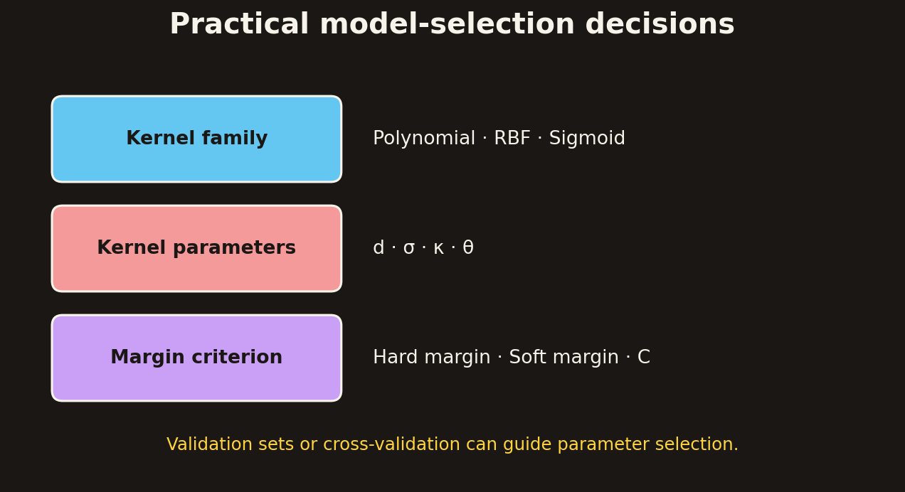

## 11. Comparing SVMs and Neural Networks

The source compares selected SVM kernels with neural-network architectures.

### 11.1 Similarities

- An SVM with a sigmoid kernel is compared with a two-layer feedforward neural network.
- An SVM with a Gaussian kernel is compared with a radial basis function (RBF) network.
- The source states that SVMs and neural networks have similar performance on many problems.

These are conceptual comparisons between model families, not claims that the algorithms are identical.

### 11.2 SVM Advantages Listed in the Source

The source identifies the following advantages:

- SVMs are based on a sound mathematical theory.
- Learning results are described as more robust.
- Overfitting is described as less common.
- The quadratic programming optimization is not trapped in local minima, unlike the neural-network optimization discussed in the source.
- There are fewer parameters to consider, particularly the kernel choice and error cost \(C\).
- SVMs can work well with fewer training samples because non-support vectors do not contribute directly to the final discriminant.

### 11.3 SVM Disadvantages Listed in the Source

- The problem needs to be formulated as a two-class classification problem.
- Learning can take a long time because of quadratic programming optimization.
- A good kernel function must be selected.

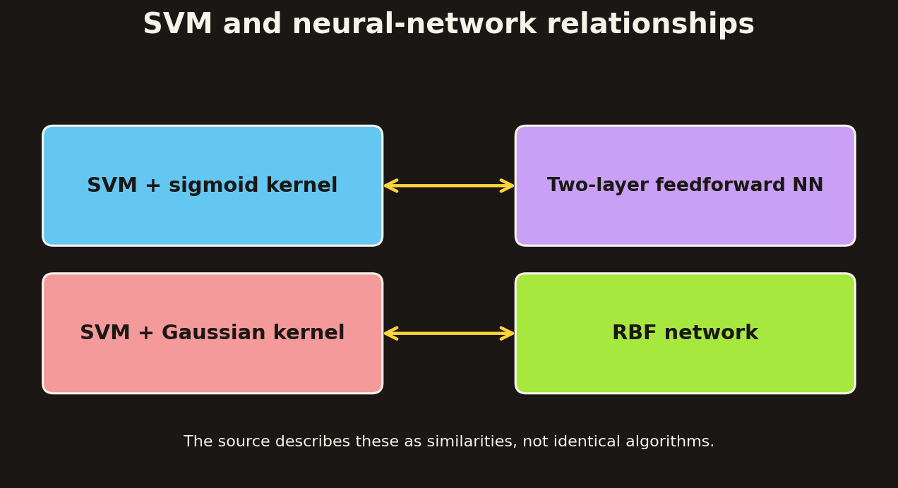

## 12. Strengths and Weaknesses of SVMs

The source separately summarizes the strengths and weaknesses of SVMs.

### 12.1 Strengths

**Training and optimization**

- Training is relatively easy in the sense that the optimization does not have local optima of the kind discussed for neural networks.
- The source emphasizes the absence of local optima in the quadratic programming formulation.

**High-dimensional data**

- SVMs scale relatively well to high-dimensional data.

**Control of complexity and error**

- The tradeoff between classifier complexity and error can be controlled explicitly.

**Non-traditional inputs**

- Inputs need not be ordinary feature vectors.
- Strings and trees can be used when an appropriate kernel or similarity function is available.

### 12.2 Weakness

The source highlights one central weakness:

- A good kernel function must be chosen.

The kernel choice is therefore both a major source of flexibility and an important modelling responsibility.

## 13. Extensions of SVM

The source names two extensions:

- **Distributed SVM**
- **Online SVM**

The final part of the source also illustrates approaches to making SVM training more scalable.

### 13.1 Training-Time Growth Illustration

A figure in the source reports training time for a synthetic two-dimensional dataset with two concentric circles.

| Number of training instances | Reported training time |
|---:|---:|
| 20 | \(1.6\times10^{-2}\) seconds |
| 200 | \(3.6\times10^{-1}\) seconds |
| 2,000 | \(1.9\times10^{1}\) seconds |
| 20,000 | \(3.3\times10^{3}\) seconds |

The displayed measurements show a rapid increase in training time as the number of training instances grows.

The source's accompanying discussion motivates more efficient large-scale SVM training. It illustrates several broad approaches:

- Reducing the training set.
- Incremental learning.
- Improving the optimization solver, including improved gradient-descent and piecewise-linear approaches shown in the diagram.
- Leveraging hardware through parallel computing.

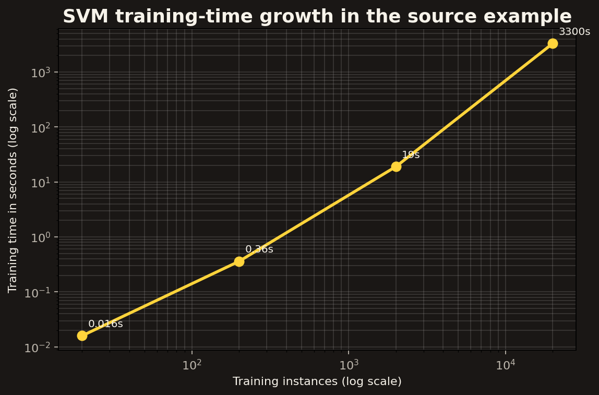

### 13.2 Distributed and Online SVM

The source names distributed SVM and online SVM as extensions but does not provide their mathematical algorithms or detailed procedures.

The accompanying scalability illustration shows the general motivation for improving training efficiency, but it does not provide a complete derivation of either extension. No additional algorithmic details are assumed here.

## 14. Chapter Summary

### Core Concepts

- A linear SVM can be extended to nonlinear classification by mapping inputs into a higher-dimensional feature space.
- The input space contains the original observations; the feature space contains their transformed representations.
- A linear decision boundary in feature space can correspond to a nonlinear decision boundary in the original input space.
- The kernel trick avoids explicitly calculating the feature transformation.
- A kernel function computes the feature-space inner product:

\[
K(x_i,x_j)=\phi(x_i)^\top\phi(x_j).
\]

- The SVM dual objective can be kernelized by replacing every inner product with a kernel evaluation.
- Prediction is a weighted sum of kernel similarities between the test input and the support vectors.
- A valid kernel must satisfy the positive-semidefinite condition for its kernel matrix.
- The source presents polynomial, RBF and sigmoid kernels.
- The polynomial kernel is \(K(x,y)=(x^\top y+1)^d\).
- The RBF kernel is \(K(x,y)=\exp(-\|x-y\|^2/(2\sigma^2))\).
- The sigmoid kernel is \(K(x,y)=\tanh(\kappa x^\top y+\theta)\).
- Kernel choice, kernel parameters and the hard-margin versus soft-margin criterion are important practical decisions.
- SVMs share conceptual similarities with selected neural-network architectures, but the source also identifies differences in optimization, robustness and training cost.
- Distributed SVM and online SVM are named as extensions; detailed algorithms are not developed in the supplied material.

### Essential Equations

| Concept | Equation |
|---|---|
| Feature mapping | \(\phi:\ x\mapsto\phi(x)\) |
| Kernel definition | \(K(x_i,x_j)=\phi(x_i)^\top\phi(x_j)\) |
| Polynomial kernel | \(K(x,y)=(x^\top y+1)^d\) |
| RBF kernel | \(K(x,y)=\exp(-\|x-y\|^2/(2\sigma^2))\) |
| Sigmoid kernel | \(K(x,y)=\tanh(\kappa x^\top y+\theta)\) |
| Kernelized dual objective | \(\sum_i\alpha_i-\frac12\sum_i\sum_j\alpha_i\alpha_jy_iy_jK(x_i,x_j)\) |
| Kernelized prediction | \(f(z)=\sum_{j\in SV}\alpha_jy_jK(x_j,z)+b\) |
| Kernel matrix | \(K_{ij}=K(x_i,x_j)\) |

## 15. Important Distinctions

**Feature mapping versus kernel evaluation**

A feature map explicitly transforms the input into a new representation. A kernel computes the inner product of those transformed representations without explicitly constructing them.

**Linear in feature space versus nonlinear in input space**

The SVM still learns a linear classifier in feature space. The resulting decision boundary can be nonlinear when expressed in the original input coordinates.

**Similarity function versus valid kernel**

A similarity score is not automatically a valid kernel. The kernel matrix must satisfy the positive-semidefinite condition.

**Kernel choice versus kernel parameter choice**

Choosing a kernel family (polynomial, RBF or sigmoid) is different from choosing its parameters, such as polynomial degree \(d\), RBF width \(\sigma\), or sigmoid parameters \(\kappa\) and \(\theta\).

**Support vectors versus all training observations**

The final kernelized discriminant is built from support vectors. Training observations with zero multipliers do not contribute directly to the prediction function.
