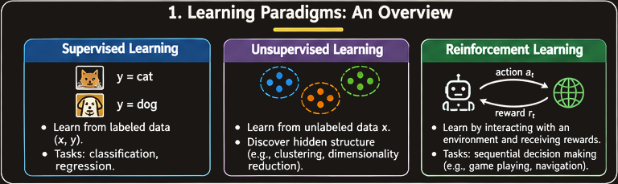
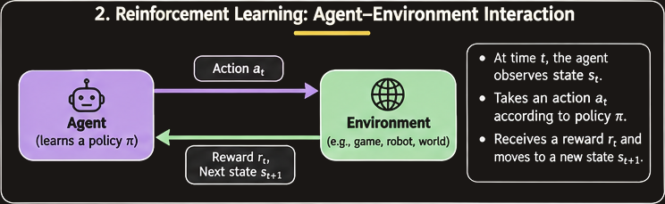
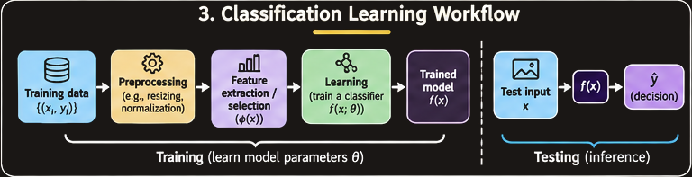
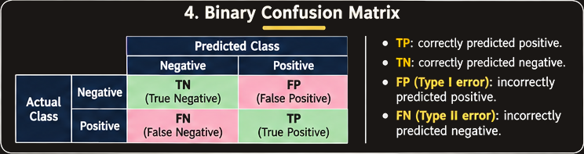
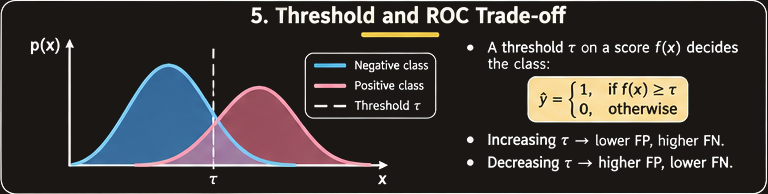
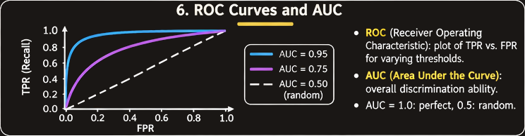
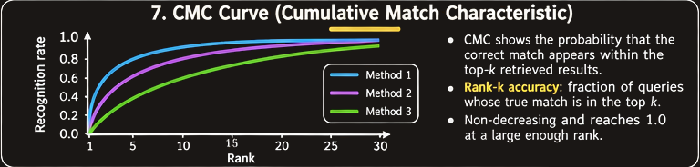
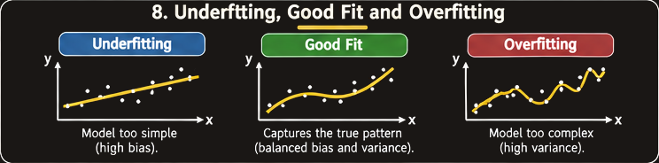
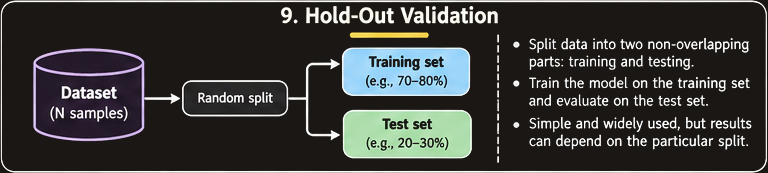
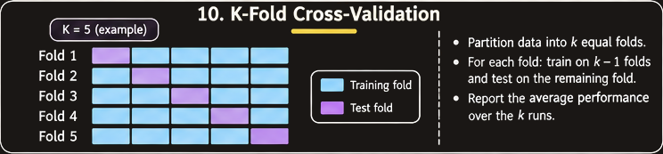

# Learning Paradigms and Model Evaluation

## 1. Overview

A machine-learning system learns patterns from data and uses those patterns to make predictions, organize information, or choose actions. To understand a complete machine-learning workflow, three questions must be answered:

1. **How does the system learn?** This is determined by the learning paradigm: supervised, unsupervised, or reinforcement learning.
2. **How is the system built and evaluated?** A pipeline separates training, model selection or validation, and testing.
3. **How do we know whether the system works well?** Evaluation metrics quantify different kinds of correct and incorrect predictions, while validation methods estimate how well a model generalizes to unseen data.

These questions connect the three lectures covered in this chapter. The material progresses from learning paradigms to classification and evaluation metrics, then to generalization, cross-validation, ROC/DET analysis, and rank-based identification evaluation.

## 2. Learning Paradigms

A **learning paradigm** describes the kind of feedback or experience available to a learning system and how that information is used.

The lectures introduce three main paradigms:

- Supervised learning
- Unsupervised learning
- Reinforcement learning

### 2.1 Supervised Learning

**Supervised learning** uses training examples for which the desired outputs, or labels, are already known. The learning algorithm uses these input-output pairs to infer a function that predicts the output for a new input.

A supervised dataset can be represented as:

$$
D = \{(x_1,y_1),(x_2,y_2),\ldots,(x_n,y_n)\}
$$

where:

- $x_i$ is the input or feature representation of example $i$.
- $y_i$ is the desired output or label.
- $n$ is the number of training examples.

The objective is to learn a function $f$ such that:

$$
\hat{y}=f(x)
$$

Here, $\hat{y}$ is the model's prediction for an input $x$. During training, the predictions are compared with known labels so that the model can learn a useful input-output relationship.

Supervised learning includes two important task types.

#### 2.1.1 Classification

**Classification** predicts a discrete class label. The output belongs to a finite set of categories.

Examples from the lectures include:

- **Cat-versus-dog recognition:** Given an image, predict whether it contains a cat or a dog.
- **Flu prediction:** Use patient properties such as fever, cold symptoms, and temperature to predict a label such as *flu* or *no flu*. This is a binary classification problem.
- **Handwritten digit recognition:** Given an image of a digit, predict one of ten labels: $0,1,\ldots,9$. This is a multiclass classification problem.
- **Spam detection:** Use words or other properties of an email to classify it as spam or not spam.
- **Person identification and object recognition:** Assign an input image to a known identity or object category.

A useful way to describe a classification example is to separate its **features** from its **label**.

For the flu example:

- Features ($x$): patient properties such as fever, cold symptoms, and temperature.
- Label ($y$): flu or no flu.

For handwritten digit recognition, one possible feature representation is a vector of pixel values. The lecture illustrates converting an image into a sequence of values, for example using 0 for white pixels and 1 for black pixels. Other feature representations are possible. Choosing useful features is not trivial in real applications.

For spam detection, features may represent whether particular words occur in an email. The lecture illustrates words such as “pharmacy”, “offer”, “meeting”, and “TA” as features, with a spam/not-spam label.

#### 2.1.2 Regression

**Regression** predicts a continuous numerical output rather than a discrete category.

Given training data:

$$
\{(x_i,y_i)\}_{i=1}^{n}
$$

the target $y_i$ is numerical, and the goal is to learn a rule that predicts $y$ for an unseen input $x$.

An example from the lecture is house-price prediction:

- Input features: number of bedrooms, number of bathrooms, and area.
- Target: house price.

A model learns a relationship between the properties of a house and its price, then uses that relationship to estimate the price of another house.

Classification and regression can use similar input data but differ in the type of output they predict. For example, identifying whether a person is a child or an adult is classification, whereas estimating the person's age in years is regression.

| Aspect | Classification | Regression |
| --- | --- | --- |
| Output | Discrete class or category | Continuous numerical value |
| Example | Flu or no flu | Predicted house price |
| Another example | Digit from 0 to 9 | Estimated age in years |

### 2.2 Unsupervised Learning

**Unsupervised learning** uses input data without supplied desired outputs or class labels.

The data can be represented as:

$$
D=\{x_1,x_2,\ldots,x_n\}
$$

The goal is to discover hidden structure or useful organization in the inputs. One common approach is to group observations according to similarity.

#### 2.2.1 Clustering

**Clustering** is the task of grouping input objects so that similar objects are placed in the same group.

The groups are not specified in advance by class labels. Instead, the algorithm discovers group structure from the data.

Examples from the lecture include:

- **Grouping videos by the people appearing in them:** Videos containing the same person may be placed in the same cluster.
- **Grouping documents by topic:** Documents can be grouped into topics such as physics and mathematics. Words in the documents can be used as features.
- **Market segmentation:** Customers can be grouped according to patterns in their data.
- **Social-network analysis:** Groups or structures may be discovered from relationships and activity.
- **Dimensionality reduction:** Unsupervised methods can also be used to represent data with fewer dimensions while retaining useful structure.

A cluster identifier such as *Cluster 1* does not automatically explain what the group means. Its interpretation comes from examining the examples and properties that have been grouped together.

### 2.3 Reinforcement Learning

**Reinforcement learning** involves an agent interacting with an environment through a sequence of actions and receiving rewards.

The lecture's interaction diagram contains two main components:

- **Agent:** The learner or decision-making system.
- **Environment:** The world with which the agent interacts.

The agent takes actions, the environment responds, and the agent receives information about the resulting state and reward. Learning is based on the consequences of sequences of actions rather than on a fixed set of input-output labels for every example.

Examples listed in the lecture include:

- Playing games such as Atari games, chess, and checkers.
- Robot navigation.
- Talent acquisition.
- Credit assignment.

In game playing, for example, an agent chooses moves and receives feedback related to the outcomes of its actions. In robot navigation, actions affect the robot's state and position in its environment.

### 2.4 Comparing the Three Paradigms

| Paradigm | Information available | Main learning objective | Lecture examples |
| --- | --- | --- | --- |
| Supervised learning | Inputs with desired outputs or labels | Learn to predict outputs for new inputs | Person identification, object recognition, stock prediction |
| Unsupervised learning | Inputs without desired labels | Discover hidden structure or groups | Social-network analysis, dimensionality reduction, market segmentation |
| Reinforcement learning | Interaction, actions, states, and rewards | Learn from the consequences of action sequences | Game playing, robot navigation, credit assignment |

The main distinction is the source of feedback:

- Supervised learning receives desired outputs.
- Unsupervised learning receives inputs without desired outputs.
- Reinforcement learning receives rewards through interaction with an environment.

### 2.5 Combinations and Related Paradigms

The lecture notes that combinations of learning paradigms are also explored. Examples named in the slides are:

- **Semi-supervised learning**
- **Self-supervised learning**
- **Supervised learning combined with reinforcement learning**

These approaches combine or modify the kinds of information and feedback used by the main paradigms. The supplied slides list them but do not develop their algorithms in detail.

## 3. A Brief History of Machine Learning

The lectures provide a high-level timeline of developments in machine learning. The timeline helps place modern methods in historical context.

| Period | Developments highlighted in the lecture |
| --- | --- |
| 1950s | Samuel's checker player; Selfridge's Pandemonium |
| 1960s | Perceptron and neural networks; pattern recognition; learning-in-the-limit theory; Minsky and Papert's analysis of perceptron limitations |
| 1970s | Symbolic concept induction; Winston's arch learner; expert systems and the knowledge-acquisition bottleneck; Quinlan's ID3; Michalski's AQ and soybean diagnosis; scientific discovery with BACON; mathematical discovery with AM |
| 2000s | Support vector machines and kernel methods; graphical models; statistical relational learning; transfer learning; sequence labelling; collective classification and structured outputs; applications in compilers, debugging, graphics, security, email management, assistants, robotics, and vision |
| 2010s | Deep-learning systems; learning for big data; Bayesian methods; multi-task and lifelong learning; applications in vision, speech, social networks, and reading |
| 2020s | Deep learning and foundation models |

This is a selective list of milestones from the lecture, not an exhaustive history of the field.

## 4. From a Learning Problem to a Classification System

A typical classification system has two connected stages: learning from labelled examples and predicting the label of a new example.

The training stage starts with a set of examples:

$$
(x_1,y_1),(x_2,y_2),\ldots,(x_n,y_n)
$$

A classification algorithm uses these examples to construct a prediction rule. A new example $x$ is then passed to the rule, which produces a predicted label:

$$
\hat{y}=f(x)
$$

The training data and test data must be separate when evaluating the model. The lecture explicitly emphasizes this separation: evaluating a prediction rule on examples that were used to train it does not provide an independent measure of performance on new data.

### 4.1 Designing a Classifier: Laptop Bag versus Purse

The lectures use a laptop-bag-versus-purse problem to illustrate classifier design.

Possible features include:

- Width
- Height
- Weight
- Feature embeddings
- Ratio of height to width

A simple classifier could use a threshold on a feature. A more complex classifier could use a multilayer perceptron (MLP) and a suitable loss function.

The threshold example uses the ratio:

$$
r=\frac{\text{Height}}{\text{Width}}
$$

The lecture illustrates a threshold of 1. The model's decision depends on whether the ratio falls on one side or the other of this threshold. The exact class assignment depends on the chosen convention for the inequality and on how the feature distributions are arranged.

This example illustrates a general principle: a classifier uses features to make a decision, and the choice of features and decision rule affects the errors it makes.

## 5. Evaluating a Binary Classifier: The Confusion Matrix

A classifier's predictions can be compared with the actual class labels. For a binary classification problem, the results are summarized in a **confusion matrix**.

The lecture's purse-versus-bag example defines:

- Positive class: purse.
- Negative class: laptop bag.

The four possible outcomes are:

| Actual class | Predicted class | Outcome | Meaning in the purse example |
| --- | --- | --- | --- |
| Positive | Positive | True positive (TP) | A purse is identified as a purse |
| Positive | Negative | False negative (FN) | A purse is identified as a bag |
| Negative | Negative | True negative (TN) | A bag is identified as a bag |
| Negative | Positive | False positive (FP) | A bag is identified as a purse |

The abbreviations are:

- **TP — True Positive:** A positive example correctly predicted as positive.
- **TN — True Negative:** A negative example correctly predicted as negative.
- **FP — False Positive:** A negative example incorrectly predicted as positive.
- **FN — False Negative:** A positive example incorrectly predicted as negative.

The meaning of positive and negative depends on the problem definition. Always identify the positive class before calculating metrics.

## 6. Core Classification Metrics

Different evaluation metrics answer different questions. Accuracy measures the overall fraction of correct predictions, while precision, recall, sensitivity, specificity, and error rates focus on particular kinds of predictions.

Let the total number of evaluated examples be:

$$
N=TP+TN+FP+FN
$$

### 6.1 Average Classification Accuracy

**Average classification accuracy** is the fraction of all examples that are classified correctly.

$$
\text{Accuracy}=\frac{TP+TN}{TP+TN+FP+FN}
$$

It counts both true positives and true negatives as correct predictions.

The corresponding overall error rate is:

$$
\text{Error rate}=\frac{FP+FN}{N}=1-\text{Accuracy}
$$

Accuracy is easy to understand, but it can be misleading when the class distribution is highly imbalanced.

### 6.2 Class-Wise Classification Accuracy

The lecture also gives **class-wise classification accuracy**, which averages the accuracy for the negative and positive classes:

$$
\text{Class-wise accuracy}
=
\frac{1}{2}
\left(
\frac{TN}{TN+FP}
+
\frac{TP}{TP+FN}
\right)
$$

This gives equal weight to the two class-specific rates, rather than allowing the larger class to dominate the overall score.

The two terms are the true negative rate and true positive rate, respectively.

### 6.3 True Positive Rate and Sensitivity

The **true positive rate (TPR)** measures the fraction of actual positive examples correctly identified.

$$
\text{TPR}=\frac{TP}{TP+FN}
$$

It is also called **sensitivity** or **recall**:

$$
\text{Sensitivity}=\text{Recall}=\frac{TP}{TP+FN}
$$

A high TPR means that the classifier finds a large fraction of the actual positive examples. A low TPR means that many positives are missed.

In a medical-screening context, high sensitivity is useful when missing a true case is particularly undesirable. The lecture notes the common screening intuition that a sensitive test can help rule out disease when the result is negative; interpreting an actual medical test still requires the relevant clinical context.

### 6.4 True Negative Rate and Specificity

The **true negative rate (TNR)** measures the fraction of actual negative examples correctly identified.

$$
\text{TNR}=\frac{TN}{TN+FP}
$$

It is also called **specificity**:

$$
\text{Specificity}=\frac{TN}{TN+FP}
$$

A high TNR means that the classifier correctly rejects most negative examples. A low TNR means that many negative examples are incorrectly flagged as positive.

### 6.5 Type I and Type II Errors

The lectures define two important error rates.

**Type I error**, also called the **false positive rate (FPR)**, is the fraction of actual negative examples incorrectly classified as positive:

$$
\text{FPR}=\frac{FP}{TN+FP}
$$

Since the actual negative examples are either true negatives or false positives:

$$
\text{FPR}=1-\text{TNR}
$$

**Type II error**, also called the **false negative rate (FNR)**, is the fraction of actual positive examples incorrectly classified as negative:

$$
\text{FNR}=\frac{FN}{TP+FN}
$$

Since actual positive examples are either true positives or false negatives:

$$
\text{FNR}=1-\text{TPR}
$$

These relationships are useful checks when calculating metrics.

### 6.6 Precision

**Precision** measures the fraction of predicted positive examples that are actually positive.

$$
\text{Precision}=\frac{TP}{TP+FP}
$$

It answers:

> Of all the examples the classifier predicted as positive, how many were truly positive?

A classifier can have high recall but low precision if it identifies most actual positives while also incorrectly flagging many negative examples.

### 6.7 Recall

**Recall** measures the fraction of actual positive examples that the classifier successfully retrieves.

$$
\text{Recall}=\frac{TP}{TP+FN}
$$

It answers:

> Of all the examples that were actually positive, how many did the classifier find?

Recall is the same quantity as sensitivity and TPR.

### 6.8 Predictive Values

The lecture also introduces predictive values, particularly in medical testing.

**Positive predictive value (PV+)** is the probability that an example is truly positive given that the classifier predicted positive. It is the same formula as precision:

$$
PV^+=\frac{TP}{TP+FP}
$$

**Negative predictive value (PV-)** is the probability that an example is truly negative given that the classifier predicted negative:

$$
PV^-=\frac{TN}{TN+FN}
$$

These predictive values answer questions about the reliability of a positive or negative prediction. They depend on the composition of the evaluated population, including how common the positive class is.

### 6.9 F1 Score

The **F1 score** is the harmonic mean of precision and recall:

$$
F_1=
2\cdot
\frac{\text{Precision}\cdot\text{Recall}}
{\text{Precision}+\text{Recall}}
$$

The harmonic mean gives more weight to a low value than the ordinary arithmetic mean does. Consequently, the F1 score is high only when both precision and recall are reasonably high.

F1 is useful when both false positives and false negatives matter and a single summary of precision and recall is desired. It does not include true negatives directly.

### 6.10 Metric Formula Summary

| Metric | Formula | What it measures |
| --- | --- | --- |
| Accuracy | $(TP+TN)/N$ | Overall fraction correct |
| Class-wise accuracy | $\frac{1}{2}(TP/(TP+FN)+TN/(TN+FP))$ | Mean of the two class-specific correct rates |
| TPR / Sensitivity / Recall | $TP/(TP+FN)$ | Fraction of actual positives found |
| TNR / Specificity | $TN/(TN+FP)$ | Fraction of actual negatives correctly rejected |
| FPR / Type I error | $FP/(TN+FP)$ | Fraction of actual negatives incorrectly flagged |
| FNR / Type II error | $FN/(TP+FN)$ | Fraction of actual positives missed |
| Precision / PV+ | $TP/(TP+FP)$ | Fraction of predicted positives that are correct |
| PV- | $TN/(TN+FN)$ | Fraction of predicted negatives that are correct |
| F1 score | $2PR/(P+R)$ | Harmonic mean of precision and recall |

In the F1 formula, $P$ denotes precision and $R$ denotes recall.

## 7. Worked Examples with Confusion Matrices

### 7.1 Purse-versus-Bag Example

The lecture gives the following first confusion matrix:

| Actual class | Predicted negative | Predicted positive | Total |
| --- | ---: | ---: | ---: |
| Negative (bag) | TN = 40 | FP = 10 | 50 |
| Positive (purse) | FN = 20 | TP = 30 | 50 |
| Total | 60 | 40 | 100 |

Therefore:

$$
TP=30,\quad TN=40,\quad FP=10,\quad FN=20
$$

**Step 1: Accuracy**

$$
\text{Accuracy}=\frac{TP+TN}{N}
=\frac{30+40}{100}=0.70=70\%
$$

**Step 2: Class-wise accuracy**

$$
\begin{aligned}
\text{Class-wise accuracy}
&=\frac{1}{2}\left(\frac{40}{50}+\frac{30}{50}\right)\\
&=\frac{1}{2}(0.8+0.6)\\
&=0.70=70\%
\end{aligned}
$$

**Step 3: True positive rate and false negative rate**

$$
\text{TPR}=\frac{30}{30+20}=0.60=60\%
$$

$$
\text{FNR}=\frac{20}{30+20}=0.40=40\%
$$

**Step 4: True negative rate and false positive rate**

$$
\text{TNR}=\frac{40}{40+10}=0.80=80\%
$$

$$
\text{FPR}=\frac{10}{40+10}=0.20=20\%
$$

**Step 5: Precision, recall, and F1**

$$
\text{Precision}=\frac{30}{30+10}=0.75=75\%
$$

$$
\text{Recall}=\frac{30}{30+20}=0.60=60\%
$$

$$
F_1=2\cdot\frac{0.75\cdot0.60}{0.75+0.60}
\approx0.667=66.7\%
$$

The classifier is more successful at correctly identifying negative examples (80% specificity) than at finding positive examples (60% sensitivity).

### 7.2 Why Accuracy Can Be Misleading

The lecture gives a second, imbalanced example:

| Actual class | Predicted negative | Predicted positive | Total |
| --- | ---: | ---: | ---: |
| Negative | TN = 90 | FP = 5 | 95 |
| Positive | FN = 3 | TP = 2 | 5 |
| Total | 93 | 7 | 100 |

The overall accuracy is:

$$
\text{Accuracy}=\frac{90+2}{100}=92\%
$$

At first glance, 92% appears strong. However, the classifier correctly identifies only 2 of the 5 positive examples:

$$
\text{TPR}=\frac{2}{2+3}=40\%
$$

Its specificity is:

$$
\text{TNR}=\frac{90}{90+5}\approx94.74\%
$$

Its precision is:

$$
\text{Precision}=\frac{2}{2+5}\approx28.57\%
$$

Its class-wise accuracy is:

$$
\begin{aligned}
\text{Class-wise accuracy}
&=\frac{1}{2}\left(\frac{90}{95}+\frac{2}{5}\right)\\
&\approx0.6737=67.37\%
\end{aligned}
$$

The classifier performs well on the majority negative class but misses most of the positive class. This example demonstrates why accuracy should not be interpreted alone when class frequencies are unequal.

## 8. Practice Problem: Traffic-Violation Detection

The lecture presents a practice problem involving an AI-based traffic system that identifies vehicles running red lights.

The positive class is **Violator** and the negative class is **Non-Violator**.

The system is evaluated on 1,000 vehicles:

| Actual condition | Predicted violator | Predicted non-violator | Total |
| --- | ---: | ---: | ---: |
| Violator | 420 | 80 | 500 |
| Non-violator | 60 | 440 | 500 |
| Total | 480 | 520 | 1,000 |

Thus:

- $TP=420$
- $FN=80$
- $FP=60$
- $TN=440$

### 8.1 Calculate TPR

$$
\text{TPR}=\frac{TP}{TP+FN}
=\frac{420}{420+80}
=\frac{420}{500}=84\%
$$

The system catches 84% of actual violators.

### 8.2 Calculate FPR

$$
\text{FPR}=\frac{FP}{FP+TN}
=\frac{60}{60+440}
=\frac{60}{500}=12\%
$$

The system incorrectly flags 12% of non-violators.

### 8.3 Calculate TNR

$$
\text{TNR}=\frac{TN}{TN+FP}
=\frac{440}{440+60}
=\frac{440}{500}=88\%
$$

The system correctly clears 88% of non-violators.

### 8.4 Calculate FNR

$$
\text{FNR}=\frac{FN}{TP+FN}
=\frac{80}{420+80}
=\frac{80}{500}=16\%
$$

The system misses 16% of actual violators.

The complementary relationships hold:

$$
\text{TPR}+\text{FNR}=84\%+16\%=100\%
$$

$$
\text{TNR}+\text{FPR}=88\%+12\%=100\%
$$

## 9. Verification, Authentication, and Identification

The lecture distinguishes two kinds of classification or matching problems.

### 9.1 Authentication or Verification: 1:1 Matching

**Verification** checks whether a claimed identity or category is correct. It is a one-to-one (1:1) comparison.

Examples:

- “Is this person Richa?”
- “Is this image an image of a helicopter?”

The system compares an input with one claimed identity or reference and decides whether the claim matches.

### 9.2 Identification: 1:n Matching

**Identification** attempts to determine which identity or class an input belongs to from a collection of possible identities or classes. It is a one-to-many (1:n) problem.

Examples:

- “Whose photograph is this?”
- “Which class does this image belong to?”

The system searches across multiple candidates and may return a ranked list of possible matches.

| Aspect | Verification | Identification |
| --- | --- | --- |
| Matching | 1:1 | 1:n |
| Question | Does this input match the claimed identity? | Which identity or class matches this input? |
| Typical output | Accept or reject | Identity or ranked candidate list |
| Evaluation plots introduced | ROC and DET | CMC |

This distinction explains why different evaluation curves are used for different applications.

## 10. Thresholds and Decision Trade-offs

Many classifiers produce a score or measure of similarity and then compare it with a threshold to make a decision.

In the purse-versus-bag illustration, the feature is the ratio of height to width:

$$
r=\frac{\text{Height}}{\text{Width}}
$$

A threshold of 1 divides the feature axis into decision regions. Changing the threshold changes which observations are classified as positive and negative.

When the feature distributions of the two classes overlap, no single threshold can perfectly separate all examples. Some observations will be classified correctly and others incorrectly.

The lecture's threshold diagrams label the regions associated with true negatives, false negatives, false positives, and true positives. They illustrate that the location of the threshold affects the balance between the two kinds of error.

A threshold is therefore not just a technical setting: it controls the decision trade-off. The appropriate choice depends on the relative importance of false positives and false negatives in the application.

## 11. ROC Curve and Area Under the Curve

### 11.1 Receiver Operating Characteristic (ROC) Curve

A **receiver operating characteristic (ROC) curve** is used in the lecture for authentication or verification evaluation.

It plots:

- Horizontal axis: false positive rate (FPR).
- Vertical axis: true positive rate (TPR).

$$
\text{ROC: } x=\text{FPR},\quad y=\text{TPR}
$$

A classifier's threshold can be varied to obtain different pairs of FPR and TPR. Plotting these pairs produces the ROC curve.

A desirable operating point has a high TPR and a low FPR: it identifies many true positives while incorrectly accepting or flagging few negatives.

The lecture also describes the axes using the terms **false accept rate (FAR)** and **true accept rate** in verification settings. In the binary formulation, FAR corresponds to FPR, while true accept rate corresponds to TPR.

### 11.2 Area Under the Curve (AUC)

The **area under the ROC curve (AUC)** summarizes the ROC curve in one number.

The lecture illustrates several possible cases:

- **AUC = 1:** Ideal separation; the ROC curve reaches the upper-left corner.
- **AUC = 0.7:** A classifier with useful but imperfect separation.
- **AUC = 0.5:** Chance-level discrimination, represented by the diagonal ROC line.
- **AUC = 0:** Completely reversed ranking in the illustrated idealized case.

A larger AUC generally indicates better ability to distinguish positive from negative examples across thresholds. AUC does not by itself specify the best operating threshold, nor does it describe every practical consequence of a classifier's errors.

The lecture's overlapping-distribution illustrations connect AUC to class separation: when positive and negative score distributions overlap substantially, errors occur and the AUC is below 1. Perfect separation corresponds to AUC 1.

## 12. Detection Error Trade-off (DET) Curve

The **detection error-tradeoff (DET) curve** is another evaluation plot introduced for verification or authentication.

It plots:

- False positive rate against false negative rate.
- In verification terminology, false accept rate against false reject rate.

$$
\text{DET: } x=\text{FPR},\quad y=\text{FNR}
$$

The ROC curve emphasizes the relationship between FPR and TPR, whereas the DET curve directly compares the two error rates.

Since:

$$
\text{FNR}=1-\text{TPR}
$$

the two plots describe related aspects of the same threshold-dependent classifier behaviour, but present the trade-off using different vertical quantities.

The DET curve is useful when the balance between false acceptance and false rejection is central to the application.

## 13. Cumulative Match Characteristic (CMC) Curve

The **cumulative match characteristic (CMC) curve** is used for identification problems, where the system returns a ranked list of candidate identities.

The horizontal axis is the rank, and the vertical axis is the identification accuracy up to that rank.

A rank-$k$ result is counted as correct if the correct identity appears anywhere among the first $k$ returned candidates.

### 13.1 Worked CMC Example from the Lecture

Suppose the gallery contains three known kittens:

- Kitten A
- Kitten B
- Kitten C

There are four test queries. The ranked outputs are:

| Query | Top result (rank 1) | Result 2 (rank 2) | Result 3 (rank 3) | Correct identity |
| --- | --- | --- | --- | --- |
| 1 | A | B | C | A |
| 2 | B | C | A | C |
| 3 | A | B | C | B |
| 4 | C | B | A | A |

For each query, locate the rank at which its correct identity first appears:

- Query 1: A appears at rank 1.
- Query 2: C appears at rank 2.
- Query 3: B appears at rank 2.
- Query 4: A appears at rank 3.

**Rank-1 accuracy**

Only query 1 has the correct identity in the first position:

$$
\text{CMC}(1)=\frac{1}{4}=25\%
$$

**Rank-2 accuracy**

By rank 2, queries 1, 2, and 3 have their correct identity in the returned list:

$$
\text{CMC}(2)=\frac{3}{4}=75\%
$$

**Rank-3 accuracy**

All four correct identities appear within the first three results:

$$
\text{CMC}(3)=\frac{4}{4}=100\%
$$

The resulting cumulative values are:

| Rank $k$ | Queries with correct identity in top $k$ | Cumulative accuracy |
| ---: | ---: | ---: |
| 1 | 1 of 4 | 25% |
| 2 | 3 of 4 | 75% |
| 3 | 4 of 4 | 100% |

The word **cumulative** is important: rank-$k$ accuracy includes every query whose correct match occurs at rank 1, 2, ..., or $k$. It is not the percentage whose correct match occurs at exactly rank $k$.

## 14. Generalization, Overfitting, and Underfitting

### 14.1 Population and Sample Data

In an ideal formulation, we want to build a model that works well for the entire population of examples relevant to the problem.

In practice, the full population is generally unavailable. We instead work with a **sample database**, which may not perfectly represent the population.

This creates an important evaluation question: does a model learn general patterns that apply to new data, or does it merely perform well on the examples it has already seen?

### 14.2 Overfitting

**Overfitting** occurs when a learning algorithm pays too much attention to peculiarities or idiosyncrasies of the training data. The resulting model fits the training examples closely but does not generalize well to unseen data.

A common symptom is:

- High accuracy on training data.
- Lower accuracy on testing data.

A model may learn noise or accidental details in the training sample rather than the underlying relationship.

### 14.3 Underfitting

**Underfitting** occurs when the learning algorithm fails to learn enough from the training data, even though useful patterns could have been learned.

An underfit model is too limited or too simple to capture the relevant structure. It performs poorly even on the training data and usually also performs poorly on unseen data.

### 14.4 Good Fit

A good-fit model captures the meaningful pattern in the training data without simply memorizing individual observations. It should perform well on both training data and independent unseen data.

| Behaviour | Training performance | Test performance | Main issue |
| --- | --- | --- | --- |
| Underfitting | Poor | Usually poor | Model has not learned enough structure |
| Good fit | Good | Good | Captures patterns that generalize |
| Overfitting | Very good | Worse than training | Learns training-specific details |

The goal is not to maximize training accuracy at any cost. The goal is to learn a model that performs reliably on data beyond the training sample.

## 15. Cross-Validation

**Cross-validation** is a statistical method for evaluating and comparing learning algorithms.

It is used for three purposes in the lecture:

1. **Performance evaluation:** Estimate the performance of a classifier using the available data.
2. **Model selection:** Compare algorithms, such as a decision-tree classifier and a neural network, to determine which performs better for the given data.
3. **Parameter tuning:** Compare variants of a parametric model to select suitable parameter settings.

Cross-validation repeatedly uses different portions of the available data for model fitting and evaluation. This helps reduce dependence on one particular train-test partition.

### 15.1 Resubstitution Validation

In **resubstitution validation**, all available data are used for training, and the same data are then used for testing.

Advantages:

- Simple to perform.

Disadvantage:

- It does not provide useful information about generalization to unseen data. Since the model is evaluated on the examples it learned from, the result can be overly optimistic due to overfitting.

Resubstitution accuracy should not be treated as an independent estimate of test performance.

### 15.2 Hold-Out Validation

In **hold-out validation**, the database is divided into two non-overlapping parts:

- Training set: used to learn the model.
- Testing set: used to evaluate the model.

Advantages:

- Training and testing use independent subsets.
- It is straightforward to implement.

Disadvantages:

- Results can depend strongly on the particular partition.
- A test set that is unusually easy or unusually difficult can give a misleading estimate.
- Some data are held out rather than used for training, so the training subset is smaller.

### 15.3 K-Fold Cross-Validation

In **$k$-fold cross-validation**, the dataset is divided into $k$ approximately equal partitions, called folds.

The procedure is:

1. Divide the data into $k$ folds.
2. Use $k-1$ folds for training.
3. Use the remaining fold for evaluation.
4. Repeat the process $k$ times, changing which fold is held out each time.
5. Aggregate the performance results across the $k$ rounds.

Each fold is used once as the held-out fold and $k-1$ times as part of the training data.

For the four-fold example in the lecture:

| Round | Fold 1 | Fold 2 | Fold 3 | Fold 4 |
| --- | --- | --- | --- | --- |
| 1 | Test | Train | Train | Train |
| 2 | Train | Test | Train | Train |
| 3 | Train | Train | Test | Train |
| 4 | Train | Train | Train | Test |

Across the folds, report summary statistics such as:

- Average accuracy or average error.
- Standard deviation or variance.

For fold accuracies $a_1,a_2,\ldots,a_k$, the average accuracy is:

$$
\bar{a}=\frac{1}{k}\sum_{i=1}^{k}a_i
$$

The variation among fold results indicates how sensitive the measured performance is to the particular data partition.

### 15.4 Leave-One-Out Cross-Validation

**Leave-one-out cross-validation (LOOCV)** is a special case of $k$-fold cross-validation in which:

$$
k=n
$$

where $n$ is the number of instances in the dataset.

The procedure is:

1. Hold out one instance for testing.
2. Train the model using the remaining $n-1$ instances.
3. Evaluate the model on the held-out instance.
4. Repeat until every instance has been held out once.

Advantages and disadvantages highlighted in the lecture:

- Advantage: It provides an unbiased performance estimate in the comparison presented by the lecture.
- Disadvantage: It can have very large variance.

Because the model must be trained once for every instance, it can also require many training runs when the dataset is large.

### 15.5 Repeated K-Fold Cross-Validation

In **repeated $k$-fold cross-validation**, the entire $k$-fold procedure is repeated multiple times, generally using different partitions.

The purpose is to obtain a larger collection of performance estimates and examine how results vary across repeated splits.

The lecture highlights:

- Advantage: A large number of performance estimates can be collected.
- Disadvantage: Training and test sets overlap across rounds, so the estimates are not fully independent. Treating them as independent can underestimate performance variance or overestimate the effective degrees of freedom when comparing methods.

### 15.6 Comparing Cross-Validation Methods

| Method | Main advantage | Main disadvantage |
| --- | --- | --- |
| Resubstitution | Simple | Overly optimistic due to evaluating on training data; does not assess generalization |
| Hold-out | Independent training and testing sets | Results depend on the chosen partition; data are withheld from each role |
| K-fold | Uses each fold for evaluation once and provides multiple estimates | Estimates across folds are related; performance variability and comparisons require care |
| Leave-one-out | Each instance is evaluated once while almost all other data are used for training | Can have very large variance and requires many training runs |
| Repeated k-fold | Produces many performance estimates across repeated partitions | Results overlap across rounds and should not be treated as independent |

The lecture's comparison table also cautions that small samples for performance estimation and dependence between repeated splits can affect estimates of performance variance and comparisons between algorithms.

### 15.7 Cross-Validation and the Training-Validation-Testing Pipeline

The earlier machine-learning pipeline distinguishes three roles:

- **Training:** Fit the model.
- **Validation:** Compare candidate models and tune settings.
- **Testing:** Evaluate the selected model on held-out data.

Cross-validation is a procedure for repeatedly estimating performance or comparing models using partitions of available data. In the lecture's description of $k$-fold cross-validation, each fold is called the test fold for that round. In a complete model-development workflow, this fold-wise evaluation is generally used as a validation or model-selection procedure, while a final independent test set can be retained for the final assessment.

The important principle is to keep model selection separate from the final evaluation. If the same held-out results are repeatedly used to choose a model and then reported as an unbiased final test result, the reported performance can become optimistic.

## 16. Putting the Evaluation Methods Together

The evaluation method should match the question being asked.

| Evaluation question | Suitable concept from the lectures |
| --- | --- |
| What fraction of all predictions is correct? | Accuracy |
| How many actual positives are found? | Recall, sensitivity, or TPR |
| How many actual negatives are correctly rejected? | Specificity or TNR |
| How many predicted positives are correct? | Precision or PV+ |
| How does a verification threshold trade off false accepts and true accepts? | ROC curve |
| How do false acceptance and false rejection trade off? | DET curve |
| How often is the correct identity found within the top $k$ candidates? | CMC curve |
| How stable is estimated performance across data partitions? | Cross-validation |
| Does a model fit training data but fail on new data? | Compare training and test performance; examine overfitting |

A good evaluation process begins by identifying the task and the cost of different errors. It then chooses metrics and validation methods that measure the relevant behaviour.

## 17. Important Questions and Self-Check

The following questions preserve the conceptual prompts and practice problems in the lectures and add checks that connect related sections.

### 17.1 Conceptual Questions

1. What are the three main machine-learning paradigms? Explain the type of information available in each.
2. What is the difference between supervised and unsupervised learning?
3. What is the difference between classification and regression? Give one example of each.
4. Why is feature selection important in a real classification problem?
5. Explain clustering and give two examples from the lecture.
6. Describe the interaction between an agent and an environment in reinforcement learning.
7. What is the difference between verification (1:1 matching) and identification (1:n matching)?
8. Why must training data and test data be separate when evaluating a classifier?
9. Explain the difference between overfitting and underfitting.
10. Why can a classifier have high accuracy but poor performance on the minority class?
11. What is the difference between precision and recall?
12. What is the difference between ROC, DET, and CMC curves?
13. Why is CMC accuracy cumulative?
14. What is the purpose of cross-validation?
15. Compare resubstitution, hold-out, $k$-fold, leave-one-out, and repeated $k$-fold cross-validation.
16. Why should a final test set not be repeatedly used to tune model parameters?

### 17.2 Numerical Practice

**Question 1 — Confusion matrix metrics**

A binary classifier produces:

- $TP=45$
- $TN=80$
- $FP=20$
- $FN=5$

Calculate:

1. Accuracy.
2. Precision.
3. Recall or TPR.
4. Specificity or TNR.
5. FPR and FNR.
6. F1 score.

**Question 2 — Class imbalance**

A dataset contains 950 negative examples and 50 positive examples. A classifier predicts every example as negative.

1. What is its accuracy?
2. What is its TPR?
3. What is its TNR?
4. What does this example reveal about accuracy?

**Question 3 — CMC**

A retrieval system is tested on five queries. The correct identities appear at ranks 1, 3, 2, 4, and 2, respectively.

Calculate the cumulative match accuracy at ranks 1, 2, 3, and 4.

**Question 4 — K-fold cross-validation**

A dataset is divided into five equal folds.

1. How many training folds are used in each round?
2. How many rounds are performed?
3. How many times is each fold used as the held-out fold?
4. If the five fold accuracies are 80%, 82%, 78%, 84%, and 81%, calculate the mean accuracy.

### 17.3 Questions Appearing in the Lecture

- **Feature-design prompt:** For a laptop bag versus purse classifier, which features could be used? The slides suggest width, height, weight, embeddings, and the ratio of height to width.
- **Handwritten-digit prompt:** What features can represent a digit image? One option shown is a vector of pixel colours or values.
- **CMC prompt:** Given ranked results for four kitten queries, what are the rank accuracies? The worked result is 25% at rank 1, 75% at rank 2, and 100% at rank 3.
- **Traffic-violation practice problem:** Compute TPR, TNR, FPR, and FNR from the 1,000-vehicle confusion matrix. The worked answers are 84%, 88%, 12%, and 16%, respectively.

## 18. Quick Revision Sheet

### Learning paradigms

- **Supervised:** Learn from labelled input-output examples.
- **Unsupervised:** Find structure in unlabelled inputs.
- **Reinforcement:** Learn from actions and rewards received through interaction.
- **Classification:** Predict a discrete label.
- **Regression:** Predict a continuous numerical value.
- **Clustering:** Group similar observations.

### Confusion-matrix metrics

- $TP$: actual positive predicted positive.
- $TN$: actual negative predicted negative.
- $FP$: actual negative predicted positive.
- $FN$: actual positive predicted negative.
- Accuracy: $(TP+TN)/N$.
- Precision: $TP/(TP+FP)$.
- Recall / TPR / Sensitivity: $TP/(TP+FN)$.
- Specificity / TNR: $TN/(TN+FP)$.
- FPR: $FP/(TN+FP)$.
- FNR: $FN/(TP+FN)$.
- F1: harmonic mean of precision and recall.

### Evaluation plots

- **ROC:** FPR versus TPR; used in verification/authentication.
- **DET:** FPR versus FNR; shows the false-accept/false-reject trade-off.
- **CMC:** Rank versus cumulative identification accuracy; used in identification.

### Generalization and validation

- **Overfitting:** Fits training details too closely and generalizes poorly.
- **Underfitting:** Fails to learn enough structure.
- **Resubstitution:** Train and test on the same data.
- **Hold-out:** One fixed non-overlapping training/test split.
- **K-fold:** Rotate the held-out fold across $k$ rounds.
- **Leave-one-out:** One instance held out per round.
- **Repeated k-fold:** Repeat k-fold partitioning multiple times.

## 19. Source Scope and Clarifications

This chapter combines the supplied Lecture 2, Lecture 3, and Lecture 4 PDFs. Repeated material on the purse-versus-bag classifier, confusion matrices, and classification metrics has been consolidated into single explanations and worked examples.

The chapter preserves the lecture's examples and terminology, including the kitten-ranking CMC exercise, the traffic-violation practice problem, the threshold-based purse-versus-bag classifier, the ROC/AUC illustrations, and the cross-validation comparison.

A few details require careful interpretation:

- The slides use the word *testing* for the held-out fold in each round of k-fold cross-validation. In a broader training-validation-testing workflow, cross-validation is commonly used for model selection or validation, with a separate final test set retained for an independent assessment.
- The lecture lists some advantages and disadvantages of cross-validation in compact form. The notes retain the central cautions about partition dependence, variance, overlapping rounds, and independence of comparisons rather than treating every fold score as statistically independent.
- The history section is a selective timeline taken from the slides and is not intended as a complete history of machine learning.
- The supplied slides introduce semi-supervised and self-supervised learning but do not explain their procedures in detail; they are therefore named without adding an extended treatment.
- The lecture's threshold illustration uses a height-to-width ratio and a threshold of 1. The precise inequality-to-class mapping is not fully specified in the extracted text, so the notes explain the threshold decision without inventing a class assignment convention.
- The ROC/AUC slides are illustrative. No underlying numerical dataset is provided for independently calculating the plotted AUC values.
