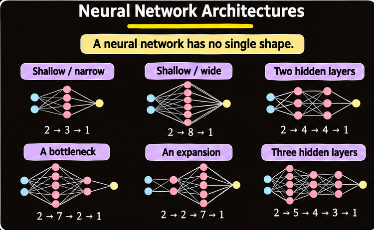
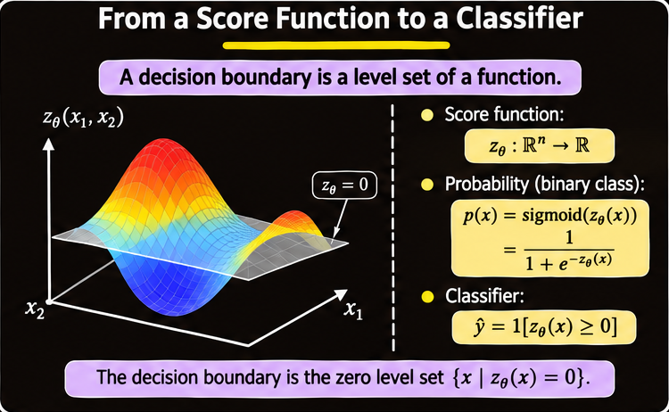
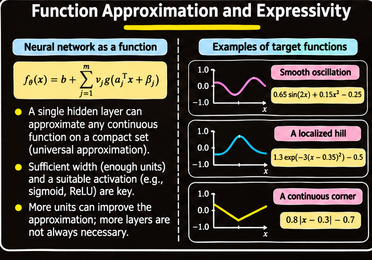
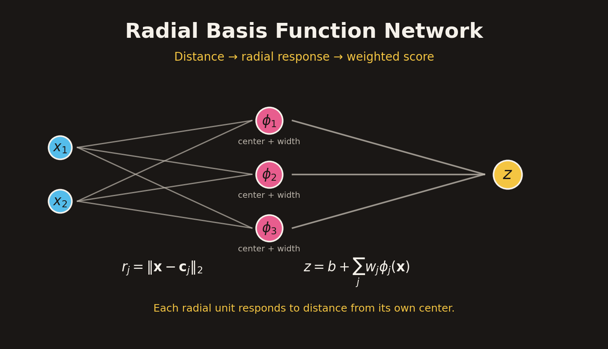
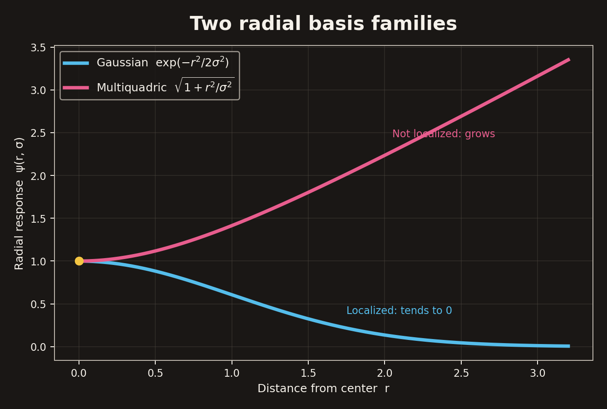
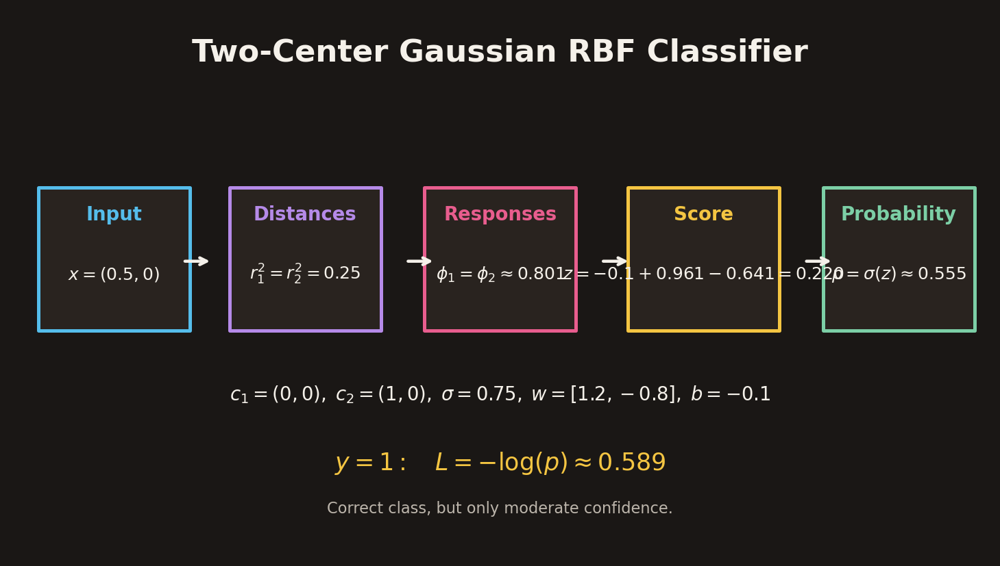

# Neural Functions, Universal Approximation and RBF Networks

## 1. Overview

A neural network is a parameterized function. Its architecture determines the family of functions it can represent, while training selects a particular function from that family by adjusting its parameters.

This chapter develops three connected ideas:

1. **Neural-network expressivity:** how width, depth, and nonlinear activations affect the functions a network can represent.
2. **Universal approximation:** why a sufficiently wide single-hidden-layer network can approximate a broad class of continuous functions on a compact domain.
3. **Radial basis function (RBF) networks:** a concrete architecture that builds functions from distance-based features, especially Gaussian radial units.

The ideas are connected to classification. A binary classifier can be built from a real-valued score function, converted to a probability by a sigmoid, and thresholded to produce a class label. The final part derives a complete RBF classifier's forward and backward calculations, including gradients for output weights, centers, and widths.

## 2. Neural-Network Architecture and Function Families

### 2.1 Architecture is not a single fixed shape

A feed-forward network can have different numbers of hidden layers and different numbers of units in each layer. A compact architecture notation lists the number of units from input to output.

For example:

| Architecture | Interpretation |
| --- | --- |
| $2\rightarrow3\rightarrow1$ | Two inputs, one hidden layer with three units, one output |
| $2\rightarrow8\rightarrow1$ | Two inputs, one wider hidden layer with eight units, one output |
| $2\rightarrow4\rightarrow4\rightarrow1$ | Two inputs, two hidden layers with four units each, one output |
| $2\rightarrow7\rightarrow2\rightarrow1$ | A wide first hidden layer followed by a narrow bottleneck |
| $2\rightarrow2\rightarrow7\rightarrow1$ | A narrow first hidden layer followed by an expansion |
| $2\rightarrow5\rightarrow4\rightarrow3\rightarrow1$ | Two inputs, three hidden layers, and one output |

**Width** is the number of units in a layer. **Depth** is the number of hidden layers. Networks can be shallow and narrow, shallow and wide, or deep with varying widths.

A bottleneck compresses the representation into fewer coordinates before the output stage. An expansion increases the number of learned features after an initially narrow representation. These arrangements impose different representational constraints and may lead to different optimization behavior.

### 2.2 Architecture defines possibilities; training chooses the function

Let a network with parameters $\theta$ compute:

$$
f_\theta:\mathbb{R}^n\rightarrow\mathbb{R}.
$$

The architecture determines which functions are expressible by varying $\theta$. Training then changes the parameters while keeping the network's wiring fixed.

Consequently:

- Different architectures can learn different decision boundaries from the same dataset.
- The same architecture can represent many different functions at different parameter settings.
- A more complicated architecture does not automatically produce a better classifier.
- The quality of the learned boundary depends on the architecture, data, loss, optimization, and generalization behavior.

For example, a network can begin with a nearly uninformative score surface. As training updates its weights, the score surface changes and the resulting classification region can become more closely aligned with the training examples. The architecture itself has not changed.

### 2.3 A score function defines a classification boundary

For binary classification, let the network produce a real-valued score:

$$
z_\theta:\mathbb{R}^n\rightarrow\mathbb{R}.
$$

A common probability mapping is the sigmoid:

$$
p(y=1\mid\mathbf{x})
=
\sigma(z_\theta(\mathbf{x}))
=
\frac{1}{1+e^{-z_\theta(\mathbf{x})}}.
$$

Thresholding the probability at $0.5$ is equivalent to thresholding the score at zero:

$$
\hat{y}
=
\mathbb{1}[p\geq0.5]
=
\mathbb{1}[z_\theta(\mathbf{x})\geq0].
$$

The decision boundary is therefore the **zero level set** of the score function:

$$
\boxed{
\mathcal{B}
=
\{\mathbf{x}:z_\theta(\mathbf{x})=0\}
}
$$

A score surface assigns a height to each input vector. The boundary consists of all input locations where the score is zero. In a two-dimensional input space, this level set is usually a curve; in higher dimensions it is a hypersurface.

The probability is above $0.5$ where the score is positive and below $0.5$ where it is negative. The boundary separates these regions.

## 3. Function Approximation as the Common Goal

Different applications require different input-output functions. Examples include:

- A smooth oscillation, such as $f(x)=0.65\sin(2x)+0.15x^2-0.25$.
- A localized hill, such as $f(x)=1.3e^{-3(x-0.35)^2}-0.5$.
- A continuous corner, such as $f(x)=0.8|x-0.3|-0.7$.

These examples have different shapes and local properties. A function approximator should be flexible enough to represent or closely approximate each of them over the region of interest.

The central question is not whether a network can memorize a particular set of training points. It is whether its function family can approximate the target relationship over a domain.

## 4. Universal Approximation with a Single Hidden Layer

### 4.1 A one-hidden-layer network

A common single-hidden-layer network has the form:

$$
\boxed{
f_\theta(\mathbf{x})
=
b+\sum_{j=1}^{m}v_j
g(\mathbf{a}_j^T\mathbf{x}+\beta_j)
}
$$

where:

- $m$ is the number of hidden units.
- $g$ is a nonlinear activation function.
- $\mathbf{a}_j$ contains the input weights for hidden unit $j$.
- $\beta_j$ is that unit's bias.
- $v_j$ is the output weight connecting the hidden unit to the score.
- $b$ is the output bias.

Each hidden unit computes a nonlinear feature of the input. The output layer forms a weighted sum of those features.

A sufficiently large number of hidden units can provide a rich collection of nonlinear features. Increasing width can therefore improve approximation quality without adding more hidden layers.

### 4.2 Universal approximation theorem

A common form of the universal approximation result states:

Let $K\subset\mathbb{R}^n$ be compact and let $f$ be continuous on $K$. For every tolerance $\varepsilon>0$, there exist a number of hidden units $m$ and suitable parameters $\theta$ such that:

$$
\boxed{
\max_{\mathbf{x}\in K}
|f(\mathbf{x})-f_\theta(\mathbf{x})|
<
\varepsilon
}
$$

The theorem establishes that a single-hidden-layer network with a suitable nonlinear activation can approximate any continuous target function on a compact domain to arbitrary prescribed accuracy, provided enough units and suitable parameters are available.

Sigmoid and ReLU hidden units with a linear output layer are common examples of suitable constructions under standard versions of the theorem.

### 4.3 What the theorem does and does not guarantee

The theorem is an **existence result**. It says that a suitable parameter setting exists; it does not provide a practical recipe for finding it.

It does not guarantee:

- That a small number of hidden units will be sufficient.
- That gradient-based training will find the required parameters.
- That training will be computationally inexpensive.
- That the learned function will generalize well to unseen data.
- That adding layers or units will automatically improve performance.

In practice, the designer still chooses the architecture, width, activation, loss, optimizer, and generalization controls.

### 4.4 Approximation with ReLU hinges

The ReLU activation is:

$$
\operatorname{ReLU}(u)=\max(0,u).
$$

A one-dimensional network can be written as a sum of shifted ReLU hinges:

$$
\boxed{
f_\theta(x)
=
b+\sum_{j=1}^{m}v_j\operatorname{ReLU}(x-t_j)
}
$$

where $t_j$ is the location at which hidden unit $j$ begins to increase.

Each ReLU unit contributes a piecewise-linear hinge. A weighted sum of hinges can form a piecewise-linear approximation to a target curve. More hidden units provide more hinge locations and can refine the approximation.

Approximation error depends on the target function, the selected hinge locations, the weights, and the number of units. A reported sampled maximum error is only an estimate over the sampled points; it is not automatically a proof of a uniform error bound over the entire continuous domain.

### 4.5 Score approximation and classification labels

Suppose a target score function $f$ is approximated by $f_\theta$ with a uniform error bound:

$$
\|f-f_\theta\|_\infty<\varepsilon.
$$

At any point where the target score has a margin larger than the approximation error,

$$
|f(\mathbf{x})|>\varepsilon,
$$

the approximated score must have the same sign as the target score. Therefore, the predicted binary label is preserved at those points.

Near the decision boundary, where $|f(\mathbf{x})|\leq\varepsilon$, a small score error may change the sign and therefore change the predicted class.

This explains why score accuracy is especially important away from the boundary, while even small approximation errors can matter near a classification threshold.

## 5. Radial Basis Function Networks

### 5.1 Radial features

A **radial basis function (RBF)** depends on the distance between the input and a center. It responds to how far the input is from a reference point, rather than to a particular direction.

For center $\mathbf{c}_j$ and width parameter $\sigma_j$, define:

$$
r_j=\|\mathbf{x}-\mathbf{c}_j\|_2
=
\sqrt{\sum_{k=1}^{n}(x_k-c_{jk})^2}.
$$

The radial feature is:

$$
\boxed{
\phi_j(\mathbf{x})
=
\psi(r_j,\sigma_j)
}
$$

An RBF network combines these radial features linearly:

$$
\boxed{
z(\mathbf{x})
=
b+\sum_{j=1}^{m}w_j\phi_j(\mathbf{x})
}
$$

The classical architecture has an input layer, one hidden layer of radial units, and a linear output score. Extended and deep variants are possible, but the single radial hidden layer is the basic construction.

### 5.2 Distance, not direction

For an input $\mathbf{x}$ and center $\mathbf{c}$, the Euclidean distance is:

$$
r
=
\sqrt{\sum_{k=1}^{n}(x_k-c_k)^2}.
$$

In two dimensions, all points at the same distance from a center receive the same response from an isotropic radial function. The response is therefore circularly symmetric in the input plane.

Feature scaling matters because Euclidean distance is sensitive to the units of each coordinate. If one feature ranges from thousands to millions while another ranges from zero to one, the large-scale feature may dominate the distance. Inputs should be scaled meaningfully before distance-based features are computed.

### 5.3 Gaussian radial basis function

The Gaussian radial basis function is:

$$
\boxed{
\psi(r,\sigma)
=
\exp\left(-\frac{r^2}{2\sigma^2}\right)
}
$$

Properties:

- At the center, $r=0$, the response is $1$.
- As distance increases, the response decreases.
- Far from the center, the response approaches zero.
- A small $\sigma$ produces a narrow, localized response.
- A large $\sigma$ produces a broader response.

The Gaussian RBF is therefore a **localized** basis function.

### 5.4 Multiquadric radial basis function

A multiquadric basis is:

$$
\boxed{
\psi(r,\sigma)
=
\sqrt{1+\frac{r^2}{\sigma^2}}
}
$$

Unlike the Gaussian, this response increases as distance increases. It is not localized and does not approach zero far from the center.

| Property | Gaussian RBF | Multiquadric RBF |
| --- | --- | --- |
| Formula | $e^{-r^2/(2\sigma^2)}$ | $\sqrt{1+r^2/\sigma^2}$ |
| Response at center | $1$ | $1$ |
| Behavior with distance | Decreases | Increases |
| Far from center | Approaches $0$ | Grows |
| Localized | Yes | No |

### 5.5 Gaussian RBF universal approximation

Gaussian radial basis networks can also approximate broad classes of continuous functions using a single radial hidden layer. A typical model is:

$$
f_\theta(\mathbf{x})
=
b+\sum_{j=1}^{m}
w_j
\exp\left(
-\frac{\|\mathbf{x}-\mathbf{c}_j\|^2}{2\sigma^2}
\right).
$$

The centers provide locations for radial features, and the output weights combine their responses. Increasing the number and suitably placing the centers can improve the approximation of a target function.

The source material associates Gaussian RBF universality with Park and Sandberg (1991). The key conceptual point is that one radial hidden layer can provide a universal approximation family under suitable conditions; a particular small number of centers is not universally sufficient.

## 6. A Fully Worked Gaussian RBF Classifier

Consider a two-unit Gaussian RBF classifier with the following parameters:

$$
\mathbf{x}=(0.5,0),\qquad y=1
$$

$$
\mathbf{c}_1=(0,0),\qquad
\mathbf{c}_2=(1,0)
$$

$$
\sigma_1=\sigma_2=0.75
$$

$$
\mathbf{w}=[1.2,-0.8],\qquad b=-0.1.
$$

The two centers are equally distant from the input. The calculation proceeds through distances, radial responses, score, probability, and loss.

### 6.1 Forward step 1: compute squared distances

For radial unit $j$:

$$
r_j^2
=
\sum_k(x_k-c_{jk})^2.
$$

For the first center:

$$
r_1^2
=
(0.5-0)^2+(0-0)^2
=
0.25.
$$

For the second center:

$$
r_2^2
=
(0.5-1)^2+(0-0)^2
=
0.25.
$$

Therefore:

$$
r_1^2=r_2^2=0.25.
$$

### 6.2 Forward step 2: compute Gaussian responses

The Gaussian response is:

$$
\phi_j
=
\exp\left(-\frac{r_j^2}{2\sigma_j^2}\right).
$$

Since $\sigma_j=0.75$:

$$
2\sigma_j^2
=
2(0.75)^2
=
1.125.
$$

Thus:

$$
\phi_1=\phi_2
=
\exp\left(-\frac{0.25}{1.125}\right)
\approx0.801.
$$

Equal distance and equal width produce equal radial responses.

### 6.3 Forward step 3: compute the score and probability

The score is the bias plus the weighted radial responses:

$$
z=b+w_1\phi_1+w_2\phi_2.
$$

Substituting:

$$
z
=
-0.1+(1.2)(0.801)+(-0.8)(0.801).
$$

The two weighted contributions are approximately:

$$
w_1\phi_1=0.961,
\qquad
w_2\phi_2=-0.641.
$$

Therefore:

$$
z\approx-0.1+0.961-0.641=0.220.
$$

Convert the score to a probability:

$$
p=\sigma(z)=\frac{1}{1+e^{-z}}.
$$

Hence:

$$
p=\sigma(0.220)\approx0.555.
$$

Because $p\geq0.5$, the predicted label is class $1$. The prediction is correct, but its confidence is only moderate.

### 6.4 Forward step 4: binary cross-entropy loss

For a binary label $y\in\{0,1\}$, binary cross-entropy is:

$$
\boxed{
L
=
-y\log p-(1-y)\log(1-p)
}
$$

For $y=1$:

$$
L=-\log p.
$$

With $p\approx0.555$:

$$
\boxed{
L\approx-\log(0.555)=0.589
}
$$

A correct class prediction can still have a nonzero loss. The loss is small only when the model assigns high probability to the correct class.

## 7. Backpropagation Through an RBF Network

Training an RBF network can adjust its output weights, bias, centers, and widths. The chain rule propagates the loss sensitivity backward through the same computations used in the forward pass.

### 7.1 Backward step 1: derivative at the score

For binary cross-entropy with sigmoid output, the derivative with respect to the score simplifies to:

$$
\boxed{
\delta
\equiv
\frac{\partial L}{\partial z}
=
p-y
}
$$

For the worked example:

$$
\delta=0.555-1=-0.445.
$$

The negative sign means that increasing the score for this example would reduce its loss.

This result follows from:

$$
\frac{\partial L}{\partial p}
=
-\frac{y}{p}+\frac{1-y}{1-p}
$$

and:

$$
\frac{\partial p}{\partial z}
=
p(1-p).
$$

Combining these derivatives yields $\partial L/\partial z=p-y$.

### 7.2 Backward step 2: gradients for output weights and bias

Since:

$$
z=b+\sum_j w_j\phi_j,
$$

the gradients are:

$$
\boxed{
\frac{\partial L}{\partial w_j}
=
\delta\phi_j
}
$$

and:

$$
\boxed{
\frac{\partial L}{\partial b}
=
\delta
}
$$

Using $\delta=-0.445$ and $\phi_1=\phi_2=0.801$:

$$
\frac{\partial L}{\partial w_1}
=
\frac{\partial L}{\partial w_2}
\approx
(-0.445)(0.801)
=
-0.356.
$$

Therefore:

$$
\nabla_{\mathbf{w}}L
\approx[-0.356,-0.356],
\qquad
\frac{\partial L}{\partial b}=-0.445.
$$

Each output-weight gradient uses the radial response cached during the forward pass.

### 7.3 Backward step 3: gradients for the centers

For the Gaussian radial function:

$$
\phi_j
=
\exp\left(-\frac{\|\mathbf{x}-\mathbf{c}_j\|^2}{2\sigma_j^2}\right),
$$

the derivative with respect to the center is:

$$
\frac{\partial\phi_j}{\partial\mathbf{c}_j}
=
\phi_j
\frac{\mathbf{x}-\mathbf{c}_j}{\sigma_j^2}.
$$

By the chain rule:

$$
\boxed{
\frac{\partial L}{\partial\mathbf{c}_j}
=
\delta w_j\phi_j
\frac{\mathbf{x}-\mathbf{c}_j}{\sigma_j^2}
}
$$

For the first center:

$$
\frac{\partial L}{\partial\mathbf{c}_1}
\approx[-0.380,0].
$$

For the second center:

$$
\frac{\partial L}{\partial\mathbf{c}_2}
\approx[-0.253,0].
$$

The sign of the output weight matters. A center does not necessarily move toward the input; the direction depends on the complete gradient, including $\delta$ and $w_j$.

### 7.4 Backward step 4: gradients for widths

A direct update to $\sigma_j$ could produce a negative width, which is invalid. A convenient parameterization is to learn the logarithm of the width:

$$
\rho_j=\log\sigma_j,
\qquad
\sigma_j=e^{\rho_j}.
$$

This guarantees $\sigma_j>0$ for every real $\rho_j$.

For a Gaussian RBF:

$$
\boxed{
\frac{\partial L}{\partial\rho_j}
=
\delta w_j\phi_j
\frac{r_j^2}{\sigma_j^2}
}
$$

For the worked example:

$$
\nabla_{\boldsymbol{\rho}}L
\approx[-0.190,0.127].
$$

A gradient-descent update is:

$$
\rho_j\leftarrow
\rho_j-\eta\frac{\partial L}{\partial\rho_j},
$$

followed by:

$$
\sigma_j=e^{\rho_j}.
$$

The width remains positive after every update.

### 7.5 Multiquadric derivatives

The chain-rule structure remains the same for another radial family, but its local derivatives change.

For:

$$
\phi_j
=
\sqrt{1+\frac{r_j^2}{\sigma_j^2}},
\qquad
\rho_j=\log\sigma_j,
$$

the relevant derivatives are:

$$
\frac{\partial\phi_j}{\partial\mathbf{c}_j}
=
-\frac{\mathbf{x}-\mathbf{c}_j}
{\sigma_j^2\phi_j}
$$

and:

$$
\frac{\partial\phi_j}{\partial\rho_j}
=
-\frac{r_j^2}{\sigma_j^2\phi_j}.
$$

The loss gradients are obtained by multiplying these local derivatives by the upstream sensitivity $\delta w_j$:

$$
\frac{\partial L}{\partial(\text{geometry})}
=
\delta w_j
\frac{\partial\phi_j}{\partial(\text{geometry})}.
$$

### 7.6 One complete SGD update

Once all gradients have been computed from the same forward pass, a basic gradient-descent step updates the trainable parameters:

$$
\boxed{
\theta\leftarrow\theta-\eta\nabla_\theta L
}
$$

The parameter set may include:

$$
\theta=(\mathbf{w},b,\mathbf{c}_1,\ldots,\mathbf{c}_m,
\rho_1,\ldots,\rho_m).
$$

The learning rate $\eta$ determines the step size. After an update, a new forward pass is required to compute the new score, probability, and loss.

One update on one example illustrates the mechanics of training. It is not evidence that the model generalizes to new data.

## 8. Two RBF Training Strategies

There are two common choices for which RBF parameters to train.

| Strategy | Trainable parameters | Optimization behavior |
| --- | --- | --- |
| Fixed centers and widths | Output weights $\mathbf{w}$ and bias $b$ | Logistic readout has a convex objective for fixed features |
| End-to-end RBF training | Output weights, bias, centers, and widths | Moving radial geometry generally makes the objective nonconvex |

### 8.1 Fixed radial geometry

When centers and widths are fixed, the radial responses are fixed features. Training only the output weights and bias is equivalent to fitting a logistic model on those features.

The loss is convex in the readout parameters for the standard logistic objective. This makes optimization more straightforward, although the quality of the result still depends on the chosen centers and widths.

### 8.2 End-to-end training

When centers and widths are trainable, the network can adapt its radial features to the data. This gives greater flexibility but makes the optimization problem generally nonconvex.

The choice is a trade-off between a simpler optimization problem and a more flexible representation.

## 9. Putting Architecture, Approximation, and Learning Together

The complete relationship can be summarized in three stages:

1. **Architecture:** determines the family of functions that can be represented.
2. **Forward pass:** computes the prediction from the current parameters.
3. **Backward pass and optimization:** computes sensitivities and changes parameters to reduce the loss.

Universal approximation establishes that a suitable function can exist in the chosen model family. Training still has to find a useful parameter setting from finite data.

The central distinction is:

- **Expressivity** asks what functions a model can represent.
- **Optimization** asks whether training can find suitable parameters.
- **Generalization** asks whether the learned function works on unseen data.

A model can be expressive but poorly optimized, or fit the training sample well but generalize poorly.

## 10. Key Takeaways

- Neural-network architecture can vary in width, depth, bottlenecks, and expansions.
- Architecture determines a family of possible functions; training changes parameters to select one function from that family.
- A binary decision boundary is the zero level set of the score function when the sigmoid output is thresholded at $0.5$.
- A single-hidden-layer network with a suitable nonlinear activation can approximate continuous functions on compact domains to arbitrary accuracy when enough hidden units and suitable parameters exist.
- Universal approximation is an existence result, not a guarantee of easy training, low complexity, or good generalization.
- ReLU units act as piecewise-linear hinges; more units can refine a one-dimensional approximation.
- Uniform score approximation preserves class labels wherever the target score margin exceeds the approximation error.
- RBF units compute features from distances to centers.
- Gaussian RBFs are localized; multiquadric RBFs grow with distance.
- A Gaussian RBF network combines radial responses with output weights and a bias.
- For sigmoid plus binary cross-entropy, the score derivative simplifies to $\delta=p-y$.
- Output-weight gradients are $\delta\phi_j$ and the bias gradient is $\delta$.
- RBF centers and widths can also be trained by backpropagation.
- Learning log-widths guarantees positive width parameters.
- Fixed centers and widths yield a convex logistic readout objective; end-to-end geometry learning is generally nonconvex.
- Expressivity, optimization, and generalization are distinct properties.

## 11. Notation Reference

| Symbol | Meaning |
| --- | --- |
| $f_\theta$ | Parameterized function represented by a neural network |
| $\theta$ | Collection of trainable network parameters |
| $m$ | Number of hidden or radial units |
| $g$ | Nonlinear hidden activation |
| $\mathbf{a}_j,\beta_j$ | Input weights and bias of hidden unit $j$ |
| $v_j,w_j$ | Output weights |
| $b$ | Output bias |
| $z_\theta(\mathbf{x})$ | Real-valued classification score |
| $\sigma(z)$ | Logistic sigmoid |
| $\mathcal{B}$ | Decision boundary |
| $\varepsilon$ | Function-approximation tolerance |
| $\mathbf{c}_j$ | Center of radial unit $j$ |
| $r_j$ | Euclidean distance from input to center $j$ |
| $\sigma_j$ | Width of radial unit $j$ |
| $\rho_j$ | Log-width parameter, $\log\sigma_j$ |
| $\phi_j(\mathbf{x})$ | Radial feature from unit $j$ |
| $\delta$ | Loss derivative with respect to score, $p-y$ |
| $\eta$ | Learning rate |

## 12. Technical Notes and Source Clarifications

- Universal approximation is stated for continuous functions on a compact domain and a suitable nonlinear activation. It does not imply that all functions are exactly representable with a finite number of units.
- The ReLU approximation illustration reports a sampled maximum error. A sampled error should not be confused with a proven supremum-norm error bound over every point in the interval.
- The fully worked RBF classifier uses two centers for arithmetic clarity. It is not a claim that two radial units are universally sufficient.
- The source's readout-gradient derivation gives $\partial L/\partial w_j=\delta\phi_j$. With $\delta\approx-0.445$ and $\phi_j\approx0.801$, both gradients are approximately $-0.356$. A separate displayed pair of values in the source is inconsistent with this derivation; the notes use the values obtained directly from the stated formula and worked-example parameters.
- The multiquadric derivatives use the convention $\phi_j=\sqrt{1+r_j^2/\sigma_j^2}$ and $\rho_j=\log\sigma_j$.
- The worked numerical example is a single-example calculation. It does not establish performance on a dataset or on unseen observations.
