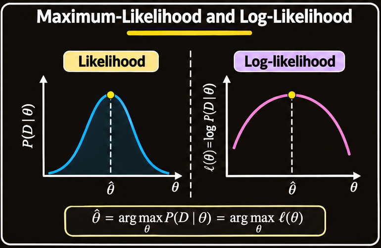
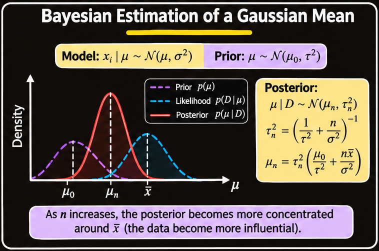
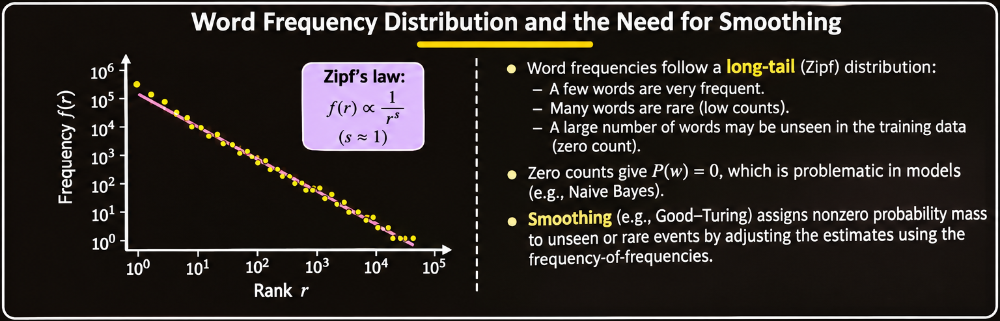

# Parameter Estimation and Probability Smoothing

## 1. Overview

A probabilistic classifier needs two kinds of information:

1. **Class priors**, such as $P(\omega_i)$, which describe how likely each class is before observing a feature vector.
2. **Class-conditional densities**, such as $p(\mathbf{x}\mid\omega_i)$, which describe how feature values are distributed within each class.

If these quantities were known exactly, Bayesian decision theory could use them to construct an optimal classifier under the chosen loss function. In practice, the distributions are usually unknown and must be estimated from a finite training sample.

This creates a parameter-estimation problem. A common strategy is to assume a known family of probability distributions, such as the Gaussian family, and estimate the unknown parameters of that family. Two important approaches are:

- **Maximum-likelihood estimation (MLE):** Treat unknown parameters as fixed quantities and choose values that make the observed data most likely.
- **Bayesian estimation:** Treat unknown parameters as random variables, represent prior uncertainty about them, and update that uncertainty using observed data.

A separate but related difficulty occurs when probabilities are estimated from counts. An event that was not observed in a finite training sample may receive probability zero under a direct frequency estimate. **Smoothing** methods address this zero-frequency problem. Add-one (Laplace) smoothing and Good–Turing smoothing are two approaches.

## 2. Why Parameter Estimation Is Necessary

### 2.1 The Bayesian classification requirement

For a feature vector $\mathbf{x}$ and class $\omega_i$, Bayes' rule gives:

$$
P(\omega_i\mid\mathbf{x})
=
\frac{p(\mathbf{x}\mid\omega_i)P(\omega_i)}
{\sum_j p(\mathbf{x}\mid\omega_j)P(\omega_j)}.
$$

The classifier needs the prior $P(\omega_i)$ and the class-conditional density $p(\mathbf{x}\mid\omega_i)$.

Class priors can often be estimated from class frequencies in the training set. Estimating a complete class-conditional density is more difficult, especially when the feature space has many dimensions. A small training sample may not contain enough information to estimate a high-dimensional distribution reliably.

### 2.2 Introduce a distributional assumption

A practical solution is to use prior knowledge about the form of the distribution. For example, suppose the feature vector from class $\omega_i$ follows a multivariate Gaussian distribution:

$$
p(\mathbf{x}\mid\omega_i)
=
\mathcal{N}(\mathbf{x}\mid\boldsymbol{\mu}_i,\mathbf{\Sigma}_i).
$$

The Gaussian density is characterized by:

- **Mean vector** $\boldsymbol{\mu}_i$: the center of the distribution.
- **Covariance matrix** $\mathbf{\Sigma}_i$: the spread of each feature and the relationships between pairs of features.

Thus, estimating an entire density is reduced to estimating a finite set of parameters. The assumption does not guarantee that the true data distribution is Gaussian; it provides a manageable model that can be fitted to the available observations.

For a univariate Gaussian, the corresponding parameters are the mean $\mu$ and variance $\sigma^2$:

$$
p(x\mid\mu,\sigma^2)
=
\frac{1}{\sqrt{2\pi\sigma^2}}
\exp\left[-\frac{(x-\mu)^2}{2\sigma^2}\right].
$$

### 2.3 Parameter notation

Let $\boldsymbol{\theta}$ denote the unknown parameter vector. In a classification problem with $c$ classes, each class can have its own parameter vector:

$$
\boldsymbol{\theta}
=
(\boldsymbol{\theta}_1,\boldsymbol{\theta}_2,\ldots,
\boldsymbol{\theta}_c).
$$

For a Gaussian class model, a class parameter vector may contain its mean and covariance:

$$
\boldsymbol{\theta}_i
=
(\boldsymbol{\mu}_i,\mathbf{\Sigma}_i).
$$

The task is to use the training data to estimate these unknown quantities, then use the fitted class-conditional densities together with class priors to classify new observations.

## 3. Maximum-Likelihood Estimation

### 3.1 Core idea

**Maximum-likelihood estimation (MLE)** chooses the parameter value that makes the observed training data most likely under the assumed model.

Suppose the training dataset contains $n$ observations:

$$
D=\{\mathbf{x}_1,\mathbf{x}_2,\ldots,\mathbf{x}_n\}.
$$

The likelihood of the parameter $\boldsymbol{\theta}$ is:

$$
L(\boldsymbol{\theta})
=
p(D\mid\boldsymbol{\theta}).
$$

If the observations are conditionally independent given the parameter, the joint likelihood factors into a product:

$$
L(\boldsymbol{\theta})
=
\prod_{k=1}^{n}
p(\mathbf{x}_k\mid\boldsymbol{\theta}).
$$

The maximum-likelihood estimate is:

$$
\boxed{
\hat{\boldsymbol{\theta}}_{\mathrm{ML}}
=
\arg\max_{\boldsymbol{\theta}}
p(D\mid\boldsymbol{\theta})
}
$$

The estimate is the parameter value under which the observed sample has the greatest likelihood. It is not a statement that the parameter itself is random or that the probability of a fixed parameter has been maximized.

For multiple classes, the same idea is applied to the parameters associated with each class, using the training observations belonging to that class.

### 3.2 Likelihood is not the same as probability density over parameters

The expression $p(D\mid\boldsymbol{\theta})$ is a probability mass or density for the observed data, viewed as a function of $\boldsymbol{\theta}$. Once the data $D$ are fixed, the likelihood compares how well different parameter values explain those data.

In MLE, $\boldsymbol{\theta}$ is treated as a fixed but unknown quantity. The method does not assign a probability distribution to the parameter.

### 3.3 Why use the log-likelihood?

Products of many small probability values can become numerically inconvenient. Taking the natural logarithm converts the product into a sum. Since the logarithm is strictly increasing, maximizing the likelihood and maximizing its logarithm give the same estimate.

Define the **log-likelihood**:

$$
\ell(\boldsymbol{\theta})
=
\log p(D\mid\boldsymbol{\theta}).
$$

Under conditional independence:

$$
\ell(\boldsymbol{\theta})
=
\sum_{k=1}^{n}
\log p(\mathbf{x}_k\mid\boldsymbol{\theta}).
$$

Therefore:

$$
\boxed{
\hat{\boldsymbol{\theta}}_{\mathrm{ML}}
=
\arg\max_{\boldsymbol{\theta}}
\ell(\boldsymbol{\theta})
}
$$

The log-likelihood is generally easier to differentiate and optimize than the original product likelihood.

### 3.4 First-order conditions for an optimum

Let the parameter vector have $p$ components:

$$
\boldsymbol{\theta}
=
(\theta_1,\theta_2,\ldots,\theta_p)^T.
$$

The gradient of the log-likelihood is:

$$
\nabla_{\boldsymbol{\theta}}\ell(\boldsymbol{\theta})
=
\begin{bmatrix}
\frac{\partial\ell}{\partial\theta_1}\\
\frac{\partial\ell}{\partial\theta_2}\\
\vdots\\
\frac{\partial\ell}{\partial\theta_p}
\end{bmatrix}.
$$

An interior optimum must satisfy the stationary-point condition:

$$
\boxed{
\nabla_{\boldsymbol{\theta}}\ell(\hat{\boldsymbol{\theta}})=\mathbf{0}
}
$$

Equivalently, each partial derivative is zero:

$$
\frac{\partial\ell}{\partial\theta_j}=0,
\qquad j=1,\ldots,p.
$$

This condition identifies candidate optima. A complete optimization analysis may also need to check the Hessian, parameter constraints, and boundary points to determine whether a stationary point is actually a maximum.

*The likelihood evaluates how well candidate parameter values explain the observed sample. The log-likelihood has the same maximizing parameter but is easier to optimize.*

## 4. MLE for a Gaussian Mean with Known Covariance

### 4.1 Model assumption

Suppose observations are sampled independently from a multivariate Gaussian population with unknown mean vector $\boldsymbol{\mu}$ and known covariance matrix $\mathbf{\Sigma}$:

$$
\mathbf{x}_k\sim
\mathcal{N}(\boldsymbol{\mu},\mathbf{\Sigma}),
\qquad k=1,\ldots,n.
$$

The only unknown parameter is the mean:

$$
\boldsymbol{\theta}=\boldsymbol{\mu}.
$$

Ignoring terms that do not depend on $\boldsymbol{\mu}$, the log-likelihood is:

$$
\ell(\boldsymbol{\mu})
=
-\frac{1}{2}
\sum_{k=1}^{n}
(\mathbf{x}_k-\boldsymbol{\mu})^T
\mathbf{\Sigma}^{-1}
(\mathbf{x}_k-\boldsymbol{\mu})
+\text{constant}.
$$

### 4.2 Differentiate and set the gradient to zero

The gradient with respect to the mean is:

$$
\nabla_{\boldsymbol{\mu}}\ell(\boldsymbol{\mu})
=
\sum_{k=1}^{n}
\mathbf{\Sigma}^{-1}
(\mathbf{x}_k-\boldsymbol{\mu}).
$$

At the maximum-likelihood estimate:

$$
\sum_{k=1}^{n}
\mathbf{\Sigma}^{-1}
(\mathbf{x}_k-\hat{\boldsymbol{\mu}})=\mathbf{0}.
$$

Because $\mathbf{\Sigma}$ is known and invertible, multiply by $\mathbf{\Sigma}$:

$$
\sum_{k=1}^{n}
(\mathbf{x}_k-\hat{\boldsymbol{\mu}})=\mathbf{0}.
$$

Expanding the sum gives:

$$
\sum_{k=1}^{n}\mathbf{x}_k
-
n\hat{\boldsymbol{\mu}}
=
\mathbf{0}.
$$

Therefore:

$$
\boxed{
\hat{\boldsymbol{\mu}}_{\mathrm{ML}}
=
\frac{1}{n}\sum_{k=1}^{n}\mathbf{x}_k
}
$$

The MLE of the Gaussian mean is the **arithmetic sample mean**. This result applies to a multivariate Gaussian as well as a univariate Gaussian: the sample vectors are averaged component by component.

### 4.3 Interpretation

The sample mean is the center that best fits the observations under the Gaussian model with known covariance. Each observation contributes equally to the estimate.

For classification, if each class is modelled by a Gaussian in a $d$-dimensional feature space, the mean vector for each class can be estimated by averaging the training vectors assigned to that class.

## 5. MLE for a Univariate Gaussian with Unknown Mean and Variance

### 5.1 Model and parameter vector

Now suppose both the mean and variance are unknown:

$$
x_k\sim\mathcal{N}(\mu,\sigma^2).
$$

Define:

$$
\boldsymbol{\theta}
=
(\theta_1,\theta_2)
=
(\mu,\sigma^2).
$$

For one observation, the log-density is:

$$
\log p(x_k\mid\mu,\sigma^2)
=
-\frac{1}{2}\log(2\pi\sigma^2)
-\frac{(x_k-\mu)^2}{2\sigma^2}.
$$

For $n$ independent observations, the log-likelihood is:

$$
\ell(\mu,\sigma^2)
=
-\frac{n}{2}\log(2\pi\sigma^2)
-\frac{1}{2\sigma^2}
\sum_{k=1}^{n}(x_k-\mu)^2.
$$

### 5.2 Estimate the mean

Differentiate with respect to $\mu$:

$$
\frac{\partial\ell}{\partial\mu}
=
\frac{1}{\sigma^2}
\sum_{k=1}^{n}(x_k-\mu).
$$

Set the derivative to zero:

$$
\sum_{k=1}^{n}(x_k-\hat{\mu})=0.
$$

Thus:

$$
\boxed{
\hat{\mu}_{\mathrm{ML}}
=
\frac{1}{n}\sum_{k=1}^{n}x_k
=
\bar{x}
}
$$

### 5.3 Estimate the variance

Differentiate the log-likelihood with respect to $\sigma^2$:

$$
\frac{\partial\ell}{\partial\sigma^2}
=
-\frac{n}{2\sigma^2}
+
\frac{1}{2(\sigma^2)^2}
\sum_{k=1}^{n}(x_k-\mu)^2.
$$

Set this derivative to zero and substitute the estimated mean:

$$
-\frac{n}{2\hat{\sigma}^2}
+
\frac{1}{2(\hat{\sigma}^2)^2}
\sum_{k=1}^{n}(x_k-\hat{\mu})^2
=0.
$$

Multiplying by $2(\hat{\sigma}^2)^2$ and rearranging:

$$
-n\hat{\sigma}^2
+
\sum_{k=1}^{n}(x_k-\hat{\mu})^2
=0.
$$

Therefore:

$$
\boxed{
\hat{\sigma}_{\mathrm{ML}}^2
=
\frac{1}{n}
\sum_{k=1}^{n}(x_k-\bar{x})^2
}
$$

The Gaussian MLEs are consequently:

$$
\boxed{
\hat{\mu}_{\mathrm{ML}}=\bar{x},
\qquad
\hat{\sigma}_{\mathrm{ML}}^2
=
\frac{1}{n}\sum_{k=1}^{n}(x_k-\bar{x})^2
}
$$

The variance estimate measures the average squared deviation from the estimated mean, using $n$ as the denominator.

## 6. Bias in Variance Estimation

### 6.1 What does bias mean?

An estimator is a rule that maps a random sample to an estimate of an unknown population quantity. Because different samples produce different estimates, an estimator itself has a sampling distribution.

An estimator $\hat{\theta}$ is **unbiased** for a parameter $\theta$ if:

$$
\mathbb{E}[\hat{\theta}]=\theta.
$$

Its **bias** is:

$$
\operatorname{Bias}(\hat{\theta})
=
\mathbb{E}[\hat{\theta}]-\theta.
$$

An unbiased estimator has zero bias. This does not mean every estimate from a particular sample equals the true parameter; it means the estimator's average over repeated samples equals the parameter.

### 6.2 Why the Gaussian MLE variance is biased

For independent observations from a population with variance $\sigma^2$, the MLE variance estimator is:

$$
\hat{\sigma}_{\mathrm{ML}}^2
=
\frac{1}{n}
\sum_{k=1}^{n}(x_k-\bar{x})^2.
$$

Its expected value is:

$$
\mathbb{E}\left[
\frac{1}{n}\sum_{k=1}^{n}(x_k-\bar{x})^2
\right]
=
\frac{n-1}{n}\sigma^2.
$$

Since:

$$
\frac{n-1}{n}\sigma^2\ne\sigma^2,
$$

the MLE variance estimator is biased downward. On average, it underestimates the true variance.

### 6.3 An unbiased sample variance

An elementary unbiased estimator for the univariate variance is:

$$
\boxed{
s^2
=
\frac{1}{n-1}
\sum_{k=1}^{n}(x_k-\bar{x})^2
}
$$

The denominator is $n-1$ rather than $n$. The correction compensates for the fact that the sample mean is itself estimated from the same observations.

For a multivariate population, the corresponding unbiased sample covariance matrix is:

$$
\boxed{
\mathbf{C}
=
\frac{1}{n-1}
\sum_{k=1}^{n}
(\mathbf{x}_k-\bar{\mathbf{x}})
(\mathbf{x}_k-\bar{\mathbf{x}})^T
}
$$

where:

$$
\bar{\mathbf{x}}
=
\frac{1}{n}\sum_{k=1}^{n}\mathbf{x}_k.
$$

The matrix $\mathbf{C}$ estimates both feature variances and pairwise covariances.

### 6.4 Absolute and asymptotic unbiasedness

Two related terms describe unbiasedness under different conditions:

- **Absolutely unbiased:** An estimator is unbiased for all distributions in the relevant family.
- **Asymptotically unbiased:** The estimator's bias tends to zero as the sample size becomes very large.

Unbiasedness is one desirable property, but it is not the only criterion for choosing an estimator. Variance, consistency, robustness, and mean squared error can also matter.

## 7. Maximum-Likelihood and Bayesian Estimation Compared

MLE and Bayesian estimation can produce similar numerical results in some settings, but their interpretations are different.

| Aspect | Maximum-likelihood estimation | Bayesian estimation |
| --- | --- | --- |
| Treatment of parameter | Fixed but unknown | Random variable with a probability distribution |
| Information before observing data | Model specification | Prior distribution over parameters |
| Main calculation | Maximize $p(D\mid\boldsymbol{\theta})$ | Update prior using Bayes' rule |
| Main result | A point estimate $\hat{\boldsymbol{\theta}}_{\mathrm{ML}}$ | Posterior density $p(\boldsymbol{\theta}\mid D)$ |
| Uncertainty about parameter | Not represented by the point estimate itself | Represented by the posterior distribution |

MLE is often simpler computationally and has useful large-sample convergence properties under suitable regularity conditions. Bayesian estimation explicitly combines prior information with sample evidence and retains uncertainty about the unknown parameters.

## 8. Bayesian Parameter Estimation

### 8.1 Treat the unknown parameter as a random variable

In Bayesian estimation, the unknown parameter $\boldsymbol{\theta}$ is represented by a random variable. Before observing the training data, uncertainty about it is described by a **prior density**:

$$
p(\boldsymbol{\theta}).
$$

After observing the dataset $D$, the prior is updated to the **posterior density**:

$$
p(\boldsymbol{\theta}\mid D).
$$

Bayes' rule gives:

$$
\boxed{
p(\boldsymbol{\theta}\mid D)
=
\frac{p(D\mid\boldsymbol{\theta})p(\boldsymbol{\theta})}
{p(D)}
}
$$

where:

- $p(\boldsymbol{\theta})$ is the prior density.
- $p(D\mid\boldsymbol{\theta})$ is the likelihood.
- $p(D)$ is the marginal likelihood or evidence, which normalizes the posterior.
- $p(\boldsymbol{\theta}\mid D)$ is the posterior density.

The evidence is obtained by integrating over all possible parameter values:

$$
p(D)
=
\int p(D\mid\boldsymbol{\theta})
p(\boldsymbol{\theta})\,d\boldsymbol{\theta}.
$$

For a discrete parameter space, the integral is replaced by a sum.

The posterior is proportional to the product of likelihood and prior:

$$
p(\boldsymbol{\theta}\mid D)
\propto
p(D\mid\boldsymbol{\theta})p(\boldsymbol{\theta}).
$$

This form is often sufficient for deriving a posterior up to its normalizing constant.

### 8.2 Independent observations

If the observations are conditionally independent given $\boldsymbol{\theta}$:

$$
p(D\mid\boldsymbol{\theta})
=
\prod_{k=1}^{n}
p(\mathbf{x}_k\mid\boldsymbol{\theta}).
$$

The posterior can therefore be written:

$$
\boxed{
p(\boldsymbol{\theta}\mid D)
\propto
p(\boldsymbol{\theta})
\prod_{k=1}^{n}
p(\mathbf{x}_k\mid\boldsymbol{\theta})
}
$$

The data contribute evidence through the likelihood, while the prior contributes information available before the current sample was observed.

### 8.3 Bayesian classification

When class-conditional model parameters are uncertain, the aim is not merely to substitute one estimated parameter value into a density. Bayesian prediction averages over the possible parameter values, weighted by their posterior probabilities.

For class $\omega_i$ with training data $D_i$, the posterior predictive density is:

$$
\boxed{
p(\mathbf{x}\mid D_i,\omega_i)
=
\int
p(\mathbf{x}\mid\boldsymbol{\theta}_i,\omega_i)
p(\boldsymbol{\theta}_i\mid D_i,\omega_i)
\,d\boldsymbol{\theta}_i
}
$$

This is also called the **posterior predictive distribution**. It accounts for uncertainty in the unknown class parameters.

The class posterior for a new observation can then be computed using:

$$
P(\omega_i\mid\mathbf{x},D)
=
\frac{
p(\mathbf{x}\mid D_i,\omega_i)P(\omega_i)
}{
\sum_j p(\mathbf{x}\mid D_j,\omega_j)P(\omega_j)
}.
$$

Thus, Bayesian parameter estimation supplies the class-conditional predictive density needed for Bayesian classification.

## 9. Bayesian Estimation of a Gaussian Mean

### 9.1 Model assumptions

Consider a univariate Gaussian population with known observation variance $\sigma^2$ and unknown mean $\mu$:

$$
x_k\mid\mu\sim\mathcal{N}(\mu,\sigma^2).
$$

Assume a Gaussian prior for the unknown mean:

$$
\mu\sim\mathcal{N}(\mu_0,\sigma_0^2).
$$

Here:

- $\mu_0$ is the prior mean.
- $\sigma_0^2$ is the prior variance, expressing uncertainty about the mean before observing the sample.
- $\sigma^2$ is the known variance of individual observations.
- $n$ is the number of independent observations.

The goal is to derive the posterior distribution $p(\mu\mid D)$.

### 9.2 Apply Bayes' rule

The posterior is proportional to the likelihood multiplied by the prior:

$$
p(\mu\mid D)
\propto
\left[
\prod_{k=1}^{n}p(x_k\mid\mu)
\right]p(\mu).
$$

Substitute the two Gaussian densities:

$$
p(\mu\mid D)
\propto
\prod_{k=1}^{n}
\exp\left[
-\frac{(x_k-\mu)^2}{2\sigma^2}
\right]
\exp\left[
-\frac{(\mu-\mu_0)^2}{2\sigma_0^2}
\right].
$$

Terms that do not depend on $\mu$ can be absorbed into a normalizing constant. Expanding the quadratic expressions and collecting the terms involving $\mu$ gives a Gaussian-shaped posterior.

### 9.3 Posterior variance and posterior mean

The posterior distribution is Gaussian:

$$
\boxed{
p(\mu\mid D)
=
\mathcal{N}(\mu\mid\mu_n,\sigma_n^2)
}
$$

Its precision (inverse variance) is:

$$
\boxed{
\frac{1}{\sigma_n^2}
=
\frac{n}{\sigma^2}
+
\frac{1}{\sigma_0^2}
}
$$

Therefore:

$$
\boxed{
\sigma_n^2
=
\frac{\sigma_0^2\sigma^2}
{n\sigma_0^2+\sigma^2}
}
$$

The posterior mean is:

$$
\boxed{
\mu_n
=
\left(
\frac{n\sigma_0^2}{n\sigma_0^2+\sigma^2}
\right)\bar{x}_n
+
\left(
\frac{\sigma^2}{n\sigma_0^2+\sigma^2}
\right)\mu_0
}
$$

where the sample mean is:

$$
\bar{x}_n
=
\frac{1}{n}\sum_{k=1}^{n}x_k.
$$

The posterior mean is a weighted average of the sample mean and the prior mean.

### 9.4 Interpretation of the posterior mean

The weights in the posterior mean depend on the relative uncertainty of the prior and the data.

- If the prior variance $\sigma_0^2$ is small, the prior is concentrated around $\mu_0$, so the posterior mean is influenced strongly by the prior.
- If the observation variance $\sigma^2$ is small, individual observations are precise, so the sample mean receives more weight.
- As the number of observations $n$ increases, the data contribute more total information and the posterior mean generally moves toward the sample mean.

The weights are nonnegative and sum to one:

$$
\frac{n\sigma_0^2}{n\sigma_0^2+\sigma^2}
+
\frac{\sigma^2}{n\sigma_0^2+\sigma^2}
=1.
$$

The posterior variance decreases as more independent observations are collected:

$$
\frac{1}{\sigma_n^2}
=
\frac{n}{\sigma^2}
+
\frac{1}{\sigma_0^2}.
$$

This equation shows that posterior precision is the sum of prior precision and data precision.

### 9.5 Posterior predictive distribution

Knowing $p(\mu\mid D)$ is not yet the same as knowing the distribution of a future observation. A new observation $x$ must account for uncertainty in $\mu$:

$$
p(x\mid D)
=
\int p(x\mid\mu)p(\mu\mid D)\,d\mu.
$$

For the Gaussian model with known observation variance and Gaussian posterior over the mean, the predictive distribution is:

$$
\boxed{
x\mid D
\sim
\mathcal{N}(\mu_n,\sigma^2+\sigma_n^2)
}
$$

The predictive mean is the posterior mean $\mu_n$. The predictive variance includes both sources of uncertainty:

- $\sigma^2$: natural variation of a new observation around the population mean.
- $\sigma_n^2$: remaining uncertainty about the unknown population mean.

This predictive density can be used as the class-conditional density in Bayesian classification. It is combined with the class prior $P(\omega_j)$ through Bayes' rule.

## 10. General Theory of Bayesian Parameter Estimation

The same procedure applies beyond the Gaussian example whenever an unknown density can be described using parameters.

The general assumptions are:

1. The functional form of $p(\mathbf{x}\mid\boldsymbol{\theta})$ is known.
2. The parameter value $\boldsymbol{\theta}$ is not known exactly.
3. Prior knowledge about the parameter is represented by a known density $p(\boldsymbol{\theta})$.
4. A dataset $D=\{\mathbf{x}_1,\ldots,\mathbf{x}_n\}$ provides additional information about the parameter.

The general problem has two stages.

**Stage 1: Compute the posterior parameter density**

$$
p(\boldsymbol{\theta}\mid D)
=
\frac{
p(D\mid\boldsymbol{\theta})p(\boldsymbol{\theta})
}{
\int p(D\mid\boldsymbol{\theta}')
p(\boldsymbol{\theta}')\,d\boldsymbol{\theta}'
}.
$$

**Stage 2: Derive the predictive density**

$$
\boxed{
p(\mathbf{x}\mid D)
=
\int
p(\mathbf{x}\mid\boldsymbol{\theta})
p(\boldsymbol{\theta}\mid D)
\,d\boldsymbol{\theta}
}
$$

The first stage updates beliefs about the unknown parameter. The second stage averages predictions over the posterior uncertainty in that parameter.

The predictive density is especially important for classification because it provides the desired class-conditional density without pretending that an uncertain parameter estimate is exact.

## 11. The Zero-Frequency Problem in Maximum-Likelihood Estimation

### 11.1 Why unseen events receive zero probability

For a discrete event $X$, a direct maximum-likelihood estimate based on observed counts is:

$$
\hat{P}_{\mathrm{ML}}(X)
=
\frac{N_X}{T},
$$

where:

- $N_X$ is the number of times event $X$ occurs in the training sample.
- $T$ is the total number of observed events.

If an event never appears in the training data, then $N_X=0$ and:

$$
\hat{P}_{\mathrm{ML}}(X)=0.
$$

This creates a serious problem in applications such as text classification. A word absent from the training corpus receives zero probability, even if it is a valid word and may appear in future documents.

For example, a text classifier trained on articles about artificial intelligence may learn probabilities for words such as “Bayes,” “neural network,” and “classification.” If a future article contains an unseen name or term, a naive frequency model may assign it zero probability. In a product of word probabilities, a single zero can make the entire document likelihood zero.

This is called the **zero-frequency problem**.

### 11.2 Why zero is too strong a conclusion

An event not appearing in a finite sample is not necessarily impossible. It may simply be rare or absent by chance.

The distinction is:

- **Unobserved:** The event did not occur in the available training sample.
- **Impossible:** The event has zero probability in the true data-generating process.

MLE based only on counts cannot distinguish these cases. Smoothing introduces a way to reserve probability for events not observed in the sample.

## 12. Add-One (Laplace) Smoothing

### 12.1 Basic idea

**Add-one smoothing**, also called **Laplace smoothing**, acts as if every possible event had been observed one additional time.

For a vocabulary containing $V$ possible events, the smoothed probability is:

$$
\boxed{
\hat{P}_{\mathrm{Laplace}}(X)
=
\frac{N_X+1}{T+V}
}
$$

The numerator adds one to the observed count of event $X$. The denominator adds one for each of the $V$ possible events, preserving normalization:

$$
\sum_{X=1}^{V}
\frac{N_X+1}{T+V}
=
\frac{T+V}{T+V}=1.
$$

An unseen event now receives a nonzero probability:

$$
\hat{P}_{\mathrm{Laplace}}(X\mid N_X=0)
=
\frac{1}{T+V}.
$$

### 12.2 Advantage

The main advantage is that no event in the specified vocabulary receives a zero probability merely because it was absent from the training sample. This is useful in language modelling and text classification, where future documents can contain words that were not observed during training.

### 12.3 Disadvantage

Add-one smoothing can be too aggressive when the vocabulary is large and the training sample is limited:

- It can remove too much probability mass from events that were observed frequently.
- It can assign too much total probability mass to unseen events.

The method treats every possible event as if it deserved one extra count, regardless of how plausible that event is. This uniform adjustment may not match the actual frequency structure of natural language or other data.

## 13. Frequency Structure and Zipf's Law

Natural language does not distribute probability evenly across words. A small number of words occur very frequently, while a large number occur rarely.

This empirical pattern is commonly associated with **Zipf's law**. When words are ranked by decreasing frequency, the frequency tends to decrease approximately as a power of the rank:

$$
f(r)\propto\frac{1}{r^s},
$$

where $r$ is the frequency rank and $s$ is typically near one in many language datasets.

The practical implication is that a language model must account for a long tail of rare events. There are many low-frequency words and possible unseen words, so allocating the same extra count to every possible word may be a poor approximation.

Smoothing methods therefore need to balance two goals:

1. Retain the strong evidence provided by frequently observed events.
2. Reserve reasonable probability for rare and unseen events.

## 14. Smoothing Estimators with a Fudge Factor

A general count-based estimator introduces a **fudge factor** $f$:

$$
\boxed{
\hat{P}(X)
=
\frac{N_X+f}{T+E_{\Omega}f}
}
$$

where:

- $N_X$ is the observed count of event $X$.
- $T$ is the total sample size.
- $f$ is the amount added to each event count.
- $E_{\Omega}$ is the number of possible events in the event space $\Omega$.

The denominator adds the same total adjustment across the event space, so the probabilities remain normalized when the event space is finite and all its possible events are included.

Different values of $f$ produce different estimators:

| Estimator | Fudge factor $f$ | Interpretation |
| --- | ---: | --- |
| Expected-likelihood estimator | $0.5$ | Adds half a count per possible event |
| Laplace / add-one estimator | $1$ | Adds one count per possible event |
| Add-tiny estimator | $1/T$ | Adds a small amount that decreases as the sample grows |

The Laplace and add-one estimators are two names for the same choice, $f=1$.

The value of $f$ controls the strength of smoothing. A larger value makes a stronger adjustment to observed counts; a smaller value makes a weaker adjustment.

## 15. Good–Turing Smoothing

### 15.1 Use the frequency of frequencies

Good–Turing smoothing estimates the probability of an event using not only the event's own observed count but also how many different events occur with that count.

Let:

- $X$ be an event, such as a word.
- $N_X$ be the number of times event $X$ was observed.
- $T$ be the total number of observations.
- $E(r)$ be the estimated number of distinct events that occurred exactly $r$ times.

The quantity $E(r)$ is called a **frequency of frequencies**: it counts how many distinct event types have an observed frequency of $r$.

The Good–Turing adjusted probability for an event observed $r$ times is:

$$
\boxed{
P_{\mathrm{GT}}(X)
=
\frac{r+1}{T}
\frac{E(r+1)}{E(r)}
\qquad\text{when }N_X=r
}
$$

Equivalently, using $N_X$ directly:

$$
\boxed{
P_{\mathrm{GT}}(X)
=
\frac{N_X+1}{T}
\frac{E(N_X+1)}{E(N_X)}
}
$$

The adjusted count is:

$$
r^*
=
(r+1)\frac{E(r+1)}{E(r)},
$$

and the adjusted probability is $r^*/T$.

The key idea is that the observed count $r$ is adjusted according to how common the next higher count is among event types. This uses information about the overall distribution of counts, rather than applying the same additive constant to every event.

### 15.2 Worked example: an uncommon word

Suppose a corpus contains $T=30{,}000$ word tokens. Consider the word “unusualness,” which appears once:

$$
N_X=1.
$$

Assume the corpus has:

- $E(1)=10{,}000$ distinct words that each appear once.
- $E(2)=3{,}000$ distinct words that each appear twice.

The Good–Turing estimate is:

$$
P_{\mathrm{GT}}(X)
=
\frac{1+1}{30{,}000}
\frac{3{,}000}{10{,}000}.
$$

Therefore:

$$
P_{\mathrm{GT}}(X)
=
\frac{2}{30{,}000}\times0.3
=
0.00002.
$$

The estimate is adjusted using the relative number of word types seen once and twice. It is not simply the raw frequency $1/30{,}000$.

### 15.3 Why Good–Turing is useful

Good–Turing smoothing is motivated by the fact that rare events provide information about the probability mass that may belong to unseen events. If many event types have appeared only once, the sample contains evidence that a substantial collection of low-frequency or unseen events may exist.

Unlike add-one smoothing, Good–Turing does not add the same fixed count to every event. It uses the empirical frequency-of-frequencies to adjust counts.

### 15.4 Practical caution

The Good–Turing formula requires estimates of $E(r)$ and $E(r+1)$. For large values of $r$, some frequency classes may contain very few event types or none at all, making the raw ratio unstable or undefined. Practical implementations may therefore smooth the frequency-of-frequencies themselves or use a modified estimator.

The calculation above illustrates the basic estimator using supplied frequency counts; it does not specify a complete procedure for estimating all frequency classes in a large corpus.

## 16. Comparing the Estimation and Smoothing Approaches

The methods in this chapter address two related but distinct problems.

| Method | Main question | Output | Main characteristic |
| --- | --- | --- | --- |
| MLE | Which fixed parameter best explains the observed data? | Point estimate | Maximizes the likelihood |
| Bayesian parameter estimation | How should uncertainty about a parameter change after observing data? | Posterior density | Combines prior and likelihood |
| Laplace smoothing | How can zero counts be avoided with a simple count adjustment? | Smoothed event probabilities | Adds one count to each possible event |
| Expected-likelihood smoothing | How can counts be adjusted less strongly than add-one? | Smoothed event probabilities | Adds half a count per possible event |
| Add-tiny smoothing | How can a very small adjustment be applied? | Smoothed event probabilities | Uses $f=1/T$ |
| Good–Turing smoothing | How should event counts be adjusted using the observed frequency distribution? | Adjusted event probabilities | Uses the frequency of frequencies |

MLE and Bayesian estimation primarily concern unknown parameters in a probability model. Smoothing primarily concerns probability estimates derived from discrete event counts. Both are important when constructing probabilistic classifiers from finite training data.

## 17. Key Takeaways

- Bayesian classification requires class priors and class-conditional densities.
- When a complete density is difficult to estimate, a parametric assumption such as Gaussianity reduces the problem to estimating a finite number of parameters.
- MLE treats parameters as fixed but unknown and chooses values that maximize the likelihood of the observed data.
- Maximizing the log-likelihood is equivalent to maximizing the likelihood and is usually easier mathematically.
- For a Gaussian with known covariance, the MLE of the mean is the sample mean.
- For a univariate Gaussian with unknown mean and variance, the MLE variance uses denominator $n$ and is biased downward.
- Replacing $n$ with $n-1$ gives the usual unbiased sample variance.
- Bayesian estimation treats unknown parameters as random variables and updates a prior distribution using observed data.
- In the Gaussian mean example, the posterior mean is a weighted average of the prior mean and sample mean, while posterior precision is the sum of prior and data precision.
- Bayesian classification can use a posterior predictive density that integrates over uncertainty in the class parameters.
- Direct frequency estimates assign zero probability to unseen events, creating the zero-frequency problem.
- Laplace smoothing avoids zero probabilities but can over-allocate probability to unseen events.
- Zipf-like frequency distributions contain a small number of frequent events and a long tail of rare events.
- Good–Turing smoothing uses the frequency of frequencies to adjust event counts.

## 18. Notation Reference

| Symbol | Meaning |
| --- | --- |
| $\omega_i$ | Class $i$ |
| $\mathbf{x}$ | Feature vector |
| $D$ | Training dataset |
| $n$ | Number of observations |
| $c$ | Number of classes |
| $\boldsymbol{\theta}$ | Unknown model parameter vector |
| $\hat{\boldsymbol{\theta}}_{\mathrm{ML}}$ | Maximum-likelihood parameter estimate |
| $L(\boldsymbol{\theta})$ | Likelihood |
| $\ell(\boldsymbol{\theta})$ | Log-likelihood |
| $\boldsymbol{\mu}$ | Gaussian mean vector |
| $\mathbf{\Sigma}$ | Gaussian covariance matrix |
| $\sigma^2$ | Univariate Gaussian variance |
| $\mu_0,\sigma_0^2$ | Prior mean and prior variance for the unknown Gaussian mean |
| $\mu_n,\sigma_n^2$ | Posterior mean and posterior variance |
| $N_X$ | Observed count of event $X$ |
| $T$ | Total number of observed events |
| $E(r)$ | Number of distinct event types observed exactly $r$ times |
| $f$ | Smoothing fudge factor |
| $E_{\Omega}$ | Number of possible events in the event space |

## 19. Scope and Technical Notes

- The Gaussian MLE derivations assume independent observations and the stated Gaussian model. The mean-estimation derivation assumes a known, invertible covariance matrix.
- The unbiased covariance formula uses the sample mean and denominator $n-1$. The Gaussian MLE covariance estimate instead uses denominator $n$.
- The Bayesian Gaussian-mean derivation assumes known observation variance $\sigma^2$, a Gaussian prior on $\mu$, and independent observations. It does not estimate $\sigma^2$.
- The posterior predictive variance includes both observation variance and posterior uncertainty about the mean.
- The count-based smoothing formula uses $E_{\Omega}$ for the size of the possible-event space. This notation makes explicit the role of the event-space size in the denominator.
- The Good–Turing example uses the frequency counts supplied in the source material. A full implementation may require additional treatment when frequency-of-frequency counts are sparse or zero.
