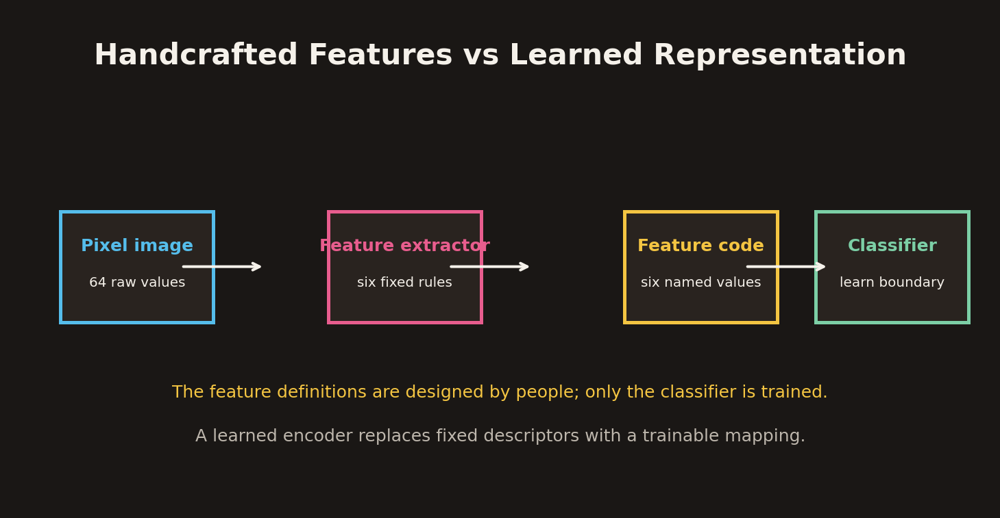
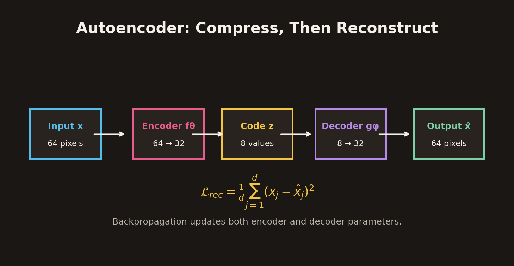
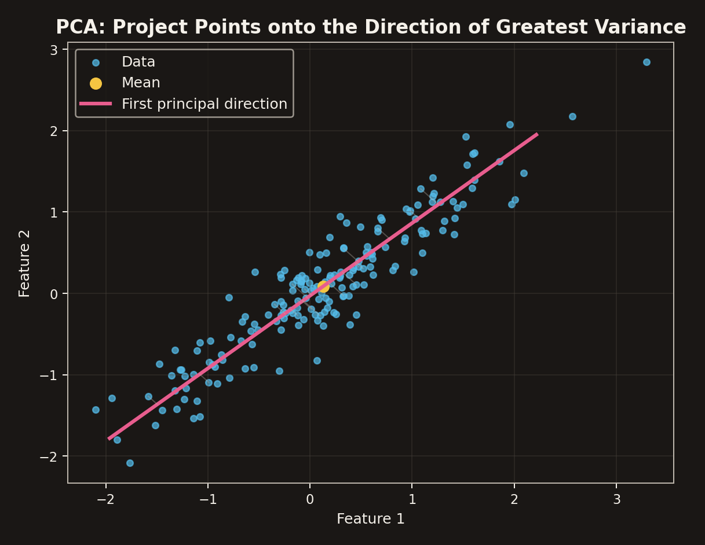
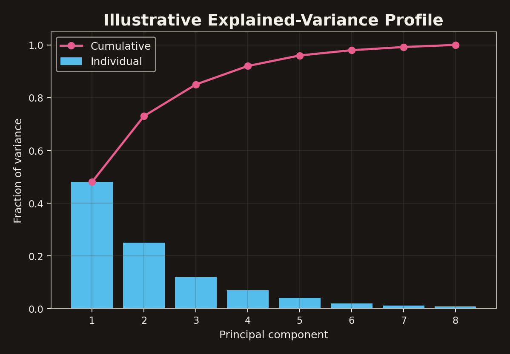
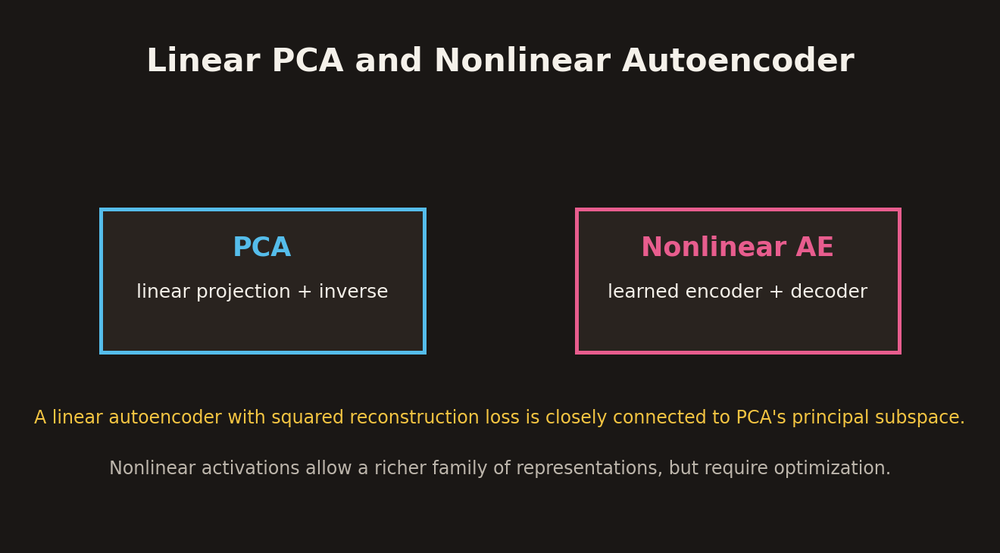
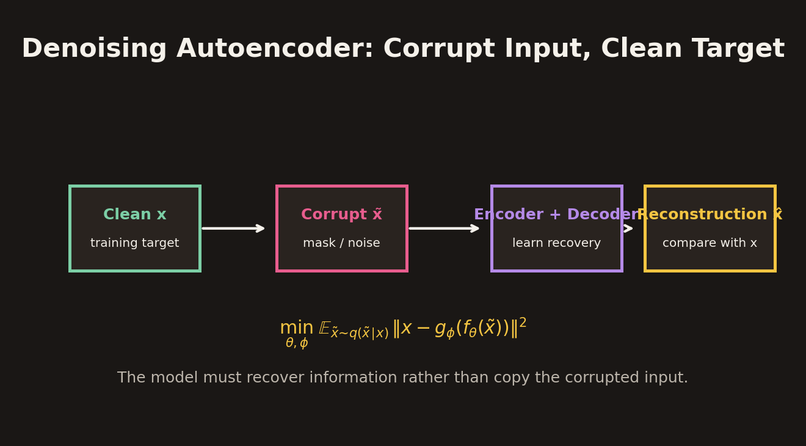

# Representation Learning and Autoencoders

## 1. Overview

A machine-learning model does not operate directly on the world as people perceive it. Images, sounds, transactions, and documents must first be represented numerically. The choice of representation strongly affects what a model can learn.

A traditional pipeline often separates **feature extraction** from **prediction**:

1. Convert raw observations into a set of measurements.
2. Feed those measurements into a classifier or regressor.
3. Train the prediction model using task labels.

The limitation is that the feature definitions are fixed by a human designer. A classifier can learn how to combine the selected measurements, but it cannot recover information that the feature extractor discarded.

**Representation learning** addresses this limitation by learning the transformation from raw inputs to useful features. An **autoencoder** is a neural architecture trained to compress an input into a code and reconstruct the original input from that code. Because the target is the input itself, an autoencoder can learn from unlabelled examples.

This chapter develops the ideas through handwritten-digit images, then connects autoencoders to principal component analysis (PCA), singular value decomposition (SVD), stacked autoencoders, and denoising autoencoders.

## 2. From Raw Data to Features

### 2.1 The familiar classification pipeline

Let an observed input be $\mathbf{x}$. A handcrafted feature extractor maps it to a feature vector:

$$
\mathbf{z}=\boldsymbol{\phi}(\mathbf{x}),
$$

where $\boldsymbol{\phi}$ is a collection of predefined measurement rules. A classifier then predicts a label:

$$
\hat{y}=h_\theta(\mathbf{z}).
$$

The classifier parameters $\theta$ are trained from examples and labels. Unless the feature extractor is explicitly made trainable, the mapping $\boldsymbol{\phi}$ remains fixed.

For example, a handwritten-digit classifier might use ink coverage and width-to-height ratio as its coordinates. The neural network learns a decision boundary in that two-dimensional feature space, but people chose the two measurements before training.

The distinction is important:

- **Feature design:** decides what information is measured.
- **Classifier training:** decides how those measurements are combined to predict a class.
- **Representation learning:** allows the model to learn the measurements or features themselves.

### 2.2 The handwritten-digit dataset

A useful running example is the UCI optical handwritten-digits dataset. The teaching demonstration uses 8 × 8 grayscale images:

- Each image contains $8\times8=64$ pixel values.
- Pixel values range from 0 to 16.
- There are 1,797 available examples.
- The task is to recognize digit identities from 0 to 9.

Different people write the same digit differently. A useful representation should preserve the visual information that helps distinguish digit identities while being robust to irrelevant changes in handwriting.

### 2.3 Turning grayscale pixels into a binary foreground mask

For the handcrafted-feature demonstration, a pixel is considered foreground ink if its intensity reaches a threshold of 5:

$$
B_{rc}=\mathbb{1}[I_{rc}\geq5],
$$

where $I_{rc}$ is the grayscale intensity at row $r$ and column $c$, and $B_{rc}\in\{0,1\}$ is the resulting binary mask.

This is a preprocessing choice, not a universal definition of ink. Changing the threshold changes the mask and can change every feature computed from it.

## 3. Six Handcrafted Features for a Digit

The six features below turn one 8 × 8 image into six named numbers. The worked sample is a digit zero, with foreground defined by $I_{rc}\geq5$.

### 3.1 Ink coverage

Ink coverage measures what fraction of the 64 cells are foreground:

$$
f_1=\frac{\sum_{r,c}B_{rc}}{64}.
$$

The example contains 28 foreground cells:

$$
f_1=\frac{28}{64}=0.4375\approx0.438.
$$

This feature captures overall thickness or density, but it does not describe where the ink occurs.

### 3.2 Aspect ratio

Find the smallest axis-aligned bounding box that contains every foreground cell. If it spans $w$ columns and $h$ rows, define:

$$
f_2=\frac{w}{h}.
$$

For the example, the box is 6 columns wide and 8 rows high:

$$
f_2=\frac{6}{8}=0.750.
$$

The ratio is dimensionless. It captures overall shape proportions, but not detailed curvature or stroke placement.

### 3.3 Normalized horizontal center of mass

Let $c\in\{0,1,\ldots,7\}$ be the column index. The mean foreground column is:

$$
\bar{c}
=
\frac{\sum_{r,c}cB_{rc}}{\sum_{r,c}B_{rc}}.
$$

Normalize it to the interval $[0,1]$ by dividing by the largest column index, 7:

$$
f_3
=
\frac{\sum_{r,c}cB_{rc}}
{7\sum_{r,c}B_{rc}}.
$$

The example gives:

$$
f_3=0.536.
$$

This captures horizontal placement, but it compresses the entire image to one coordinate and loses local structure.

### 3.4 Upper-half ink fraction

Count the foreground cells in the top four rows and divide by the total foreground count:

$$
f_4
=
\frac{\text{foreground cells in rows }0\text{--}3}
{\text{all foreground cells}}.
$$

For the example, 14 of 28 ink cells are in the upper half:

$$
f_4=\frac{14}{28}=0.500.
$$

This feature distinguishes top-heavy from bottom-heavy writing, but its result depends on the chosen horizontal split.

### 3.5 Vertical symmetry

Reflect the binary image from left to right and compare it with the original. A simple normalized symmetry score is:

$$
f_5
=
1-\frac{1}{64}
\sum_{r,c}|B_{rc}-B_{r,7-c}|.
$$

A perfect mirror-symmetric mask has zero mismatches and score 1. More mismatches reduce the score. The example has:

$$
f_5=0.813.
$$

This is a coarse symmetry measure. It does not account for small shifts or variations in stroke thickness.

### 3.6 Number of holes

A **hole** is a connected background region completely enclosed by foreground ink. Background regions that touch the image border are not counted as holes.

The example digit zero encloses one background region:

$$
f_6=1.
$$

Hole count is useful for some digit shapes, but it is not enough to distinguish all digits. For example, a zero and a six can both enclose a region while differing in other important geometric details.

### 3.7 The complete handcrafted vector

The six measurements form:

$$
\boxed{
\mathbf{z}
=
[f_1,f_2,f_3,f_4,f_5,f_6]
=
[0.438,0.750,0.536,0.500,0.813,1]
}
$$

Each coordinate has a human-readable definition. This is an advantage for interpretability and auditing.

However, the vector is only six-dimensional and necessarily discards much of the original 64-pixel information. The downstream classifier cannot reconstruct details that were not retained.

## 4. Why Handcrafted Features Can Be Limiting

Handcrafted features are useful when the relevant properties are known and can be measured reliably. Their weaknesses become visible when the data or task changes.

- **Unmodelled variation:** Different stroke thicknesses, alignments, and gaps may change the measurements in ways that are not useful for digit identity.
- **Information loss:** A feature such as hole count ignores the shape, position, and connectivity of the enclosed region.
- **Task dependence:** Features suitable for distinguishing some classes may be inadequate for another task.
- **Maintenance:** New writing styles or data conditions may require new measurements, normalization, or feature combinations.

The key issue is not that handcrafted features are always bad. It is that the designer must anticipate which aspects of the input will matter.

## 5. Representation Learning

### 5.1 Learn the feature map

Instead of specifying six descriptors, let a trainable encoder map the pixel vector to a learned code:

$$
\mathbf{z}=f_\theta(\mathbf{x}).
$$

The parameters $\theta$ determine which transformations are learned. The learned coordinates may combine many pixel values and can encode useful patterns that are difficult to describe with one named measurement.

There are two important ways to teach this feature map:

- **Supervised feature learning:** train the representation as part of a task whose target is a class label or another desired output.
- **Reconstruction-based learning:** train a model to reconstruct its input, without requiring class labels.

An autoencoder uses the second approach.

### 5.2 Classification versus reconstruction

A classifier receives an input $\mathbf{x}$ and tries to predict a target label $y$:

$$
\hat{y}=h(\mathbf{x}),
\qquad
\mathcal{L}_{class}=\mathcal{L}(y,\hat{y}).
$$

An autoencoder receives $\mathbf{x}$ and tries to reproduce it:

$$
\hat{\mathbf{x}}=g(\mathbf{x}),
\qquad
\mathcal{L}_{rec}=\mathcal{L}(\mathbf{x},\hat{\mathbf{x}}).
$$

The target is the input itself, not the digit identity. This provides a learning signal even when class annotations are unavailable.

## 6. Autoencoder Architecture

### 6.1 Encoder, code, and decoder

An autoencoder consists of two learned functions:

**Encoder**

$$
\mathbf{z}=f_\theta(\mathbf{x})
$$

The encoder maps the input into a latent representation or **code**.

**Decoder**

$$
\hat{\mathbf{x}}=g_\phi(\mathbf{z})
$$

The decoder maps the code back into the input space.

The complete model is:

$$
\boxed{
\hat{\mathbf{x}}
=
g_\phi(f_\theta(\mathbf{x}))
}
$$

The encoder and decoder are trained together. Backpropagation sends reconstruction-loss gradients through the decoder and encoder so that both sets of parameters can change.

### 6.2 Reconstruction loss

For an input with $d$ components, mean squared reconstruction error is:

$$
\boxed{
\mathcal{L}_{rec}
=
\frac{1}{d}
\sum_{j=1}^{d}(x_j-\hat{x}_j)^2
}
$$

For the 64-pixel images:

$$
\mathcal{L}_{rec}
=
\frac{1}{64}
\sum_{j=1}^{64}(x_j-\hat{x}_j)^2.
$$

The training objective is:

$$
\min_{\theta,\phi}
\mathbb{E}_{\mathbf{x}}
\left[
\mathcal{L}_{rec}
\left(
\mathbf{x},
g_\phi(f_\theta(\mathbf{x}))
\right)
\right].
$$

A smaller reconstruction loss means that the output is numerically closer to the input under the chosen loss. It does not automatically mean that the code is useful for every downstream task.

### 6.3 Why use a bottleneck or another constraint?

If the encoder and decoder have enough capacity and there is no constraint, an autoencoder may learn an almost identity mapping: copy the input through the network and reproduce it without learning a useful compact representation.

A **bottleneck** restricts the code dimension:

$$
d_z<d_x.
$$

For the teaching example, the architecture is:

$$
\boxed{64\rightarrow32\rightarrow8\rightarrow32\rightarrow64}
$$

The eight-dimensional code must summarize the 64 input values. This encourages the model to retain information that helps reconstruction while discarding some detail.

A bottleneck is not the only possible constraint. Denoising, sparsity penalties, weight constraints, and other regularizers can also discourage trivial copying.

### 6.4 A measured small-autoencoder demonstration

The lecture's example uses:

- Input and output dimension: 64.
- Encoder widths: 64 → 32 → 8.
- Decoder widths: 8 → 32 → 64.
- `tanh` and sigmoid activations.
- Mean squared error reconstruction loss.
- Adam optimizer with learning rate 0.002.
- Batch size 64.
- A stratified split of 1,252 training, 270 validation, and 275 test examples.
- Stratified split seed 42 and initialization seed 17.
- Validation-selected checkpoint at epoch 350 for the autoencoder.

For one held-out test sample, the eight-dimensional code is reported as:

$$
\mathbf{z}
=
[-0.37,0.43,0.52,0.44,0.37,-0.23,0.49,-0.40].
$$

These latent coordinates are learned combinations, not named measurements such as ink coverage or aspect ratio. The model is trained using reconstruction loss, not digit-label loss.

The small run is a teaching demonstration, not a state-of-the-art performance claim.

## 7. Reusing a Learned Representation

After reconstruction training, the encoder can be retained and connected to a new supervised head.

For digit identity:

$$
\mathbf{x}
\rightarrow
f_\theta(\mathbf{x})
\rightarrow
h_\psi(\mathbf{z})
\rightarrow
\hat{y}_{digit}.
$$

For another task, such as odd-versus-even classification, a different head can be trained on the same representation.

The encoder is not automatically optimal for every downstream task. A task-specific head needs labelled training examples, and the encoder may be frozen or fine-tuned depending on the learning setup.

### 7.1 Handcrafted versus learned representations

| Criterion | Handcrafted features | Learned representation |
| --- | --- | --- |
| Feature meaning | Named and human-defined | Often distributed across latent coordinates |
| Construction | Fixed rules | Trainable mapping |
| Interpretability | Usually easier to inspect | Individual coordinates may be difficult to name |
| Assumptions | Explicit in feature definitions | Encoded implicitly through data and architecture |
| Adaptation | Redesign features when conditions change | Can adapt through representation training |
| Reuse | Often tied to intended measurements | May transfer to multiple tasks, but must be tested |

A learned representation can be more flexible, but it is not automatically interpretable or universally useful. Transfer is a hypothesis to validate on the target task.

## 8. Principal Component Analysis: A Linear Representation

PCA is a classical dimensionality-reduction method that provides a useful bridge between handcrafted features and learned neural representations.

### 8.1 Redundant measurements

Suppose two features measure ink in overlapping column windows. Their values may rise together because both respond to the overall amount of ink in a digit.

If two coordinates are strongly correlated, they contain overlapping information. PCA finds a new coordinate system whose axes capture directions of variation in the data.

### 8.2 Center the data

Let the dataset contain $n$ observations with $d$ features. Arrange them as rows of a matrix:

$$
X\in\mathbb{R}^{n\times d}.
$$

Compute the training-set mean:

$$
\boldsymbol{\mu}
=
\frac{1}{n}\sum_{i=1}^{n}\mathbf{x}_i.
$$

Center every observation:

$$
\mathbf{x}_{c,i}
=
\mathbf{x}_i-\boldsymbol{\mu}.
$$

The centered data matrix is $X_c$. Centering matters because PCA describes variation around the mean rather than variation caused by an arbitrary offset.

### 8.3 Covariance and principal directions

The sample covariance matrix is:

$$
C
=
\frac{1}{n-1}X_c^TX_c.
$$

PCA finds eigenvectors and eigenvalues satisfying:

$$
C\mathbf{v}_j=\lambda_j\mathbf{v}_j,
$$

with eigenvalues ordered:

$$
\lambda_1\geq\lambda_2\geq\cdots\geq\lambda_d\geq0.
$$

Interpretation:

- $\mathbf{v}_j$ is a principal direction.
- $\lambda_j$ measures the variance of the data along that direction.
- The first principal component captures the greatest possible variance among all unit-length linear directions.
- Later components capture the greatest remaining variance subject to orthogonality to earlier components.

The principal directions are orthonormal:

$$
V^TV=I.
$$

### 8.4 Keep the first $k$ directions

Construct the matrix of the first $k$ principal directions:

$$
V_k=[\mathbf{v}_1,\ldots,\mathbf{v}_k].
$$

For a centered input, the PCA code is:

$$
\boxed{
\mathbf{z}=V_k^T(\mathbf{x}-\boldsymbol{\mu})
}
$$

The reconstruction is:

$$
\boxed{
\hat{\mathbf{x}}
=
\boldsymbol{\mu}+V_k\mathbf{z}
}
$$

Combining the two:

$$
\hat{\mathbf{x}}
=
\boldsymbol{\mu}
+
V_kV_k^T(\mathbf{x}-\boldsymbol{\mu}).
$$

This is the orthogonal projection onto the affine subspace spanned by the retained principal directions. The component orthogonal to that subspace is discarded.

### 8.5 Explained variance

The fraction of total variance explained by component $j$ is:

$$
r_j
=
\frac{\lambda_j}{\sum_{\ell=1}^{d}\lambda_\ell}.
$$

The cumulative explained-variance ratio for the first $k$ components is:

$$
R_k
=
\frac{\sum_{j=1}^{k}\lambda_j}
{\sum_{\ell=1}^{d}\lambda_\ell}.
$$

The lecture's two-feature illustration reports that one coordinate retains 92.3% of the variance in those two measurements. This is specific to that example, not a general PCA guarantee.

More components generally preserve more variance and image detail, but require a larger code. Variance retention is not identical to downstream task accuracy.

### 8.6 SVD as a way to compute PCA

Instead of explicitly forming the covariance matrix, perform a singular value decomposition of the centered data matrix:

$$
X_c=U\Sigma V^T.
$$

Here:

- $U$ contains left singular vectors, which describe coordinates of examples in the singular-vector basis.
- $\Sigma$ is diagonal and contains singular values $\sigma_1\geq\sigma_2\geq\cdots$.
- Columns of $V$ are the principal directions in feature space.

The PCA scores are:

$$
Z=U\Sigma=X_cV.
$$

The covariance eigenvalues are related to singular values by:

$$
\boxed{
\lambda_j=\frac{\sigma_j^2}{n-1}
}
$$

Keeping only the first $k$ singular components gives the rank-$k$ reconstruction:

$$
\hat{X}_c=U_k\Sigma_kV_k^T.
$$

SVD computes the same principal directions without explicitly forming the covariance matrix, which can be advantageous numerically and computationally.

### 8.7 PCA on handwritten digits

The lecture compares reconstructions of the same held-out digit using 2, 8, 16, and 32 principal components. As $k$ increases, more image detail is preserved. The 2-component reconstruction retains 28.4% of training variance in the reported demonstration.

Important interpretation:

- PCA is fitted on the training split.
- The same fitted PCA is applied to held-out examples.
- Only the number of retained components changes in the reconstruction comparison.
- A lower-dimensional representation is generally lossy.

The training-only fit prevents information from the validation or test sets from influencing the learned principal directions.

## 9. PCA and Autoencoders: The Connection

PCA and autoencoders both encode an input into a lower-dimensional representation and decode it into an approximation of the input.

| Property | PCA | Nonlinear autoencoder |
| --- | --- | --- |
| Encoder | Linear projection | Learned neural mapping |
| Decoder | Linear reconstruction | Learned neural mapping |
| Objective | Maximize retained variance / minimize linear reconstruction error | Minimize chosen reconstruction loss |
| Computation | Eigen-decomposition or SVD | Iterative optimization |
| Representation | Linear subspace | Can represent nonlinear structure |
| Main choices | Number of components and preprocessing | Architecture, bottleneck, activations, loss, optimizer, regularization |

A linear autoencoder trained with squared reconstruction error is closely connected to PCA's principal subspace. With suitable conditions, its optimal reconstruction subspace matches the PCA subspace. The learned latent coordinates need not match PCA coordinates exactly because latent rotations or other equivalent parameterizations may represent the same subspace.

A nonlinear autoencoder extends the family of transformations beyond a linear subspace. It can model nonlinear structure, but its result depends on architecture, optimization, initialization, and regularization.

## 10. Stacked Autoencoders

### 10.1 Multiple encoder transformations

A deeper autoencoder can apply several transformations before reaching the code:

$$
\mathbf{h}_1=f_1(\mathbf{x}),
\qquad
\mathbf{z}=f_2(\mathbf{h}_1).
$$

The decoder reverses the hierarchy:

$$
\hat{\mathbf{h}}_1=g_2(\mathbf{z}),
\qquad
\hat{\mathbf{x}}=g_1(\hat{\mathbf{h}}_1).
$$

For the example dimensions:

$$
64\rightarrow32\rightarrow8\rightarrow32\rightarrow64.
$$

The encoder learns a hierarchy of features: early transformations produce intermediate features, while later transformations combine them into a compact code.

### 10.2 Classical layerwise pretraining recipe

A classical stacked-autoencoder procedure learns one encoder stage at a time:

1. Train the first autoencoder to map the input to a first hidden representation and reconstruct the input.
2. Freeze or retain the first encoder and use its hidden representation as the input for the next autoencoder.
3. Train the next encoder-decoder pair to reconstruct that representation.
4. Stack the learned encoders and corresponding decoders into a deeper autoencoder.
5. Optionally fine-tune the complete network jointly using the overall reconstruction objective.

Layerwise pretraining provides local learning objectives before the complete deep model is assembled. It is a historical and conceptual training strategy; modern practice may instead train an end-to-end model directly when optimization and data support it.

## 11. Denoising Autoencoders

### 11.1 Corrupt the input, reconstruct the clean target

A standard autoencoder receives $\mathbf{x}$ and is trained to reconstruct $\mathbf{x}$. A **denoising autoencoder (DAE)** first corrupts the input, then asks the network to reconstruct the original clean example.

Let the corruption process be sampled from:

$$
\tilde{\mathbf{x}}\sim q(\tilde{\mathbf{x}}\mid\mathbf{x}).
$$

The model computes:

$$
\hat{\mathbf{x}}
=
g_\phi(f_\theta(\tilde{\mathbf{x}})).
$$

The objective is:

$$
\boxed{
\min_{\theta,\phi}
\mathbb{E}_{\mathbf{x}}
\mathbb{E}_{\tilde{\mathbf{x}}\sim q(\cdot\mid\mathbf{x})}
\left[
\|\mathbf{x}-g_\phi(f_\theta(\tilde{\mathbf{x}}))\|^2
\right]
}
$$

The crucial distinction is:

- Input to the encoder: corrupted $\tilde{\mathbf{x}}$.
- Target used in the loss: clean $\mathbf{x}$.

The network cannot succeed by simply copying the corrupted input. It must learn regularities that help infer the missing or perturbed information.

### 11.2 Masking-noise demonstration

The lecture's denoising example masks 25% of the input pixels. The network uses the same 64–32–8–32–64 architecture. The corrupted image enters the encoder, while the loss compares the reconstruction with the original clean image.

The reported validation-selected checkpoint is epoch 343. The output is improved but imperfect: denoising is a learned inference problem, not a guarantee of exact recovery.

### 11.3 Stacked denoising autoencoders

Denoising objectives can also be applied layer by layer:

1. Train the first encoder stage to recover a clean input representation from a corrupted version.
2. Use the learned first-layer representation to train a second denoising stage.
3. Stack the learned encoders into a hierarchy.
4. Optionally fine-tune the complete network.

The two ideas play different roles:

- **Denoising** supplies a local learning objective that encourages robust features.
- **Stacking** supplies a hierarchy of successive feature transformations.

## 12. From Representation Pretraining to Classification

The overall learning pipeline can now be understood as two stages.

### Stage 1: Learn a representation

Train an encoder and decoder with reconstruction loss:

$$
\mathbf{x}
\rightarrow
f_\theta(\mathbf{x})
\rightarrow
\mathbf{z}
\rightarrow
g_\phi(\mathbf{z})
\rightarrow
\hat{\mathbf{x}}.
$$

### Stage 2: Learn the task decision rule

Retain the encoder, remove the reconstruction decoder, and attach a task-specific head:

$$
\mathbf{x}
\rightarrow
f_\theta(\mathbf{x})
\rightarrow
\mathbf{z}
\rightarrow
h_\psi(\mathbf{z})
\rightarrow
\hat{y}.
$$

The head is trained using class labels. The encoder may be frozen initially or fine-tuned jointly with the head.

This makes the learning roles clear:

- Reconstruction teaches the encoder to represent structure in the input.
- Labels teach the supervised head how to make the required decision.
- Fine-tuning can adapt both representation and decision boundary to the task.

## 13. Important Limitations and Common Misunderstandings

- **Low reconstruction error does not guarantee good classification.** The autoencoder may preserve pixel-level details that are irrelevant to class identity.
- **A compact code is not automatically meaningful.** Individual latent coordinates may not have a simple human interpretation.
- **Unlabelled does not mean task-independent.** The learned representation is shaped by the training distribution and reconstruction objective.
- **Transfer must be evaluated.** A representation that works for digit reconstruction may not be useful for a different dataset or task.
- **PCA preserves variance, not necessarily class information.** Low-variance directions can still be discriminative.
- **More components reduce information loss but increase code size.** The choice of $k$ is a trade-off.
- **Denoising cannot recover arbitrary missing information.** It relies on regularities learned from the data distribution.
- **The bottleneck alone does not ensure a useful representation.** Model capacity, data, optimization, and regularization all matter.

## 14. Key Takeaways

- A feature extractor defines the coordinates in which a classifier learns.
- Handcrafted features are interpretable but encode human assumptions and may discard useful detail.
- Representation learning trains the transformation from raw input to useful features.
- An autoencoder has an encoder, a compact code, and a decoder.
- The reconstruction target is the input itself, so class labels are not required.
- A bottleneck or another constraint discourages a trivial identity mapping.
- The 8 × 8 digit example uses six handcrafted features and a learned 8-dimensional autoencoder code.
- PCA finds orthogonal linear directions of greatest variance and projects data onto the first $k$ components.
- PCA encoding is $V_k^T(x-\mu)$; decoding is $\mu+V_kz$.
- SVD computes PCA directions and scores; covariance eigenvalues equal $\sigma_j^2/(n-1)$.
- Linear autoencoders with squared reconstruction loss are closely connected to PCA; nonlinear autoencoders can learn richer mappings.
- Stacked autoencoders build hierarchical representations, and classical layerwise pretraining learns one stage at a time.
- Denoising autoencoders corrupt the input but compare the reconstruction with the clean target.
- A pretrained encoder can be reused with a supervised head, but downstream usefulness must be tested.

## 15. Notation Reference

| Symbol | Meaning |
| --- | --- |
| $\mathbf{x}$ | Original input vector |
| $I_{rc}$ | Grayscale intensity at row $r$, column $c$ |
| $B_{rc}$ | Binary foreground indicator |
| $\boldsymbol{\phi}$ | Handcrafted feature-extraction mapping |
| $\mathbf{z}$ | Feature vector or learned latent code |
| $f_\theta$ | Encoder with parameters $\theta$ |
| $g_\phi$ | Decoder with parameters $\phi$ |
| $\hat{\mathbf{x}}$ | Reconstructed input |
| $\mathcal{L}_{rec}$ | Reconstruction loss |
| $d$ | Input dimension |
| $V_k$ | Matrix of first $k$ principal directions |
| $\boldsymbol{\mu}$ | Training-set feature mean |
| $X_c$ | Centered data matrix |
| $C$ | Sample covariance matrix |
| $\mathbf{v}_j$ | Principal eigenvector |
| $\lambda_j$ | Variance eigenvalue for component $j$ |
| $U,\Sigma,V$ | SVD factors |
| $\sigma_j$ | Singular value (not the same as an activation function) |
| $\tilde{\mathbf{x}}$ | Corrupted input in denoising |
| $q(\tilde{\mathbf{x}}\mid\mathbf{x})$ | Corruption distribution |

## 16. Source Scope and Reproducibility Notes

The numerical digit example uses the UCI optical recognition of handwritten digits data through the public scikit-learn digits distribution. The lecture reports 1,797 examples, 8 × 8 images, and pixel values from 0 to 16.

The autoencoder demonstration reports a stratified 1,252 / 270 / 275 train-validation-test split, split seed 42, initialization seed 17, Adam learning rate 0.002, batch size 64, and MSE reconstruction loss. The autoencoder checkpoint is selected at epoch 350; the denoising checkpoint is selected at epoch 343. The denoising corruption masks 25% of the input. The stated sample identifiers are teaching examples, not general performance evidence.

The lecture explicitly distinguishes observed inputs, computed transformations, and measured model outputs. The numerical code and reconstruction results should therefore be read as outputs of a small local demonstration, not as theoretical guarantees or benchmark claims.
