# Support Vector Machines and Multiclass Classification

## 1. Overview

A **Support Vector Machine (SVM)** is a classifier developed from statistical learning theory by Vladimir Vapnik and collaborators. The method became prominent after demonstrating strong performance in handwriting recognition using image inputs and hand-designed features. SVMs have been used in object detection and recognition, content-based image retrieval, text recognition, biometrics, and speech recognition. They can also be used for regression.

The central classification idea is to choose a decision boundary that separates classes with the **largest possible margin**. The margin is the width of the region around the decision boundary that can expand before reaching a training point. Maximizing this margin gives a stable separating boundary.

The main ideas developed in this chapter are:

- Discriminant functions for assigning observations to classes.
- Linear discriminant functions and their geometric interpretation.
- Maximum-margin classification and support vectors.
- The constrained optimization problem for a hard-margin SVM.
- Lagrangian duality and the Karush–Kuhn–Tucker (KKT) conditions.
- Soft-margin SVMs for noisy or non-separable data.
- Multiclass classification using one-versus-all and one-versus-one strategies.

The supplied material names nonlinear SVMs and the kernel trick in its outline, but does not provide the kernel construction or its derivation. That topic is therefore identified as an extension rather than filled in with material from outside the source.

## 2. Discriminant Functions

A **discriminant function** assigns a score to a feature vector. In a problem with several classes, let $f_i(x)$ be the score associated with class $\omega_i$. The classifier assigns $x$ to class $\omega_i$ when

$$
f_i(x)>f_j(x)
\qquad \text{for every }j\ne i.
$$

In other words, the predicted class is the one with the largest discriminant score.

### 2.1 Two-Class Discrimination

For two classes, $\omega_1$ and $\omega_2$, the difference between their discriminant functions can be written as

$$
f(x)=f_1(x)-f_2(x).
$$

The decision rule becomes

$$
\begin{cases}
\text{decide }\omega_1, & f(x)>0,\\
\text{decide }\omega_2, & f(x)\leq 0.
\end{cases}
$$

A minimum-error-rate classifier provides one example of a discriminant function:

$$
f(x)=P(\omega_1\mid x)-P(\omega_2\mid x).
$$

If the posterior probability of $\omega_1$ is larger, the discriminant is positive and the classifier selects $\omega_1$.

### 2.2 Different Forms of Discriminant Functions

A discriminant function can take many forms. Examples include:

- A nearest-neighbour rule, which compares a test observation with stored training observations.
- A linear function, which separates classes using a line, plane, or hyperplane.
- A nonlinear function, which can create a more complicated decision boundary.

A linear discriminant function has the form

$$
f(x)=w^\top x+b,
$$

where $w$ is the weight vector and $b$ is the bias or intercept.

### 2.3 What Is Retained After Training?

A nearest-neighbour classifier must retain the training observations because a new prediction is made by comparing the test point with those observations.

A linear classifier instead uses the training data to learn its parameters, particularly $w$ and $b$. Once training is complete, the training observations can be discarded for ordinary prediction: evaluating $w^\top x+b$ is sufficient to classify a new point.

This distinction concerns prediction after training. The training data are still needed when fitting or updating the classifier.

## 3. Linear Discriminant Functions and Decision Boundaries

A linear discriminant function is

$$
f(x)=w^\top x+b.
$$

The decision boundary is the set of points for which the discriminant equals zero:

$$
w^\top x+b=0.
$$

The classifier assigns points on opposite sides of this boundary to different classes:

$$
f(x)>0 \quad \text{for one class},
\qquad
f(x)<0 \quad \text{for the other}.
$$

### 3.1 Geometric Interpretation

The equation $w^\top x+b=0$ describes:

- A line in two-dimensional feature space.
- A plane in three-dimensional feature space.
- A hyperplane in an $n$-dimensional feature space.

The vector $w$ is normal, or perpendicular, to the decision hyperplane. The bias $b$ determines the location of the hyperplane relative to the origin.

The unit-length normal vector is

$$
\hat n=\frac{w}{\|w\|}.
$$

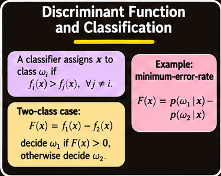

The direction of $w$ determines the orientation of the boundary, while its magnitude is related to the scale of the discriminant values. The bias shifts the boundary without changing its orientation.

### 3.2 Why a Linear Separator Is Not Unique

If a set of training points is linearly separable, there can be infinitely many lines or hyperplanes that classify every training point correctly. Minimizing the training classification error alone therefore does not determine one unique solution.

The important question is not only whether a boundary separates the training data, but also which separating boundary is likely to be most stable when the input data change slightly or new examples are observed.

This motivates the maximum-margin principle.

## 4. Large-Margin Linear Classification

A **large-margin linear classifier** chooses the separating hyperplane with the largest margin.

The margin is the width of the region around the decision boundary that can be expanded before it reaches a training observation. The points that touch the boundaries of this region are the **support vectors**.

The maximum-margin boundary is preferred because it is the most stable separator under small perturbations of the training inputs. The material presents this stability as a reason for its strong generalization ability.

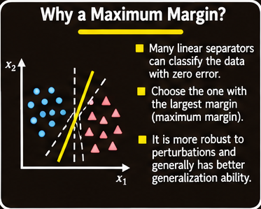

### 4.1 Label Representation

Consider a labelled training set

$$
D=\{(x_i,y_i)\}_{i=1}^{n},
$$

where each $x_i$ is a feature vector and

$$
y_i\in\{-1,+1\}.
$$

The linear classifier is

$$
f(x)=w^\top x+b.
$$

Correct classification requires

$$
\begin{aligned}
w^\top x_i+b&>0 &&\text{if }y_i=+1,\\
w^\top x_i+b&<0 &&\text{if }y_i=-1.
\end{aligned}
$$

These two conditions can be combined as

$$
y_i(w^\top x_i+b)>0.
$$

### 4.2 Canonical Margin Constraints

Multiplying both $w$ and $b$ by the same positive constant does not change the decision boundary:

$$
w^\top x+b=0
\quad\Longleftrightarrow\quad
c(w^\top x+b)=0,
\qquad c>0.
$$

This freedom allows the scale of the discriminant to be chosen so that the closest positive and negative training observations satisfy

$$
w^\top x_+ + b=+1,
\qquad
w^\top x_- + b=-1.
$$

All training examples must then satisfy the canonical constraints

$$
\begin{aligned}
w^\top x_i+b&\geq 1 &&\text{if }y_i=+1,\\
w^\top x_i+b&\leq -1 &&\text{if }y_i=-1.
\end{aligned}
$$

Equivalently, both classes can be expressed in one inequality:

$$
\boxed{y_i(w^\top x_i+b)\geq 1,\quad i=1,\ldots,n.}
$$

The central decision boundary remains $w^\top x+b=0$. The two supporting hyperplanes are $w^\top x+b=+1$ and $w^\top x+b=-1$.

### 4.3 Deriving the Margin Width

The distance from the origin to a hyperplane

$$
w^\top x=k
$$

is

$$
\frac{|k|}{\|w\|}.
$$

The positive and negative support hyperplanes are separated by a distance

$$
m
=
\frac{1}{\|w\|}
-
\frac{-1}{\|w\|}
=
\frac{2}{\|w\|}.
$$

Thus, the margin width is

$$
\boxed{m=\frac{2}{\|w\|}.}
$$

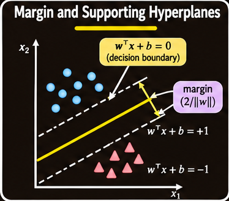

Maximizing the margin is therefore equivalent to minimizing $\|w\|$. For mathematical convenience, the optimization objective is written using the squared norm:

$$
\max_{w,b}\frac{2}{\|w\|}
\quad\Longleftrightarrow\quad
\min_{w,b}\frac{1}{2}\|w\|^2.
$$

The factor of one-half does not change the minimizer; it simplifies differentiation.

## 5. Hard-Margin SVM Optimization

When the training data are perfectly linearly separable, the maximum-margin classifier can be written as a constrained optimization problem.

### 5.1 Primal Formulation

The hard-margin SVM solves

$$
\boxed{
\begin{aligned}
\min_{w,b}\quad &\frac{1}{2}\|w\|^2\\
\text{subject to}\quad
&y_i(w^\top x_i+b)\geq 1,
\quad i=1,\ldots,n.
\end{aligned}
}
$$

This is a **quadratic programming problem with linear constraints**:

- The objective $\frac12\|w\|^2$ is quadratic.
- Each classification constraint is linear in $w$ and $b$.
- The constraints require every training observation to lie on or outside the margin boundaries.

The optimization selects the separating hyperplane with maximum margin among all hyperplanes that classify the training data correctly.

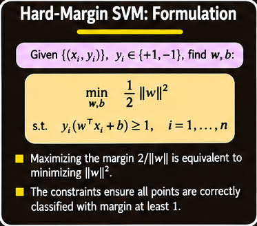

### 5.2 Why Optimization Is Needed

A classifier that only minimizes training error could select any of many separating boundaries. The SVM objective adds a geometric preference: among valid separators, choose the one with the smallest weight-vector norm, which is the one with the largest margin.

The optimization problem is called the **primal formulation**. Its solution can be transformed into a dual formulation that depends on dot products between training observations.

## 6. Lagrangian and Dual Formulation

The constrained primal problem can be handled using Lagrange multipliers. Introduce one multiplier $\alpha_i$ for each training constraint.

### 6.1 Constructing the Lagrangian

For the hard-margin problem, define

$$
L_P(w,b,\alpha)
=
\frac{1}{2}\|w\|^2
-
\sum_{i=1}^{n}
\alpha_i
\left[y_i(w^\top x_i+b)-1\right],
$$

subject to

$$
\alpha_i\geq 0.
$$

The multipliers $\alpha_i$ enforce the margin constraints. The Lagrangian combines the objective with the constraints so that the constrained problem can be expressed through stationarity conditions and a dual optimization problem.

### 6.2 Stationarity Conditions

At the optimum, differentiate the Lagrangian with respect to $w$ and $b$ and set the derivatives to zero.

Differentiating with respect to $w$ gives

$$
\frac{\partial L_P}{\partial w}
=
w-\sum_{i=1}^{n}\alpha_i y_i x_i=0.
$$

Therefore,

$$
\boxed{w=\sum_{i=1}^{n}\alpha_i y_i x_i.}
$$

Differentiating with respect to $b$ gives

$$
\frac{\partial L_P}{\partial b}
=
-\sum_{i=1}^{n}\alpha_i y_i=0,
$$

so

$$
\boxed{\sum_{i=1}^{n}\alpha_i y_i=0.}
$$

The weight vector is thus a linear combination of the training vectors, with coefficients determined by the multipliers and class labels.

### 6.3 The Dual Objective

Substituting the stationarity expressions into the Lagrangian eliminates $w$ and $b$. The resulting hard-margin dual problem is

$$
\boxed{
\begin{aligned}
\max_{\alpha}\quad
&\sum_{i=1}^{n}\alpha_i
-\frac{1}{2}
\sum_{i=1}^{n}\sum_{j=1}^{n}
\alpha_i\alpha_j y_i y_j x_i^\top x_j\\
\text{subject to}\quad
&\alpha_i\geq 0,\quad i=1,\ldots,n,\\
&\sum_{i=1}^{n}\alpha_i y_i=0.
\end{aligned}
}
$$

The primal formulation optimizes the hyperplane parameters $w$ and $b$. The dual formulation optimizes the multipliers $\alpha_i$.

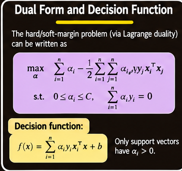

A key feature of the dual objective is that the training observations appear through pairwise dot products:

$$
x_i^\top x_j.
$$

This observation becomes important when considering nonlinear extensions, because the classifier and its training optimization can be expressed in terms of inner products.

## 7. KKT Conditions and Support Vectors

The **Karush–Kuhn–Tucker (KKT) conditions** describe properties that hold at the optimum of the constrained optimization problem.

For the hard-margin SVM, the important conditions include:

### 7.1 Stationarity

$$
w-\sum_i\alpha_i y_i x_i=0,
$$

$$
\sum_i\alpha_i y_i=0.
$$

### 7.2 Primal Feasibility

Every training observation must satisfy its margin constraint:

$$
y_i(w^\top x_i+b)-1\geq 0.
$$

### 7.3 Dual Feasibility

The Lagrange multipliers must be non-negative:

$$
\alpha_i\geq 0.
$$

### 7.4 Complementary Slackness

For every training observation,

$$
\boxed{
\alpha_i\left[y_i(w^\top x_i+b)-1\right]=0.
}
$$

This condition has a central interpretation.

- If a point lies strictly outside the margin, then its margin constraint is not tight, so its multiplier must be zero.
- If a multiplier is nonzero, the corresponding point must lie exactly on a supporting margin boundary.

The training observations with nonzero multipliers are the **support vectors**.

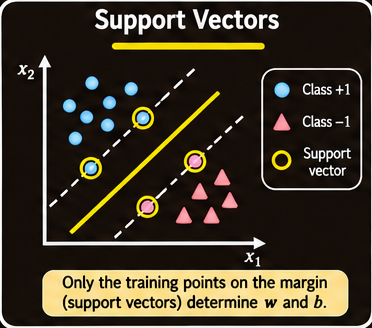

### 7.5 Why Only Support Vectors Determine the Boundary

From stationarity,

$$
w=\sum_{i=1}^{n}\alpha_i y_i x_i.
$$

Since only support vectors have nonzero $\alpha_i$, this becomes

$$
\boxed{
w=\sum_{i\in SV}\alpha_i y_i x_i.
}
$$

Here, $SV$ denotes the set of support-vector indices.

The decision function can therefore be written as

$$
g(x)
=
w^\top x+b
=
\sum_{i\in SV}\alpha_i y_i x_i^\top x+b.
$$

Only the support vectors contribute to the learned weight vector and the resulting discriminant function. Once the model has been trained, these support vectors, their labels, their multipliers, and the bias are sufficient to evaluate the classifier.

### 7.6 Recovering the Bias

For a support vector $x_i$ on a margin boundary, the corresponding equality is

$$
y_i(w^\top x_i+b)=1.
$$

Solving for $b$ gives

$$
b=y_i-w^\top x_i.
$$

The bias can therefore be recovered using a support vector. In practice, multiple support vectors may be available, but the source material presents the equality for a support vector as the basis for obtaining $b$.

## 8. Soft-Margin SVM for Non-Separable Data

The hard-margin formulation assumes that the training observations can be separated perfectly by a linear hyperplane with no points inside the margin. Real datasets may contain noise, outliers, or overlapping classes, making this assumption unsuitable.

A **soft-margin SVM** introduces slack variables to allow margin violations and misclassified training examples.

### 8.1 Slack Variables

For each observation, introduce a non-negative slack variable $\xi_i$:

$$
\xi_i\geq 0.
$$

The margin constraint becomes

$$
\boxed{
y_i(w^\top x_i+b)\geq 1-\xi_i.
}
$$

The slack variable measures how much the corresponding example is allowed to violate the unit-margin requirement.

- $\xi_i=0$: the observation satisfies the hard-margin constraint.
- $0<\xi_i<1$: the observation lies inside the margin but remains on the correct side of the decision boundary.
- $\xi_i=1$: the observation may lie on the decision boundary.
- $\xi_i>1$: the observation is on the wrong side of the boundary and is misclassified.

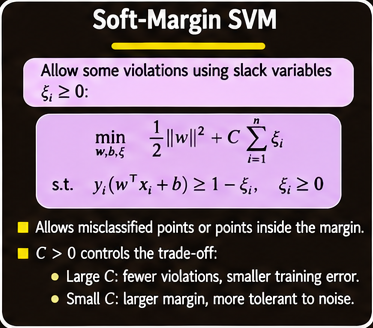

### 8.2 Soft-Margin Primal Objective

The soft-margin SVM balances a large margin against the total slack:

$$
\boxed{
\begin{aligned}
\min_{w,b,\xi}\quad
&\frac{1}{2}\|w\|^2+C\sum_{i=1}^{n}\xi_i\\
\text{subject to}\quad
&y_i(w^\top x_i+b)\geq 1-\xi_i,\\
&\xi_i\geq 0,\quad i=1,\ldots,n.
\end{aligned}
}
$$

The first term encourages a large margin. The second term penalizes margin violations and classification errors.

The parameter $C$ controls the tradeoff between margin maximization and training errors.

### 8.3 Effect of the Parameter C

**Large $C$**

- Assigns a high penalty to slack and training violations.
- Encourages the classifier to fit the training examples more closely.
- Approaches hard-margin behaviour as $C$ becomes extremely large.
- Can overfit, particularly when the data contain noise or non-separable observations.

**Small $C$**

- Allows more margin violations.
- Places less emphasis on fitting every training example.
- Can produce a wider-margin solution.
- If too small, may underfit.

The choice of $C$ is therefore a model-selection decision: it controls how strongly the classifier prioritizes training-set fit relative to margin size.

### 8.4 Soft-Margin Dual Problem

The dual problem for the soft-margin SVM has the same quadratic objective as the hard-margin dual, but the multiplier constraints change:

$$
\boxed{
\begin{aligned}
\max_{\alpha}\quad
&\sum_{i=1}^{n}\alpha_i
-\frac{1}{2}
\sum_{i=1}^{n}\sum_{j=1}^{n}
\alpha_i\alpha_j y_i y_j x_i^\top x_j\\
\text{subject to}\quad
&0\leq\alpha_i\leq C,\quad i=1,\ldots,n,\\
&\sum_{i=1}^{n}\alpha_i y_i=0.
\end{aligned}
}
$$

Compared with the hard-margin problem, the condition $\alpha_i\geq0$ is replaced by the bounded condition $0\leq\alpha_i\leq C$.

The parameter $C$ therefore also controls the upper bound on the dual multipliers.

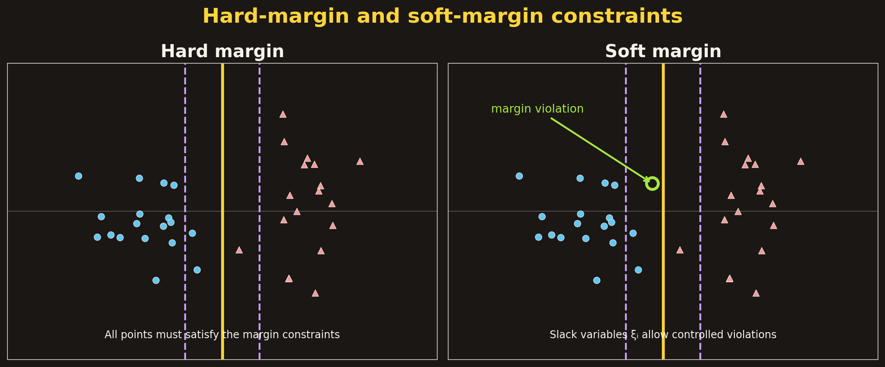

## 9. Nonlinear SVM and the Kernel Trick: Scope

The source outline identifies **nonlinear SVM and the kernel trick** as a topic. The remaining material, however, develops the linear SVM, its dual representation, and soft-margin formulation; it does not supply a kernel function, feature mapping, or kernel-based optimization derivation.

The following source-supported observation motivates the connection without adding an unsupported derivation:

- The SVM decision function depends on dot products between a test point and support vectors.
- The dual training objective depends on dot products between pairs of training observations.

This dot-product structure is the point at which a kernel-based extension can be introduced, but the actual kernel trick is not specified in the supplied material. No particular kernel, kernel formula, or nonlinear SVM training procedure is assumed here.

## 10. Multiclass Classification

A binary classifier distinguishes between two classes. Many practical tasks require choosing among more than two categories.

Examples include:

- Recognizing which character appears in a handwritten input.
- Identifying the object category in a photograph, such as a car tire, duck, or laptop.
- Classifying an observation into one of many object categories, as in a large image dataset.

A binary SVM can be extended to multiclass problems by decomposing the problem into multiple binary classification tasks.

Two strategies are developed:

1. **One-versus-all (OVA):** Train one classifier for each class against all remaining classes.
2. **One-versus-one (OVO):** Train one classifier for every pair of classes.

## 11. One-Versus-All (OVA) Multiclass SVM

The **one-versus-all** strategy decomposes a problem with $K$ classes into $K$ binary classification problems.

### 11.1 Assumption

The method assumes that each class can be separated individually from all the other classes combined.

For a dataset

$$
D=\{(x_i,y_i)\},
\qquad
y_i\in\{1,2,\ldots,K\},
$$

one binary classifier is trained for each class $k$.

### 11.2 Training Procedure

For classifier $k$:

- Positive examples are all observations whose label is $k$.
- Negative examples are all observations whose label is not $k$.

The procedure trains $K$ binary classifiers:

$$
w_1,w_2,\ldots,w_K.
$$

Each classifier learns to recognize its own class against the combined set of all other classes.

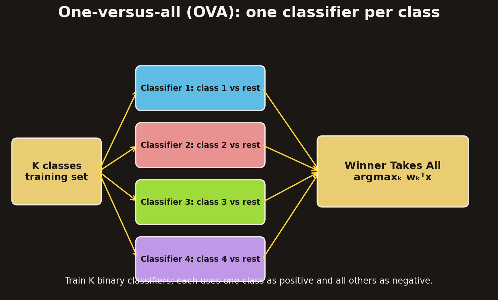

### 11.3 Prediction: Winner Takes All

For a new observation $x$, evaluate the score from every class-specific classifier:

$$
w_1^\top x,\ w_2^\top x,\ \ldots,\ w_K^\top x.
$$

The predicted class is the one with the largest score:

$$
\boxed{
\hat y=\arg\max_{k\in\{1,\ldots,K\}}w_k^\top x.
}
$$

This rule is called **Winner Takes All**. The classifier whose score is largest determines the final class.

### 11.4 Challenges of OVA

The source identifies three challenges:

- **Multiple rounds of training:** One binary classifier must be trained for every class.
- **Computational expense:** Training all class-specific classifiers can be costly.
- **Class imbalance:** Each binary problem may have one class as the positive group and all remaining classes as the negative group. The positive and negative sets can therefore have very different sizes.

The class-imbalance issue is particularly important because the binary learner may face many more negative examples than positive examples.

## 12. One-Versus-One (OVO) Multiclass Classification

The **one-versus-one** strategy trains a separate binary classifier for every pair of classes.

### 12.1 Assumption

The method assumes that every pair of classes can be separated by a binary classifier.

For each pair of labels $(j,k)$:

- Positive examples are observations belonging to class $j$.
- Negative examples are observations belonging to class $k$.

All other classes are excluded from that pairwise training problem.

### 12.2 Number of Classifiers

There are $K$ classes, and each classifier corresponds to one unordered pair of distinct classes.

The number of pairwise classifiers is

$$
\boxed{
\binom{K}{2}=\frac{K(K-1)}{2}.
}
$$

For example, with four classes, the classifiers are trained for the pairs

$$
(1,2),\ (1,3),\ (1,4),\ (2,3),\ (2,4),\ (3,4),
$$

giving six binary classifiers.

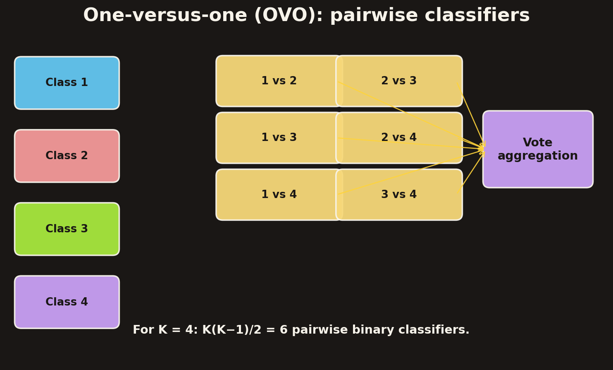

### 12.3 Prediction by Voting

For a new observation, each pairwise classifier votes for one of its two classes.

Each class participates in $K-1$ pairwise classifiers and can receive votes from those comparisons. The predicted class can be selected by majority vote:

$$
\boxed{
\hat y=\arg\max_{k}V_k,
}
$$

where $V_k$ is the number of votes received by class $k$.

Another strategy is to organize the pairwise decisions into a tournament between classes. The source mentions both majority voting and tournament-style organization as possible ways to combine the pairwise predictions.

## 13. Comparing OVA and OVO

The two strategies make different tradeoffs.

| Aspect | One-versus-all (OVA) | One-versus-one (OVO) |
| --- | --- | --- |
| Binary problems | $K$ | $\frac{K(K-1)}{2}$ |
| Training examples per classifier | One class versus all remaining examples | Only the two classes in the pair |
| Positive/negative balance | Can be strongly imbalanced | Uses two individual classes |
| Prediction | Highest class-specific score | Combine pairwise votes or tournament decisions |
| Main computational consideration | Fewer, potentially larger classifiers | More, generally smaller classifiers |

### 13.1 Number Versus Size of Classifiers

OVA trains a number of classifiers proportional to $K$:

$$
O(K).
$$

OVO trains a number proportional to the number of class pairs:

$$
O(K^2).
$$

Viewed only by classifier count, OVA requires fewer models. However, each OVO classifier is trained using only the examples from its two classes, so an individual pairwise training problem is generally smaller.

The source comparison emphasizes that if the time required to train a classifier grows superlinearly with the number of training observations, the smaller pairwise problems can make OVO attractive despite the larger number of classifiers.

The final comparison statement in the supplied material contains inconsistent acronym and complexity wording. Consequently, it does not establish an unambiguous universal winner between OVA and OVO. The reliable conclusion is that classifier count and classifier size must both be considered, along with the cost of training each binary model.

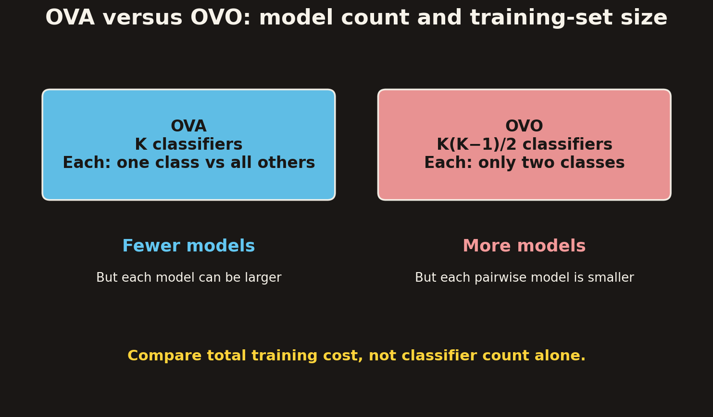

## 14. Robustness and Small Input Perturbations

The source includes examples in which a small perturbation is added to an image and the resulting classifier output changes substantially. One example changes a pig image's predicted label to “airliner”; another changes a panda image's label to “gibbon,” with a much higher reported confidence after perturbation.

These examples illustrate a general issue in machine-learning classification: a model can be sensitive to small input changes, even when the altered input appears visually similar to a person.

The examples are presented as a robustness illustration, not as a derivation of an SVM-specific property. They reinforce the importance of considering how stable a classifier's predictions are under changes to its inputs.

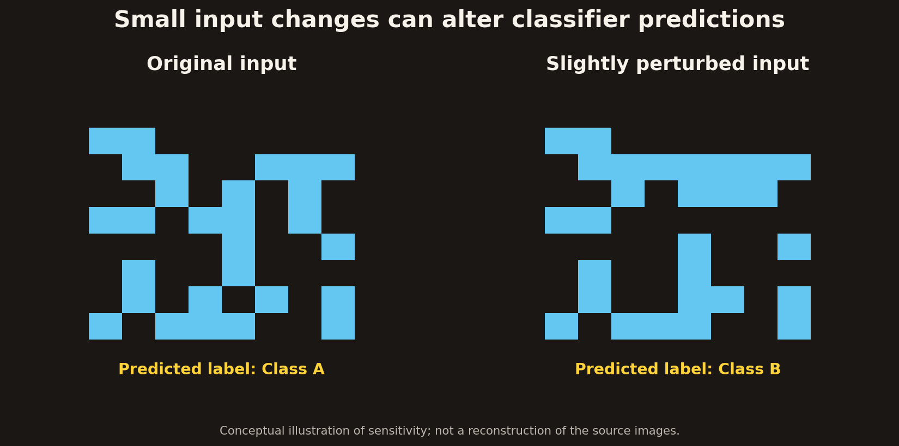

## 15. Key Ideas to Remember

- A **discriminant function** assigns scores to classes; the class with the largest score is selected.
- In a binary problem, the difference between two class scores gives a single discriminant function.
- A **linear discriminant function** has the form $f(x)=w^\top x+b$.
- The decision boundary $w^\top x+b=0$ is a line, plane, or hyperplane depending on feature-space dimension.
- The weight vector $w$ is normal to the boundary; $b$ controls its position.
- Many linear separators can classify separable training data correctly. The SVM selects the one with maximum margin.
- With labels $y_i\in\{-1,+1\}$, the canonical hard-margin constraints are $y_i(w^\top x_i+b)\geq1$.
- The margin width is $2/\|w\|$, so maximizing the margin is equivalent to minimizing $\frac12\|w\|^2$.
- The hard-margin SVM is a quadratic program with linear constraints.
- The dual formulation uses pairwise dot products $x_i^\top x_j$ and non-negative Lagrange multipliers.
- The KKT complementary-slackness condition explains why only support vectors have nonzero multipliers.
- The weight vector is a linear combination of support vectors: $w=\sum_{i\in SV}\alpha_i y_i x_i$.
- A soft-margin SVM uses slack variables $\xi_i$ to allow margin violations and misclassifications.
- The parameter $C$ controls the tradeoff between margin size and training violations. Large $C$ penalizes violations strongly; small $C$ allows more.
- The soft-margin dual constrains each multiplier to $0\leq\alpha_i\leq C$.
- **OVA** trains $K$ classifiers, each class against all others, and predicts using the largest score.
- **OVO** trains $K(K-1)/2$ pairwise classifiers and combines their votes or tournament decisions.
- OVA has fewer but potentially larger binary problems; OVO has more but generally smaller pairwise problems.
- The supplied material names the kernel trick but does not develop its equations or procedure; no additional kernel details are assumed here.
