# Unsupervised Learning

## 1. Overview

**Unsupervised learning** explores data when no target or class attribute is supplied. Instead of learning to predict a known answer, the objective is to discover intrinsic structure in the observations.

A central unsupervised-learning task is **clustering**: grouping observations so that similar instances belong to the same cluster and dissimilar instances belong to different clusters. Clustering is used in customer segmentation, document organization, image analysis, biology, medicine, psychology, marketing, and many other fields.

For example:

- A clothing manufacturer can group people with similar body measurements into small, medium, and large size categories.
- A business can group customers according to purchasing patterns to support targeted marketing.
- A document collection can be grouped by content to create a topic hierarchy.
- Images of objects can be grouped according to visual properties such as shape.

The result is not automatically a set of objectively correct classes. The useful grouping depends on the application, the representation of the data, the distance or similarity function, and the clustering algorithm.

### 1.1 Supervised and Unsupervised Learning

| Aspect | Supervised learning | Unsupervised learning |
| --- | --- | --- |
| Target attribute | Available | Not available |
| Main objective | Learn patterns relating input attributes to a target | Discover intrinsic structure in the data |
| Typical output | A predictor for future instances | Clusters, regions, patterns, or other structure |
| Example | Predict whether an email is spam | Group emails with similar content |

In supervised learning, examples have known target values. In unsupervised learning, the algorithm must organize the data without being given an a priori grouping.

### 1.2 What Makes a Good Clustering?

A useful clustering usually has:

- **Low within-cluster dissimilarity:** instances in the same cluster should be similar or close to one another.
- **High between-cluster dissimilarity:** instances in different clusters should be relatively different or far apart.

The exact meaning of similarity depends on the data and application. A distance function that is suitable for numeric measurements may be unsuitable for categorical attributes or text.

A clustering result therefore depends on three connected choices:

1. The clustering algorithm.
2. The distance, similarity, or dissimilarity function.
3. The application and the interpretation of the resulting groups.

## 2. K-Means Clustering

**K-means** is a partitional clustering algorithm. It divides a dataset into a user-specified number, $k$, of clusters. Each cluster is represented by a center called its **centroid**.

Let the dataset be

$$
D=\{x_1,x_2,\ldots,x_n\},
$$

where each observation is a real-valued vector

$$
x_i=(x_{i1},x_{i2},\ldots,x_{ir})\in\mathbb{R}^{r}.
$$

Here, $n$ is the number of observations and $r$ is the number of attributes or dimensions. K-means partitions the observations into $k$ non-overlapping clusters:

$$
C_1,C_2,\ldots,C_k.
$$

The centroid of cluster $C_j$ is the mean vector of all observations assigned to it.

### 2.1 The K-Means Algorithm

**Input:** A dataset $D$, a number of clusters $k$, and a distance function.

**Output:** $k$ clusters and their centroids.

1. **Initialize:** Randomly select $k$ data points as the initial centroids, also called seeds.
2. **Assign:** Assign each data point to the cluster whose centroid is closest to it.
3. **Update:** Recompute each centroid as the mean of the points currently assigned to that cluster.
4. **Repeat:** Return to the assignment step until a convergence criterion is satisfied.

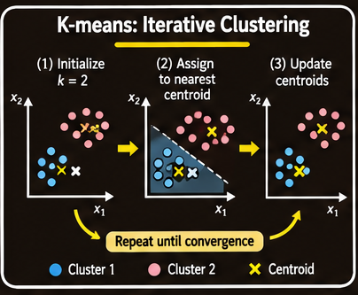

*The assignment and centroid-update steps alternate. Each update changes the centers used in the next assignment.*

For Euclidean distance, the centroid of cluster $C_j$ is

$$
m_j=\frac{1}{|C_j|}\sum_{x_i\in C_j}x_i,
$$

where $|C_j|$ is the number of observations in the cluster.

The distance from a point $x_i$ to its centroid is

$$
\operatorname{dist}(x_i,m_j)
=
\sqrt{\sum_{\ell=1}^{r}(x_{i\ell}-m_{j\ell})^2}.
$$

The mean is appropriate for numeric attributes because it produces a representative point in the same numeric feature space.

### 2.2 Objective Function: Sum of Squared Error

A common objective for K-means is the **sum of squared error (SSE)**:

$$
\operatorname{SSE}
=
\sum_{j=1}^{k}
\sum_{x_i\in C_j}
\operatorname{dist}(x_i,m_j)^2.
$$

The objective adds the squared distance from every point to the centroid of its assigned cluster. K-means seeks a partition with a small SSE.

The squared distance penalizes points that are far from their centroids more strongly than points that are close. The assignment step chooses the nearest centroid, while the update step replaces each centroid with the mean that minimizes the sum of squared distances within its current cluster.

### 2.3 Convergence and Stopping Criteria

K-means can stop when one of the following conditions is met:

1. No points, or only a very small number of points, are reassigned to different clusters.
2. The centroids no longer change, or their changes become sufficiently small.
3. The decrease in SSE between iterations becomes smaller than a chosen threshold.

The algorithm normally reaches a stable assignment after a finite number of iterations. However, it is not guaranteed to find the globally best clustering. With the SSE objective, it terminates at a **local optimum** determined in part by the initial seeds.

### 2.4 Strengths of K-Means

- **Simple:** The algorithm is easy to understand and implement.
- **Efficient:** Its stated time complexity is $O(tkn)$, where $t$ is the number of iterations, $k$ is the number of clusters, and $n$ is the number of data points.
- **Scalable in common settings:** When $k$ and $t$ are small relative to the dataset size, the computation is approximately linear in $n$.
- **Popular:** Its simplicity and efficiency make it a widely used clustering method.

### 2.5 Limitations of K-Means

**The number of clusters must be supplied.** The user must choose $k$ before running the algorithm. This can be difficult when the number of natural groups is unknown.

**The mean must be meaningful.** K-means relies on numeric means. A mean is not naturally defined for nominal categorical values. For categorical data, a related method called **K-modes** uses the most frequent value, or mode, of each attribute as the cluster representative.

**Sensitivity to outliers.** An outlier is a data point far from most other observations. Because the mean is affected by extreme values, an outlier can pull a centroid away from the main body of its cluster. This may produce undesirable assignments.

Possible ways to reduce the effect of outliers include:

- Monitor points that remain much farther from their centroids than other observations over several iterations, then decide whether they should be excluded.
- Run clustering on a random sample and assign the remaining observations afterward using distance, similarity, or a classifier. A small random sample has a lower chance of including a rare outlier, although it does not guarantee that outliers will be absent.

**Sensitivity to initial seeds.** Different initial centroids can lead to different final partitions. A poor initialization may produce an undesirable local optimum. Using different seeds or a more deliberate initialization method can improve the result, but the course material does not prescribe one specific seed-selection algorithm.

**Preference for compact shapes.** K-means works best when clusters are roughly spherical or hyper-ellipsoidal. It is not generally suitable for clusters with strongly irregular shapes, such as concentric rings or interlocking curves. A nearest-centroid assignment can split one natural curved group into several regions or combine parts of different natural groups.

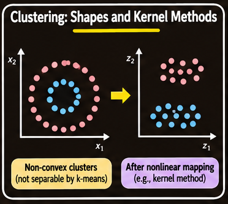

*Centroid-based partitions are most natural for compact groups. Nonlinear approaches can represent more complex shapes.*

Despite its limitations, no clustering algorithm is best for every application. Other methods also have weaknesses, and the true clusters are often unknown. The suitability of an algorithm depends on the data and the task.

### 2.6 K-Modes for Categorical Data

**K-modes** adapts the partitional clustering idea to categorical attributes. Instead of using a mean vector, each cluster is represented by a vector of modes: the most frequent category for each attribute.

For example, if a cluster contains customers whose most frequent values are `urban`, `monthly`, and `basic` for three categorical attributes, those modes form its representative profile.

K-modes is appropriate when arithmetic means are not meaningful for the attribute values.

## 3. Representing Clusters

A clustering is easier to interpret when each group has a useful summary. The best representation depends on the shape of the cluster and the type of data.

### 3.1 Centroids and Spread

For numeric data, a cluster can be represented by:

- Its **centroid**, which describes its central location.
- Its **radius**, which summarizes how far observations extend from the center.
- Its **standard deviation or spread in each dimension**, which describes variation along individual attributes.

A centroid together with measures of spread is often useful for approximately spherical or ellipsoidal clusters.

A centroid alone is not enough to describe an elongated or irregular cluster. Two clusters can have similar centroids while having very different shapes or orientations.

### 3.2 Frequent Values and Descriptive Terms

For categorical data, frequent values can represent a cluster. In text clustering, a small collection of frequent or characteristic words can summarize the documents in a group.

For example, a document cluster containing frequent terms such as `football`, `team`, `goal`, and `league` may represent sports-related content. Such terms provide an interpretable description even though a numeric centroid is not directly meaningful in the original word space.

### 3.3 Arbitrary-Shaped Clusters

Centroid-based descriptions are less suitable for irregular groups. A cluster may form a ring, curve, or other non-convex region, in which case its centroid may lie in a location containing few or no observations.

The representation should therefore match the intended use. For example, compact size groups may be useful for manufacturing even if they do not capture every irregularity in the original measurements.

## 4. Methods for More Complex Cluster Shapes

K-means is not the only way to form clusters. Several methods use richer representations or transformations to handle patterns that are not well described by a single centroid.

### 4.1 Gaussian Mixture Models

A **Gaussian Mixture Model (GMM)** represents a data distribution as a weighted combination of Gaussian distributions. Each Gaussian component can describe a group with its own center and covariance, allowing components to have different spreads and orientations.

A mixture density has the form

$$
p(x)=\sum_{j=1}^{k}\pi_j\,
\mathcal{N}(x\mid\mu_j,\Sigma_j),
$$

where:

- $k$ is the number of Gaussian components.
- $\pi_j$ is the mixture weight for component $j$, with $\pi_j\geq 0$ and $\sum_j\pi_j=1$.
- $\mu_j$ is the component mean.
- $\Sigma_j$ is the component covariance matrix.
- $\mathcal{N}(x\mid\mu_j,\Sigma_j)$ is the Gaussian density for component $j$.

Unlike hard K-means assignments, a mixture model can describe **soft membership**: an observation can have a probability of belonging to each component. The covariance matrices allow ellipsoidal component shapes.

The essential idea is that several Gaussian components can combine to describe a distribution with multiple peaks or separated groups. Parameter estimation is a separate part of fitting a mixture model.

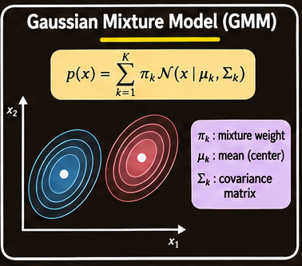

### 4.2 Kernel K-Means

**Kernel K-means** uses a nonlinear mapping to represent data in a feature space where clusters that are difficult to separate in the original input space may become easier to separate.

Let $\phi(x)$ denote a mapping from an original observation into a feature space. A kernel function computes inner products in that feature space without necessarily constructing the mapped vectors explicitly:

$$
K(x_i,x_j)=\phi(x_i)^\top\phi(x_j).
$$

The kernel trick makes it possible to work with nonlinear relationships. This can allow K-means-style clustering to discover shapes such as concentric rings or curved groups that ordinary K-means cannot represent well.

The essential idea is to perform clustering using distances induced by the feature-space representation rather than relying only on Euclidean distances in the original space.

### 4.3 Spectral Clustering

**Spectral clustering** represents data through a similarity or kernel matrix and uses eigenvectors to obtain a new representation. The course describes representing observations using the top $k$ eigenvectors of the kernel matrix, followed by a clustering step equivalent in spirit to kernel K-means.

This can reveal structure that is difficult to identify from the original coordinates. For example, concentric rings that overlap in the original two-dimensional layout can be represented in a transformed space where the groups are easier to distinguish.

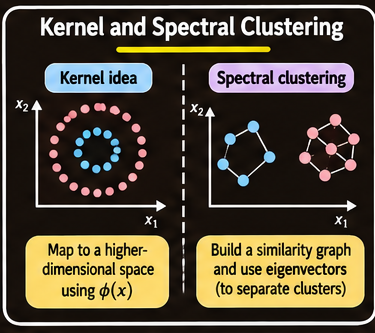

The important distinction is that ordinary K-means partitions the original feature space using distances to centroids, while kernel-based and spectral approaches first construct a representation that can expose nonlinear structure.

## 5. Hierarchical Clustering

**Hierarchical clustering** produces a nested sequence of clusters. The hierarchy is represented as a tree called a **dendrogram**.

A dendrogram records which groups are joined or divided and the level at which each operation occurs. A horizontal cut through the tree can produce different numbers of clusters.

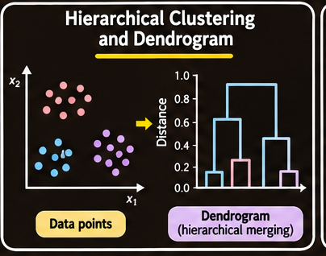

There are two main approaches.

### 5.1 Agglomerative Clustering: Bottom-Up

Agglomerative clustering begins with each data point as its own cluster.

1. Treat every observation as a singleton cluster.
2. Find the two closest clusters.
3. Merge them into a new cluster.
4. Recompute the distance between the new cluster and every other cluster.
5. Repeat until all observations belong to one cluster.

Agglomerative clustering is more commonly used than divisive clustering in the course treatment.

### 5.2 Divisive Clustering: Top-Down

Divisive clustering begins with all observations in one root cluster.

1. Start with the entire dataset as one cluster.
2. Split the cluster into child clusters.
3. Recursively divide the child clusters.
4. Stop when each cluster contains a single observation, or when another chosen stopping condition is met.

The two approaches construct the same kind of nested representation in opposite directions: agglomerative clustering merges from the bottom, while divisive clustering splits from the top.

### 5.3 Agglomerative Clustering Algorithm

**Input:** A dataset $D$ and a method for measuring distances between clusters.

**Output:** A hierarchy of nested clusters.

1. Make each data point a separate cluster.
2. Compute pairwise distances between the initial clusters.
3. Find the two nearest clusters.
4. Merge them to form a new cluster.
5. Compute the distance from the new cluster to all remaining clusters.
6. Repeat until one cluster remains.

The way step 5 is performed depends on the **linkage method**.

### 5.4 Worked Example: Single-Link Agglomeration

Consider four one-dimensional observations:

| Point | A | B | C | D |
| --- | ---: | ---: | ---: | ---: |
| Value | 0 | 2 | 5 | 9 |

Initially, each point is a separate cluster.

1. The closest pair is $A$ and $B$, with distance $2$. Merge them to form $\{A,B\}$.
2. Under single linkage, the distance from $\{A,B\}$ to $C$ is the minimum pairwise distance: $\min(5,3)=3$. The distance from $C$ to $D$ is $4$. Merge $\{A,B\}$ with $C$.
3. The distance from $\{A,B,C\}$ to $D$ is $\min(9,7,4)=4$. Merge them into one cluster.

The resulting sequence is:

$$
\{A\},\{B\},\{C\},\{D\}
\rightarrow
\{A,B\},\{C\},\{D\}
\rightarrow
\{A,B,C\},\{D\}
\rightarrow
\{A,B,C,D\}.
$$

A dendrogram preserves the order and merge distances, allowing a user to choose a cut that produces a desired number of groups.

### 5.5 Choosing a Cut in a Hierarchy

A hierarchical result contains multiple possible clusterings. One can select a level of the dendrogram and cut the tree there.

For the four-point example, possible two-group partitions include:

| Partition | Group means | Total squared error |
| --- | --- | ---: |
| $\{A\}\mid\{B,C,D\}$ | $0$ and $5.33$ | $24.67$ |
| $\{A,B\}\mid\{C,D\}$ | $1$ and $7$ | $10.00$ |
| $\{A,B,C\}\mid\{D\}$ | $2.33$ and $9$ | $12.67$ |

The middle partition has the smallest total squared error among these three possibilities. This illustrates that a hierarchy can be examined at several levels, and that a selected cut can be assessed using a criterion relevant to the application.

## 6. Measuring Distance Between Clusters: Linkage Methods

The distance between individual data points does not by itself determine how to measure the distance between two multi-point clusters. Different **linkage methods** define cluster-to-cluster distance differently and can produce different dendrograms.

Let $A$ and $B$ be two clusters, and let $d(x,y)$ be the distance between two individual observations.

### 6.1 Single Linkage

Single linkage uses the closest pair of observations, one from each cluster:

$$
d_{\text{single}}(A,B)
=
\min_{x\in A,\,y\in B}d(x,y).
$$

It can connect clusters with irregular shapes because only one close pair is needed to join two groups.

Its weakness is the **chain effect**: a sequence of intermediate or noisy points can link two otherwise separate groups, creating a long chain.

### 6.2 Complete Linkage

Complete linkage uses the furthest pair of observations:

$$
d_{\text{complete}}(A,B)
=
\max_{x\in A,\,y\in B}d(x,y).
$$

This tends to favour compact clusters because a merge is judged by the most distant cross-cluster pair. It is sensitive to outliers: one far-away observation can make two clusters appear very distant.

### 6.3 Average Linkage

Average linkage computes the average of all pairwise distances between observations in the two clusters:

$$
d_{\text{average}}(A,B)
=
\frac{1}{|A||B|}
\sum_{x\in A}\sum_{y\in B}d(x,y).
$$

It is a compromise between single linkage's tendency to form long chains and complete linkage's sensitivity to extreme pairwise distances.

### 6.4 Centroid Linkage

Centroid linkage measures the distance between the centroids of two clusters:

$$
d_{\text{centroid}}(A,B)=d(m_A,m_B),
$$

where $m_A$ and $m_B$ are the cluster centroids.

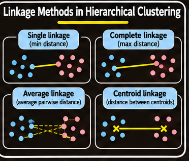

| Linkage | Distance definition | Main characteristic |
| --- | --- | --- |
| Single | Minimum cross-cluster distance | Can find irregular shapes; may create chains |
| Complete | Maximum cross-cluster distance | Favours compact groups; sensitive to outliers |
| Average | Mean of all cross-cluster distances | Compromise between single and complete |
| Centroid | Distance between cluster centroids | Summarizes groups by their centers |

The linkage method is an important part of the hierarchical clustering design because it determines which clusters are considered nearest at each merge.

## 7. DBSCAN: Density-Based Spatial Clustering

**DBSCAN** stands for **Density-Based Spatial Clustering of Applications with Noise**. It defines clusters as dense regions separated by regions of lower density.

DBSCAN addresses two important limitations of centroid-based clustering:

- K-means requires the number of clusters $k$ in advance and favours compact, roughly spherical groups.
- K-means and standard hierarchical clustering generally assign every observation to a cluster, including outliers.

DBSCAN can discover clusters with arbitrary shapes, determine the number of clusters from the density structure, and label isolated observations as noise.

### 7.1 The Two Parameters

DBSCAN uses two parameters:

- $\varepsilon$ (*epsilon*): the radius of the neighbourhood around a point.
- `MinPts`: the minimum number of points required for a neighbourhood to count as dense.

The $\varepsilon$-neighbourhood of point $p$ is

$$
N_{\varepsilon}(p)
=
\{q\in D:\operatorname{dist}(p,q)\leq\varepsilon\}.
$$

The point $p$ itself is included in its own neighbourhood. Therefore, it contributes one to the neighbourhood count.

### 7.2 Core, Border, and Noise Points

A point is classified according to the number and arrangement of its neighbours.

- **Core point:** $|N_{\varepsilon}(p)|\geq\text{MinPts}$. Its neighbourhood contains enough points to be considered dense.
- **Border point:** It is not a core point, but it lies within the $\varepsilon$-neighbourhood of at least one core point.
- **Noise point:** It is neither a core point nor a border point.

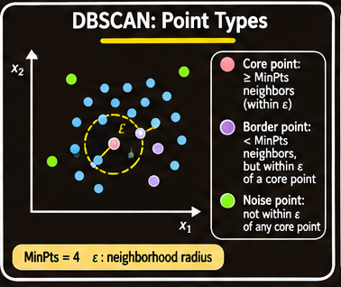

Only core points can expand a cluster. Border points can belong to a cluster, but they do not initiate further expansion.

### 7.3 Density Reachability and Connectivity

DBSCAN uses relationships between points to define a cluster.

**Directly density-reachable:** A point $q$ is directly density-reachable from $p$ if $p$ is a core point and $q$ lies in $N_{\varepsilon}(p)$.

**Density-reachable:** A point $q$ is density-reachable from $p$ if there is a chain

$$
p=p_1,p_2,\ldots,p_n=q
$$

such that each point $p_{i+1}$ is directly density-reachable from $p_i$.

**Density-connected:** Two points $p$ and $q$ are density-connected if there is some point $o$ from which both are density-reachable.

A DBSCAN cluster is a maximal set of density-connected points. Points that do not belong to any cluster are treated as noise.

An important property is that reachability is not symmetric: a border point cannot expand a cluster, so points are not reachable outward from a border point. Density-connectivity is symmetric.

### 7.4 DBSCAN Algorithm

**Input:** Dataset $D$, neighbourhood radius $\varepsilon$, minimum count `MinPts`, and a distance function.

**Output:** Clusters and noise points.

1. Select an unvisited point $p$ and mark it visited.
2. Compute its neighbourhood $N=N_{\varepsilon}(p)$.
3. If $|N|<\text{MinPts}$, label $p$ as noise for now. It may later be assigned as a border point if a core point reaches it.
4. Otherwise, create a new cluster and add $p$.
5. Examine the points in $N$:
   - If a point $q$ is unvisited, mark it visited and compute $N_{\varepsilon}(q)$.
   - If $q$ is a core point, add its neighbourhood to the set of points to examine.
   - If $q$ does not yet belong to a cluster, add it to the current cluster.
6. Continue until the cluster cannot be expanded further.
7. Repeat with another unvisited point until all points have been considered.

Every point is visited once. Only core points expand the search; border points join clusters without expanding them. A point initially labelled noise may later be claimed as a border point.

A brute-force neighbourhood search gives a worst-case cost of $O(n^2)$. With a spatial index such as a k-d tree or R*-tree, the course notes an approximate $O(n\log n)$ cost in low-dimensional settings. Index performance depends on dimensionality and data structure behaviour.

### 7.5 Worked DBSCAN Example

Consider ten two-dimensional points:

| Point | $x_1$ | $x_2$ |
| --- | ---: | ---: |
| $P_1$ | 1 | 1 |
| $P_2$ | 2 | 1 |
| $P_3$ | 1 | 2 |
| $P_4$ | 2 | 2 |
| $P_5$ | 3 | 3 |
| $P_6$ | 6 | 6 |
| $P_7$ | 7 | 6 |
| $P_8$ | 6 | 7 |
| $P_9$ | 7 | 7 |
| $P_{10}$ | 4 | 8 |

Use Euclidean distance with

$$
\varepsilon=1.5,
\qquad
\text{MinPts}=3.
$$

Because a point counts as its own neighbour, a core point must have at least three points in its neighbourhood, including itself.

Useful distances include:

- Side-by-side points: $1$.
- Diagonal points separated by one unit in each coordinate: $\sqrt{2}\approx1.41$.
- A displacement of two units in one coordinate and one in the other: $\sqrt{5}\approx2.24$.

#### Step 1: Determine every neighbourhood

| Point | $N_{\varepsilon}(p)$ | Count | Type |
| --- | --- | ---: | --- |
| $P_1$ | $P_1,P_2,P_3,P_4$ | 4 | Core |
| $P_2$ | $P_1,P_2,P_3,P_4$ | 4 | Core |
| $P_3$ | $P_1,P_2,P_3,P_4$ | 4 | Core |
| $P_4$ | $P_1,P_2,P_3,P_4,P_5$ | 5 | Core |
| $P_5$ | $P_4,P_5$ | 2 | Border |
| $P_6$ | $P_6,P_7,P_8,P_9$ | 4 | Core |
| $P_7$ | $P_6,P_7,P_8,P_9$ | 4 | Core |
| $P_8$ | $P_6,P_7,P_8,P_9$ | 4 | Core |
| $P_9$ | $P_6,P_7,P_8,P_9$ | 4 | Core |
| $P_{10}$ | $P_{10}$ | 1 | Noise |

The key decisions are:

- $P_4$ and $P_5$ are separated by $\sqrt{2}\approx1.41$, which is within $\varepsilon=1.5$. Thus, $P_5$ belongs to the neighbourhood of the core point $P_4$.
- $P_5$ has only two neighbours including itself, so it is not a core point. Because it is reached by $P_4$, it is a border point.
- $P_3$ and $P_5$ are separated by $\sqrt{5}\approx2.24$, which is greater than $\varepsilon$.
- The nearest point to $P_{10}$ is $P_8$, at distance $\sqrt{5}\approx2.24$. No core point reaches $P_{10}$, so it is noise.

#### Step 2: Expand clusters

Starting from $P_1$, DBSCAN creates the first cluster. Its core neighbours are examined, and $P_4$ adds $P_5$ to the cluster as a border point.

The core group $P_6$ through $P_9$ forms a second cluster. $P_{10}$ is not reached by a core point and remains noise.

The final result is:

$$
C_1=\{P_1,P_2,P_3,P_4,P_5\},
$$

where $P_5$ is a border point, and

$$
C_2=\{P_6,P_7,P_8,P_9\},
\qquad
\text{Noise}=\{P_{10}\}.
$$

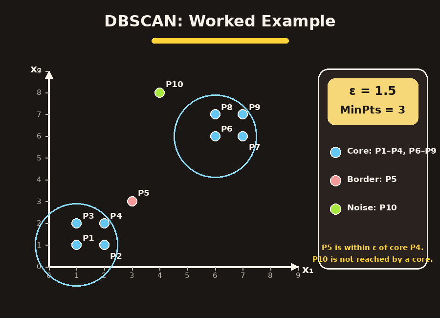

The number of clusters is discovered by the algorithm; it is not supplied as an input. In contrast, K-means with $k=2$ must assign $P_{10}$ to one of the clusters. Its distance to the second cluster's centroid $(6.5,6.5)$ is approximately $2.92$, compared with approximately $6.58$ to the first cluster's centroid $(1.8,1.8)$. It is therefore assigned to the second cluster and can pull that centroid away from the main group.

### 7.6 Choosing $\varepsilon$ and `MinPts`

The parameters determine what counts as a dense region.

- For data with $d$ dimensions, a suggested lower bound is `MinPts` of at least $d+1$; $2d$ is a common default. Larger values may be appropriate for noisy data.
- A **k-distance plot** can help select $\varepsilon$. Set $k=\text{MinPts}-1$, calculate each point's distance to its $k$-th nearest neighbour, sort these distances, and look for an elbow. The elbow is a candidate value for $\varepsilon$.
- If $\varepsilon$ is too small, many observations become noise.
- If $\varepsilon$ is too large, separate clusters may merge.

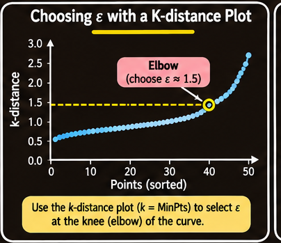

The parameter settings should be examined in the context of the data and the distance metric rather than selected mechanically.

### 7.7 Strengths and Limitations of DBSCAN

| Strengths | Limitations |
| --- | --- |
| Does not require the number of clusters in advance | A single global $\varepsilon$ can fail when clusters have very different densities |
| Can find clusters of arbitrary shape | Sensitive to $\varepsilon$ and the distance metric |
| Handles outliers explicitly as noise | Becomes less effective in high-dimensional spaces |
| Uses only two main parameters | A border point reachable from two clusters may be assigned to whichever cluster finds it first |
| Core and noise labels do not depend on visit order | Brute-force neighbourhood search is $O(n^2)$ |

Methods such as OPTICS and HDBSCAN are mentioned as alternatives for data with varying cluster densities.

#### 7.8 Effect of Changing the Parameters

For the same ten-point example:

**Case A: $\varepsilon=1.0$, `MinPts` = 3**

- $P_1$ through $P_4$ each have exactly three points in their neighbourhoods, so they are core.
- $P_5$ is farther than $1.0$ from $P_4$ and becomes noise.
- $P_6$ through $P_9$ form the second cluster.
- Noise: $\{P_5,P_{10}\}$.

**Case B: $\varepsilon=1.5$, `MinPts` = 5**

- Only $P_4$ has at least five points in its neighbourhood and is core.
- $P_1,P_2,P_3,P_5$ are border points reached by $P_4$.
- $P_6$ through $P_9$ have only four points in their neighbourhoods and have no core neighbour, so they become noise.
- Noise: $\{P_6,P_7,P_8,P_9,P_{10}\}$.

The example demonstrates that reducing $\varepsilon$ can remove points from cluster boundaries, while increasing `MinPts` can eliminate a cluster if its local density is no longer sufficient.

## 8. Distance and Similarity Functions

A distance function is central to clustering because it defines which observations count as similar or dissimilar. Different attribute types require different measures.

A function suitable for numeric measurements may not be appropriate for nominal categories, binary attributes, or text documents.

### 8.1 Numeric Attributes: Minkowski Distance

For two numeric vectors $x_i$ and $x_j$ with $r$ attributes, the Minkowski distance of order $h$ is

$$
\operatorname{dist}_{h}(x_i,x_j)
=
\left(
\sum_{f=1}^{r}|x_{if}-x_{jf}|^h
\right)^{1/h},
$$

where $h$ is a positive integer.

Two common special cases are:

**Euclidean distance** ($h=2$):

$$
\operatorname{dist}_{2}(x_i,x_j)
=
\sqrt{\sum_{f=1}^{r}(x_{if}-x_{jf})^2}.
$$

This is the ordinary straight-line distance.

**Manhattan distance** ($h=1$):

$$
\operatorname{dist}_{1}(x_i,x_j)
=
\sum_{f=1}^{r}|x_{if}-x_{jf}|.
$$

This is also called city-block distance. It adds the absolute differences along each coordinate.

### 8.2 Other Numeric Distance Functions

**Weighted Euclidean distance** gives different attributes different importance:

$$
\operatorname{dist}_{w}(x_i,x_j)
=
\sqrt{
\sum_{f=1}^{r}w_f(x_{if}-x_{jf})^2
},
$$

where $w_f$ is the weight assigned to attribute $f$.

**Squared Euclidean distance** removes the square root:

$$
\operatorname{dist}_{\text{sq}}(x_i,x_j)
=
\sum_{f=1}^{r}(x_{if}-x_{jf})^2.
$$

It places progressively greater emphasis on points that are far apart.

**Chebyshev distance** uses the largest absolute difference across attributes:

$$
\operatorname{dist}_{\infty}(x_i,x_j)
=
\max_{f=1,\ldots,r}|x_{if}-x_{jf}|.
$$

It treats two observations as different when at least one attribute differs substantially.

### 8.3 Binary Attributes and the Confusion Matrix

A binary attribute has two states, usually represented by $0$ and $1$. For two observations $x_i$ and $x_j$, compare their binary values and count:

| Count | Meaning |
| --- | --- |
| $a$ | Both observations have value 1 |
| $b$ | $x_i$ has 1 and $x_j$ has 0 |
| $c$ | $x_i$ has 0 and $x_j$ has 1 |
| $d$ | Both observations have value 0 |

The total number of compared attributes is $a+b+c+d$.

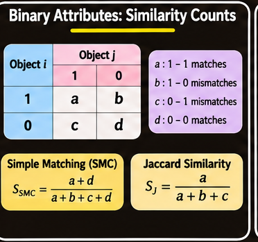

### 8.4 Symmetric Binary Attributes

A binary attribute is **symmetric** when its two states are equally important and carry equal weight. An example used in the course is a two-state attribute in which neither value is considered more important.

The **Simple Matching Coefficient** (SMC) measures the proportion of matching values:

$$
\operatorname{SMC}(x_i,x_j)
=
\frac{a+d}{a+b+c+d}.
$$

The corresponding dissimilarity is the proportion of mismatches:

$$
\operatorname{dist}(x_i,x_j)
=
\frac{b+c}{a+b+c+d}.
$$

For example, consider:

$$
x_1=(1,1,1,0,1,0,0),
$$

$$
x_2=(0,1,1,0,0,1,0).
$$

There are two $1$-$1$ matches, two $0$-$0$ matches, two $1$-$0$ mismatches, and one $0$-$1$ mismatch. Therefore,

$$
\operatorname{dist}(x_1,x_2)
=
\frac{2+1}{2+2+1+2}
=
\frac{3}{7}
\approx0.429.
$$

### 8.5 Asymmetric Binary Attributes

A binary attribute is **asymmetric** when one state is more important than the other. By convention, state $1$ represents the more important state, which is often the rare or infrequent state.

For example, in a medical record, the presence of a rare symptom may be more informative than its absence. Two people both lacking that symptom should not necessarily be treated as strongly similar.

The **Jaccard coefficient** ignores joint zero values:

$$
J(x_i,x_j)=\frac{a}{a+b+c}.
$$

The corresponding Jaccard distance is

$$
d_J(x_i,x_j)=\frac{b+c}{a+b+c}=1-J(x_i,x_j).
$$

The count $d$ is omitted because a joint absence is not considered informative for an asymmetric binary attribute.

### 8.6 Nominal Attributes

A **nominal attribute** has more than two possible values, with no meaningful ordering between them. Examples include colour, country, and product category.

If two observations have $r$ nominal attributes and match on $q$ of them, the simple matching distance is

$$
\operatorname{dist}(x_i,x_j)=\frac{r-q}{r}.
$$

It is the proportion of attributes whose values differ.

### 8.7 Text Documents: Cosine Similarity

A document can be represented as a vector of word or term values. A common simplified representation is the **bag of words**, in which the document is represented by the terms it contains or their frequencies. The order and position of words are ignored.

For text documents, similarity is often more useful than a raw distance. A common measure is **cosine similarity**:

$$
\operatorname{cosine}(x_i,x_j)
=
\frac{x_i^\top x_j}
{\|x_i\|\,\|x_j\|}.
$$

It measures the cosine of the angle between two document vectors. Documents with similar term distributions tend to have a larger cosine similarity, even when their lengths differ.

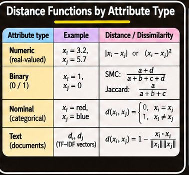

## 9. Data Standardization

When distances are computed in Euclidean space, attributes should often be standardized so that their numerical scales do not give some attributes disproportionate influence.

Consider two observations:

$$
x_i=(0.1,20),
\qquad
x_j=(0.9,720).
$$

Their Euclidean distance is

$$
\sqrt{(0.9-0.1)^2+(720-20)^2}
=
\sqrt{0.8^2+700^2}
\approx700.
$$

The second attribute dominates the distance because its numerical range is much larger. This can happen even when the first attribute is equally important to the application.

Standardization transforms attributes to comparable scales. The appropriate method depends on the attribute type.

### 9.1 Interval-Scaled Attributes

An **interval-scaled attribute** is numeric and follows a linear scale. Equal numerical differences have equal meaning across the scale. For example, the difference between ages 10 and 20 is the same as the difference between 40 and 50.

Two standardization methods are range scaling and z-score scaling.

**Range scaling** maps an attribute to a common range, commonly $[0,1]$:

$$
\operatorname{range}(x_{if})
=
\frac{x_{if}-\min(f)}
{\max(f)-\min(f)}.
$$

Here, $\min(f)$ and $\max(f)$ are the minimum and maximum observed values of attribute $f$.

**Z-score scaling** centers an attribute around its mean and divides by its mean absolute deviation as defined in the course material.

First compute the mean:

$$
m_f=\frac{1}{n}\sum_{i=1}^{n}x_{if}.
$$

Then compute the mean absolute deviation:

$$
s_f=\frac{1}{n}\sum_{i=1}^{n}|x_{if}-m_f|.
$$

Finally,

$$
z(x_{if})=\frac{x_{if}-m_f}{s_f}.
$$

This definition uses **mean absolute deviation**, not the standard-deviation denominator used in many common definitions of a z-score. The distinction matters when implementing the formula.

If an attribute has no variation, its range and deviation are zero; a scaling rule must handle that attribute separately rather than divide by zero.

### 9.2 Ratio-Scaled Attributes

A **ratio-scaled attribute** is numeric but has an exponential rather than linear scale. The course gives growth in the total amount of microorganisms as an example:

$$
x(t)=Ae^{Bt},
$$

where $A$ and $B$ are positive constants.

A logarithmic transformation converts multiplicative or exponential changes into additive differences:

$$
x'=\log(x).
$$

The transformed values can then be treated as interval-scaled values for standardization. The logarithm requires positive values; zero or negative values need an application-specific treatment.

### 9.3 Nominal Attributes: One-Hot Encoding

A nominal attribute can be transformed into binary attributes.

If an attribute has $v$ possible values, create $v$ binary attributes, one for each category. Set the binary attribute corresponding to the observed category to $1$ and all the others to $0$.

For example, a `fruit` attribute with values `Apple`, `Orange`, and `Pear` becomes three attributes:

| Original value | Apple | Orange | Pear |
| --- | ---: | ---: | ---: |
| Apple | 1 | 0 | 0 |
| Orange | 0 | 1 | 0 |
| Pear | 0 | 0 | 1 |

This is commonly called **one-hot encoding**. The resulting binary attributes can be used with numeric distance calculations, but the choice of distance still determines how category matches and mismatches are interpreted.

### 9.4 Ordinal Attributes

An **ordinal attribute** has values with a meaningful order, but the numerical spacing between categories may not be known.

For example:

$$
\text{Young}<\text{MiddleAge}<\text{Old}.
$$

A common approach in the course is to treat ordinal attributes as interval-scaled values. This assumes that the ordered categories can be represented on a numeric scale. The assumption should be checked because equal spacing between categories is not guaranteed by the ordering alone.

## 10. Handling Mixed Attributes

Real datasets often contain a mixture of attribute types:

- Interval-scaled
- Ratio-scaled
- Symmetric binary
- Asymmetric binary
- Ordinal
- Nominal

A distance function designed for purely numeric data or purely nominal data cannot always be applied directly to such a dataset.

### 10.1 Convert Attributes to a Dominant Type

One approach is to identify the dominant attribute type and convert the other attributes to that type.

For example, if most attributes are interval-scaled:

- Convert ratio-scaled attributes using a logarithmic transformation, then treat them as interval-scaled.
- Treat ordinal attributes as interval-scaled when the ordering can reasonably be represented numerically.
- Symmetric binary attributes can also be treated as interval-scaled.

Converting nominal or asymmetric binary attributes to interval-scaled values is less meaningful because their values do not have a natural numerical order. Assigning numbers to categories can introduce an artificial ordering. One alternative is to convert nominal values into a set of symmetric binary attributes.

### 10.2 Combine Individual Attribute Distances

Another approach computes a distance for each attribute separately and then combines the available distances.

A general form is

$$
\operatorname{dist}(x_i,x_j)
=
\frac{
\sum_{f=1}^{r}\delta_{ij}^{f}d_{ij}^{f}
}{
\sum_{f=1}^{r}\delta_{ij}^{f}
},
$$

where:

- $r$ is the number of attributes.
- $d_{ij}^{f}$ is the distance contributed by attribute $f$, scaled to the range $[0,1]$.
- $\delta_{ij}^{f}=1$ when both observations have comparable, non-missing values for attribute $f$; otherwise it is $0$.
- For an asymmetric binary attribute, a joint zero value is treated as non-informative and can also be excluded by setting the indicator to $0$.

The numerator sums the distances for attributes that should be compared. The denominator counts the attributes included in that comparison. This produces a normalized combined distance between $0$ and $1$.

If all indicators are zero, the expression is undefined because no attribute contributes a comparison. The implementation must use a defined fallback, such as a default value or excluding that pair, rather than divide by zero.

## 11. Choosing a Clustering Algorithm

Many clustering algorithms are available, and each works well for certain data distributions and applications. No single method is universally best.

The choice depends on:

- The expected shape and density of clusters.
- Whether the number of clusters is known.
- Whether outliers should be assigned to clusters or identified separately.
- The type and scale of the attributes.
- The distance or similarity function.
- Algorithm-specific parameters and computational constraints.
- The intended interpretation and use of the result.

A practical approach is to run several algorithms with different distance functions and parameter settings, then carefully compare and interpret the results.

The interpretation should combine knowledge of the original data with an understanding of how each algorithm works. Clustering is application-dependent and can involve subjective choices. Since the correct clusters are usually not known in advance, comparing methods is inherently difficult.

### 11.1 High-Level Comparison of Main Methods

| Method | Main idea | Number of clusters required? | Typical strengths | Main limitations |
| --- | --- | --- | --- | --- |
| K-means | Assign points to nearest centroid and update means | Yes, $k$ | Simple and efficient | Sensitive to seeds and outliers; favours compact shapes |
| K-modes | Use attribute-wise modes for categorical data | Yes, $k$ | Handles categorical values | Requires a suitable categorical dissimilarity |
| Gaussian mixture model | Model data as a mixture of Gaussian components | Usually component count is chosen | Soft membership and ellipsoidal components | Depends on mixture assumptions and parameter estimation |
| Kernel K-means | Cluster in a nonlinear feature space | Yes, $k$ | Can represent complex shapes | Depends on kernel choice and parameters |
| Spectral clustering | Use eigenvector representation of a similarity/kernel matrix | Usually $k$ | Can reveal nonlinear structure | Requires similarity construction and spectral computation |
| Hierarchical clustering | Build a nested tree of merges or splits | A cut determines the count | Shows structure at multiple levels | Depends on distance and linkage; merge decisions are hierarchical |
| DBSCAN | Find connected dense regions | No | Finds arbitrary shapes and labels noise | Sensitive to density parameters; one global radius may not fit all groups |

This table is a guide rather than a ranking. The best method is the one whose assumptions and output match the problem.

### 11.2 Cluster Evaluation Is Difficult

Clustering is difficult to evaluate because there is often no known ground-truth label indicating the correct group for each observation. Different algorithms, distance functions, and parameter settings can produce different but potentially useful groupings.

A basic quality principle is:

- Minimize within-cluster dissimilarity.
- Maximize between-cluster dissimilarity.

These principles are not a complete evaluation procedure. The interpretation of a result must also consider the application and whether the groups are meaningful for the intended use. No specific set of numerical cluster-evaluation metrics is developed here, so additional metrics should not be assumed to be part of this treatment.

## 12. Discovering Holes and Empty Regions

Clustering identifies groups of observations, but the data space also contains regions with few or no observations. These are called **holes** or **empty regions**.

A hole is a region in the attribute space that contains no, or very few, data points. Such regions can occur because:

- The dataset does not contain enough observations in that part of the space.
- Certain combinations of attribute values are impossible or rarely occur.

Holes can be useful because they reveal constraints or patterns that are not captured by clusters alone.

For example, a medical dataset may reveal that certain symptoms and test values never occur together, or that a particular medicine is associated with test values that never exceed a certain range. Such patterns may suggest relationships, constraints, or biological regularities that deserve further investigation.

### 12.1 Data Regions and Empty Regions

The data space can be divided into:

- **Data regions:** areas containing observations or clusters.
- **Empty regions:** holes containing few or no observations.

The course introduces a way to identify these regions using a supervised learning technique—**decision-tree induction**—inside an otherwise unsupervised-learning problem.

A standard decision tree classifier cannot be applied directly because it requires at least two classes, while an unsupervised dataset has no class label for each point.

### 12.2 Turning the Problem into a Classification Task

The method creates two conceptual classes:

- **Y:** Existing data points.
- **N:** Non-existing points, representing locations in the data space where observations are absent.

The space is assumed to contain uniformly distributed N points. With Y and N points, the task becomes a binary classification problem: distinguish data regions from empty regions.

A decision tree can then partition the space into hyper-rectangles, which correspond to rules involving axis-parallel boundaries.

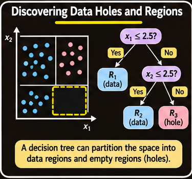

The decision tree provides a rule-based representation of where data occur and where they do not.

### 12.3 Avoiding Explicit Generation of All N Points

Physically adding a large set of uniformly distributed N points would increase the dataset size and computational cost. In high-dimensional spaces, a sufficiently uniform set could require an exponential number of points.

The method therefore computes the number of N points needed at each node rather than explicitly generating every non-existing point.

Suppose the current space contains 25 Y points and 25 conceptual N points. A candidate split $S$ divides a one-dimensional interval of length 10 at position 4.

The expected number of N points on the left is proportional to the fraction of space on that side:

$$
N_{\text{left}}=25\times\frac{4}{10}=10.
$$

The right side receives

$$
N_{\text{right}}=25-10=15.
$$

If the left side contains 3 Y points and the right side contains 22 Y points, the class counts for evaluating the split are:

| Region | Y points | N points |
| --- | ---: | ---: |
| Left | 3 | 10 |
| Right | 22 | 15 |

These counts are sufficient to calculate the class entropy and evaluate information gain for the split.

### 12.4 Entropy and Information Gain

For a node containing classes $Y$ and $N$, entropy measures the uncertainty in the class distribution:

$$
H(E)
=
-\sum_{c\in\{Y,N\}}P(c\mid E)\log_2 P(c\mid E).
$$

If a candidate split divides a node $E$ into child regions $E_1$ and $E_2$, information gain is

$$
IG
=
H(E)
-
\sum_{j=1}^{2}
\frac{|E_j|}{|E|}
H(E_j).
$$

Here, the class probabilities are calculated from the Y and N counts. Since N points are assumed to be uniformly distributed, their counts can be estimated from the fraction of the current region occupied by each child.

The split is useful when it reduces uncertainty about whether a location belongs to a data region or an empty region.

### 12.5 How Many N Points Should a Node Receive?

The method adjusts the conceptual N count at each tree node.

Let a node inherit some number of N points from its parent. The rule is:

1. If the number of inherited N points is less than the number of Y points in the current node, increase the N count so that the node has equal numbers of Y and N points.
2. Otherwise, keep the inherited N count unchanged.

The root begins with zero inherited N points.

For example, suppose a parent node has 1,000 Y points and 1,000 N points. After splitting:

- Left child: 20 Y points and 500 inherited N points.
- Right child: 980 Y points and 500 inherited N points.

At the left child, the inherited N count already exceeds the Y count, so it remains 500. At the right child, the inherited N count is smaller than the Y count, so it is increased to 980.

The rule avoids reducing the N count at a node where N already exceeds Y. Reducing it could allow isolated Y observations to form apparent data regions, making outlier detection and region separation less reliable.

### 12.6 Characteristics and Limitations

The decision-tree approach has several useful properties:

- It represents data and empty regions as **hyper-rectangles**, or rules.
- It can detect outliers automatically: observations lying in an empty region are treated as outliers.
- It may use only a subset of attributes, identifying dimensions that are useful for describing the data regions. This connects to the idea of subspace clustering.

Its main limitation is geometric. A standard decision tree creates axis-parallel splits, so its regions are hyper-rectangles. Irregularly shaped data regions can therefore be difficult to represent accurately.

## 13. Key Ideas to Remember

- **Unsupervised learning** discovers structure without a supplied target attribute.
- **Clustering** groups similar observations and separates dissimilar ones.
- A useful clustering generally has low within-cluster dissimilarity and high between-cluster dissimilarity.
- **K-means** alternates between assigning points to the nearest centroid and recomputing the centroids.
- K-means minimizes a local version of the sum of squared error, but its result depends on initialization.
- K-means is efficient and simple, but requires $k$, is sensitive to outliers and seeds, and favours compact shapes.
- **K-modes** uses modes instead of means for categorical data.
- Cluster summaries may use centroids and spread, frequent categorical values, or frequent words.
- **Gaussian mixture models** represent data as weighted Gaussian components and can express soft membership.
- **Kernel K-means** and **spectral clustering** use nonlinear or eigenvector-based representations to reveal complex structure.
- **Hierarchical clustering** produces a dendrogram. Agglomerative methods merge from the bottom; divisive methods split from the top.
- Linkage choices—single, complete, average, and centroid—change how cluster distances are calculated.
- **DBSCAN** uses $\varepsilon$ and `MinPts` to identify core, border, and noise points. It discovers the number of clusters and can find arbitrary shapes.
- Distance functions must match attribute types: numeric, symmetric binary, asymmetric binary, nominal, or text.
- Standardization prevents attributes with large numeric ranges from dominating distance calculations.
- Mixed attributes can be converted to a common type or combined through normalized per-attribute distances.
- No clustering algorithm is best for every dataset; compare methods and interpret results using application knowledge.
- **Holes** are sparse or empty regions of the data space and can reveal constraints or useful patterns.
- A decision tree can separate observed data regions from conceptual non-existing regions by treating existing and non-existing locations as two classes.
