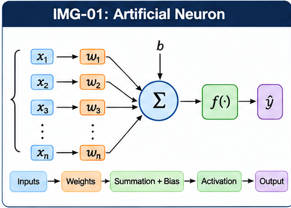
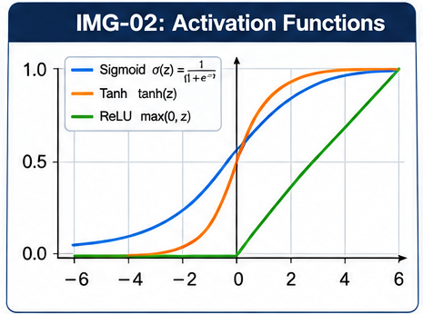
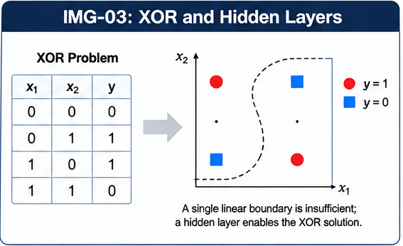
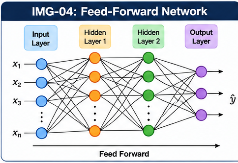
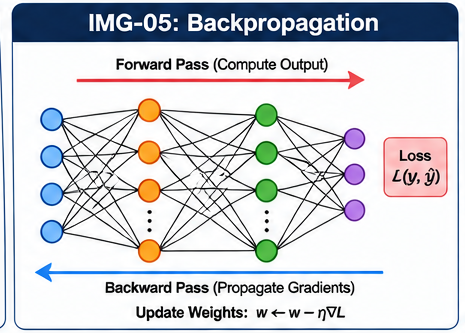
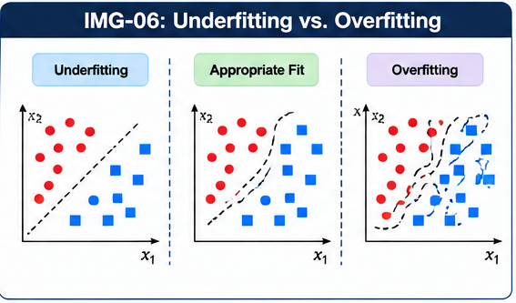
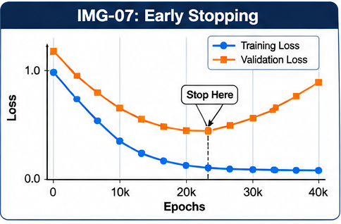
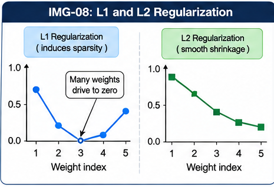
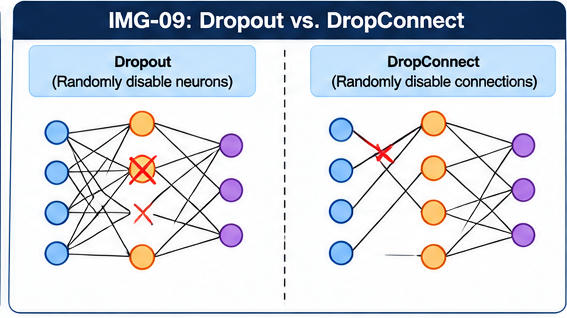

# Neural Networks

Neural networks learn a mapping from inputs to outputs by combining simple computational units called **neurons**. A single neuron can represent only a limited family of functions; arranging neurons into layers and learning their weights allows a network to construct useful intermediate features and represent much more complex relationships.

This chapter follows the lecture's progression from a perceptron and gradient-based learning to multilayer networks, backpropagation, bias terms, and regularization. The two lecture decks use both geometric pictures and equations; the explanations below make their central ideas explicit.

## 1. From biological neurons to artificial neurons

A biological neuron receives signals through dendrites, integrates them in the cell body, and sends signals along its axon. An artificial neuron is only a simplified mathematical analogy: it combines numerical inputs, weights their contributions, adds a bias, and applies an activation function.

For inputs $x_1,\ldots,x_n$, weights $w_1,\ldots,w_n$, and bias $b$, the neuron's pre-activation value is

$$
z = \sum_{i=1}^{n} w_i x_i + b = \mathbf{w}^{\mathsf T}\mathbf{x}+b.
$$

Its output is

$$
a = \phi(z),
$$

where $\phi$ is the **activation function**.

- **Inputs** $x_i$ represent the available features.
- **Weights** $w_i$ determine the strength and sign of each feature's contribution.
- **Bias** $b$ shifts the pre-activation value independently of the input values.
- **Activation** $\phi$ transforms the weighted sum into the neuron's output.

A positive weight makes an input increase $z$ when that input increases; a negative weight makes it decrease $z$. The magnitude of a weight controls the strength of that effect, subject to the activation function and the scales of the inputs.

*Figure 1. Planned visual: inputs flow into a weighted sum, the bias is added, and the activation function produces the output.*

## 2. The perceptron

A **perceptron** is a simple artificial neuron commonly used for binary classification. It computes a weighted sum and applies a threshold-like decision rule. One convention uses outputs in $\{-1,+1\}$:

$$
\hat{y} =
\begin{cases}
+1, & \text{if } \mathbf{w}^{\mathsf T}\mathbf{x}+b > 0,\\
-1, & \text{otherwise}.
\end{cases}
$$

An equivalent convention uses labels $0$ and $1$. These label conventions differ, but the key idea is the same: the sign of the score determines which side of a decision boundary the example lies on.

The decision boundary is the set of points satisfying

$$
\mathbf{w}^{\mathsf T}\mathbf{x}+b=0.
$$

With two input features, this boundary is a line; with three, it is a plane; in higher dimensions, it is a hyperplane. A single perceptron therefore creates a **linear decision boundary**.

### 2.1 The perceptron training rule

The perceptron learns weights from labelled examples. In the $\{-1,+1\}$ convention, a common update for a misclassified training example $(\mathbf{x},y)$ is

$$
\mathbf{w} \leftarrow \mathbf{w}+\eta y\mathbf{x},
\qquad
b \leftarrow b+\eta y,
$$

where $\eta>0$ is the learning rate.

If the example has the correct label, the basic perceptron rule leaves the parameters unchanged. If it is misclassified, the update shifts the score in the direction that favours the correct label:

- for a positive example ($y=+1$), the update increases its score;
- for a negative example ($y=-1$), the update decreases its score.

The rule is simple, but it does not minimize a smooth differentiable loss in the same way as gradient descent. The classical perceptron convergence guarantee applies when the training data are linearly separable; it does not guarantee a solution for data that cannot be separated by one hyperplane.

## 3. Gradient descent and the delta rule

The perceptron uses a hard threshold. To derive a gradient-based learning rule, the lecture considers an **unthresholded linear unit** whose output is

$$
o(\mathbf{x})=\mathbf{w}^{\mathsf T}\mathbf{x}.
$$

For a training set $D$ containing examples $(\mathbf{x}_d,t_d)$, define the squared-error objective

$$
E(\mathbf{w})=\frac{1}{2}\sum_{d\in D}(t_d-o_d)^2,
$$

where $t_d$ is the target and $o_d=\mathbf{w}^{\mathsf T}\mathbf{x}_d$ is the model output. The factor $\frac12$ is included because it cancels the factor of $2$ produced when differentiating a square.

### 3.1 What the gradient tells us

The gradient collects the partial derivatives of the error with respect to all weights:

$$
\nabla_{\mathbf{w}}E =
\left[
\frac{\partial E}{\partial w_1},
\frac{\partial E}{\partial w_2},
\ldots,
\frac{\partial E}{\partial w_n}
\right]^{\mathsf T}.
$$

The gradient points in the direction of steepest local increase of the objective. Therefore, moving in the **negative gradient direction** reduces the objective locally. Standard gradient descent updates the weights by

$$
\mathbf{w}\leftarrow\mathbf{w}-\eta\nabla_{\mathbf{w}}E.
$$

The learning rate $\eta$ controls the step size. If it is too small, learning may be slow; if it is too large, updates may overshoot and fail to settle.

### 3.2 Deriving the delta-rule update

For one weight $w_i$,

$$
\begin{aligned}
\frac{\partial E}{\partial w_i}
&=\frac{\partial}{\partial w_i}
  \left[\frac12\sum_{d\in D}(t_d-o_d)^2\right]\\
&=-\sum_{d\in D}(t_d-o_d)
  \frac{\partial o_d}{\partial w_i}.
\end{aligned}
$$

Since $o_d=\sum_i w_i x_{di}$, we have $\frac{\partial o_d}{\partial w_i}=x_{di}$. Thus,

$$
\frac{\partial E}{\partial w_i}
=-\sum_{d\in D}(t_d-o_d)x_{di}.
$$

Substituting this into gradient descent gives

$$
\Delta w_i=\eta\sum_{d\in D}(t_d-o_d)x_{di},
\qquad
w_i\leftarrow w_i+\Delta w_i.
$$

This is the **delta rule** for the linear unit under the summed squared-error convention above. It changes each weight in proportion to the prediction error and the corresponding input feature. A bias can be treated as a weight connected to a constant input $x_0=1$, so its update follows the same logic.

The lecture's displayed expressions use a sum over training examples. In practical neural-network training, the sum may instead be averaged over a mini-batch; that changes the gradient scale and should be reflected consistently in the learning rate.

## 4. Activation functions

An activation function determines how a neuron's pre-activation score becomes its output. In a multilayer network, nonlinear activations are essential: stacking only linear transformations still produces an overall linear transformation and cannot create nonlinear decision boundaries.

### 4.1 Sigmoid

The logistic sigmoid is

$$
\sigma(z)=\frac{1}{1+e^{-z}}.
$$

It maps any real input to a value strictly between $0$ and $1$. It is smooth and can be interpreted as a probability-like output in suitable binary classification models.

Its derivative is

$$
\sigma'(z)=\sigma(z)\bigl(1-\sigma(z)\bigr).
$$

The derivative is largest at $z=0$ and becomes small when the sigmoid saturates near $0$ or $1$. In deep networks, repeated multiplication by small derivatives can contribute to the **vanishing-gradient problem**.

### 4.2 Hyperbolic tangent

The hyperbolic tangent activation is

$$
\tanh(z)=\frac{e^z-e^{-z}}{e^z+e^{-z}}.
$$

It maps real inputs to $(-1,1)$ and is zero-centred. Like sigmoid, it saturates for large positive or negative inputs and can have small derivatives in those regions.

### 4.3 ReLU

The **rectified linear unit (ReLU)** is

$$
\operatorname{ReLU}(z)=\max(0,z).
$$

It returns zero for negative inputs and the input itself for positive inputs. ReLU is computationally simple and does not saturate on its positive side, which often makes it useful in hidden layers. However, a unit that remains in the negative region can receive zero gradient and stop updating through that activation; this is commonly called a “dead ReLU.”

| Activation | Output range | Main property | Important limitation |
| --- | --- | --- | --- |
| Sigmoid | $(0,1)$ | Smooth, probability-like output | Saturation and small gradients at extremes |
| Tanh | $(-1,1)$ | Smooth and zero-centred | Saturation and small gradients at extremes |
| ReLU | $[0,\infty)$ | Simple; non-saturating for positive inputs | Zero gradient for negative inputs |

*Figure 2. Planned visual: plot all three functions with labelled axes and their characteristic ranges.*

## 5. Why multilayer networks are needed: the XOR problem

A single perceptron can separate classes only when one linear boundary can divide them. Some classification tasks do not have that property.

For the XOR function, the output is $1$ when the two binary inputs differ and $0$ when they are equal:

| $x_1$ | $x_2$ | XOR$(x_1,x_2)$ |
| --- | --- | --- |
| 0 | 0 | 0 |
| 0 | 1 | 1 |
| 1 | 0 | 1 |
| 1 | 1 | 0 |

The two positive cases occupy opposite corners of the input square, as do the two negative cases. No single straight line can separate the positive cases from both negative cases. This is why a single linear perceptron cannot solve XOR.

A hidden layer can construct intermediate features or boundaries. For example, XOR can be written using logical operations as

$$
x_1\operatorname{XOR}x_2
=(x_1\operatorname{OR}x_2)\operatorname{AND}
\neg(x_1\operatorname{AND}x_2).
$$

A neural network learns a numerical analogue of this composition: earlier units respond to useful patterns, and later units combine their responses. The point is not that the network must explicitly use these logic gates, but that multiple units can combine simpler boundaries into a nonlinear overall boundary.

*Figure 3. Planned visual: show the four XOR points and explain how intermediate hidden units permit a nonlinear separation.*

## 6. Feed-forward layered networks

A **feed-forward neural network** maps an input vector $\mathbf{x}$ to an output vector $\mathbf{y}$ through successive layers. Information moves from the input layer through zero or more hidden layers to the output layer; there are no feedback connections in the basic feed-forward architecture.

For layer $\ell$, a standard formulation is

$$
\mathbf{z}^{(\ell)}
=\mathbf{W}^{(\ell)}\mathbf{a}^{(\ell-1)}
+\mathbf{b}^{(\ell)},
\qquad
\mathbf{a}^{(\ell)}=\phi^{(\ell)}(\mathbf{z}^{(\ell)}),
$$

where $\mathbf{a}^{(0)}=\mathbf{x}$, $\mathbf{W}^{(\ell)}$ is the layer's weight matrix, $\mathbf{b}^{(\ell)}$ is its bias vector, and $\phi^{(\ell)}$ is its activation function. The final layer produces the prediction.

The layers have different roles:

- **Input layer:** holds the features supplied to the model.
- **Hidden layers:** transform the representation. They can detect combinations of input features and build progressively more useful representations.
- **Output layer:** converts the final representation into the required prediction, such as a class score, probability, or numerical value.

The lecture's geometric intuition is that early layers can create simple linear boundaries, later layers can combine these boundaries, and the full network can form complex nonlinear decision regions. The layers do not literally need to draw visible lines; this is a geometric way to understand the functions they compute.

### 6.1 Width, depth, and function approximation

**Width** is the number of units in a layer; **depth** is the number of layers. Increasing width gives a layer more units with which to represent features. Increasing depth lets the network compose transformations across stages.

A one-hidden-layer ReLU network can build a piecewise-linear function. In one dimension, a schematic representation is

$$
f(x)\approx a_0+a_1x+\sum_{k=1}^{m}a_k\operatorname{ReLU}(x-c_k),
$$

where each $c_k$ is a location at which a unit can introduce a change in slope. More hidden units can introduce more such “kinks,” allowing a closer approximation to a target function. This is the intuition behind the lecture's comparison of networks with 3, 6, and 20 hidden ReLU units.

For suitable conditions, sufficiently wide neural networks can approximate continuous functions on compact domains. This is an expressiveness result, not a guarantee that training will find the required weights or that a larger network will generalize better.

The lecture also illustrates classification accuracy rising as the number of hidden units increases in one illustrative run, while noting that more units do not guarantee better test accuracy. That caveat matters: capacity can improve the fit, but the effect on unseen data depends on training, data quality, and regularization.

*Figure 4. Planned visual: a labelled layered network, with arrows showing forward computation and bias terms associated with neurons.*

## 7. Training a multilayer network with backpropagation

A network is trained by adjusting its weights and biases to reduce a loss function on examples. **Backpropagation** efficiently computes how the loss changes with every parameter by applying the chain rule from the output layer back through the hidden layers. An optimizer, such as gradient descent, then uses those derivatives to update the parameters.

Backpropagation is not itself the optimizer. It computes gradients; gradient descent or another optimization method uses them.

### 7.1 Forward pass

For a training example, compute the activation of each layer in order:

$$
\mathbf{z}^{(\ell)}
=\mathbf{W}^{(\ell)}\mathbf{a}^{(\ell-1)}
+\mathbf{b}^{(\ell)}, \qquad
\mathbf{a}^{(\ell)}=\phi^{(\ell)}(\mathbf{z}^{(\ell)}).
$$

The final activation is the prediction. Compare it with the target using the chosen loss function.

### 7.2 Backward pass: the chain rule

Let $L$ be the loss for one example. Define the error signal for layer $\ell$ as

$$
\boldsymbol{\delta}^{(\ell)}
=\frac{\partial L}{\partial \mathbf{z}^{(\ell)}}.
$$

For an output layer, the exact expression depends on the output activation and loss. For a component-wise activation with a compatible loss, it can be written as the derivative of the loss with respect to the activation multiplied by the activation derivative.

For a hidden layer, the error signal is propagated backward:

$$
\boldsymbol{\delta}^{(\ell)}
=\left((\mathbf{W}^{(\ell+1)})^{\mathsf T}
\boldsymbol{\delta}^{(\ell+1)}\right)
\odot \phi'^{(\ell)}(\mathbf{z}^{(\ell)}),
$$

where $\odot$ denotes element-wise multiplication. This equation combines two effects: how the next layer depends on this layer, and how sensitive this layer's activation is to its pre-activation.

The gradients for the parameters of layer $\ell$ are

$$
\frac{\partial L}{\partial \mathbf{W}^{(\ell)}}
=\boldsymbol{\delta}^{(\ell)}
(\mathbf{a}^{(\ell-1)})^{\mathsf T},
\qquad
\frac{\partial L}{\partial \mathbf{b}^{(\ell)}}
=\boldsymbol{\delta}^{(\ell)}.
$$

These equations express an important pattern: a weight's gradient depends on the error signal at the receiving unit and the activation coming from the sending unit. Gradients over a batch are combined according to the loss reduction convention (sum or mean).

### 7.3 Parameter update

For basic gradient descent, the update is

$$
\mathbf{W}^{(\ell)}
\leftarrow \mathbf{W}^{(\ell)}
-\eta\frac{\partial L}{\partial\mathbf{W}^{(\ell)}},
\qquad
\mathbf{b}^{(\ell)}
\leftarrow \mathbf{b}^{(\ell)}
-\eta\frac{\partial L}{\partial\mathbf{b}^{(\ell)}}.
$$

The full training cycle is:

1. Take a training example or mini-batch.
2. Run the forward pass and compute the predictions.
3. Evaluate the loss.
4. Backpropagate the loss to compute gradients.
5. Update the weights and biases.
6. Repeat over the data and across training epochs.

An **epoch** is one complete pass through the training dataset. More epochs can reduce training loss, but they do not necessarily improve performance on unseen data.

*Figure 5. Planned visual: forward arrows carry activations toward the output; backward arrows carry error gradients toward earlier layers.*

## 8. Bias terms in neural networks

A neuron's bias is an additive parameter:

$$
z=\mathbf{w}^{\mathsf T}\mathbf{x}+b.
$$

It allows the activation or decision boundary to shift without requiring the input features themselves to change. Without a bias, a linear decision boundary must pass through the origin; with a bias, it can be placed elsewhere.

For a sigmoid neuron,

$$
a=\sigma(\mathbf{w}^{\mathsf T}\mathbf{x}+b),
$$

changing the weights affects the slope and orientation of the transition in input space, while changing the bias shifts where the transition occurs. In a one-dimensional plot, varying $w$ changes how steeply the sigmoid rises (and a negative weight reverses its direction); varying $b$ moves the curve horizontally. More precisely, the sigmoid midpoint occurs when $\mathbf{w}^{\mathsf T}\mathbf{x}+b=0$.

### 8.1 One bias per neuron, not one shared scalar for an entire layer

The continuation lecture compares “one bias per layer” with “one bias per node.” Its displayed formulas are visually ambiguous, but the standard layer formulation is clear: a layer with $m$ neurons normally has a bias vector with one learned bias per neuron,

$$
\mathbf{z}=\mathbf{W}\mathbf{x}+\mathbf{b},
\qquad
\mathbf{b}\in\mathbb{R}^{m}.
$$

Each neuron can therefore shift its own activation threshold. A shared scalar bias for all neurons is a more constrained design and is not the usual dense-layer convention. The phrase “one bias per layer” can sometimes mean a *bias vector attached to the layer*, rather than one scalar shared by all its nodes; this distinction resolves the terminology without assuming that the slide's ambiguous notation is definitive.

## 9. Training error, generalization, and model fit

The model should learn patterns that transfer to unseen examples, not simply memorize the training set. Training and validation/test losses help diagnose whether additional training is useful.

- **Underfitting:** the model is too limited, insufficiently trained, or otherwise unable to capture the underlying pattern. Training error and validation error are often both high.
- **Appropriate fit:** the model captures meaningful structure and performs well on unseen examples.
- **Overfitting:** the model fits noise or peculiarities of the training data. Training loss may continue to decrease while validation loss begins to rise.

*Figure 6. Planned visual: show an overly simple boundary, a useful boundary, and a highly irregular boundary that follows noise.*

### 9.1 The bias–variance trade-off

The lecture illustrates error as model capacity increases. A useful qualitative interpretation is:

- **Bias** reflects error from assumptions or a model that is too restrictive. It is often high in the underfitting region.
- **Variance** reflects sensitivity to the particular training sample. It often increases as model flexibility grows.
- **Generalization error** reflects performance on new data and often reaches its best level at an intermediate capacity.

This is a conceptual pattern, not a universal guarantee that each curve has a particular shape. The best capacity depends on the data, training procedure, and evaluation metric.

### 9.2 Early stopping

The training deck's early-stopping plot shows training loss continuing to fall while validation loss eventually begins to rise. **Early stopping** uses validation performance to decide when to stop training.

A typical procedure is:

1. Train for an epoch.
2. Evaluate loss or a chosen metric on a separate validation set.
3. Keep a copy of the parameters whenever validation performance improves.
4. Stop after validation performance fails to improve for a chosen patience period, and restore the best saved parameters.

The validation set is used to select the stopping point; the test set should be reserved for final evaluation. Early stopping limits how far the model adapts to the training data and acts as a form of regularization.

*Figure 7. Planned visual: training loss falls; validation loss falls and then rises; mark the best validation point.*

## 10. Regularization: balancing fit and complexity

Minimizing training loss alone is called **empirical risk minimization**. A flexible model can achieve low training loss while generalizing poorly. **Regularization** expresses a preference for models with certain properties—often smaller weights or simpler effective behaviour—by adding a penalty to the training objective.

A general regularized objective is

$$
J(\mathbf{w},b)
=\sum_{i=1}^{n} \ell(y_i,\hat{y}_i)
+\lambda R(\mathbf{w}),
$$

where $\ell$ is the per-example loss, $R$ is a regularization penalty, and $\lambda\geq 0$ controls the strength of the penalty. If $\lambda=0$, the penalty has no effect. Increasing $\lambda$ places more emphasis on the penalty and may reduce overfitting, but too much regularization can cause underfitting.

The continuation lecture describes this as minimizing loss plus complexity, or **structural risk minimization**. It motivates the penalty by noting that very large weights can make predictions sensitive to small feature changes and can allow a model to rely excessively on particular features. Regularization does not guarantee that every large weight is bad; it encodes a useful preference that is often helpful for generalization.

The exact scale of the loss term matters. Some objectives use a sum over examples and others use an average; $\lambda$ must be interpreted relative to that convention.

## 11. L1 regularization

The **L1 penalty** is the sum of absolute weight values:

$$
R_{1}(\mathbf{w})=\|\mathbf{w}\|_1=\sum_{j}|w_j|.
$$

The regularized objective is

$$
J(\mathbf{w},b)=\sum_{i=1}^{n}\ell(y_i,\hat{y}_i)
+\lambda\sum_j|w_j|.
$$

For nonzero $w_j$, the derivative of $|w_j|$ is $\operatorname{sign}(w_j)$. A gradient-descent step for a differentiable data loss therefore has the form

$$
w_j\leftarrow w_j-\eta\left(
\frac{\partial L_{\text{data}}}{\partial w_j}
+\lambda\operatorname{sign}(w_j)\right).
$$

The absolute-value penalty is not differentiable at zero; implementations handle this using subgradients or proximal methods. Intuitively, L1 pushes weights toward zero and can produce **sparse** solutions in which some weights are exactly zero. This makes it useful when feature selection or a sparse parameterization is desired.

The lecture shows an update for an exponential loss, $\exp[-y_i(\mathbf{w}\cdot\mathbf{x}_i+b)]$, with binary labels conventionally represented by $y_i\in\{-1,+1\}$. Under that particular loss, the data-loss gradient contributes terms proportional to $-y_i x_{ij}\exp[-y_i(\mathbf{w}\cdot\mathbf{x}_i+b)]$; the L1 term contributes $\lambda\operatorname{sign}(w_j)$. This is one loss choice, not the definition of L1 regularization itself.

## 12. L2 regularization

The **L2 penalty** is the sum of squared weights:

$$
R_{2}(\mathbf{w})=\|\mathbf{w}\|_2^2=\sum_j w_j^2.
$$

The regularized objective is

$$
J(\mathbf{w},b)=\sum_{i=1}^{n}\ell(y_i,\hat{y}_i)
+\lambda\sum_j w_j^2.
$$

Because $\frac{\partial}{\partial w_j}w_j^2=2w_j$, the update under this exact convention is

$$
w_j\leftarrow w_j-\eta\left(
\frac{\partial L_{\text{data}}}{\partial w_j}
+2\lambda w_j\right).
$$

Some texts define the penalty as $\frac12\sum_jw_j^2$; that convention removes the factor of $2$. These are equivalent after rescaling $\lambda$. L2 regularization is also called **weight decay** in common settings. It discourages large weights and generally shrinks many weights toward zero without usually making them exactly zero.

The lecture's continuation material calls L2 “Ridge regression (Tikhonov regularization).” Ridge regression is the corresponding squared-error linear-model case; L2 penalties are also used in neural networks with other loss functions.

## 13. L1 vs. L2 and Elastic Net

| Property | L1 regularization | L2 regularization |
| --- | --- | --- |
| Penalty | $\sum_j |w_j|$ | $\sum_j w_j^2$ |
| Typical effect | Can set some weights exactly to zero | Shrinks weights smoothly toward zero |
| Useful when | Sparsity or feature selection is important | Limiting large weights and sharing influence across many features is useful |
| Mathematical behaviour | Nondifferentiable at zero | Smooth and differentiable |

The choice depends on the task, the parameterization, and empirical validation; neither method is universally best. In deep learning, L2-style weight decay is common, while L1 can be useful when sparse weights are an explicit goal.

**Elastic Net** combines the two penalties:

$$
R_{\text{EN}}(\mathbf{w})
=\alpha\|\mathbf{w}\|_1+(1-\alpha)\|\mathbf{w}\|_2^2,
\qquad 0\leq\alpha\leq1,
$$

with the relative scaling adjustable by convention. The L1 part encourages sparsity; the L2 part provides smooth shrinkage. This combines aspects of both approaches rather than guaranteeing that it will outperform either one.

*Figure 8. Planned visual: a conceptual comparison of L1's tendency toward sparse coefficients and L2's smooth shrinkage; label it as illustrative, not as measured data.*

## 14. Dropout and DropConnect

Weight penalties constrain parameter values. **Dropout** instead regularizes the network by randomly omitting activations during training. On each training pass, some units are temporarily disabled according to a dropout probability. The network must therefore learn representations that do not rely too heavily on any single unit.

At inference time, dropout is disabled and the trained network is evaluated using the framework's corresponding scaling convention. Common implementations use *inverted dropout*, scaling retained activations during training so no additional scaling is needed at inference.

The lecture describes dropout as randomly dropping nodes at every iteration and as making training behave like an ensemble of many models. The ensemble intuition is useful: different random subnetworks are trained across updates, while inference uses the shared learned parameters rather than explicitly evaluating every subnetwork.

**DropConnect** is related but operates on connections/weights rather than dropping whole unit activations: individual weights are randomly masked during training. The continuation deck names DropConnect but does not provide enough detail to establish a particular implementation or equation, so it is treated here only at this conceptual level.

| Method | What is penalized or removed? | Main idea |
| --- | --- | --- |
| L1 | Absolute weight magnitudes | Encourage sparse weights |
| L2 | Squared weight magnitudes | Discourage large weights smoothly |
| Dropout | Unit activations, randomly during training | Reduce co-adaptation and reliance on individual units |
| DropConnect | Individual connections/weights, randomly during training | Regularize by masking connections |

*Figure 9. Planned visual: show a full network, a training pass with some units omitted for dropout, and a separate pass with individual connections masked for DropConnect.*

## 15. Putting the ideas together

The concepts in these lectures form a single training story:

1. A neuron computes a weighted sum plus a bias, then applies an activation.
2. A perceptron uses a threshold to produce a linear decision boundary and can be trained with the perceptron update rule.
3. Gradient descent minimizes a differentiable loss by moving parameters opposite its gradient; the delta rule is the linear-unit squared-error case.
4. Nonlinear activations and multiple layers let a network represent relationships, such as XOR, that a single linear boundary cannot capture.
5. Backpropagation applies the chain rule efficiently to calculate gradients throughout the network.
6. Training for more epochs can improve training fit but may eventually harm validation performance.
7. Early stopping, L1/L2 penalties, dropout, and related methods help control overfitting in different ways.

A useful practical principle is to distinguish **capacity**, **optimization**, and **generalization**. Capacity describes what a network could represent; optimization describes whether training finds useful parameters; generalization describes how well the trained model performs on new data. Increasing network size changes capacity, but it does not automatically solve optimization difficulties or improve generalization.

## 16. Important distinctions to remember

- **Bias parameter vs. statistical bias:** the neural-network bias $b$ is an additive parameter in a neuron's pre-activation. It is not the same concept as “bias” in the bias–variance trade-off.
- **Backpropagation vs. gradient descent:** backpropagation computes gradients; gradient descent uses gradients to update parameters.
- **Training loss vs. validation loss:** training loss measures fit to training examples; validation loss helps estimate generalization during model selection.
- **More units vs. better test performance:** more units increase representational capacity but may also increase overfitting risk.
- **L1 vs. L2:** L1 tends to encourage exact zeros; L2 tends to shrink weights smoothly.
- **Dropout vs. DropConnect:** dropout masks activations; DropConnect masks connections/weights.

The source slides do not specify every detail of the multilayer XOR construction or the full DropConnect algorithm. The explanations above give the standard conceptual account without attributing an unshown numerical construction to the lecture.
