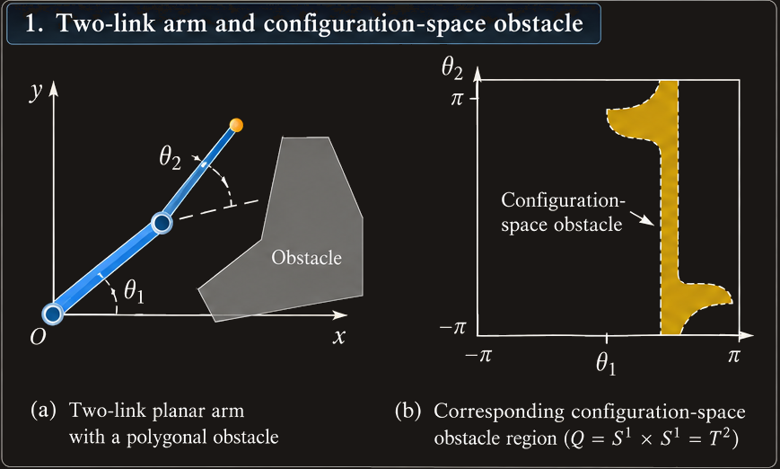
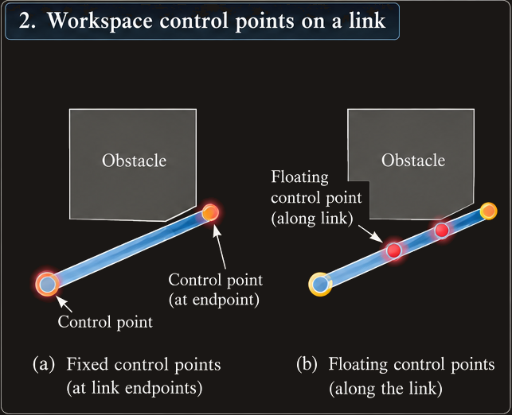
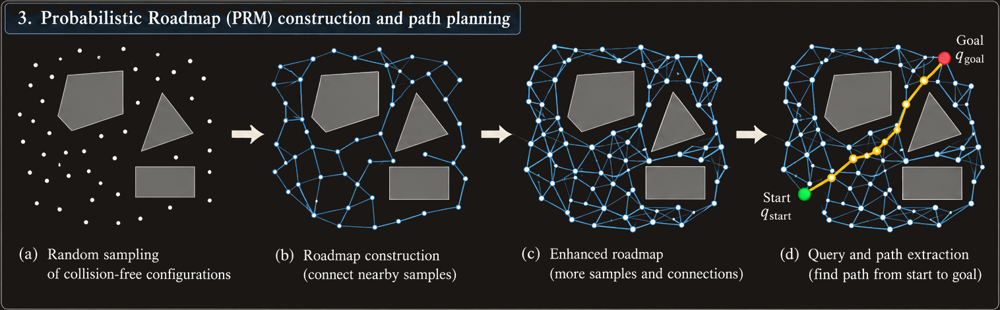

# Path Planning and Collision Avoidance

## 1. Motivation and learning objectives

Robot kinematics answers where the robot's links and end effector will be for a given set of joint variables. It does not, by itself, establish whether the robot can move between two configurations without hitting an obstacle. **Path planning** addresses this geometric problem: given an initial configuration and a goal configuration, find a continuous collision-free path between them.

This chapter develops the course's main progression:

1. Represent the robot and its obstacles in **configuration space**.
2. Use artificial potential fields to attract the robot toward its goal and repel it from obstacles.
3. Define potentials in the workspace when computing configuration-space distances is too difficult.
4. Map workspace forces to joint-space forces or torques with Jacobians.
5. Use random motion to escape local minima.
6. Build a **probabilistic roadmap (PRM)** that can be reused for multiple queries in the same environment.

The focus is geometric planning. A planned path is a sequence or continuous curve of configurations; converting it into a smooth, time-parameterized trajectory and generating motor torques are separate tasks.

## 2. Configuration space

### 2.1 Configuration and configuration space

A **configuration** specifies the position and orientation of every point of the robot. For a robot with joint variables collected in a vector \(q\), the joint vector is a convenient representation of its configuration. The set of all possible configurations is the **configuration space**, denoted \(Q\).

Examples:

- A one-link planar revolute arm has \(Q=S^1\): its configuration is one angle, \(\theta_1\).
- A two-link planar revolute arm has \(Q=S^1\times S^1=T^2\), parameterized by \((\theta_1,\theta_2)\).
- A three-axis Cartesian arm has \(Q=\mathbb{R}^3\), parameterized by \((x,y,z)\).
- A rigid body moving and rotating in a plane can be represented by \(q=(x,y,\theta)\), with \(Q=\mathbb{R}^2\times SO(2)\).

The configuration space is not necessarily ordinary Euclidean space. Revolute angles wrap around, and different joint types impose different geometry and constraints.

### 2.2 Configuration-space obstacles

Let \(A\) denote the robot, \(A(q)\) the region of workspace occupied by the robot at configuration \(q\), \(O_i\) the workspace obstacles, and \(O=\bigcup_i O_i\) their union. A configuration is in collision when the robot and an obstacle intersect:

$$
A(q)\cap O\ne\varnothing.
$$

The **configuration-space obstacle set** is

$$
Q_O=\{q\in Q\mid A(q)\cap O\ne\varnothing\},
$$

and the **free configuration space** is

$$
Q_{\mathrm{free}}=Q\setminus Q_O.
$$

This transformation is conceptually powerful: instead of moving an extended robot around obstacles, imagine the robot as a point moving through \(Q\), while obstacles become forbidden regions in that space. The forbidden regions account for the robot's size and shape, not just the obstacle locations.

A collision-free path from \(q_{\mathrm{init}}\) to \(q_{\mathrm{final}}\) is a continuous map

$$
\tau:[0,1]\rightarrow Q_{\mathrm{free}},
\qquad
\tau(0)=q_{\mathrm{init}},\quad
\tau(1)=q_{\mathrm{final}}.
$$

In practice, a planner often returns discrete set points \(q_0,q_1,\ldots,q_k\). A later trajectory-generation stage can interpolate and smooth these points.

### 2.3 Constructing configuration-space obstacles

For a translating rigid polygonal robot and a polygonal obstacle, the configuration-space obstacle can be constructed geometrically from the robot and obstacle shapes. Intuitively, translate the robot through all placements that could produce contact; the corresponding robot-origin positions form the boundary of the forbidden region. For convex polygons, the construction can be based on vertex-edge contact relationships. With multiple obstacles, take the union of the individual configuration-space obstacle regions. A nonconvex obstacle can be decomposed into convex pieces, transformed separately, and then recombined.

For articulated robots, the mapping is more difficult. For example, a two-link planar arm's obstacle region lives in the \((\theta_1,\theta_2)\) space. A grid approximation can test each cell for collision and shade the colliding cells, but this is only an approximation.

The difficulty grows rapidly with the number of degrees of freedom. If each dimension is discretized into \(k\) intervals, an \(n\)-dimensional grid has on the order of \(k^n\) cells. This dimensional growth is a key reason to use search-based and randomized methods rather than explicitly constructing all of \(Q_{\mathrm{free}}\).

**Visual placeholder:** The source chapter's illustration of a two-link arm and its configuration-space obstacle is useful for showing how workspace collision regions become forbidden regions in joint-angle space.

## 3. Artificial potential fields in configuration space

### 3.1 Basic idea

An artificial potential field assigns a scalar potential \(U(q)\) to each configuration. The goal attracts the robot, while obstacles repel it. The total field is additive:

$$
U(q)=U_{\mathrm{att}}(q)+U_{\mathrm{rep}}(q).
$$

The negative gradient is interpreted as a force that points in the direction of steepest decrease:

$$
F(q)=-\nabla U(q)
=-\nabla U_{\mathrm{att}}(q)-\nabla U_{\mathrm{rep}}(q).
$$

Planning then becomes an optimization-like search: start at \(q_{\mathrm{init}}\) and repeatedly move in the direction of the resultant force.

### 3.2 Attractive potential

Let \(\rho_f(q)=\|q-q_{\mathrm{final}}\|\) be the distance to the goal. A simple quadratic or parabolic-well potential is

$$
U_{\mathrm{att}}(q)=\frac{1}{2}\zeta\rho_f(q)^2
=\frac{1}{2}\zeta\|q-q_{\mathrm{final}}\|^2,
$$

where \(\zeta>0\) scales the attraction. Its gradient and attractive force are

$$
\nabla U_{\mathrm{att}}(q)=\zeta(q-q_{\mathrm{final}}),
$$

$$
F_{\mathrm{att}}(q)=-\zeta(q-q_{\mathrm{final}}).
$$

The force points toward the goal and its magnitude grows linearly with distance. Close to the goal, the force tends smoothly to zero, which is preferable to a constant-magnitude force with a discontinuity at the goal. Far from the goal, however, the quadratic force can become very large.

A useful alternative combines a quadratic field near the goal with a conic (linear-in-distance) field farther away. For threshold \(d>0\),

$$
U_{\mathrm{att}}(q)=
\begin{cases}
\frac{1}{2}\zeta\rho_f(q)^2, & \rho_f(q)\le d,\\
\zeta d\rho_f(q)-\frac{1}{2}\zeta d^2, & \rho_f(q)>d.
\end{cases}
$$

The two pieces agree in value and gradient at \(\rho_f=d\). Thus attraction is smooth at the transition while its magnitude does not grow without bound with distance.

### 3.3 Repulsive potential

Let \(\rho(q)\) be the shortest distance from \(q\) to the nearest configuration-space obstacle boundary. Let \(\rho_0>0\) be the obstacle's distance of influence and \(\eta>0\) its repulsion gain. The repulsive potential is

$$
U_{\mathrm{rep}}(q)=
\begin{cases}
\frac{1}{2}\eta\left(\frac{1}{\rho(q)}-\frac{1}{\rho_0}\right)^2,
& \rho(q)\le \rho_0,\\
0, & \rho(q)>\rho_0.
\end{cases}
$$

The potential grows as the robot approaches the obstacle and is zero outside the influence distance. Within the influence region, its negative gradient is

$$
F_{\mathrm{rep}}(q)=
\eta\left(\frac{1}{\rho(q)}-\frac{1}{\rho_0}\right)
\frac{1}{\rho(q)^2}\nabla\rho(q),
$$

and it is zero when \(\rho(q)>\rho_0\). For a smooth, convex obstacle region, if \(b\) is the closest point on its boundary, then

$$
\rho(q)=\|q-b\|,
\qquad
\nabla\rho(q)=\frac{q-b}{\|q-b\|}.
$$

This gradient points from the obstacle boundary toward the current configuration, so the repulsive force points away from the obstacle.

For nonconvex obstacle sets, the nearest boundary point may change abruptly as \(q\) moves. Consequently, \(\rho\) may fail to be differentiable everywhere and the repulsive force can be discontinuous. One simple practical response described in the course is to avoid overlapping influence regions of distinct obstacles where possible.

### 3.4 Gradient-descent planner

At iteration \(i\), evaluate the resultant force and take a step in its normalized direction:

$$
q_{i+1}=q_i+\alpha_i\frac{F(q_i)}{\|F(q_i)\|}.
$$

Here \(\alpha_i\) is the step size. It must be small enough to avoid stepping across an obstacle, but large enough to avoid excessive computation. In implementation, a stopping tolerance is more practical than exact equality:

$$
\|q_i-q_{\mathrm{final}}\|<\varepsilon.
$$

**Algorithm**

1. Initialize \(q_0=q_{\mathrm{init}}\).
2. Evaluate the attractive and repulsive forces at \(q_i\).
3. If the goal tolerance is met, return the sequence of configurations.
4. Otherwise, advance a step along the normalized resultant force.
5. Repeat until the goal is reached or a failure/stagnation condition is detected.

Potential-field methods are simple and often fast, but the resultant field can have a **local minimum** away from the goal. At such a point the forces balance and gradient descent stops even though a valid path may exist. Thus convergence to a minimum does not guarantee arrival at the goal.

## 4. Potential fields defined in the workspace

### 4.1 Why work in the workspace?

Computing the distance to configuration-space obstacles and its gradient can be difficult for articulated robots. Workspace distances in two or three dimensions are often easier to calculate. The alternative is to place artificial potentials on selected points of the robot in workspace \(W\), then map the induced forces back to the joints.

A robot arm has finite volume, so evaluating a field over every point of every link would be costly. Instead, choose **control points**. For attractive fields, these might be link centers or the origins of the robot's Denavit–Hartenberg frames (excluding the fixed base frame). For repulsion, choose fixed points on the robot and, when needed, additional floating points near the obstacle.

### 4.2 Workspace attractive fields

Let \(a_i(q)\) be the workspace position of attractive control point \(i\). Its target position is \(a_i(q_{\mathrm{final}})\). Define

$$
r_i(q)=\|a_i(q)-a_i(q_{\mathrm{final}})\|.
$$

A quadratic-near/conic-far potential for this point is

$$
U_{\mathrm{att},i}(q)=
\begin{cases}
\frac{1}{2}\zeta_i r_i(q)^2, & r_i(q)\le d,\\
\zeta_i d r_i(q)-\frac{1}{2}\zeta_i d^2, & r_i(q)>d.
\end{cases}
$$

The corresponding workspace force is

$$
F_{\mathrm{att},i}(q)=
\begin{cases}
-\zeta_i\left(a_i(q)-a_i(q_{\mathrm{final}})\right), & r_i(q)\le d,\\
-\zeta_i d\frac{a_i(q)-a_i(q_{\mathrm{final}})}{r_i(q)}, & r_i(q)>d.
\end{cases}
$$

When a sufficiently informative set of independent control points reaches its target positions, the robot reaches the desired configuration. Control-point selection matters: a set that does not adequately represent the robot's geometry or configuration may fail to determine the intended pose.

### 4.3 Workspace repulsive fields and floating points

For a repulsive control point \(a_j(q)\), let \(\rho(a_j(q))\) be its shortest distance to any workspace obstacle. Use the same inverse-distance potential form:

$$
U_{\mathrm{rep},j}(q)=
\begin{cases}
\frac{1}{2}\eta_j\left(\frac{1}{\rho(a_j(q))}-\frac{1}{\rho_0}\right)^2,
& \rho(a_j(q))\le\rho_0,\\
0, & \rho(a_j(q))>\rho_0.
\end{cases}
$$

Its repulsive force is

$$
F_{\mathrm{rep},j}(q)=
\eta_j\left(\frac{1}{\rho(a_j(q))}-\frac{1}{\rho_0}\right)
\frac{1}{\rho(a_j(q))^2}\nabla\rho(a_j(q)).
$$

If \(b\) is the closest point on the obstacle boundary, then

$$
\nabla\rho(x)\big|_{x=a_j(q)}
=\frac{a_j(q)-b}{\|a_j(q)-b\|}.
$$

A critical limitation is that a sparse set of fixed control points cannot guarantee collision avoidance. The endpoints of a link may be far from an obstacle while the link's middle intersects it. A **floating repulsive control point** is placed at the point on a link boundary closest to an obstacle; its position changes with configuration. This point can detect and respond to the otherwise-missed near-contact.

Even with floating points, the planned motion should be checked for collisions; a finite set of sampled points is an approximation to the full robot geometry.

## 5. Mapping workspace forces to joint forces and torques

Workspace forces must be converted into forces and torques on the robot's joints before they can drive a configuration-space update.

### 5.1 Derivation using virtual work

Let \(F_w\) be a workspace force applied at a control point and let \(F_q\) be the corresponding generalized joint force vector (torques for revolute joints and forces for prismatic joints). For a virtual displacement, the principle of virtual work gives

$$
F_w^T\delta x=F_q^T\delta q.
$$

The differential kinematics relation is

$$
\delta x=J(q)\delta q,
$$

where \(J(q)\) is the Jacobian mapping joint displacements to the control point's workspace displacement. Substituting,

$$
F_w^T J(q)\delta q=F_q^T\delta q.
$$

Since this must hold for all virtual joint displacements,

$$
F_q=J(q)^T F_w.
$$

The transpose Jacobian therefore maps workspace forces to generalized joint forces. This is the force counterpart of the Jacobian's mapping of joint velocities to workspace velocities.

### 5.2 Example: a planar rigid body

Suppose a rigid body has configuration \(q=(x,y,\theta)\), and a point has local coordinates \((a_x,a_y)\). Its world coordinates are

$$
a(q)=
\begin{bmatrix}
x+a_x\cos\theta-a_y\sin\theta\\
y+a_x\sin\theta+a_y\cos\theta
\end{bmatrix}.
$$

Its Jacobian is

$$
J_a(q)=
\begin{bmatrix}
1&0&-a_x\sin\theta-a_y\cos\theta\\
0&1&a_x\cos\theta-a_y\sin\theta
\end{bmatrix}.
$$

For workspace force \(F_w=(F_x,F_y)^T\), the generalized force is

$$
F_q=J_a(q)^T F_w
=
\begin{bmatrix}
F_x\\
F_y\\
F_\theta
\end{bmatrix},
$$

where

$$
F_\theta=
F_x(-a_x\sin\theta-a_y\cos\theta)
+F_y(a_x\cos\theta-a_y\sin\theta).
$$

The third component is the torque about the body's origin. It agrees with the mechanics relation \(\tau=r\times F\), with all vectors expressed in a common coordinate frame.

### 5.3 Example: two-link planar arm

For link lengths \(l_1,l_2\), the positions of the two joint-frame origins are

$$
a_1(q)=
\begin{bmatrix}
l_1\cos\theta_1\\
l_1\sin\theta_1
\end{bmatrix},
\quad
a_2(q)=
\begin{bmatrix}
l_1\cos\theta_1+l_2\cos(\theta_1+\theta_2)\\
l_1\sin\theta_1+l_2\sin(\theta_1+\theta_2)
\end{bmatrix}.
$$

Writing \(c_1=\cos\theta_1\), \(s_1=\sin\theta_1\), \(c_{12}=\cos(\theta_1+\theta_2)\), and \(s_{12}=\sin(\theta_1+\theta_2)\), the Jacobians are

$$
J_{a_1}=
\begin{bmatrix}
-l_1s_1&0\\
l_1c_1&0
\end{bmatrix},
\qquad
J_{a_2}=
\begin{bmatrix}
-l_1s_1-l_2s_{12}&-l_2s_{12}\\
l_1c_1+l_2c_{12}&l_2c_{12}
\end{bmatrix}.
$$

The total generalized force is the sum of each control point's contribution **after mapping each force into joint space**:

$$
F(q)=
\sum_i J_i(q)^T F_{\mathrm{att},i}(q)
+\sum_j J_j(q)^T F_{\mathrm{rep},j}(q).
$$

Do not add workspace forces first and then map their sum through one Jacobian if the forces act at different points. Equal and opposite forces at different locations can cancel as a net translational force while producing a nonzero moment. The Jacobian transpose correctly preserves these torque effects.

### 5.4 Design choices for the workspace planner

- \(\zeta_i\) sets the attractive influence of control point \(i\). Unequal gains can create a “follow-the-leader” motion: one point moves toward its target first, and the rest of the robot reorients afterward.
- \(\eta_j\) sets the repulsive influence of control point \(j\). An obstacle close to the goal may need a smaller gain so it does not overwhelm attraction to the goal.
- \(\rho_0\) sets an obstacle's influence radius. It can vary by obstacle; choosing it carefully can avoid repulsion at the goal and reduce overlapping influence regions.

The planner then uses the same normalized gradient-descent update as before, but with the resultant generalized force obtained from workspace control points.

## 6. Escaping local minima with random motion

### 6.1 Randomized Potential Planner (RPP)

Potential fields can trap a planner at a local minimum. The **Randomized Potential Planner (RPP)** addresses this by alternating between ordinary gradient descent and a random walk:

1. Follow the resultant potential force.
2. Detect likely stagnation, for example when several successive configurations remain within a small region.
3. Execute a random walk to move away from the suspected local minimum.
4. Resume gradient descent from the random-walk endpoint.

A stagnation heuristic can test whether several successive iterates are all within a tolerance \(\epsilon\) of one another. This is evidence of being stuck, not a mathematical proof.

### 6.2 Random-walk step and scale

For \(q=(q_1,\ldots,q_n)\), one random step can be generated by adding or subtracting a small fixed amount in each coordinate:

$$
q_{\mathrm{next}}=
(q_1\pm v_1,\ldots,q_n\pm v_n).
$$

The walk consists of \(t\) such steps. The original method discussed in the chapter uses random signs for the coordinate changes. The scale \(v_i\) and number of steps \(t\) determine how far the planner is likely to move. Under independent, zero-mean step assumptions, the displacement variance grows proportionally to \(t v_i^2\). The chapter suggests estimating a useful walk scale from the local potential variation or determining it empirically.

Randomization improves the chance of escaping a local minimum, but it does not make every finite run guaranteed to find a path. A random walk also needs collision checking and appropriate handling of joint limits or other configuration constraints.

## 7. Probabilistic Roadmap (PRM) methods

### 7.1 Roadmap concept

A **probabilistic roadmap** is a graph approximating connectivity in free configuration space. Its nodes are collision-free configurations; its edges are local, collision-free paths between pairs of nodes. Once built, the roadmap can support multiple start-to-goal queries in the same environment.

The construction has four main stages:

1. Sample configurations in \(Q\) and discard those in collision.
2. Connect nearby samples using a local planner, keeping only collision-free connections.
3. Enhance the roadmap if it has disconnected components, especially around narrow passages.
4. Connect the start and goal to the roadmap, search the graph, and smooth the resulting path.

### 7.2 Sampling free configurations

The simplest method samples configurations uniformly at random and rejects those in \(Q_O\). The weakness is that the number of samples in a region is proportional to that region's volume. A narrow but essential passage may receive few or no samples. This is the **narrow-passage problem**.

More sophisticated sampling strategies can target difficult regions. The course also describes an enhancement phase that adds samples around under-connected parts of the roadmap.

### 7.3 Connecting neighboring configurations

For each node, attempt to connect its \(k\) nearest neighbors, where \(k\) is a design parameter. “Nearest” depends on the distance measure. The chapter lists four useful choices:

**Euclidean norm in configuration space**

$$
d_2(q,q')=\left(\sum_{i=1}^n(q_i'-q_i)^2\right)^{1/2}.
$$

**Infinity norm in configuration space**

$$
d_\infty(q,q')=\max_i|q_i'-q_i|.
$$

**Euclidean workspace distance over reference points \(A\)**

$$
d_{W,2}(q,q')=
\left(\sum_{p\in A}\|p(q')-p(q)\|^2\right)^{1/2}.
$$

**Infinity workspace distance over reference points \(A\)**

$$
d_{W,\infty}(q,q')=\max_{p\in A}\|p(q')-p(q)\|.
$$

The simplest and often-used measure is the Euclidean norm in configuration space. Workspace-based distances can reflect the robot's physical movement more directly, but require forward-kinematics evaluations for the chosen reference points. For revolute joints, angle wrapping should be handled consistently when computing distances; a naive difference between angles near opposite ends of the chosen interval can overestimate their true separation.

A common local planner proposes a straight line in configuration space between two nodes. Collision checking is then performed along that candidate segment. If a collision occurs, reject the edge or try a more sophisticated local planner. Discrete collision checks work only if the sampling resolution is fine enough to detect collisions; too-coarse sampling can miss an intersection between samples. Incremental collision detection can avoid repeating many computations at nearby configurations.

### 7.4 Enhancing disconnected roadmaps

The initial graph may have several connected components, meaning that nodes within one component can reach one another but cannot reach nodes in another component using existing edges. Enhancement attempts to connect these components.

Strategies described in the chapter include:

- Try to connect a node in a smaller component to the largest component, selecting a nearby candidate.
- Bias candidate selection toward nodes with few neighbors, since they may lie near narrow passages.
- Add new samples around poorly connected nodes, then try to connect the new samples to the existing roadmap.
- Use a more capable local planner, such as RPP, for difficult connections.

These are heuristics: they improve the chance of connectivity but do not guarantee success for a fixed finite number of attempts.

### 7.5 Querying and smoothing a PRM

To answer a query:

1. Use the local planner to connect \(q_{\mathrm{init}}\) and \(q_{\mathrm{final}}\) to suitable roadmap nodes.
2. Search the graph for a route between the added start and goal connections.
3. If a route is found, simplify it.

A basic smoothing method selects two points on the path and tests whether the local planner can connect them directly without collision. If so, replace the intervening path section with the shortcut. Repeat until no useful improvement is found. Every shortcut must be collision-checked; visual straightness alone does not establish safety.

PRMs are particularly useful when the environment is fixed and many path queries must be answered, because the roadmap construction cost can be amortized across queries.

## 8. Comparing the methods

| Method | Main representation | Strength | Main limitation |
| --- | --- | --- | --- |
| Explicit configuration-space construction | Explicit forbidden and free regions in \(Q\) | Geometric interpretation; can support systematic planning | Representation and computation grow rapidly with dimension |
| Configuration-space potential field | Scalar potential directly on \(Q\) | Conceptually simple; follows local gradient | Distance gradients can be hard to compute; local minima |
| Workspace potential field | Potentials at robot control points in \(W\) | Workspace distances are often easier to compute | Sparse control points may miss link collisions; requires Jacobians |
| RPP | Potential descent plus random walks | Can escape some local minima | Heuristic stagnation detection and random-walk parameters |
| PRM | Graph of sampled free configurations | Reusable for many queries in a fixed environment | Narrow passages may be missed; connectivity depends on samples and local planner |

No method eliminates the need for collision detection. A path planner must account for the robot's geometry and verify that candidate transitions are collision-free at an appropriate level of fidelity.

## 9. Historical perspective and broader context

The chapter places geometric path planning in a historical progression. Early robot planning research emphasized high-level symbolic reasoning, while geometric constraints were difficult to represent computationally. Configuration space provided a rigorous framework for expressing collision-free motion. Exact and approximate explicit representations then revealed serious complexity problems as the number of degrees of freedom increased. Potential fields offered a practical local-search alternative, and randomized methods were introduced to address local minima and difficult connectivity. PRMs became attractive in settings where a robot repeatedly operates in the same environment.

The chapter's broader lesson is that practical motion planning balances geometric fidelity, computational cost, and the probability of finding a usable route. Exact completeness can be expensive; heuristic and randomized methods can work well in practice but must be understood in terms of their limitations.

## 10. Worked reasoning patterns and common mistakes

### 10.1 How to reason about a planning problem

1. **Define the configuration:** identify all joint variables and their valid ranges.
2. **Define collision:** model the robot links and workspace obstacles, including the robot's extent.
3. **Choose a representation:** explicit configuration-space obstacles when feasible; otherwise consider potential fields or sampling-based planning.
4. **Plan candidate motion:** compute a sequence of configurations or graph edges.
5. **Check collision:** test candidate transitions, not only their endpoints.
6. **Handle failure modes:** detect stagnation for potential fields; improve sampling/connectivity for PRMs.
7. **Smooth and execute separately:** smoothing is still subject to collision checking; time parameterization and dynamics are later stages.

### 10.2 Common misunderstandings

- **A collision-free end-effector path is not necessarily a collision-free robot path.** The links can hit obstacles even when the end effector clears them.
- **A local minimum is not the goal.** A zero resultant force may occur because attraction and repulsion balance.
- **Potential-field descent is not globally complete.** A valid route may exist even when the local method fails.
- **A few fixed control points do not fully represent a link.** Floating points and explicit collision checking help catch collisions between endpoints.
- **Workspace forces acting at different points should be mapped separately.** Add their generalized joint-force contributions after applying each point's Jacobian transpose.
- **A PRM edge is a path, not just a pair of safe endpoints.** The connection between endpoints must also be checked for collision.
- **More samples do not automatically solve every narrow passage efficiently.** Sampling distribution and roadmap enhancement matter.
- **A geometric path is not yet an executable trajectory.** Timing, velocity/acceleration limits, dynamics, and control are separate concerns.

## 11. Key equations at a glance

| Concept | Equation |
| --- | --- |
| Configuration-space obstacle | \(Q_O=\{q\in Q\mid A(q)\cap O\ne\varnothing\}\) |
| Free configuration space | \(Q_{\mathrm{free}}=Q\setminus Q_O\) |
| Total potential | \(U=U_{\mathrm{att}}+U_{\mathrm{rep}}\) |
| Resultant potential force | \(F=-\nabla U\) |
| Quadratic attractive potential | \(U_{\mathrm{att}}=\frac12\zeta\|q-q_{\mathrm{final}}\|^2\) |
| Gradient-descent step | \(q_{i+1}=q_i+\alpha_i F(q_i)/\|F(q_i)\|\) |
| Workspace-to-joint force mapping | \(F_q=J^T F_w\) |
| PRM configuration-space distance | \(d_2(q,q')=(\sum_i(q_i'-q_i)^2)^{1/2}\) |

## 12. Chapter synthesis

Configuration space turns collision avoidance into a search for a path through free configurations. Potential fields guide local motion by combining goal attraction and obstacle repulsion, but their gradients can lead to local minima. Workspace potentials simplify distance calculations by acting on selected robot points, and the Jacobian transpose maps those forces to joint-space forces or torques. Random walks can help a potential-field planner escape stagnation. PRMs take a different approach: they sample free configurations, connect them into a graph, improve connectivity, and search the graph for a route. The right choice depends on robot complexity, environment structure, query frequency, and the acceptable trade-off between computational effort and planning reliability.
